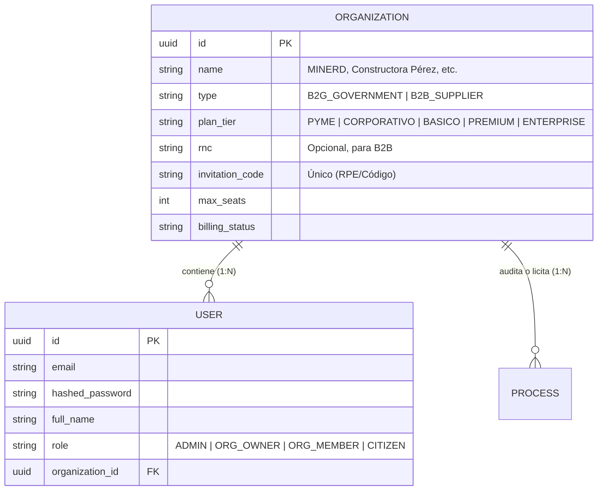
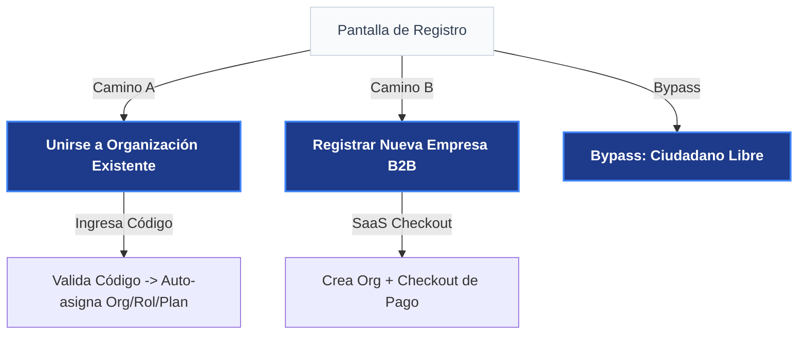

# 🔄 Flujo de Contratación, Organizaciones (Multi-Tenancy) y Onboarding

Este documento describe la arquitectura multi-inquilino (*multi-tenant*) de **VeedorIA**, detallando cómo se agrupan los usuarios bajo **Organizaciones** y cómo fluyen los procesos de compra y registro (*onboarding*).

---

## 1. Arquitectura de Base de Datos Multi-Inquilino

Para garantizar la coherencia comercial, simplificar la facturación de planes de suscripción y permitir espacios de trabajo colaborativos seguros, VeedorIA separa las cuentas en **Organizaciones** y **Usuarios**.

### Tabla `Organization` (Inquilino / Tenant)
*   **Facturación Centralizada:** El plan (`plan_tier`) y el estado de suscripción (`billing_status`) se definen a nivel de organización.
*   **Colaboración:** Todos los miembros de una organización comparten la misma base de datos de alertas, procesos monitoreados, anotaciones de auditoría y bitácoras de red de colusión.
*   **Código de Invitación:** Cada organización posee un `invitation_code` único (generado al crearse la organización) que sus miembros usan para unirse a ella.

### Tabla `User`
*   Pertenece a una única organización (`organization_id` es clave foránea).
*   Es nullable/opcional para **Ciudadanos (CITIZEN)** y **Administradores Globales (ADMIN)** que operan fuera del ecosistema de organizaciones.
*   El rol dentro de la organización se define como `ORG_OWNER` (creador/administrador de la organización con permisos de facturación y gestión de miembros) o `ORG_MEMBER` (auditor o analista estándar).

---

## 2. Flujo de Onboarding en Registro: Dos Caminos de Entrada

La introducción del modelo de organizaciones simplifica drásticamente el diseño del Registro, dividiendo el acceso de usuarios en dos flujos claramente diferenciados:

### Camino A: Unirse a una Organización Existente (Flujo "Miembro")
Este flujo aplica para:
*   **Auditores del Gobierno (B2G):** Quienes reciben el código institucional (ej. `MINERD-XYZ-2026`) provisto por su director técnico.
*   **Colaboradores de Empresas (B2B):** Quienes son invitados por el dueño de la empresa que ya contrató el plan PyME o Corporativo.

**Lógica del Sistema:**
1. El usuario introduce el **Código de Invitación**.
2. El sistema valida el código en tiempo real y muestra un banner dinámico de confirmación: *"Te estás uniendo a: Ministerio de Educación (MINERD) - Plan Premium B2G"*.
3. El usuario completa sus datos personales (Nombre, Email, Contraseña).
4. Al hacer clic en registrar, la cuenta se crea con el rol `ORG_MEMBER` y se vincula automáticamente al `organization_id` correspondiente. Su panel se abre de inmediato con acceso total a los datos compartidos de la entidad.

---

### Camino B: Registrar una Nueva Empresa (Flujo "Dueño / Propietario")
Este flujo aplica para directores de empresas privadas (B2B) que desean comprar una nueva suscripción de inteligencia comercial en modo auto-servicio.

**Lógica del Sistema:**
1. El usuario selecciona el plan deseado (PyME o Corporativo).
2. Introduce los datos del usuario administrador y los datos de la nueva organización: **Nombre de la Empresa** y **RNC**.
3. Realiza el pago de la suscripción con tarjeta de crédito (Stripe/Azul/Net).
4. El sistema crea simultáneamente:
   * El registro en la tabla `Organization` (con el plan seleccionado, estado de pago activo, y genera un nuevo `invitation_code` para que invite a sus colaboradores).
   * El registro en la tabla `User` vinculado a esta organización con el rol `ORG_OWNER`.

*Nota: Las cuentas gubernamentales (B2G) no se pueden crear mediante el Camino B autogestionado; deben solicitar una demostración y firmar un contrato offline, tras lo cual se les entrega su código de activación para usar el Camino A.*
