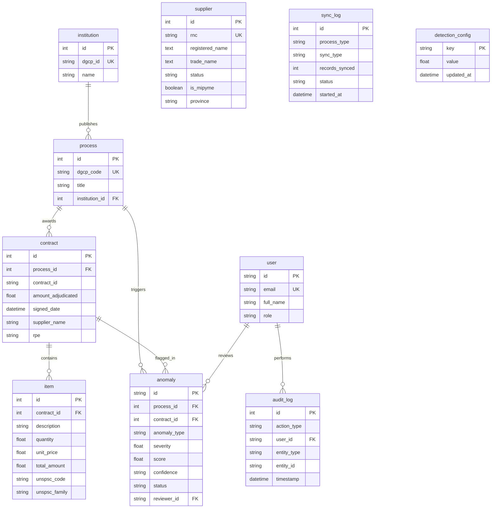

<!-- scanner:2026-10-18 -->
# Data Model

> 📋 Generado por `project-scanner` el 2026-10-18 a partir de los 10 modelos SQLModel en `app/backend/src/models/` y las 14 migraciones Alembic en `app/backend/migrations/versions/`.

## Entity Relationship Diagram

## Entities

### `institution` (`app/backend/src/models/institution.py`)
| Column | Type | Nullable | Default | Index | Description |
|--------|------|----------|---------|-------|-------------|
| `id` | `int` | NO | Auto-increment | PK | Identificador interno de la institución |
| `dgcp_id` | `varchar(50)` | NO | — | UNIQUE, IDX | Código oficial de la unidad de compra en la DGCP |
| `name` | `varchar(255)` | NO | — | — | Nombre de la institución pública |

### `process` (`app/backend/src/models/process.py`)
| Column | Type | Nullable | Default | Index | Description |
|--------|------|----------|---------|-------|-------------|
| `id` | `int` | NO | Auto-increment | PK | Identificador interno del proceso de compra |
| `dgcp_code` | `varchar(50)` | NO | — | UNIQUE, IDX | Código único del proceso en la DGCP |
| `title` | `varchar(500)` | NO | — | — | Objeto o descripción del proceso de contratación |
| `institution_id` | `int` | YES | `NULL` | FK (`institution.id`) | Institución convocante |

### `contract` (`app/backend/src/models/contract.py`)
| Column | Type | Nullable | Default | Index | Description |
|--------|------|----------|---------|-------|-------------|
| `id` | `int` | NO | Auto-increment | PK | Identificador interno del contrato |
| `process_id` | `int` | YES | `NULL` | FK (`process.id`) | Proceso asociado (`uq_contract_id_process_id`) |
| `contract_id` | `varchar(100)` | NO | — | UNIQUE (compuesto) | Código oficial del contrato en la DGCP |
| `amount_adjudicated` | `float` | YES | `NULL` | IDX | Monto adjudicado del contrato |
| `signed_date` | `datetime` | YES | `NULL` | IDX | Fecha de firma del contrato |
| `status` | `varchar(50)` | YES | `NULL` | — | Estado del contrato |
| `supplier_name` | `varchar(255)` | YES | `NULL` | IDX | Razón social del proveedor adjudicado |
| `currency` | `varchar(3)` | YES | `NULL` | — | Moneda (`DOP`, `USD`) |
| `object_description` | `varchar(500)` | YES | `NULL` | — | Descripción del objeto contractual |
| `adjudication_status` | `varchar(50)` | YES | `NULL` | — | Estado de adjudicación |
| `creation_date` | `datetime` | YES | `NULL` | — | Fecha de creación del registro |
| `rpe` | `varchar(20)` | YES | `NULL` | — | Registro de Proveedor del Estado (RPE) |

### `item` (`app/backend/src/models/item.py`)
| Column | Type | Nullable | Default | Index | Description |
|--------|------|----------|---------|-------|-------------|
| `id` | `int` | NO | Auto-increment | PK | Identificador interno del artículo adjudicado |
| `contract_id` | `int` | YES | `NULL` | FK (`contract.id`) | Contrato al que pertenece el ítem |
| `description` | `varchar(500)` | NO | — | — | Descripción del artículo o servicio |
| `quantity` | `float` | NO | `1.0` | — | Cantidad contratada |
| `unit` | `varchar(50)` | YES | `NULL` | — | Unidad de medida |
| `unit_price` | `float` | YES | `NULL` | — | Precio unitario adjudicado |
| `total_amount` | `float` | YES | `NULL` | — | Monto total de la línea |
| `unspsc_code` | `varchar(8)` | YES | `NULL` | IDX | Código del clasificador UNSPSC |
| `process_code` | `varchar(50)` | YES | `NULL` | IDX | Código del proceso relacionado |
| `unspsc_family` | `varchar(8)` | YES | `NULL` | IDX | Familia UNSPSC usada para agrupación estadística de precios |
| `unspsc_class` | `varchar(8)` | YES | `NULL` | — | Clase UNSPSC |
| `budget_account` | `varchar(20)` | YES | `NULL` | — | Cuenta presupuestaria |

### `supplier` (`app/backend/src/models/supplier.py`)
| Column | Type | Nullable | Default | Index | Description |
|--------|------|----------|---------|-------|-------------|
| `id` | `int` | NO | Auto-increment | PK | Identificador interno del proveedor |
| `rnc` | `varchar(50)` | NO | — | UNIQUE, IDX | RNC o cédula del proveedor |
| `registered_name` | `text` | YES | `NULL` | — | Razón social registrada |
| `trade_name` | `text` | YES | `NULL` | — | Nombre comercial |
| `phone` | `varchar(100)` | YES | `NULL` | — | Teléfono de contacto |
| `email` | `text` | YES | `NULL` | — | Correo electrónico |
| `address` | `text` | YES | `NULL` | — | Dirección física (usada también en señales de colusión) |
| `status` | `varchar(50)` | YES | `NULL` | — | Estado del proveedor en DGCP |
| `is_mipyme` | `boolean` | YES | `NULL` | — | Indicador MiPyME |
| `classification` | `text` | YES | `NULL` | — | Clasificación del rubro |
| `supplier_type` | `text` | YES | `NULL` | — | Tipo de persona jurídica/física |
| `province` | `varchar(100)` | YES | `NULL` | — | Provincia |
| `municipality` | `varchar(100)` | YES | `NULL` | — | Municipio |

### `anomaly` (`app/backend/src/models/anomaly.py`)
| Column | Type | Nullable | Default | Index | Description |
|--------|------|----------|---------|-------|-------------|
| `id` | `varchar(36)` | NO | `uuid4()` | PK | UUID de la anomalía detectada |
| `process_id` | `int` | YES | `NULL` | FK (`process.id`) | Proceso observado |
| `contract_id` | `int` | YES | `NULL` | FK (`contract.id`) | Contrato observado |
| `anomaly_type` | `varchar(50)` | NO | — | IDX | Tipo: `PRICE_ANOMALY`, `FRAGMENTATION`, `COLLUSION` |
| `severity` | `float` | NO | `0.0` | IDX | Nivel de severidad normalizado (`0.0` a `1.0`) |
| `score` | `float` | YES | `NULL` | — | Puntaje crudo del detector |
| `confidence` | `varchar(12)` | NO | `'MEDIA'` | — | Nivel de confianza (`ALTA`, `MEDIA`, `BAJA`) |
| `signals_count` | `int` | NO | `0` | — | Cantidad de señales convergentes |
| `detection_metadata` | `json` | YES | `NULL` | — | Evidencia detallada (Z-Score, IF score, vínculos, contratos) |
| `dismissal_reason` | `varchar(20)` | YES | `NULL` | — | Motivo de descarte en el bucle de feedback |
| `description` | `varchar(2000)` | NO | — | — | Explicación legible del hallazgo |
| `status` | `varchar(20)` | NO | `'PENDING'` | IDX | Estado: `PENDING`, `CONFIRMED`, `DISMISSED` |
| `reviewer_id` | `varchar(36)` | YES | `NULL` | FK (`user.id`) | Usuario auditor que revisó el hallazgo |
| `amount` | `float` | YES | `NULL` | — | Monto involucrado desnormalizado para consulta rápida |
| `process_code` | `varchar(100)` | YES | `NULL` | — | Código del proceso desnormalizado |
| `supplier_name` | `varchar(500)` | YES | `NULL` | — | Proveedor involucrado |
| `institution_name` | `varchar(500)` | YES | `NULL` | — | Institución involucrada |
| `created_at` / `updated_at` | `datetime` | NO | `UTC now` | — | Timestamps de creación y actualización |

### `user` (`app/backend/src/models/user.py`)
| Column | Type | Nullable | Default | Index | Description |
|--------|------|----------|---------|-------|-------------|
| `id` | `varchar(36)` | NO | `uuid4()` | PK | UUID del usuario |
| `email` | `varchar(255)` | NO | — | UNIQUE, IDX | Correo electrónico |
| `password_hash` | `varchar(255)` | NO | — | — | Hash `bcrypt` de la contraseña |
| `full_name` | `varchar(255)` | NO | — | — | Nombre completo |
| `role` | `varchar(20)` | NO | `'citizen'` | — | Rol (`citizen`, `auditor`, `admin`) |
| `extra_data` | `json` | YES | `NULL` | — | Metadatos adicionales del perfil |
| `created_at` / `updated_at` | `datetime` | NO | `UTC now` | — | Timestamps |

### `audit_log` (`app/backend/src/models/audit_log.py`)
| Column | Type | Nullable | Default | Index | Description |
|--------|------|----------|---------|-------|-------------|
| `id` | `int` | NO | Auto-increment | PK | Identificador del evento de auditoría |
| `action_type` | `varchar(50)` | NO | — | IDX | Acción registrada (ej. revisión de anomalía) |
| `user_id` | `varchar(36)` | YES | `NULL` | FK (`user.id`), IDX | Actor que ejecutó la acción |
| `entity_type` | `varchar(50)` | NO | — | — | Entidad afectada (`anomaly`, etc.) |
| `entity_id` | `varchar(100)` | NO | — | — | ID de la entidad afectada |
| `old_value` / `new_value` | `json` | YES | `NULL` | — | Estado anterior y nuevo en formato JSON |
| `ip_address` | `varchar(45)` | YES | `NULL` | — | Dirección IP de origen |
| `timestamp` | `datetime` | NO | `UTC now` | IDX | Fecha y hora del evento |

### `sync_log` (`app/backend/src/models/sync_log.py`) & `detection_config` (`app/backend/src/models/detection_config.py`)
- **`sync_log`**: Bitácora de corridas de sincronización y detección (`id`, `process_type`, `sync_type`, `started_at`, `completed_at`, `records_synced`, `status`, `error_message`, `triggered_by`, `details`).
- **`detection_config`**: Parámetros clave-valor (`key` PK `varchar(50)`, `value` `float`, `updated_at`) ajustados por el bucle de retroalimentación de anomalías.

## Relationships
| From | To | Type | FK | ON DELETE |
|------|----|------|----|-----------|
| `process` | `institution` | Many-to-One | `process.institution_id → institution.id` | SET NULL |
| `contract` | `process` | Many-to-One | `contract.process_id → process.id` | SET NULL (`c4a7d2e8f1b0`) |
| `item` | `contract` | Many-to-One | `item.contract_id → contract.id` | CASCADE / SET NULL |
| `anomaly` | `process` | Many-to-One | `anomaly.process_id → process.id` | SET NULL |
| `anomaly` | `contract` | Many-to-One | `anomaly.contract_id → contract.id` | SET NULL |
| `anomaly` | `user` | Many-to-One | `anomaly.reviewer_id → user.id` | SET NULL |
| `audit_log` | `user` | Many-to-One | `audit_log.user_id → user.id` | SET NULL |

## Migraciones
- **Herramienta**: **Alembic** (`app/backend/alembic.ini`, `app/backend/migrations/versions/`).
- **Ejecución**:
  - CLI / Local: `poetry run alembic upgrade head` o `poetry run python -m src.cli.run_migrations`.
  - Regla: Toda modificación a modelos en `app/backend/src/models/` debe ir acompañada de su revisión Alembic reversible (`upgrade` / `downgrade`).

## Seeds
- Los datos se pueblan mediante la sincronización directa con la API de Datos Abiertos de la DGCP (`poetry run python -m src.cli.sync_dgcp` o `POST /api/sync/dgcp`).
- Para pruebas automatizadas se utilizan fixtures en memoria sobre SQLite asíncrono en `app/backend/tests/`.

## Changelog
| Date | Feature | Change |
|------|---------|--------|
| 2026-10-18 | `project-scanner` | Línea base inicial extraída de los 10 modelos SQLModel y 14 migraciones Alembic |

---
_Last updated: 2026-10-18 by project-scanner_