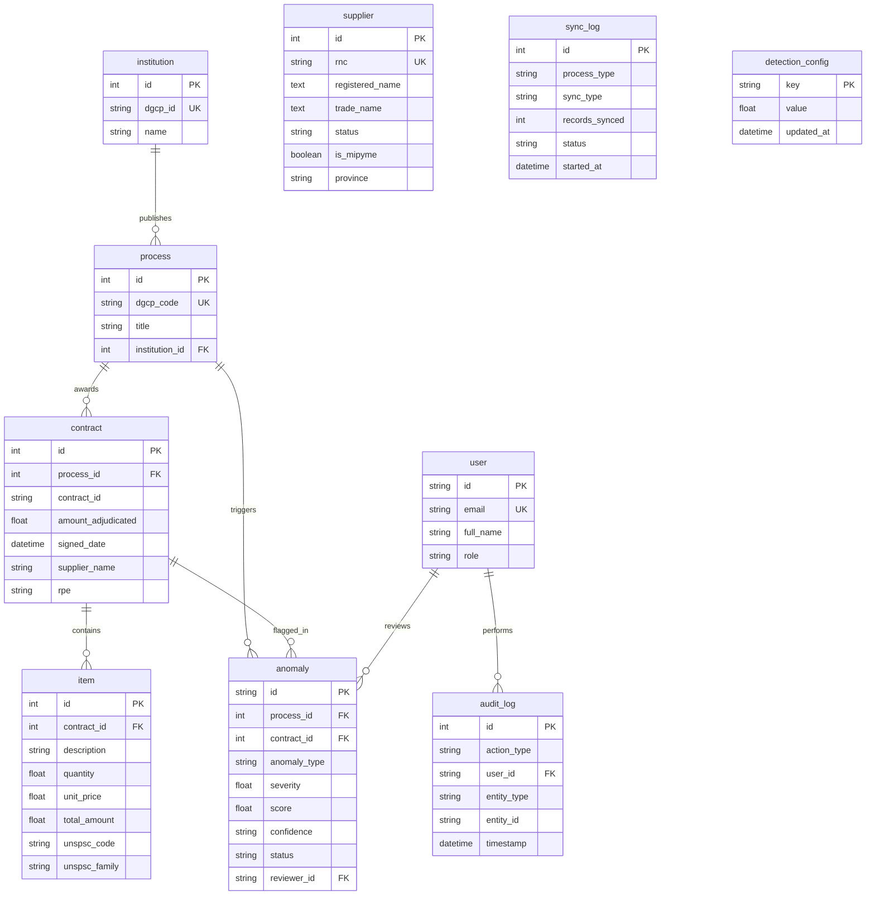

<!-- scanner:2026-10-18 -->
# Data Model

> 📋 Generado por `project-scanner` el 2026-10-18 a partir de los 10 modelos SQLModel en `app/backend/src/models/` y las 14 migraciones Alembic en `app/backend/migrations/versions/`.

## Entity Relationship Diagram

## Entities

### `institution` (`app/backend/src/models/institution.py`)
| Column | Type | Nullable | Default | Index | Description |
|--------|------|----------|---------|-------|-------------|
| `id` | `int` | NO | Auto-increment | PK | Identificador interno de la institución |
| `dgcp_id` | `varchar(50)` | NO | — | UNIQUE, IDX | Código oficial de la unidad de compra en la DGCP |
| `name` | `varchar(255)` | NO | — | — | Nombre de la institución pública |

### `process` (`app/backend/src/models/process.py`)
| Column | Type | Nullable | Default | Index | Description |
|--------|------|----------|---------|-------|-------------|
| `id` | `int` | NO | Auto-increment | PK | Identificador interno del proceso de compra |
| `dgcp_code` | `varchar(50)` | NO | — | UNIQUE, IDX | Código único del proceso en la DGCP |
| `title` | `varchar(500)` | NO | — | — | Objeto o descripción del proceso de contratación |
| `institution_id` | `int` | YES | `NULL` | FK (`institution.id`) | Institución convocante |

### `contract` (`app/backend/src/models/contract.py`)
| Column | Type | Nullable | Default | Index | Description |
|--------|------|----------|---------|-------|-------------|
| `id` | `int` | NO | Auto-increment | PK | Identificador interno del contrato |
| `process_id` | `int` | YES | `NULL` | FK (`process.id`) | Proceso asociado (`uq_contract_id_process_id`) |
| `contract_id` | `varchar(100)` | NO | — | UNIQUE (compuesto) | Código oficial del contrato en la DGCP |
| `amount_adjudicated` | `float` | YES | `NULL` | IDX | Monto adjudicado del contrato |
| `signed_date` | `datetime` | YES | `NULL` | IDX | Fecha de firma del contrato |
| `status` | `varchar(50)` | YES | `NULL` | — | Estado del contrato |
| `supplier_name` | `varchar(255)` | YES | `NULL` | IDX | Razón social del proveedor adjudicado |
| `currency` | `varchar(3)` | YES | `NULL` | — | Moneda (`DOP`, `USD`) |
| `object_description` | `varchar(500)` | YES | `NULL` | — | Descripción del objeto contractual |
| `adjudication_status` | `varchar(50)` | YES | `NULL` | — | Estado de adjudicación |
| `creation_date` | `datetime` | YES | `NULL` | — | Fecha de creación del registro |
| `rpe` | `varchar(20)` | YES | `NULL` | — | Registro de Proveedor del Estado (RPE) |

### `item` (`app/backend/src/models/item.py`)
| Column | Type | Nullable | Default | Index | Description |
|--------|------|----------|---------|-------|-------------|
| `id` | `int` | NO | Auto-increment | PK | Identificador interno del artículo adjudicado |
| `contract_id` | `int` | YES | `NULL` | FK (`contract.id`) | Contrato al que pertenece el ítem |
| `description` | `varchar(500)` | NO | — | — | Descripción del artículo o servicio |
| `quantity` | `float` | NO | `1.0` | — | Cantidad contratada |
| `unit` | `varchar(50)` | YES | `NULL` | — | Unidad de medida |
| `unit_price` | `float` | YES | `NULL` | — | Precio unitario adjudicado |
| `total_amount` | `float` | YES | `NULL` | — | Monto total de la línea |
| `unspsc_code` | `varchar(8)` | YES | `NULL` | IDX | Código del clasificador UNSPSC |
| `process_code` | `varchar(50)` | YES | `NULL` | IDX | Código del proceso relacionado |
| `unspsc_family` | `varchar(8)` | YES | `NULL` | IDX | Familia UNSPSC usada para agrupación estadística de precios |
| `unspsc_class` | `varchar(8)` | YES | `NULL` | — | Clase UNSPSC |
| `budget_account` | `varchar(20)` | YES | `NULL` | — | Cuenta presupuestaria |

### `supplier` (`app/backend/src/models/supplier.py`)
| Column | Type | Nullable | Default | Index | Description |
|--------|------|----------|---------|-------|-------------|
| `id` | `int` | NO | Auto-increment | PK | Identificador interno del proveedor |
| `rnc` | `varchar(50)` | NO | — | UNIQUE, IDX | RNC o cédula del proveedor |
| `registered_name` | `text` | YES | `NULL` | — | Razón social registrada |
| `trade_name` | `text` | YES | `NULL` | — | Nombre comercial |
| `phone` | `varchar(100)` | YES | `NULL` | — | Teléfono de contacto |
| `email` | `text` | YES | `NULL` | — | Correo electrónico |
| `address` | `text` | YES | `NULL` | — | Dirección física (usada también en señales de colusión) |
| `status` | `varchar(50)` | YES | `NULL` | — | Estado del proveedor en DGCP |
| `is_mipyme` | `boolean` | YES | `NULL` | — | Indicador MiPyME |
| `classification` | `text` | YES | `NULL` | — | Clasificación del rubro |
| `supplier_type` | `text` | YES | `NULL` | — | Tipo de persona jurídica/física |
| `province` | `varchar(100)` | YES | `NULL` | — | Provincia |
| `municipality` | `varchar(100)` | YES | `NULL` | — | Municipio |

### `anomaly` (`app/backend/src/models/anomaly.py`)
| Column | Type | Nullable | Default | Index | Description |
|--------|------|----------|---------|-------|-------------|
| `id` | `varchar(36)` | NO | `uuid4()` | PK | UUID de la anomalía detectada |
| `process_id` | `int` | YES | `NULL` | FK (`process.id`) | Proceso observado |
| `contract_id` | `int` | YES | `NULL` | FK (`contract.id`) | Contrato observado |
| `anomaly_type` | `varchar(50)` | NO | — | IDX | Tipo: `PRICE_ANOMALY`, `FRAGMENTATION`, `COLLUSION` |
| `severity` | `float` | NO | `0.0` | IDX | Nivel de severidad normalizado (`0.0` a `1.0`) |
| `score` | `float` | YES | `NULL` | — | Puntaje crudo del detector |
| `confidence` | `varchar(12)` | NO | `'MEDIA'` | — | Nivel de confianza (`ALTA`, `MEDIA`, `BAJA`) |
| `signals_count` | `int` | NO | `0` | — | Cantidad de señales convergentes |
| `detection_metadata` | `json` | YES | `NULL` | — | Evidencia detallada (Z-Score, IF score, vínculos, contratos) |
| `dismissal_reason` | `varchar(20)` | YES | `NULL` | — | Motivo de descarte en el bucle de feedback |
| `description` | `varchar(2000)` | NO | — | — | Explicación legible del hallazgo |
| `status` | `varchar(20)` | NO | `'PENDING'` | IDX | Estado: `PENDING`, `CONFIRMED`, `DISMISSED` |
| `reviewer_id` | `varchar(36)` | YES | `NULL` | FK (`user.id`) | Usuario auditor que revisó el hallazgo |
| `amount` | `float` | YES | `NULL` | — | Monto involucrado desnormalizado para consulta rápida |
| `process_code` | `varchar(100)` | YES | `NULL` | — | Código del proceso desnormalizado |
| `supplier_name` | `varchar(500)` | YES | `NULL` | — | Proveedor involucrado |
| `institution_name` | `varchar(500)` | YES | `NULL` | — | Institución involucrada |
| `created_at` / `updated_at` | `datetime` | NO | `UTC now` | — | Timestamps de creación y actualización |

### `user` (`app/backend/src/models/user.py`)
| Column | Type | Nullable | Default | Index | Description |
|--------|------|----------|---------|-------|-------------|
| `id` | `varchar(36)` | NO | `uuid4()` | PK | UUID del usuario |
| `email` | `varchar(255)` | NO | — | UNIQUE, IDX | Correo electrónico |
| `password_hash` | `varchar(255)` | NO | — | — | Hash `bcrypt` de la contraseña |
| `full_name` | `varchar(255)` | NO | — | — | Nombre completo |
| `role` | `varchar(20)` | NO | `'citizen'` | — | Rol (`citizen`, `auditor`, `admin`) |
| `extra_data` | `json` | YES | `NULL` | — | Metadatos adicionales del perfil |
| `created_at` / `updated_at` | `datetime` | NO | `UTC now` | — | Timestamps |

### `audit_log` (`app/backend/src/models/audit_log.py`)
| Column | Type | Nullable | Default | Index | Description |
|--------|------|----------|---------|-------|-------------|
| `id` | `int` | NO | Auto-increment | PK | Identificador del evento de auditoría |
| `action_type` | `varchar(50)` | NO | — | IDX | Acción registrada (ej. revisión de anomalía) |
| `user_id` | `varchar(36)` | YES | `NULL` | FK (`user.id`), IDX | Actor que ejecutó la acción |
| `entity_type` | `varchar(50)` | NO | — | — | Entidad afectada (`anomaly`, etc.) |
| `entity_id` | `varchar(100)` | NO | — | — | ID de la entidad afectada |
| `old_value` / `new_value` | `json` | YES | `NULL` | — | Estado anterior y nuevo en formato JSON |
| `ip_address` | `varchar(45)` | YES | `NULL` | — | Dirección IP de origen |
| `timestamp` | `datetime` | NO | `UTC now` | IDX | Fecha y hora del evento |

### `sync_log` (`app/backend/src/models/sync_log.py`) & `detection_config` (`app/backend/src/models/detection_config.py`)
- **`sync_log`**: Bitácora de corridas de sincronización y detección (`id`, `process_type`, `sync_type`, `started_at`, `completed_at`, `records_synced`, `status`, `error_message`, `triggered_by`, `details`).
- **`detection_config`**: Tabla de calibración dinámica en vivo (`key` PK `varchar(50)`, `value` `float`, `updated_at`) que almacena los **13 parámetros gobernados desde `/app/configuracion-deteccion`**:
  - **Pesos y Sensibilidad del Motor (6 claves)**:
    - `PRICE_ANOMALY_WEIGHT` (default `1.0`), `FRAGMENTATION_WEIGHT` (default `1.0`), `COLLUSION_WEIGHT` (default `1.0`).
    - `MIN_CRITICAL_SEVERITY` (default `0.70`), `PRICE_VARIATION_PCT_THRESHOLD` (default `35.0`%), `FRAGMENTATION_WINDOW_DAYS` (default `30.0` días).
  - **Tabla de Umbrales por Modalidad DGCP en DOP (7 claves)**:
    - `THRESHOLD_CD_DOP` (`300,000` — Compra por Debajo del Umbral `-CD-`).
    - `THRESHOLD_CM_DOP` (`1,500,000` — Compra Menor `-CM-`).
    - `THRESHOLD_CP_DOP` (`6,500,000` — Comparación de Precios `-CP-`).
    - `THRESHOLD_PEIN_DOP` (`15,000,000` — Procedimiento de Excepción `-PEIN-`/`-PEPU-`/`-PESI-`/`-PEEX-`).
    - `THRESHOLD_LPN_DOP` (`20,000,000` — Licitación Pública `-LPN-`/`-LPI-`/`-SOR-`).
    - `THRESHOLD_PEEN_DOP` (`25,000,000` — Emergencia Nacional / Urgencia `-PEEN-`/`-PEUR-`).
    - `FRAGMENTATION_THRESHOLD_DOP` (`5,000,000` — Umbral general de respaldo cuando la referencia no incluye sigla estándar).

### `support_ticket` (`app/backend/src/models/support_ticket.py`)
| Column | Type | Nullable | Default | Index | Description |
|--------|------|----------|---------|-------|-------------|
| `id` | `int` | NO | Auto-increment | PK | Identificador interno del ticket |
| `code` | `varchar(20)` | NO | — | UNIQUE, IDX | Código legible (`SUP-YYYY-NNNN`) usado en la bandeja |
| `subject` | `varchar(200)` | NO | — | — | Asunto reportado por el solicitante |
| `category` | `varchar(30)` | NO | `SOPORTE_FUNCIONAL` | — | `SOPORTE_FUNCIONAL`, `ERROR_TECNICO`, `SOLICITUD_DATOS`, `FACTURACION` |
| `module` | `varchar(40)` | NO | `OTRO` | — | Módulo afectado (`SINCRONIZACION`, `CALIBRACION`, `BITACORA`, `DETECCION`, `ACCESOS`, `OTRO`) |
| `priority` | `varchar(10)` | NO | `MEDIA` | — | `ALTA`, `MEDIA`, `BAJA` |
| `description` | `text` | NO | — | — | Relato del problema o solicitud |
| `status` | `varchar(20)` | NO | `ABIERTO` | IDX | `ABIERTO`, `EN_PROGRESO`, `RESUELTO`, `CERRADO` |
| `reporter_id` | `int` | NO | — | FK (`app_user.id`), IDX | Usuario que abrió el ticket |
| `reporter_tenant_id` | `int` | NO | — | FK (`tenant.id`), IDX | Organización del solicitante (aislamiento de autoservicio) |
| `assigned_to_id` | `int` | YES | `NULL` | FK (`app_user.id`), IDX | Administrador de plataforma asignado |
| `created_at` / `updated_at` | `datetime` | NO | `utcnow_naive()` | — | Marcas naive-UTC de creación y última modificación |
| `closed_at` | `datetime` | YES | `NULL` | — | Se limpia al reabrir el ticket (`TICKET_REOPENED`) |

### `support_ticket_message` (`app/backend/src/models/support_ticket.py`)
| Column | Type | Nullable | Default | Index | Description |
|--------|------|----------|---------|-------|-------------|
| `id` | `int` | NO | Auto-increment | PK | Identificador del mensaje |
| `ticket_id` | `int` | NO | — | FK (`support_ticket.id`), IDX, CASCADE | Ticket al que pertenece la respuesta |
| `author_id` | `int` | NO | — | FK (`app_user.id`), IDX | Autor del mensaje (solicitante o soporte) |
| `body` | `text` | NO | — | — | Contenido de la respuesta |
| `created_at` | `datetime` | NO | `utcnow_naive()` | — | Fecha naive-UTC del mensaje |

## Relationships
| From | To | Type | FK | ON DELETE |
|------|----|------|----|-----------|
| `process` | `institution` | Many-to-One | `process.institution_id → institution.id` | SET NULL |
| `contract` | `process` | Many-to-One | `contract.process_id → process.id` | SET NULL (`c4a7d2e8f1b0`) |
| `item` | `contract` | Many-to-One | `item.contract_id → contract.id` | CASCADE / SET NULL |
| `anomaly` | `process` | Many-to-One | `anomaly.process_id → process.id` | SET NULL |
| `anomaly` | `contract` | Many-to-One | `anomaly.contract_id → contract.id` | SET NULL |
| `anomaly` | `user` | Many-to-One | `anomaly.reviewer_id → user.id` | SET NULL |
| `audit_log` | `user` | Many-to-One | `audit_log.user_id → user.id` | SET NULL |
| `support_ticket` | `app_user` | Many-to-One | `support_ticket.reporter_id → app_user.id` | — |
| `support_ticket` | `tenant` | Many-to-One | `support_ticket.reporter_tenant_id → tenant.id` | — |
| `support_ticket` | `app_user` | Many-to-One | `support_ticket.assigned_to_id → app_user.id` | SET NULL |
| `support_ticket_message` | `support_ticket` | Many-to-One | `support_ticket_message.ticket_id → support_ticket.id` | CASCADE |

## Migraciones
- **Herramienta**: **Alembic** (`app/backend/alembic.ini`, `app/backend/migrations/versions/`).
- **Ejecución**:
  - CLI / Local: `poetry run alembic upgrade head` o `poetry run python -m src.cli.run_migrations`.
  - Regla: Toda modificación a modelos en `app/backend/src/models/` debe ir acompañada de su revisión Alembic reversible (`upgrade` / `downgrade`).
- **Revisión `4ceda77036aa`** (Paquete 4): crea `support_ticket` y `support_ticket_message` con sus índices. ⚠️ La cadena Alembic no contiene `app_user` ni `tenant` (viven en el seed de RBAC), por lo que la migración **no declara FKs a nivel DDL**; las relaciones se declaran en los modelos SQLModel y se validan en runtime. Deuda registrada: alinear la cadena cuando `app_user`/`tenant` se incorporen como revisiones.

## Seeds
- Los datos se pueblan mediante la sincronización directa con la API de Datos Abiertos de la DGCP (`poetry run python -m src.cli.sync_dgcp` o `POST /api/sync/dgcp`).
- Para pruebas automatizadas se utilizan fixtures en memoria sobre SQLite asíncrono en `app/backend/tests/`.

## Changelog
| Date | Feature | Change |
|------|---------|--------|
| 2026-10-18 | `project-scanner` | Línea base inicial extraída de los 10 modelos SQLModel y 14 migraciones Alembic |
| 2026-10-21 | `implementer` (Paquete 3) | `suite-licitaciones-b2b` no agrega tablas: reutiliza `tenant` (`plan_tier`, `supplier_rpe`, `max_categorias_unspsc`) y `audit_log` como store inmutable con `entity_type = B2B_WATCHLIST:{tenant}` / `B2B_SECTORS:{tenant}` / `B2B_SUBSCRIPTION:{tenant}` (UPSERT/DELETE de pizarras, familias monitoreadas e historial de cambio de plan) |
| 2026-10-21 | `implementer` (Paquete 4) | `consola-admin-operaciones` agrega `support_ticket` + `support_ticket_message` (revisión `4ceda77036aa`) y reutiliza `audit_log` para `SYNC_TRIGGERED`, `DETECTION_TRIGGERED`, `UPDATE_DETECTION_CONFIG`, `DETECTION_CONFIG_RESET`, `CALIBRATION_APPLY`, `AUDIT_LOG_EXPORT` y el ciclo de vida de tickets |

### `tenants` (`app/backend/src/models/auth.py`)
| Column | Type | Nullable | Default | Index | Description |
|--------|------|----------|---------|-------|-------------|
| `id` | `varchar(36)` | NO | UUID | PK | Identificador de la organización suscriptora |
| `code` | `varchar(50)` | NO | — | UNIQUE, IDX | Código corto de organización (`NEXODIGITAL`, `MOPC-B2G`, `CONSTRUCTORA-B2B`) |
| `name` | `varchar(255)` | NO | — | — | Nombre oficial de la institución o proveedor suscrito |
| `tenant_type` | `varchar(50)` | NO | — | — | Tipo (`PLATFORM`, `GOV_INSTITUTION`, `B2B_SUPPLIER`) |
| `plan_tier` | `varchar(50)` | NO | — | — | Plan (`PLATFORM_GLOBAL`, `B2G_BASIC`, `B2G_PREMIUM`, `B2G_ENTERPRISE`, `B2B_PYME`, `B2B_CORPORATE`) |
| `institution_id` | `int` | YES | `NULL` | IDX | Vínculo con `institution.id` para aislamiento de datos B2G |
| `supplier_rpe` | `varchar(50)` | YES | `NULL` | IDX | Vínculo con `contract.rpe` para aislamiento de datos B2B |
| `status` | `varchar(30)` | NO | `'ACTIVE'` | — | Estado de la suscripción (`ACTIVE`, `SUSPENDED`) |

### `roles`, `permissions`, `role_permissions`, `password_reset_tokens` (`app/backend/src/models/auth.py`)
- **`roles`**: Catálogo de roles (`SYSTEM_ADMIN`, `LEAD_AUDITOR`, `INSTITUTIONAL_AUDITOR`, `SUPPLIER_EXECUTIVE`).
- **`permissions`**: Catálogo de 13 permisos granulares agrupados por módulo funcional.
- **`role_permissions`**: Tabla puente `N:M` entre `roles` y `permissions`.
- **`password_reset_tokens`**: Tokens efímeros (`token_hash` SHA-256, `expires_at`, `used_at`) para restablecimiento seguro de contraseña.

---
_Last updated: 2026-10-21 by implementer (added Multi-Tenant & RBAC tables + suite-licitaciones-b2b audit_log usage)_