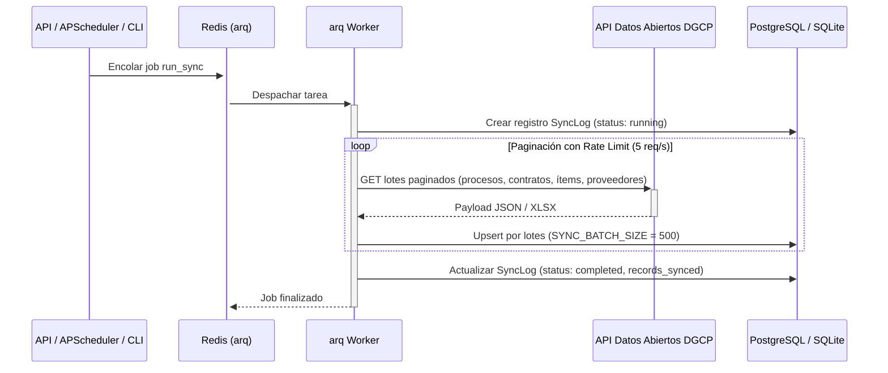

<!-- scanner:2026-10-18 -->
# External Integrations

> 📋 Generado por `project-scanner` el 2026-10-18 a partir de `app/backend/src/infrastructure/dgcp_client.py` y archivos de despliegue.

## Active Integrations
| Service | Purpose | Protocol | Auth | Environment Config |
|---------|---------|----------|------|--------------------|
| API de Datos Abiertos DGCP (`datosabiertos.dgcp.gob.do`) | Ingesta de procesos, contratos, artículos adjudicados, instituciones y proveedores del Estado dominicano | HTTPS REST (JSON / XLSX) | Público (Datos Abiertos) | `DGCP_API_BASE_URL`, `SYNC_RATE_LIMIT` |
| Redis (`arq` Queue) | Encolamiento y ejecución distribuida de tareas de sincronización (`run_sync`) y detección (`run_detection`) | TCP (`redis://`) | URL / Password | `REDIS_URL` |

## Platform Integrations
### Render (`app/backend/render.yaml`)
| Aspecto | Detalle |
|---------|---------|
| **Servicios definidos** | `veedoria-api` (Web Docker), `veedoria-worker` (Worker Docker `arq`), `veedoria-redis` (Redis) |
| **Configuración** | Blueprint IaC en `app/backend/render.yaml` |
| **Variables enlazadas** | `REDIS_URL` inyectada desde `veedoria-redis`; `JWT_SECRET` autogenerado y compartido entre `api` y `worker`; `DATABASE_URL` configurada en panel |

## Integration Details

### API de Datos Abiertos DGCP (`DGCPClient` — `app/backend/src/infrastructure/dgcp_client.py`)
- **URL Base**: `https://datosabiertos.dgcp.gob.do/api-dgcp/v1` (`settings.dgcp_api_base_url`)
- **Autenticación**: No requiere token (API pública gubernamental)
- **Rate Limits**: Controlado en el cliente mediante `sync_rate_limit: float = 5.0` req/s
- **Timeouts y Reintentos**:
  - `dgcp_request_timeout`: `30` segundos
  - `dgcp_max_retries`: `3` intentos con backoff exponencial (`dgcp_retry_base_delay = 1.0`s)
- **Manejo de errores**: Excepción tipada `DGCPClientError` y registro de estado `failed` con detalle en la tabla `sync_log`.

### Flujo de Sincronización DGCP

## Circuit Breaker Pattern
- En `DGCPClient._request` se aplica control de tasa preventivo y hasta `3` reintentos con espera exponencial ante fallos transitorios de red o códigos `5xx`/`429` del portal de Datos Abiertos.
- Si una corrida queda interrumpida por reinicio del contenedor, el `lifespan` de FastAPI marca automáticamente los registros `SyncLog` en estado `running` como `failed` (`error_message = 'server_restart'`), desbloqueando nuevas ejecuciones.

## Health Checks
| Integración | Método de verificación | Intervalo | Timeout | Acción en fallo |
|-------------|----------------------|-----------|---------|-----------------|
| Redis (`docker-compose.yml`) | `redis-cli ping` | `5s` | `3s` (5 reintentos) | Retrasa inicio de `api` y `worker` (`service_healthy`) |
| Sincronización DGCP | `GET /api/sync/status` (`SyncLog`) | Por solicitud / Diario 06:00 | `30s` por request | Registra `error_message` en `sync_log` |

## Changelog
| Date | Feature | Change |
|------|---------|--------|
| 2026-10-18 | `project-scanner` | Documentación inicial de integración con DGCP API, Redis/arq y Render |

---
_Last updated: 2026-10-18 by project-scanner_