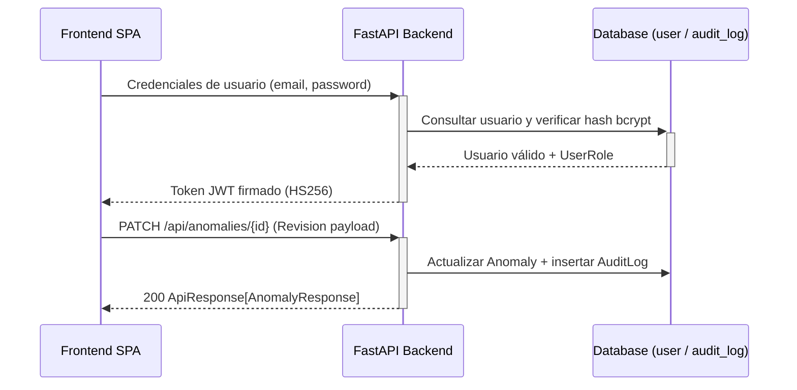

<!-- scanner:2026-10-18 -->
# Security Model

> 📋 Generado por `project-scanner` el 2026-10-18 a partir de los modelos, configuración y dependencias de `veedoria-monorepo`.

## Authentication
| Method | Provider | Details |
|--------|----------|---------|
| JWT (`HS256`) | Backend interno (`PyJWT` `^2.9.0`) | Configurado mediante `JWT_SECRET` (mínimo 32 caracteres) y `JWT_ALGORITHM="HS256"` en `src/config.py` |
| Password Hashing | `bcrypt` `^4.2.0` | Almacenamiento de `password_hash` en la tabla `user` |

### JWT Flow

## Authorization
### Roles (`UserRole` — `app/backend/src/models/user.py`)
| Role | Description | Permisos principales |
|------|-------------|---------------------|
| `citizen` | Ciudadano / Consulta pública (rol por defecto) | Consulta del portal cívico, verificador de precios, visualización de anomalías y estadísticas |
| `auditor` / `admin` | Auditor de veeduría / Administrador | Confirmación o descarte de anomalías (`PATCH /api/anomalies/{id}`), ejecución manual de detección/sincronización |

### Permission Matrix
| Resource | Admin / Auditor | Citizen (Public) |
|----------|-----------------|------------------|
| `GET /api/anomalies` | ✅ | ✅ |
| `GET /api/anomalies/stats` | ✅ | ✅ |
| `GET /api/anomalies/{id}` | ✅ | ✅ |
| `GET /api/anomalies/{id}/context` | ✅ | ✅ |
| `PATCH /api/anomalies/{id}` | ✅ | `[VERIFY]` Restringir con guard JWT |
| `POST /api/anomalies/detect` | ✅ | `[VERIFY]` Restringir con guard JWT |
| `POST /api/sync/dgcp` | ✅ | `[VERIFY]` Restringir con guard JWT |

## Secrets Management
| Secret | Storage | Path / Variable |
|--------|---------|-----------------|
| `JWT_SECRET` | Variables de entorno (`.env` local / Render Secret en prod) | `JWT_SECRET` (autogenerado en `render.yaml`) |
| `DATABASE_URL` | Variables de entorno (`.env` local / Render Env Var `sync: false`) | `DATABASE_URL` |
| `REDIS_URL` | Variables de entorno / Render Service Link | `REDIS_URL` |
| Credenciales SDD / MCP | Archivo local ignorado por Git | `.sdd-credentials.json` (en `.gitignore`) |

## CORS
| Environment | Allowed Origins | Credentials | Notes |
|-------------|----------------|-------------|-------|
| DEV | `http://localhost:5173` (Vite dev server) | `true` | Proxy / comunicación local Frontend ↔ Backend |
| PROD | `[VERIFY]` Dominio oficial del frontend | `true` | Configurar `CORSMiddleware` con lista blanca explícita en producción |

## Audit Log
La tabla `audit_log` (`app/backend/src/models/audit_log.py`) registra acciones críticas sobre las entidades del sistema:

| Evento | Datos registrados | Retención |
|--------|------------------|-----------|
| Revisión de anomalía (`CONFIRMED` / `DISMISSED`) | `action_type`, `user_id`, `entity_type` (`anomaly`), `entity_id`, `old_value` (JSON), `new_value` (JSON), `ip_address`, `timestamp` (UTC) | Permanente en base de datos |
| Ejecución de sincronización / detección | `process_type`, `sync_type`, `triggered_by`, `records_synced`, `status`, `error_message` en tabla `sync_log` | Permanente en base de datos |

## OWASP Top 10 Checklist
| # | Vulnerabilidad | Estado | Mitigación |
|---|---------------|--------|------------|
| A01 | Broken Access Control | - [x] | RBAC relacional (`Role`, `Permission`, `RolePermission`) + `require_permission` + aislamiento por organización (`get_Optional_tenant_scope`) en `/api/auth/*` y `/api/anomalies/*` |
| A02 | Cryptographic Failures | - [x] | `bcrypt` para contraseñas, `PyJWT` para tokens, variables sensibles fuera del código |
| A03 | Injection | - [x] | Consultas parametrizadas mediante SQLModel / SQLAlchemy 2.0 y validación estricta con Pydantic v2 |
| A04 | Insecure Design | - [x] | Separación de capas Clean Architecture y bitácora de auditoría (`AuditLog`) en bucle de retroalimentación |
| A05 | Security Misconfiguration | - [x] | Configuración tipada con `pydantic-settings` y manejador global que oculta stacktraces en errores `500` |
| A06 | Vulnerable Components | - [x] | Versiones actuales verificadas con `context7` y reglas de seguridad Ruff (`S` / flake8-bandit activadas en `pyproject.toml`) |
| A07 | Auth Failures | - [x] | Endpoints `/api/auth/login`, `/logout`, `/forgot-password` (anti-enumeración) y `/reset-password` (token de un solo uso) implementados y probados |
| A08 | Software & Data Integrity | - [x] | Lockfiles (`poetry.lock`, `package-lock.json`) y migraciones Alembic deterministas |
| A09 | Logging & Monitoring Failures | - [x] | Logging estructurado en `veedoria.*`, `SyncLog` y `AuditLog` |
| A10 | Server-Side Request Forgery | - [x] | Cliente HTTP `DGCPClient` restringido exclusivamente a `settings.dgcp_api_base_url` |

## Security Checklist
- [x] Todos los endpoints administrativos y de revisión cuentan con validación JWT y permisos RBAC
- [x] CORS configurado por ambiente en `main.py`
- [x] Rate limiting habilitado en cliente de ingesta externa (`DGCPClient`)
- [x] Validación de entrada con Pydantic v2 (`Query`, `AnomalyReviewPayload`)
- [x] Prevención de inyección SQL vía ORM SQLModel / SQLAlchemy
- [x] Prevención de XSS mediante escapado automático en React 19

## Changelog
| Date | Feature | Change |
|------|---------|--------|
| 2026-10-18 | `project-scanner` | Línea base de seguridad extraída de `pyproject.toml`, `user.py`, `audit_log.py` y `main.py` |

---
_Last updated: 2026-10-19 by solution-designer (autenticacion-rbac completed)_