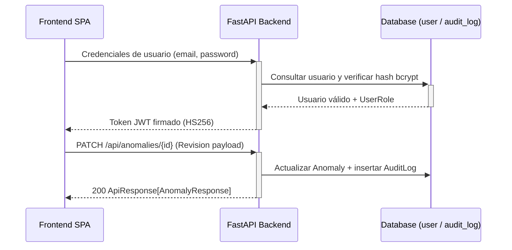

<!-- scanner:2026-10-18 -->
# Security Model

> 📋 Generado por `project-scanner` el 2026-10-18 a partir de los modelos, configuración y dependencias de `veedoria-monorepo`.

## Authentication
| Method | Provider | Details |
|--------|----------|---------|
| JWT (`HS256`) | Backend interno (`PyJWT` `^2.9.0`) | Configurado mediante `JWT_SECRET` (mínimo 32 caracteres) y `JWT_ALGORITHM="HS256"` en `src/config.py` |
| Password Hashing | `bcrypt` `^4.2.0` | Almacenamiento de `password_hash` en la tabla `user` |

### JWT Flow

## Authorization
### Roles (`UserRole` — `app/backend/src/models/user.py`)
| Role | Description | Permisos principales |
|------|-------------|---------------------|
| `citizen` | Ciudadano / Consulta pública (rol por defecto) | Consulta del portal cívico, verificador de precios, visualización de anomalías y estadísticas |
| `auditor` / `admin` | Auditor de veeduría / Administrador | Confirmación o descarte de anomalías (`PATCH /api/anomalies/{id}`), ejecución manual de detección/sincronización |

### Permission Matrix
| Resource | Admin / Auditor | Citizen (Public) |
|----------|-----------------|------------------|
| `GET /api/anomalies` | ✅ | ✅ |
| `GET /api/anomalies/stats` | ✅ | ✅ |
| `GET /api/anomalies/{id}` | ✅ | ✅ |
| `GET /api/anomalies/{id}/context` | ✅ | ✅ |
| `PATCH /api/anomalies/{id}` | ✅ | `[VERIFY]` Restringir con guard JWT |
| `POST /api/anomalies/detect` | ✅ | `[VERIFY]` Restringir con guard JWT |
| `POST /api/sync/dgcp` | ✅ | `[VERIFY]` Restringir con guard JWT |

## Matriz Consolidada de Organizaciones, Planes de Suscripción y Permisos Multi-Tenant

### 1. Cuentas y Organizaciones Pre-Sembradas (`ensure_auth_seed`)

| Organización (`tenant.code`) | Segmento (`tenant_type`) | Plan (`plan_tier`) | Cuenta Demo Principal | Rol (`rol.codigo`) | Alcance de Datos | Candados de Suscripción Activos |
|------------------------------|--------------------------|--------------------|-----------------------|--------------------|------------------|---------------------------------|
| `NEXODIGITAL` | `PLATFORM` | `PLATFORM_GLOBAL` | `admin@veedoria.gob.do` | `PLATFORM_ADMIN` | Nacional (Todas las instituciones y proveedores) | Ninguno (acceso total a B2G, B2B y Administración) |
| `MOPC-B2G` | `GOV_INSTITUTION` | `B2G_PREMIUM` | `auditor@mopc.gob.do` | `CONTRALOR` | Acotado a `institution_id` del MOPC | Ninguno en módulos B2G (Red de Colusión, Reportes e Integraciones habilitados) |
| `MINERD-B2G` | `GOV_INSTITUTION` | `B2G_BASIC` | `auditor@minerd.gob.do` | `AUDITOR_ANALISTA` | Acotado a `institution_id` del MINERD | 4.º KPI de Panorama B2G bloqueado; Red de Colusión (`/app/red-colusion`) en estado `locked: true`; emisión de llaves API restringida al Plan Institucional Avanzado |
| `ACERO-B2B` | `B2B_SUPPLIER` | `B2B_CORPORATE` | `proveedor@constructora.do` | `B2B_GERENTE` | Acotado al RPE empresarial + Mercado UNSPSC | Ninguno en módulos B2B (Cuartiles de precios, competidores y tasa de adjudicación desbloqueados) |
| `FERRETERIA-B2B` | `B2B_SUPPLIER` | `B2B_PYME` | `pyme@ferreteria.do` | `B2B_ANALISTA` | Acotado al RPE empresarial + Mercado UNSPSC | KPI de Tasa de Adjudicación bloqueado en `/app/dashboard`; tabla detallada de competidores y cuartiles avanzados bloqueados en `/app/mercado` |

### 2. Matriz de Visibilidad y Control de Acceso por Ruta

| Ruta Frontend / Endpoint Backend | `PLATFORM_ADMIN` | Auditor B2G Avanzado (`B2G_PREMIUM`) | Auditor B2G Básico (`B2G_BASIC`) | Proveedor Corporativo (`B2B_CORPORATE`) | Proveedor Pyme (`B2B_PYME`) |
|----------------------------------|:----------------:|:------------------------------------:|:--------------------------------:|:---------------------------------------:|:---------------------------:|
| `/app/dashboard` (`GET /api/dashboard/overview`) | ✅ Variante `ADMIN` (y selector `?view_mode=`) | ✅ Variante `B2G` Completa | ✅ Variante `B2G` (4.º KPI con candado) | ✅ Variante `B2B` Completa | ✅ Variante `B2B` (2.º KPI con candado) |
| `/app/auditor` (`GET/PATCH /api/anomalies/*`) | ✅ Nacional | ✅ Institucional | ✅ Institucional | 🚫 `403` | 🚫 `403` |
| `/app/procesos` (`GET /api/auditor/processes`) | ✅ Nacional | ✅ Institucional | ✅ Institucional | 🚫 `403` | 🚫 `403` |
| `/app/red-colusion` (`GET /api/auditor/collusion-network`) | ✅ Grafo completo | ✅ Grafo completo | 🔒 Vista bloqueada (`locked: true`) | 🚫 `403` | 🚫 `403` |
| `/app/configuracion-deteccion` (`GET/PUT /api/auditor/detection-config`) | ✅ Lectura y Edición | ✅ Lectura y Edición (`CONTRALOR`) | 👁️ Solo lectura (`can_edit: false`) | 🚫 `403` | 🚫 `403` |
| `/app/resoluciones` (`GET /api/auditor/resolutions`) | ✅ Nacional | ✅ Institucional | ✅ Institucional | 🚫 `403` | 🚫 `403` |
| `/app/reportes` (`GET /api/auditor/reports/summary`) | ✅ Nacional + Exportación CSV/Acta | ✅ Institucional + Exportación CSV/Acta | ✅ Institucional + Exportación CSV/Acta | 🚫 `403` | 🚫 `403` |
| `/app/integraciones` (`GET/POST/DELETE /api/auditor/integrations/*`) | ✅ Emisión y Revocación | ✅ Emisión y Revocación | 🔒 Emisión bloqueada por plan | 🚫 `403` | 🚫 `403` |
| `/app/mercado` (`GET /api/market/intelligence`) | ✅ Completo | 🚫 Redirigido a B2G | 🚫 Redirigido a B2G | ✅ 3 Subsecciones completas | 🔒 Subsecciones avanzadas con candado |
| `/app/oportunidades` (`GET /api/b2b/opportunities`) | ✅ Nacional (multi-tenant) | ✅ Supervisión | ✅ Supervisión | ✅ Radar + watchlist completo | 🔒 Cuotas: 3 rubros / 10 pizarras activas |
| `/app/mis-licitaciones` (`GET/POST/PUT/DELETE /api/b2b/bids*`) | ✅ Nacional | ✅ Supervisión (consulta) | ✅ Supervisión (consulta) | ✅ Watchlist ilimitado | 🔒 Máx. 10 pizarras activas (`403 PLAN_QUOTA_EXCEEDED`) |
| `/app/competidor/:rnc` (`GET /api/b2b/competitors/{rnc}`) | ✅ Nacional | ✅ Supervisión | ✅ Supervisión | ✅ Inteligencia forense (precios por rubro UNSPSC + flags de anomalías) | 🔒 Ficha forense `locked: true` (requiere `B2B_CORPORATE`) |
| `/app/simulador-precios` (`POST /api/b2b/price-simulator`) | ✅ Nacional | ✅ Supervisión | ✅ Supervisión | ✅ Cuartiles P25/P50/P75 + asesoría legal completa | ✅ Banda legal + cuartiles disponibles |
| `/app/sectores` (`GET/PUT /api/b2b/sectors`) | ✅ Nacional | ✅ Supervisión (consulta) | ✅ Supervisión (consulta) | ✅ Monitoreo de rubros ilimitado | 🔒 Máx. 3 rubros UNSPSC (`403 PLAN_QUOTA_EXCEEDED`) |
| `/app/suscripcion` (`GET/PUT /api/b2b/subscription`) | ✅ Nacional + cambio de plan (`PLATFORM_ADMIN`) | 👁️ Según rol del usuario b2g (p. ej. `CONTRALOR` no puede cambiar el plan) | 👁️ Según rol del usuario b2g (p. ej. `CONTRALOR` no puede cambiar el plan) | ✅ Consulta + cambio de plan (rol `PROVEEDOR`) | ✅ Consulta + cambio de plan (rol `PROVEEDOR`) |
| `/app/usuarios` y `/app/roles` (`/api/auth/users`, `/api/auth/roles`) | ✅ Global | ✅ Usuarios de su institución | 👁️ Según permiso `USER_READ` | ✅ Usuarios de su empresa | 👁️ Según permiso `USER_READ` |

## Secrets Management
| Secret | Storage | Path / Variable |
|--------|---------|-----------------|
| `JWT_SECRET` | Variables de entorno (`.env` local / Render Secret en prod) | `JWT_SECRET` (autogenerado en `render.yaml`) |
| `DATABASE_URL` | Variables de entorno (`.env` local / Render Env Var `sync: false`) | `DATABASE_URL` |
| `REDIS_URL` | Variables de entorno / Render Service Link | `REDIS_URL` |
| Credenciales SDD / MCP | Archivo local ignorado por Git | `.sdd-credentials.json` (en `.gitignore`) |

## CORS
| Environment | Allowed Origins | Credentials | Notes |
|-------------|----------------|-------------|-------|
| DEV | `http://localhost:5173` (Vite dev server) | `true` | Proxy / comunicación local Frontend ↔ Backend |
| PROD | `[VERIFY]` Dominio oficial del frontend | `true` | Configurar `CORSMiddleware` con lista blanca explícita en producción |

## Audit Log
La tabla `audit_log` (`app/backend/src/models/audit_log.py`) registra acciones críticas sobre las entidades del sistema:

| Evento | Datos registrados | Retención |
|--------|------------------|-----------|
| Revisión de anomalía (`CONFIRMED` / `DISMISSED`) | `action_type`, `user_id`, `entity_type` (`anomaly`), `entity_id`, `old_value` (JSON), `new_value` (JSON), `ip_address`, `timestamp` (UTC) | Permanente en base de datos |
| Ejecución de sincronización / detección | `process_type`, `sync_type`, `triggered_by`, `records_synced`, `status`, `error_message` en tabla `sync_log` | Permanente en base de datos |

## OWASP Top 10 Checklist
| # | Vulnerabilidad | Estado | Mitigación |
|---|---------------|--------|------------|
| A01 | Broken Access Control | - [x] | RBAC relacional (`Role`, `Permission`, `RolePermission`) + `require_permission` + aislamiento por organización (`get_Optional_tenant_scope`) en `/api/auth/*` y `/api/anomalies/*` |
| A02 | Cryptographic Failures | - [x] | `bcrypt` para contraseñas, `PyJWT` para tokens, variables sensibles fuera del código |
| A03 | Injection | - [x] | Consultas parametrizadas mediante SQLModel / SQLAlchemy 2.0 y validación estricta con Pydantic v2 |
| A04 | Insecure Design | - [x] | Separación de capas Clean Architecture y bitácora de auditoría (`AuditLog`) en bucle de retroalimentación |
| A05 | Security Misconfiguration | - [x] | Configuración tipada con `pydantic-settings` y manejador global que oculta stacktraces en errores `500` |
| A06 | Vulnerable Components | - [x] | Versiones actuales verificadas con `context7` y reglas de seguridad Ruff (`S` / flake8-bandit activadas en `pyproject.toml`) |
| A07 | Auth Failures | - [x] | Endpoints `/api/auth/login`, `/logout`, `/forgot-password` (anti-enumeración) y `/reset-password` (token de un solo uso) implementados y probados |
| A08 | Software & Data Integrity | - [x] | Lockfiles (`poetry.lock`, `package-lock.json`) y migraciones Alembic deterministas |
| A09 | Logging & Monitoring Failures | - [x] | Logging estructurado en `veedoria.*`, `SyncLog` y `AuditLog` |
| A10 | Server-Side Request Forgery | - [x] | Cliente HTTP `DGCPClient` restringido exclusivamente a `settings.dgcp_api_base_url` |

## Security Checklist
- [x] Todos los endpoints administrativos y de revisión cuentan con validación JWT y permisos RBAC
- [x] CORS configurado por ambiente en `main.py`
- [x] Rate limiting habilitado en cliente de ingesta externa (`DGCPClient`)
- [x] Validación de entrada con Pydantic v2 (`Query`, `AnomalyReviewPayload`)
- [x] Prevención de inyección SQL vía ORM SQLModel / SQLAlchemy
- [x] Prevención de XSS mediante escapado automático en React 19

## Changelog
| Date | Feature | Change |
|------|---------|--------|
| 2026-10-18 | `project-scanner` | Línea base de seguridad extraída de `pyproject.toml`, `user.py`, `audit_log.py` y `main.py` |
| 2026-10-21 | `implementer` (Paquete 3) | Añadidos los 6 endpoints/pantallas de `suite-licitaciones-b2b` a la matriz por ruta; guard de segmento B2B (`/api/b2b/*` para `B2B_SUPPLIER`, `GOV_OVERSIGHT`, `PLATFORM` o permiso `B2B_ANALYTICS`); candados de cuota `B2B_PYME` (3 rubros / 10 pizarras — `403 PLAN_QUOTA_EXCEEDED`), ficha forense `locked` en PyME y cambio de plan restringido a roles de administración (`TENANT_ADMIN`/`PLATFORM_ADMIN`/`PROVEEDOR`); trazabilidad `B2B_BID_UPSERT` / `B2B_BID_DELETE` / `B2B_SECTORS_UPDATE` / `B2B_PLAN_CHANGE` en `audit_log` |

---
_Last updated: 2026-10-21 by implementer (added Multi-Tenant Plans, Locks, B2G/B2B Route Matrix & suite-licitaciones-b2b guards)_