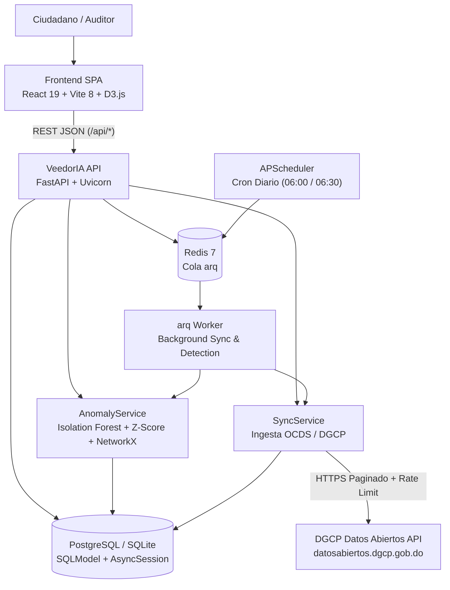

<!-- scanner:2026-10-18 -->
# System Design

> 📋 Generado por `project-scanner` el 2026-10-18 a partir del análisis del monorepo `veedoria-monorepo`.

## Overview
**VeedorIA** es una plataforma de monitoreo y auditoría inteligente de contrataciones públicas para la República Dominicana basada en el estándar OCDS y la API de Datos Abiertos de la DGCP. Combina un frontend SPA en **React 19 + TypeScript 6 + Vite 8 + D3.js** con un backend asíncrono en **FastAPI + SQLModel + PostgreSQL/SQLite**, procesamiento distribuido de ingesta y detección mediante **arq + Redis 7**, y algoritmos de Machine Learning (**Isolation Forest**, **Z-Score**) y teoría de grafos (**NetworkX**) para identificar sobreprecios, fraccionamiento de contratos y redes de colusión.

## Architecture Diagram

## Components
| Component | Technology | Purpose | Owner |
|-----------|-----------|---------|-------|
| Frontend SPA (`app/frontend`) | React 19, TypeScript 6, Vite 8, TailwindCSS 4, HeroUI, D3.js, TanStack Query | Portal cívico bilingüe, verificador de precios y consola interactiva de auditoría de anomalías | Frontend |
| VeedorIA API (`app/backend`) | Python 3.11+, FastAPI, Uvicorn, Pydantic v2 | Exposición de endpoints REST (`/api/anomalies`, `/api/sync`), validación y manejo global de errores | Backend |
| Anomaly Engine (`anomaly_service.py`) | scikit-learn, NetworkX, pandas, numpy, rapidfuzz | Detección de sobreprecios, fraccionamiento y grafos de colusión con bucle de retroalimentación (`DetectionConfig`) | Backend / Data |
| Sync Engine (`sync_service.py`, `dgcp_client.py`) | httpx, openpyxl, SQLModel | Ingesta incremental y completa desde la API OCDS de la DGCP e importación de catálogos JSON/XLSX | Backend |
| Async Worker (`arq_worker.py`) | arq 0.28 + Redis 7 + APScheduler | Ejecución en segundo plano de sincronizaciones masivas y corridas de detección sin bloquear el event loop HTTP | Platform / Backend |

## Infrastructure
<!-- scanner:2026-10-18 -->

| Resource | Service | Environment | Notes |
|----------|---------|-------------|-------|
| API Server (`veedoria-api`) | Docker (`python:3.12-slim`) / Render Web Service | dev / prod | Expone puerto `8000` (Docker/Render) o `3001` (dev local) |
| Background Worker (`veedoria-worker`) | Docker / Render Worker (`python -m arq src.cli.arq_worker.WorkerSettings`) | dev / prod | Procesa tareas `run_sync` y `run_detection` |
| Queue / Cache (`veedoria-redis`) | `redis:7-alpine` / Render Redis | dev / prod | Cola de trabajos asíncronos y coordinación de workers |
| Database | SQLite (`aiosqlite`) / PostgreSQL (`asyncpg`) | dev / prod | 10 tablas gestionadas con Alembic (`app/backend/migrations/`) |

## Ambientes
| Aspecto | DEV | CERT | PROD |
|---------|-----|------|------|
| Instancias API | 1 × Uvicorn local (`--reload`) o contenedor Docker | `[VERIFY]` 1 × Docker container | Render Web Service (`veedoria-api`) |
| Base de datos | SQLite (`veedoria.db`) o PostgreSQL local (`:5432`) | `[VERIFY]` PostgreSQL | PostgreSQL administrado (`DATABASE_URL` con `asyncpg`) |
| Redis | `redis:7-alpine` local (`localhost:6379/0`) | `[VERIFY]` Redis instancia única | Render Redis (`veedoria-redis`) |
| Logs level | `INFO` / `DEBUG` | `INFO` | `INFO` / `WARN` |
| Datos | Subconjunto de contratos DGCP sincronizados | Subconjunto de validación | Datos abiertos reales de la DGCP (sincronización diaria) |

## Escalabilidad
- **Desacoplamiento de cargas pesadas**: La ingesta de datos DGCP y la ejecución de algoritmos ML/grafos se delegan a workers `arq` sobre Redis (`202 Accepted`), manteniendo baja la latencia de lectura en la API.
- **Procesamiento por lotes**: La sincronización procesa registros en lotes configurables (`SYNC_BATCH_SIZE = 500`) con control de tasa (`SYNC_RATE_LIMIT = 5.0` req/s).
- **Cuellos de botella conocidos**:
  - Conteo e hidratación de contexto de anomalías sobre grandes volúmenes de contratos → mitigado mediante índices compuestos (`c5a7d2e8f1b0_add_performance_indexes.py`) y filtrado de enlaces de colusión por proveedores de la anomalía actual.
  - Concurrencia de escritura en SQLite local → uso de PostgreSQL (`asyncpg`) para cargas concurrentes en Docker/producción.

## Observabilidad
| Tipo | Herramienta | Detalle |
|------|------------|---------|
| Logs | Python `logging` (`veedoria.app`, `veedoria.*`) | Formato estructurado `%(asctime)s \| %(name)s \| %(levelname)s \| %(message)s` |
| Auditoría de Jobs | Tabla `sync_log` (`GET /api/sync/status`) | Registra inicio, fin, registros procesados, tipo de sync/detección, errores y recuperación ante reinicios (`server_restart`) |
| Auditoría de Negocio | Tabla `audit_log` | Trazabilidad de cambios de estado (`old_value`, `new_value`, `user_id`, `ip_address`) al revisar anomalías |
| Health checks | `redis-cli ping` en Docker Compose + `/api/sync/status` | Verificación de disponibilidad de cola y estado de sincronización |

## Cost Estimation
### Monthly Estimate
| Service | Spec | Price/month | Free Tier | Notes |
|---------|------|-------------|-----------|-------|
| Render Web Service (`veedoria-api`) | Plan Free / Starter Docker | \$0.00 - \$7.00 | Free plan configurado en `render.yaml` | Servicio HTTP principal |
| Render Background Worker (`veedoria-worker`) | Plan Free / Starter Docker | \$0.00 - \$7.00 | Definido en `render.yaml` | Worker `arq` |
| Render Redis (`veedoria-redis`) | Plan Free (25MB) | \$0.00 | Free tier en `render.yaml` | Cola de jobs |
| PostgreSQL (Supabase / Render) | Free / Micro tier | \$0.00 - \$15.00 | Hasta 500MB en tier gratuito | Base de datos relacional |
| **Total estimado (con free tier)** | | **\$0.00/mes** | | Configuración actual en `render.yaml` |

### Cost Scaling
- Al superar el límite de memoria o almacenamiento del tier gratuito de PostgreSQL (>500MB por histórico completo de contratos e ítems OCDS), escalar a plan gestionado (~$15-$25/mes) y worker dedicado con ≥1GB RAM para ejecución de `scikit-learn` y `NetworkX`.

## Key Decisions
- **Arquitectura Limpia en Monorepo**: Separación estricta de `domain`, `infrastructure`, `models`, `services` y `presentation` en `app/backend` y `app/frontend`.
- **Bucle de Retroalimentación Cerrado (`DetectionConfig`)**: Las confirmaciones y descartes de los auditores ajustan dinámicamente los pesos y umbrales de detección sin requerir redespliegue de código.
- **Doble Motor de Base de Datos Asíncrono**: Soporte transparente para `sqlite+aiosqlite` en desarrollo ligero y `postgresql+asyncpg` en contenedores y producción.

---
_Last updated: 2026-10-18 by project-scanner_