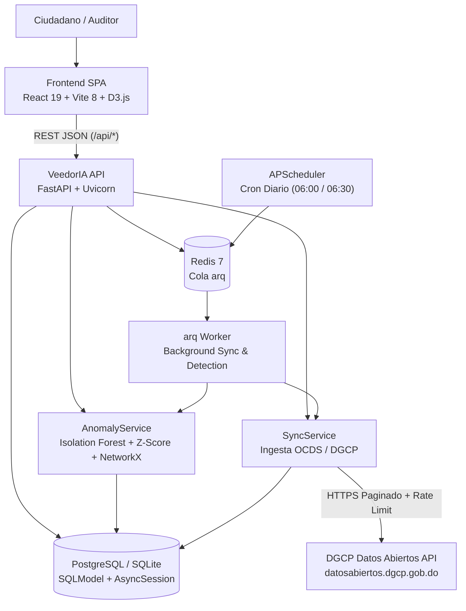

<!-- scanner:2026-10-18 -->
# System Design

> 📋 Generado por `project-scanner` el 2026-10-18 a partir del análisis del monorepo `veedoria-monorepo`.

## Overview
**VeedorIA** es una plataforma de monitoreo y auditoría inteligente de contrataciones públicas para la República Dominicana basada en el estándar OCDS y la API de Datos Abiertos de la DGCP. Combina un frontend SPA en **React 19 + TypeScript 6 + Vite 8 + D3.js** con un backend asíncrono en **FastAPI + SQLModel + PostgreSQL/SQLite**, procesamiento distribuido de ingesta y detección mediante **arq + Redis 7**, y algoritmos de Machine Learning (**Isolation Forest**, **Z-Score**) y teoría de grafos (**NetworkX**) para identificar sobreprecios, fraccionamiento de contratos y redes de colusión.

## Architecture Diagram

### Production Infrastructure (`docs/diagrams/infrastructure.png`)

### Local Development Infrastructure (`docs/diagrams/infrastructure-dev.png`)

## Components
| Component | Technology | Purpose | Owner |
|-----------|-----------|---------|-------|
| Frontend SPA (`app/frontend`) | React 19, TypeScript 6, Vite 8, TailwindCSS 4, HeroUI, D3.js, TanStack Query | Portal cívico bilingüe, verificador de precios y consola interactiva de auditoría de anomalías | Frontend |
| VeedorIA API (`app/backend`) | Python 3.11+, FastAPI, Uvicorn, Pydantic v2 | Exposición de endpoints REST (`/api/anomalies`, `/api/sync`, `/api/public`, `/api/auth`), validación y manejo global de errores | Backend |
| Auth & Multi-Tenant Engine (`auth_service.py`) | PyJWT, bcrypt, SQLModel | Autenticación JWT, recuperación de clave, aislamiento por organización suscriptora (`B2G`, `B2B`, `Global`) y RBAC relacional (4 roles, 13 permisos) | Backend / Security |
| Public Portal Engine (`public_portal_service.py`) | SQLAlchemy 2.0 Async | Buscador ciudadano multi-token con expansión de sinónimos, Sankey presupuestario, mapa provincial, comparador de precios y rankings | Backend |
| Anomaly Engine (`anomaly_service.py`) | scikit-learn, NetworkX, pandas, numpy, rapidfuzz | Detección de sobreprecios, fraccionamiento y grafos de colusión con bucle de retroalimentación (`DetectionConfig`) | Backend / Data |
| Sync Engine (`sync_service.py`, `dgcp_client.py`) | httpx, openpyxl, SQLModel | Ingesta incremental y completa desde la API OCDS de la DGCP e importación de catálogos JSON/XLSX | Backend |
| Async Worker (`arq_worker.py`) | arq 0.28 + Redis 7 + APScheduler | Ejecución en segundo plano de sincronizaciones masivas y corridas de detección sin bloquear el event loop HTTP | Platform / Backend |

## Infrastructure
<!-- scanner:2026-10-18 -->

| Resource | Service | Environment | Notes |
|----------|---------|-------------|-------|
| API Server (`veedoria-api`) | Docker (`python:3.12-slim`) / Render Web Service | dev / prod | Expone puerto `8000` (Docker/Render) o `3001` (dev local) |
| Background Worker (`veedoria-worker`) | Docker / Render Worker (`python -m arq src.cli.arq_worker.WorkerSettings`) | dev / prod | Procesa tareas `run_sync` y `run_detection` |
| Queue / Cache (`veedoria-redis`) | `redis:7-alpine` / Render Redis | dev / prod | Cola de trabajos asíncronos y coordinación de workers |
| Database | SQLite (`aiosqlite`) / PostgreSQL (`asyncpg`) | dev / prod | 10 tablas gestionadas con Alembic (`app/backend/migrations/`) |

## Ambientes
| Aspecto | Local | Preview (PR) | DEV / QA (`dev`) | CERT (`cert` / `release/*`) | PROD (`main`) |
|---------|-------|--------------|------------------|-----------------------------|---------------|
| Frontend SPA | Vite Dev (`:5173`) | Vercel PR Preview (`pr-{N}`) | `https://dev.veedoria.do` | `https://cert.veedoria.do` | `https://veedoria.do` |
| Instancias API | Uvicorn (`:3001`) / Docker | Consume API DEV | `veedoria-api-dev` | `veedoria-api-cert` | `veedoria-api` (Render) |
| Worker `arq` | Proceso local / Docker | Comparte Worker DEV | `veedoria-worker-dev` | `veedoria-worker-cert` | `veedoria-worker` |
| Base de datos | SQLite (`veedoria.db`) o PG local | PostgreSQL DEV | PostgreSQL DEV | PostgreSQL CERT (aislado) | PostgreSQL PROD (`asyncpg`) |
| Redis | `localhost:6379/0` | Redis DEV | `veedoria-redis-dev` | `veedoria-redis-cert` | `veedoria-redis` |
| Promoción / Gate | Manual | Auto por PR (auto-cleanup) | Auto en merge a `dev` | Manual · Gate: **Dev + QA** | Manual + Tag `vX.Y.Z` · Gate: **Dev + QA + BA** |
| Migraciones DB | `alembic upgrade head` | — | Pre-deploy automático | Pre-deploy con rollback en fallo | Pre-deploy con aprobación manual |

## Escalabilidad
- **Desacoplamiento de cargas pesadas**: La ingesta de datos DGCP y la ejecución de algoritmos ML/grafos se delegan a workers `arq` sobre Redis (`202 Accepted`), manteniendo baja la latencia de lectura en la API.
- **Procesamiento por lotes**: La sincronización procesa registros en lotes configurables (`SYNC_BATCH_SIZE = 500`) con control de tasa (`SYNC_RATE_LIMIT = 5.0` req/s).
- **Cuellos de botella conocidos**:
  - Conteo e hidratación de contexto de anomalías sobre grandes volúmenes de contratos → mitigado mediante índices compuestos (`c5a7d2e8f1b0_add_performance_indexes.py`) y filtrado de enlaces de colusión por proveedores de la anomalía actual.
  - Concurrencia de escritura en SQLite local → uso de PostgreSQL (`asyncpg`) para cargas concurrentes en Docker/producción.

## Observabilidad
| Tipo | Herramienta | Detalle |
|------|------------|---------|
| Logs | Python `logging` (`veedoria.app`, `veedoria.*`) | Formato estructurado `%(asctime)s \| %(name)s \| %(levelname)s \| %(message)s` |
| Auditoría de Jobs | Tabla `sync_log` (`GET /api/sync/status`) | Registra inicio, fin, registros procesados, tipo de sync/detección, errores y recuperación ante reinicios (`server_restart`) |
| Auditoría de Negocio | Tabla `audit_log` | Trazabilidad de cambios de estado (`old_value`, `new_value`, `user_id`, `ip_address`) al revisar anomalías |
| Health checks | `redis-cli ping` en Docker Compose + `/api/sync/status` | Verificación de disponibilidad de cola y estado de sincronización |

## Cost Estimation
### Monthly Estimate
| Service | Spec | Price/month | Free Tier | Notes |
|---------|------|-------------|-----------|-------|
| Render Web Service (`veedoria-api`) | Plan Free / Starter Docker | \$0.00 - \$7.00 | Free plan configurado en `render.yaml` | Servicio HTTP principal |
| Render Background Worker (`veedoria-worker`) | Plan Free / Starter Docker | \$0.00 - \$7.00 | Definido en `render.yaml` | Worker `arq` |
| Render Redis (`veedoria-redis`) | Plan Free (25MB) | \$0.00 | Free tier en `render.yaml` | Cola de jobs |
| PostgreSQL (Supabase / Render) | Free / Micro tier | \$0.00 - \$15.00 | Hasta 500MB en tier gratuito | Base de datos relacional |
| **Total estimado (con free tier)** | | **\$0.00/mes** | | Configuración actual en `render.yaml` |

### Cost Scaling
- Al superar el límite de memoria o almacenamiento del tier gratuito de PostgreSQL (>500MB por histórico completo de contratos e ítems OCDS), escalar a plan gestionado (~$15-$25/mes) y worker dedicado con ≥1GB RAM para ejecución de `scikit-learn` y `NetworkX`.

## Motor Analítico B2G, Umbrales por Modalidad DGCP y Marco Legal (Ley 340-06)

### 1. Cálculo de Sobreprecio y Detección de Ruido de Catalogación UNSPSC (`PRICE_ANOMALY`)
- **Mediana por Rubro UNSPSC**: Agrupa todos los ítems adjudicados con el mismo `unspsc_code` ($n \ge 4$) y calcula la mediana estadística $\text{Mediana} = \text{median}(P_1, \dots, P_n)$.
- **Porcentaje de Sobreprecio**:
  $$\text{Desviación \%} = \left(\frac{\text{Precio Unitario} - \text{Mediana}}{\text{Mediana}}\right) \times 100$$
- **Curación de Contexto (`get_anomaly_context`)**: Selecciona únicamente el renglón anómalo objetivo (`is_anomaly = true`) junto a una muestra estratificada de hasta 29 puntos del rubro para evitar saturación visual en `PriceScatter.tsx`. Si el contrato contiene múltiples renglones bajo el mismo código UNSPSC, alerta sobre **Agrupamiento Indebido del Catálogo CBS/UNSPSC (Art. 3 num. 3 Ley 340-06)**.

### 2. Evaluación de Fraccionamiento y Tabla de Umbrales DGCP en Base de Datos (`FRAGMENTATION`)
- **Extracción de Sigla de Modalidad**: El motor extrae la sigla del procedimiento desde `Process.dgcp_code` (`-CD-`, `-CM-`, `-CP-`, `-PEIN-`/`-PEPU-`, `-LPN-`/`-LPI-`, `-PEEN-`/`-PEUR-`) y resuelve su tope normativo consultando la tabla `detection_config` en PostgreSQL (`THRESHOLD_CD_DOP`, `THRESHOLD_CM_DOP`, `THRESHOLD_CP_DOP`, `THRESHOLD_PEIN_DOP`, `THRESHOLD_LPN_DOP`, `THRESHOLD_PEEN_DOP`, `FRAGMENTATION_THRESHOLD_DOP`), editable en vivo desde `/app/configuracion-deteccion`.
- **Agrupación por Expediente Fraccionado**: Todos los contratos pertenecientes al proceso observado (`Contract.process_id == anomaly.process_id`) se marcan como alertados (`is_alert = true`) y su suma acumulada se contrasta contra el umbral de la modalidad correspondiente.

### 3. Fundamentación Normativa Condicional (Ley 340-06 · Reglamento 416-23)
- **Sobreprecio**: Art. 3 (Eficiencia y Economía) y Arts. 96–97 del Decreto 416-23 (Razonabilidad del Precio).
- **Fraccionamiento**: Arts. 16 y 17 Párrafo I de la Ley 340-06, Art. 62 del Decreto 416-23 (Presunción de Fraccionamiento en el PACC) y Arts. 65–66 (Sanciones).
- **Colusión**: Art. 3 nums. 2 y 6, Arts. 11 y 14 (Prohibiciones por Vinculación), Art. 66 Párrafo II (Inhabilitación del RPE de 1 a 5 años), Art. 5 de la Ley 42-08 (Defensa de la Competencia) y Ley 155-17 (Declaración Jurada de Beneficiario Final).

## Key Decisions
- **Arquitectura Limpia en Monorepo**: Separación estricta de `domain`, `infrastructure`, `models`, `services` y `presentation` en `app/backend` y `app/frontend`.
- **Bucle de Retroalimentación Cerrado (`DetectionConfig`)**: Las confirmaciones y descartes de los auditores ajustan dinámicamente los pesos y umbrales de detección sin requerir redespliegue de código.
- **Doble Motor de Base de Datos Asíncrono**: Soporte transparente para `sqlite+aiosqlite` en desarrollo ligero y `postgresql+asyncpg` en contenedores y producción.

---
_Last updated: 2026-10-20 by implementer (added herramientas-auditoria-b2g, DGCP modality thresholds & Law 340-06 framework)_