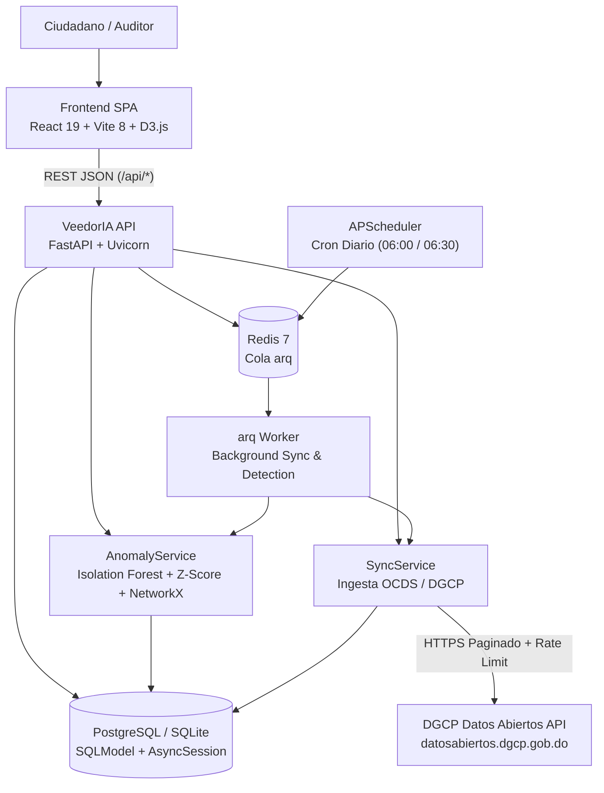

<!-- scanner:2026-10-18 -->
# System Design

> 📋 Generado por `project-scanner` el 2026-10-18 a partir del análisis del monorepo `veedoria-monorepo`.

## Overview
**VeedorIA** es una plataforma de monitoreo y auditoría inteligente de contrataciones públicas para la República Dominicana basada en el estándar OCDS y la API de Datos Abiertos de la DGCP. Combina un frontend SPA en **React 19 + TypeScript 6 + Vite 8 + D3.js** con un backend asíncrono en **FastAPI + SQLModel + PostgreSQL/SQLite**, procesamiento distribuido de ingesta y detección mediante **arq + Redis 7**, y algoritmos de Machine Learning (**Isolation Forest**, **Z-Score**) y teoría de grafos (**NetworkX**) para identificar sobreprecios, fraccionamiento de contratos y redes de colusión.

## Architecture Diagram

### Production Infrastructure (`docs/diagrams/infrastructure.png`)

### Local Development Infrastructure (`docs/diagrams/infrastructure-dev.png`)

## Components
| Component | Technology | Purpose | Owner |
|-----------|-----------|---------|-------|
| Frontend SPA (`app/frontend`) | React 19, TypeScript 6, Vite 8, TailwindCSS 4, HeroUI, D3.js, TanStack Query | Portal cívico bilingüe, verificador de precios y consola interactiva de auditoría de anomalías | Frontend |
| VeedorIA API (`app/backend`) | Python 3.11+, FastAPI, Uvicorn, Pydantic v2 | Exposición de endpoints REST (`/api/anomalies`, `/api/sync`, `/api/public`, `/api/auth`), validación y manejo global de errores | Backend |
| Auth & Multi-Tenant Engine (`auth_service.py`) | PyJWT, bcrypt, SQLModel | Autenticación JWT, recuperación de clave, aislamiento por organización suscriptora (`B2G`, `B2B`, `Global`) y RBAC relacional (4 roles, 13 permisos) | Backend / Security |
| Public Portal Engine (`public_portal_service.py`) | SQLAlchemy 2.0 Async | Buscador ciudadano multi-token con expansión de sinónimos, Sankey presupuestario, mapa provincial, comparador de precios y rankings | Backend |
| Anomaly Engine (`anomaly_service.py`) | scikit-learn, NetworkX, pandas, numpy, rapidfuzz | Detección de sobreprecios, fraccionamiento y grafos de colusión con bucle de retroalimentación (`DetectionConfig`) | Backend / Data |
| Sync Engine (`sync_service.py`, `dgcp_client.py`) | httpx, openpyxl, SQLModel | Ingesta incremental y completa desde la API OCDS de la DGCP e importación de catálogos JSON/XLSX | Backend |
| Async Worker (`arq_worker.py`) | arq 0.28 + Redis 7 + APScheduler | Ejecución en segundo plano de sincronizaciones masivas y corridas de detección sin bloquear el event loop HTTP | Platform / Backend |

## Infrastructure
<!-- scanner:2026-10-18 -->

| Resource | Service | Environment | Notes |
|----------|---------|-------------|-------|
| API Server (`veedoria-api`) | Docker (`python:3.12-slim`) / Render Web Service | dev / prod | Expone puerto `8000` (Docker/Render) o `3001` (dev local) |
| Background Worker (`veedoria-worker`) | Docker / Render Worker (`python -m arq src.cli.arq_worker.WorkerSettings`) | dev / prod | Procesa tareas `run_sync` y `run_detection` |
| Queue / Cache (`veedoria-redis`) | `redis:7-alpine` / Render Redis | dev / prod | Cola de trabajos asíncronos y coordinación de workers |
| Database | SQLite (`aiosqlite`) / PostgreSQL (`asyncpg`) | dev / prod | 10 tablas gestionadas con Alembic (`app/backend/migrations/`) |

## Ambientes
| Aspecto | Local | Preview (PR) | DEV / QA (`dev`) | CERT (`cert` / `release/*`) | PROD (`main`) |
|---------|-------|--------------|------------------|-----------------------------|---------------|
| Frontend SPA | Vite Dev (`:5173`) | Vercel PR Preview (`pr-{N}`) | `https://dev.veedoria.do` | `https://cert.veedoria.do` | `https://veedoria.do` |
| Instancias API | Uvicorn (`:3001`) / Docker | Consume API DEV | `veedoria-api-dev` | `veedoria-api-cert` | `veedoria-api` (Render) |
| Worker `arq` | Proceso local / Docker | Comparte Worker DEV | `veedoria-worker-dev` | `veedoria-worker-cert` | `veedoria-worker` |
| Base de datos | SQLite (`veedoria.db`) o PG local | PostgreSQL DEV | PostgreSQL DEV | PostgreSQL CERT (aislado) | PostgreSQL PROD (`asyncpg`) |
| Redis | `localhost:6379/0` | Redis DEV | `veedoria-redis-dev` | `veedoria-redis-cert` | `veedoria-redis` |
| Promoción / Gate | Manual | Auto por PR (auto-cleanup) | Auto en merge a `dev` | Manual · Gate: **Dev + QA** | Manual + Tag `vX.Y.Z` · Gate: **Dev + QA + BA** |
| Migraciones DB | `alembic upgrade head` | — | Pre-deploy automático | Pre-deploy con rollback en fallo | Pre-deploy con aprobación manual |

## Escalabilidad
- **Desacoplamiento de cargas pesadas**: La ingesta de datos DGCP y la ejecución de algoritmos ML/grafos se delegan a workers `arq` sobre Redis (`202 Accepted`), manteniendo baja la latencia de lectura en la API.
- **Procesamiento por lotes**: La sincronización procesa registros en lotes configurables (`SYNC_BATCH_SIZE = 500`) con control de tasa (`SYNC_RATE_LIMIT = 5.0` req/s).
- **Cuellos de botella conocidos**:
  - Conteo e hidratación de contexto de anomalías sobre grandes volúmenes de contratos → mitigado mediante índices compuestos (`c5a7d2e8f1b0_add_performance_indexes.py`) y filtrado de enlaces de colusión por proveedores de la anomalía actual.
  - Concurrencia de escritura en SQLite local → uso de PostgreSQL (`asyncpg`) para cargas concurrentes en Docker/producción.

## Observabilidad
| Tipo | Herramienta | Detalle |
|------|------------|---------|
| Logs | Python `logging` (`veedoria.app`, `veedoria.*`) | Formato estructurado `%(asctime)s \| %(name)s \| %(levelname)s \| %(message)s` |
| Auditoría de Jobs | Tabla `sync_log` (`GET /api/sync/status`) | Registra inicio, fin, registros procesados, tipo de sync/detección, errores y recuperación ante reinicios (`server_restart`) |
| Auditoría de Negocio | Tabla `audit_log` | Trazabilidad de cambios de estado (`old_value`, `new_value`, `user_id`, `ip_address`) al revisar anomalías |
| Health checks | `redis-cli ping` en Docker Compose + `/api/sync/status` | Verificación de disponibilidad de cola y estado de sincronización |

## Cost Estimation
### Monthly Estimate
| Service | Spec | Price/month | Free Tier | Notes |
|---------|------|-------------|-----------|-------|
| Render Web Service (`veedoria-api`) | Plan Free / Starter Docker | \$0.00 - \$7.00 | Free plan configurado en `render.yaml` | Servicio HTTP principal |
| Render Background Worker (`veedoria-worker`) | Plan Free / Starter Docker | \$0.00 - \$7.00 | Definido en `render.yaml` | Worker `arq` |
| Render Redis (`veedoria-redis`) | Plan Free (25MB) | \$0.00 | Free tier en `render.yaml` | Cola de jobs |
| PostgreSQL (Supabase / Render) | Free / Micro tier | \$0.00 - \$15.00 | Hasta 500MB en tier gratuito | Base de datos relacional |
| **Total estimado (con free tier)** | | **\$0.00/mes** | | Configuración actual en `render.yaml` |

### Cost Scaling
- Al superar el límite de memoria o almacenamiento del tier gratuito de PostgreSQL (>500MB por histórico completo de contratos e ítems OCDS), escalar a plan gestionado (~$15-$25/mes) y worker dedicado con ≥1GB RAM para ejecución de `scikit-learn` y `NetworkX`.

## Motor Analítico B2G, Umbrales por Modalidad DGCP y Marco Legal (Ley 340-06)

### 1. Procesamiento de Datos Abiertos OCDS y Separación del Ruido de Catalogación CBS/UNSPSC
- **Limitación estructural del dataset OCDS/DGCP**: En las contrataciones públicas dominicanas es frecuente que las unidades operativas agrupen múltiples renglones heterogéneos de una obra o servicio bajo un mismo código genérico del **Catálogo de Bienes y Servicios (CBS / UNSPSC)** (por ejemplo, clasificar todas las partidas de una remodelación hospitalaria bajo `72101507` *Servicio de mantenimiento de edificios*).
- **Cómo distingue VeedorIA el sobreprecio real del ruido de catalogación**:
  1. En `get_anomaly_context`, el sistema identifica el renglón auditado exacto (`is_anomaly = true` únicamente para el `Item` cuyo precio unitario coincide con `anomaly.amount` o presenta el mayor desvío unitario positivo) y construye una **muestra estratificada de hasta 30 puntos** del mismo rubro UNSPSC en el mercado nacional.
  2. Si el contrato evaluado contiene múltiples renglones bajo el mismo `unspsc_code`, el sistema calcula cuántos ítems pertenecen al mismo contrato y activa automáticamente en la UI (`AnomalyDrawer.tsx` y `ComplianceReportsPage.tsx`) una **Observación Técnica de Catalogación (Art. 3 num. 3 Ley 340-06)** advirtiendo al auditor que verifique el Pliego de Condiciones y el Presupuesto Detallado antes de confirmar un sobreprecio.

### 2. Las 3 Ecuaciones y Algoritmos del Motor (`AnomalyService`)

#### A. Detección de Sobreprecios (`PRICE_ANOMALY`)
- **Agrupación por Rubro UNSPSC**: Agrupa todos los ítems adjudicados con igual `unspsc_code` ($n \ge 4$) y calcula la mediana estadística:
  $$\text{Mediana} = \text{median}(P_1, P_2, \dots, P_n)$$
- **Porcentaje de Desviación sobre la Mediana**:
  $$\text{Desviación \%} = \left(\frac{\text{Precio Unitario Adjudicado} - \text{Mediana}}{\text{Mediana}}\right) \times 100$$
- **Evaluación Dual (Machine Learning + Estadística Robusta)**:
  - Cuando el rubro posee $n \ge 30$ registros históricos: aplica **Isolation Forest** (`contamination=0.05`, `random_state=42`) y marca anomalía cuando $\text{score} < 0$ y el precio supera el corte porcentual configurado en `PRICE_VARIATION_PCT_THRESHOLD`.
  - Cuando el rubro posee $4 \le n < 30$ registros: aplica **Z-Score robusto**:
    $$z = \frac{P_i - \mu}{\sigma}, \quad |z| > 2.5$$
- **Severidad Normalizada**: Ponderada por el peso dinámico `PRICE_ANOMALY_WEIGHT` almacenado en `detection_config` y acotada a $[0.0, 1.0]$ con redondeo a 2 decimales.

#### B. Detección de Fraccionamiento Contractual (`FRAGMENTATION`)
- **Condiciones simultáneas de disparo**:
  1. **Misma Institución Convocante** (`Process.institution_id`).
  2. **Ventana Temporal PACC**: Contratos firmados dentro del rango de días configurado en `FRAGMENTATION_WINDOW_DAYS` (por defecto `30` días).
  3. **Similitud Semántica del Objeto/Ítems**: Comparación difusa mediante `rapidfuzz.fuzz.ratio(desc_i, desc_j) >= 70%` entre las descripciones de los artículos contratados.
  4. **Superación del Umbral de la Modalidad DGCP**: El motor extrae la sigla del código del proceso (`Process.dgcp_code`: `-CD-`, `-CM-`, `-CP-`, `-PEIN-`/`-PEPU-`, `-LPN-`/`-LPI-`, `-PEEN-`/`-PEUR-`) y consulta en tiempo real su tope en DOP desde la tabla `detection_config` en PostgreSQL (`THRESHOLD_CD_DOP`, `THRESHOLD_CM_DOP`, `THRESHOLD_CP_DOP`, `THRESHOLD_PEIN_DOP`, `THRESHOLD_LPN_DOP`, `THRESHOLD_PEEN_DOP`, `FRAGMENTATION_THRESHOLD_DOP`).
- **Agrupación Completa por Proceso Fraccionado**: En `get_anomaly_context`, **todos los contratos que pertenecen al proceso observado (`Contract.process_id == anomaly.process_id`)** se marcan con `is_alert = true` (barras rojas en `FragmentationBarChart.tsx`) y su suma acumulada total se contrasta frente al tope legal de la modalidad.

#### C. Detección de Redes de Colusión (`COLLUSION`)
- **Grafo Bipartito y Proyección de Co-Adjudicación**: Construye un grafo `NetworkX` entre instituciones, procesos y proveedores, detectando comunidades densas mediante la **heurística de Louvain** (`community_louvain`) y similitud textual de ofertas mediante **TF-IDF de n-gramas de caracteres + Similitud del Coseno**.
- **Cruces Determinísticos de Vinculación Societaria**: Evalúa coincidencias exactas o normalizadas entre competidores de un mismo proceso en: (1) teléfono de contacto (`phone`), (2) dirección física (`address`), (3) dominio corporativo de correo (`email`), (4) proximidad secuencial de RNC/RPE y (5) concentración atípica de adjudicaciones (>60% de los contratos de una unidad de compra).

### 3. Guía Práctica de Dictamen para el Auditor (Ley 340-06 · Reglamento 416-23 · Ley 42-08 · Ley 155-17)

| Categoría | Base Legal Primaria | Cuándo CONFIRMAR el Hallazgo (`CONFIRMED`) | Cuándo DESCARTAR el Hallazgo (`DISMISSED`) |
|-----------|---------------------|--------------------------------------------|--------------------------------------------|
| **Sobreprecio (`PRICE_ANOMALY`)** | **Ley 340-06** Art. 3 (Eficiencia y Economía) · **Decreto 416-23** Arts. 96–97 (Razonabilidad del Precio) | El bien o servicio adjudicado es homogéneo respecto a su código UNSPSC y su precio unitario supera injustificadamente la mediana del mercado sin soporte en costos de transporte, urgencia o especificaciones técnicas superiores. | **Ruido de Catalogación CBS/UNSPSC**: La unidad de compra utilizó un código UNSPSC genérico para agrupar múltiples partidas distintas de una obra o lote global (verificable en el Pliego de Condiciones). |
| **Fraccionamiento (`FRAGMENTATION`)** | **Ley 340-06** Arts. 16 y 17 Párrafo I · **Decreto 416-23** Art. 62 (Presunción de Fraccionamiento en PACC) y Arts. 65–66 | La institución subdividió una misma necesidad previsible en el PACC en 2 o más contratos dentro de la ventana temporal cuya suma acumulada obligaba a convocar una modalidad de mayor concurrencia (ej. Licitación Pública en vez de Comparación de Precios). | **División Legítima por Lotes o Excepción Certificada**: (a) El proceso fue convocado legalmente dividido en lotes geográficos para fomentar participación MiPyME, o (b) corresponde a una Excepción por Emergencia Nacional (`-PEEN-`/`-PEUR-`) amparada por Decreto Presidencial o Resolución motivada de la MAE (Art. 6 Párrafo Ley 340-06). |
| **Colusión (`COLLUSION`)** | **Ley 340-06** Arts. 3 nums. 2 y 6, 11, 14 y 66 Párrafo II · **Ley 42-08** Art. 5 · **Ley 155-17** (Beneficiario Final) | Se comprueba en el Registro Mercantil y en la **Declaración Jurada de Beneficiario Final (Ley 155-17)** que los oferentes comparten socios, administradores, apoderados, domicilio operativo o coordinación de posturas para simular competencia. | **Coincidencia Nominal o Consorcio Declarado**: Los proveedores participan bajo un Consorcio formalmente constituido en el expediente o la coincidencia geográfica corresponde a un centro empresarial/provincia sin vínculo societario ni de control real. |

## Key Decisions
- **Arquitectura Limpia en Monorepo**: Separación estricta de `domain`, `infrastructure`, `models`, `services` y `presentation` en `app/backend` y `app/frontend`.
- **Bucle de Retroalimentación Cerrado (`DetectionConfig`)**: Las confirmaciones y descartes de los auditores ajustan dinámicamente los pesos y umbrales de detección sin requerir redespliegue de código.
- **Doble Motor de Base de Datos Asíncrono**: Soporte transparente para `sqlite+aiosqlite` en desarrollo ligero y `postgresql+asyncpg` en contenedores y producción.

---
_Last updated: 2026-10-20 by implementer (added herramientas-auditoria-b2g, DGCP modality thresholds & Law 340-06 framework)_