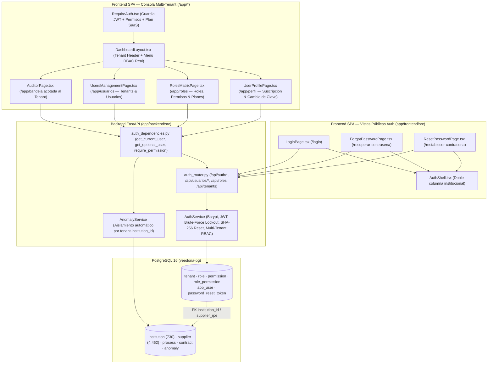
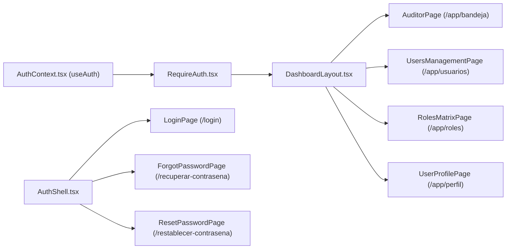
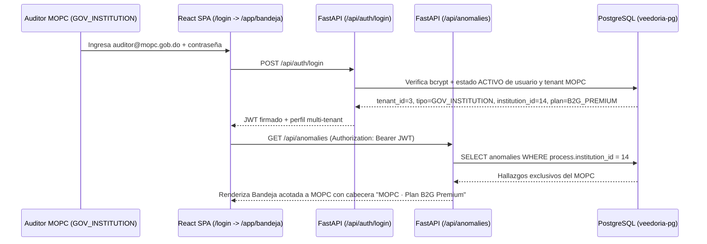

# Design: Autenticación Institucional Multi-Tenant, Usuarios y Control de Acceso Relacional (`autenticacion-rbac`)

> 📋 Generated by `solution-designer` · 2026-10-19
> ✅ Approved by: Jeremy Michel Solano Frías (2026-10-19)

## Traceability
- **Work Item**: Pendiente (sin PBI/Feature en ADO)
- **Parent**: [veedoria-core](../intake.md)
- **Branch**: `dev`
- **Requirements**: [requirements.md](./requirements.md)
- **Test Plan**: [test-plan.md](./test-plan.md)
- **Test Cases**: [test-cases.md](./test-cases.md)

## Technology Decisions
- **Frontend**: **React `^19.2.6` + TypeScript `~6.0.2` + Vite `^8.0.12` + TailwindCSS `^4.3.1` + TanStack React Query `^5.99.0` + `react-router-dom` `^7.14.0` + `lucide-react` `^1.16.0`** — Implementa el `AuthShell` institucional de doble columna (`/login`, `/recuperar-contrasena`, `/restablecer-contrasena`), el contexto de sesión `AuthProvider` + guardia de rutas `RequireAuth`, y las vistas de administración y autoservicio bajo `/app` (`/app/perfil`, `/app/usuarios`, `/app/roles`), eliminando el selector ficticio `"Simular Rol"` de `DashboardLayout.tsx`.
- **Backend & Security**: **Python `3.12+` / `3.14` + FastAPI `^0.135.3` + SQLModel / SQLAlchemy Async `^2.0.49` (`asyncpg`) + `bcrypt` + `PyJWT` (`HS256`) + `secrets` / `hashlib` (`SHA-256`)** — Cifrado de contraseñas con `bcrypt` (`rounds=10`), emisión y verificación de tokens JWT con claims multi-tenant (`sub`, `email`, `rol`, `tenant_id`, `tenant_type`, `plan_tier`, `institution_id`, `supplier_rpe`, `permisos`), bloqueo temporal de 15 minutos tras 5 intentos fallidos consecutivos, y dependencias `get_current_user` / `require_permission` que inyectan automáticamente el alcance del `Tenant` en los servicios de negocio.
- **Database**: **PostgreSQL 16 (`veedoria-pg`)** — Nuevas tablas relacionales normalizadas `tenant`, `role`, `permission`, `role_permission`, `app_user` y `password_reset_token` vinculadas mediante claves foráneas a `institution.id` (para tenants `GOV_INSTITUTION`) y `supplier.rpe` (para tenants `B2B_SUPPLIER`).
- **Cloud Services**: Despliegue `monorepo-split` (SPA en Vercel/CDN + API FastAPI en contenedor Docker sobre Render/AWS ECS) con promoción multi-ambiente `dev → cert → main`.
- **Theme**: `govtech` (*El Observatorio Dominicano* — Navy institucional `#0F172A` / `#003D9B`, superficies limpias, tipografías `Manrope` / `Plus Jakarta Sans`, `Inter` y `JetBrains Mono`, sin insignias decorativas artificiales).

## Architecture

### System Overview


### Component Diagram


## Deployment
- **Pattern**: `monorepo-split` (Frontend React 19 + Vite y Backend FastAPI asíncrono).
- **App**: Frontend en Vercel/CDN y Backend en contenedor Docker sobre Render/AWS ECS.
- **Infra**: PostgreSQL 16 (`veedoria-pg`) + Redis 7 (`backend-redis-1`).
- **CI/CD**: GitHub Actions ejecutando `pytest`, `eslint`, `tsc -b` y `vite build`.
- **Justification**: Implementar el modelo relacional `tenant -> app_user -> role -> role_permission -> permission` directamente en PostgreSQL y validarlo en FastAPI garantiza aislamiento real entre instituciones (B2G) y proveedores (B2B) sin depender de servicios externos de identidad de terceros.
- **Discarded**: Mantener el selector estático `"Simular Rol"` en el cliente sin respaldo en base de datos ni validación de servidor (descartado por carecer de seguridad real y de aislamiento multi-tenant).

### Environments
| Environment | Branch | Frontend URL | Backend API URL | Deploy trigger & Gate |
|-------------|--------|--------------|-----------------|-----------------------|
| **Local** | `feature/*` / `dev` | `http://localhost:5173/login` | `http://127.0.0.1:3001/api/auth` | Manual (`npm run dev` + `uvicorn src.presentation.main:app --port 3001`) |
| **Preview (PR)** | PR hacia `dev` | `https://pr-{N}-veedoria.vercel.app/login` | `https://api-dev.veedoria.do/api/auth` | Automático al abrir/actualizar PR (entorno efímero de revisión) |
| **DEV / QA** | `dev` | `https://dev.veedoria.do/login` | `https://api-dev.veedoria.do/api/auth` | Automático en merge a `dev` tras CI (`pytest` + `eslint` + `tsc -b` + `vite build`) |
| **CERT (Staging)** | `cert` / `release/*` | `https://cert.veedoria.do/login` | `https://api-cert.veedoria.do/api/auth` | Promoción manual `dev → cert` · **Approval Gate: Dev + QA** |
| **PROD** | `main` | `https://veedoria.do/login` | `https://api.veedoria.do/api/auth` | Promoción manual `cert → main` + **Release Tag `vX.Y.Z`** · **Approval Gate: Dev + QA + BA** |

## Database Schema

### Table: `tenant` (Organizaciones suscritas en el modelo SaaS B2G / B2B)
| Column | Type | Constraints | Default | Description |
|--------|------|------------|---------|-------------|
| `id` | `SERIAL / INTEGER` | `PRIMARY KEY` | `autoincrement` | Identificador único del tenant |
| `codigo` | `VARCHAR(40)` | `UNIQUE, NOT NULL` | — | Código único del tenant (`NEXODIGITAL`, `DGCP-OVERSIGHT`, `MOPC-B2G`, `MINERD-B2G`, `CONSTRUCTORA-B2B`) |
| `nombre` | `VARCHAR(180)` | `NOT NULL` | — | Nombre oficial de la institución o empresa suscrita |
| `tipo` | `VARCHAR(30)` | `NOT NULL` | `'GOV_INSTITUTION'` | Segmento (`PLATFORM`, `GOV_OVERSIGHT`, `GOV_INSTITUTION`, `B2B_SUPPLIER`) |
| `plan_tier` | `VARCHAR(30)` | `NOT NULL` | `'B2G_BASIC'` | Plan SaaS (`PLATFORM_GLOBAL`, `B2G_BASIC`, `B2G_PREMIUM`, `B2G_ENTERPRISE`, `B2B_PYME`, `B2B_CORPORATE`) |
| `institution_id` | `INTEGER` | `FK -> institution.id, NULLABLE` | `NULL` | Institución vinculada para aislamiento automático en tenants `GOV_INSTITUTION` |
| `supplier_rpe` | `VARCHAR(50)` | `NULLABLE` | `NULL` | RPE vinculado para aislamiento en tenants `B2B_SUPPLIER` |
| `max_categorias_unspsc` | `INTEGER` | `NOT NULL` | `3` | Límite de rubros UNSPSC (`3` en `B2B_PYME`, `9999` en `B2B_CORPORATE` / `B2G`) |
| `estado` | `VARCHAR(15)` | `NOT NULL` | `'ACTIVO'` | Estado operativo del tenant (`ACTIVO`, `INACTIVO`) |
| `created_at` | `TIMESTAMPTZ` | `NOT NULL` | `NOW()` | Fecha de alta del tenant |
| `updated_at` | `TIMESTAMPTZ` | `NOT NULL` | `NOW()` | Fecha de última actualización |

### Table: `role` (Catálogo relacional de roles)
| Column | Type | Constraints | Default | Description |
|--------|------|------------|---------|-------------|
| `id` | `SERIAL / INTEGER` | `PRIMARY KEY` | `autoincrement` | Identificador único del rol |
| `codigo` | `VARCHAR(30)` | `UNIQUE, NOT NULL` | — | Código del rol (`PLATFORM_ADMIN`, `TENANT_ADMIN`, `AUDITOR`, `PROVEEDOR`) |
| `nombre` | `VARCHAR(100)` | `NOT NULL` | — | Nombre legible del rol |
| `descripcion` | `VARCHAR(255)` | `NOT NULL` | — | Descripción de responsabilidades |
| `es_sistema` | `BOOLEAN` | `NOT NULL` | `true` | Protege los roles base contra eliminación |
| `estado` | `VARCHAR(15)` | `NOT NULL` | `'ACTIVO'` | Estado del rol (`ACTIVO`, `INACTIVO`) |
| `created_at` | `TIMESTAMPTZ` | `NOT NULL` | `NOW()` | Fecha de creación |

### Table: `permission` (Catálogo de permisos atómicos y plan mínimo)
| Column | Type | Constraints | Default | Description |
|--------|------|------------|---------|-------------|
| `id` | `SERIAL / INTEGER` | `PRIMARY KEY` | `autoincrement` | Identificador del permiso |
| `codigo` | `VARCHAR(50)` | `UNIQUE, NOT NULL` | — | Código (`ANOMALY_READ`, `ANOMALY_REVIEW`, `DETECTION_RUN`, `COLLUSION_VIEW`, `PRICE_AI_VIEW`, `SYNC_TRIGGER`, `AI_CALIBRATE`, `B2B_ANALYTICS`, `USER_ADMIN`, `TENANT_ADMIN`, `ROLE_VIEW`) |
| `modulo` | `VARCHAR(30)` | `NOT NULL` | — | Módulo (`AUDITORIA`, `DETECCION`, `PROCESOS`, `PROVEEDORES`, `SEGURIDAD`) |
| `plan_minimo` | `VARCHAR(30)` | `NOT NULL` | `'ALL'` | Plan mínimo que desbloquea la capacidad (`ALL`, `B2G_BASIC`, `B2G_PREMIUM`, `B2G_ENTERPRISE`, `B2B_PYME`, `B2B_CORPORATE`, `PLATFORM_GLOBAL`) |
| `descripcion` | `VARCHAR(255)` | `NOT NULL` | — | Descripción de la capacidad |

### Table: `role_permission` (Relación M:N entre Roles y Permisos)
| Column | Type | Constraints | Default | Description |
|--------|------|------------|---------|-------------|
| `role_id` | `INTEGER` | `PRIMARY KEY, FK -> role.id (ON DELETE CASCADE)` | — | Rol asociado |
| `permission_id` | `INTEGER` | `PRIMARY KEY, FK -> permission.id (ON DELETE CASCADE)` | — | Permiso concedido |

### Table: `app_user` (Directorio de cuentas institucionales multi-tenant)
| Column | Type | Constraints | Default | Description |
|--------|------|------------|---------|-------------|
| `id` | `SERIAL / INTEGER` | `PRIMARY KEY` | `autoincrement` | Identificador único del usuario |
| `tenant_id` | `INTEGER` | `FK -> tenant.id (ON DELETE RESTRICT), NOT NULL` | — | Organización (`Tenant`) a la que pertenece el usuario |
| `role_id` | `INTEGER` | `FK -> role.id (ON DELETE RESTRICT), NOT NULL` | — | Rol relacional asignado |
| `nombre` | `VARCHAR(140)` | `NOT NULL` | — | Nombre completo del usuario |
| `correo` | `VARCHAR(160)` | `UNIQUE, NOT NULL` | — | Correo institucional normalizado en minúsculas |
| `password_hash` | `VARCHAR(255)` | `NOT NULL` | — | Hash criptográfico bcrypt (`cost >= 10`) |
| `cargo` | `VARCHAR(120)` | `NULLABLE` | `NULL` | Cargo institucional o empresarial |
| `estado` | `VARCHAR(15)` | `NOT NULL` | `'ACTIVO'` | Estado (`ACTIVO`, `INACTIVO`) |
| `intentos_fallidos` | `INTEGER` | `NOT NULL` | `0` | Contador de intentos fallidos consecutivos |
| `bloqueado_hasta` | `TIMESTAMPTZ` | `NULLABLE` | `NULL` | Fecha/hora UTC hasta la cual la cuenta está bloqueada (15 min) |
| `ultimo_acceso_at` | `TIMESTAMPTZ` | `NULLABLE` | `NULL` | Fecha/hora UTC del último login exitoso |
| `created_at` | `TIMESTAMPTZ` | `NOT NULL` | `NOW()` | Fecha de creación |
| `updated_at` | `TIMESTAMPTZ` | `NOT NULL` | `NOW()` | Fecha de actualización |

### Table: `password_reset_token` (Tokens SHA-256 de recuperación de contraseña)
| Column | Type | Constraints | Default | Description |
|--------|------|------------|---------|-------------|
| `id` | `SERIAL / INTEGER` | `PRIMARY KEY` | `autoincrement` | Identificador del registro |
| `token_hash` | `VARCHAR(64)` | `UNIQUE, NOT NULL` | — | Digest `SHA-256` del token aleatorio de 32 bytes |
| `user_id` | `INTEGER` | `FK -> app_user.id (ON DELETE CASCADE), NOT NULL` | — | Usuario propietario |
| `expira_at` | `TIMESTAMPTZ` | `NOT NULL` | — | Expiración estricta a los 15 minutos |
| `utilizado` | `BOOLEAN` | `NOT NULL` | `false` | Indicador de consumo único |
| `created_at` | `TIMESTAMPTZ` | `NOT NULL` | `NOW()` | Fecha de emisión |

### Indexes
| Name | Columns | Type |
|------|---------|------|
| `ix_app_user_correo` | `app_user(correo)` | `B-Tree UNIQUE` |
| `ix_app_user_tenant_id` | `app_user(tenant_id)` | `B-Tree` |
| `ix_app_user_role_id` | `app_user(role_id)` | `B-Tree` |
| `ix_tenant_codigo` | `tenant(codigo)` | `B-Tree UNIQUE` |
| `ix_password_reset_token_hash` | `password_reset_token(token_hash)` | `B-Tree UNIQUE` |

## API Contracts

### POST /api/auth/login
- **Request**:
```json
{
  "correo": "auditor@mopc.gob.do",
  "password": "VeedorIA2026!"
}
```
- **Response** (`200 OK`):
```json
{
  "data": {
    "access_token": "eyJhbGciOiJIUzI1NiIs...",
    "token_type": "bearer",
    "expires_in": 28800,
    "user": {
      "id": 3,
      "nombre": "Ing. Roberto Méndez",
      "correo": "auditor@mopc.gob.do",
      "cargo": "Auditor Interno de Compras",
      "estado": "ACTIVO",
      "rol": {
        "id": 3,
        "codigo": "AUDITOR",
        "nombre": "Auditor Institucional B2G"
      },
      "tenant": {
        "id": 3,
        "codigo": "MOPC-B2G",
        "nombre": "Ministerio de Obras Públicas y Comunicaciones (MOPC)",
        "tipo": "GOV_INSTITUTION",
        "plan_tier": "B2G_PREMIUM",
        "institution_id": 14,
        "supplier_rpe": null,
        "max_categorias_unspsc": 9999
      },
      "permisos": [
        "ANOMALY_READ",
        "ANOMALY_REVIEW",
        "DETECTION_RUN",
        "COLLUSION_VIEW",
        "PRICE_AI_VIEW",
        "PROCESS_READ"
      ]
    }
  }
}
```
- **Auth**: Público.
- **Errors**: `401 INVALID_CREDENTIALS`, `403 USER_OR_TENANT_INACTIVE`, `429 ACCOUNT_LOCKED`.
- **Maps to**: REQ-001, REQ-002.

### GET /api/auth/me
- **Request**: Header `Authorization: Bearer <token>`.
- **Response** (`200 OK`): Retorna el objeto `user` actualizado desde PostgreSQL con su `rol`, `tenant` y `permisos` efectivos.
- **Auth**: Requerido (`Bearer JWT`).
- **Errors**: `401 UNAUTHORIZED`, `403 USER_OR_TENANT_INACTIVE`.
- **Maps to**: REQ-002, REQ-010.

### POST /api/auth/logout
- **Request**: `{}`
- **Response** (`200 OK`): `{"data": {"success": true, "message": "Sesión cerrada correctamente."}}`
- **Auth**: Público / Bearer.
- **Maps to**: REQ-003.

### POST /api/auth/forgot-password
- **Request**: `{"correo": "auditor@mopc.gob.do"}`
- **Response** (`200 OK`):
```json
{
  "data": {
    "message": "Si el correo ingresado coincide con una cuenta activa, recibirá un enlace para restablecer su contraseña en breve.",
    "reset_url_preview": "/restablecer-contrasena?token=8f9a..."
  }
}
```
- **Auth**: Público.
- **Errors**: `429 RATE_LIMIT_EXCEEDED` (si solicita otro token en `< 2` minutos).
- **Maps to**: REQ-005.

### POST /api/auth/reset-password
- **Request**:
```json
{
  "token": "8f9a...",
  "nueva_password": "NuevaPassword2026!",
  "confirmar_password": "NuevaPassword2026!"
}
```
- **Response** (`200 OK`): `{"data": {"success": true, "message": "Contraseña restablecida exitosamente."}}`
- **Auth**: Público (con token criptográfico).
- **Errors**: `400 INVALID_OR_EXPIRED_RESET_TOKEN`, `422 PASSWORD_POLICY_VIOLATION`.
- **Maps to**: REQ-006.

### PUT /api/auth/change-password
- **Request**:
```json
{
  "password_actual": "VeedorIA2026!",
  "nueva_password": "ClaveActualizada2026!",
  "confirmar_password": "ClaveActualizada2026!"
}
```
- **Response** (`200 OK`): `{"data": {"success": true, "message": "Contraseña actualizada exitosamente."}}`
- **Auth**: Requerido (`Bearer JWT`).
- **Errors**: `400 CURRENT_PASSWORD_INCORRECT`, `422 NEW_PASSWORD_INVALID`.
- **Maps to**: REQ-007.

### GET /api/usuarios, POST /api/usuarios, PUT /api/usuarios/{user_id}
- **Request / Response**: Listado de usuarios con su `rol` y `tenant` (acotado al `tenant_id` del solicitante si es `TENANT_ADMIN`, o global si es `PLATFORM_ADMIN`); creación y edición de usuarios con validación de contraseña y rol.
- **Auth**: Requerido (`USER_ADMIN`).
- **Errors**: `400 CANNOT_DEACTIVATE_SELF_ADMIN`, `403 CROSS_TENANT_FORBIDDEN`, `409 USER_DUPLICATE_EMAIL`, `422 WEAK_PASSWORD`.
- **Maps to**: REQ-004.

### POST /api/usuarios/{user_id}/unlock & POST /api/usuarios/{user_id}/reset-link
- **Response** (`200 OK`): Desbloquea la cuenta (`intentos_fallidos = 0`, `bloqueado_hasta = NULL`) o genera un enlace temporal `/restablecer-contrasena?token=...`.
- **Auth**: Requerido (`USER_ADMIN`).
- **Maps to**: REQ-008.

### GET /api/tenants, POST /api/tenants, PUT /api/tenants/{tenant_id}
- **Response** (`200 OK`): Lista las organizaciones suscritas (`tenants`) con su `tipo`, `plan_tier`, `institution_id`, `supplier_rpe`, conteo de usuarios y estado; permite cambiar el `plan_tier` (ej. de `B2G_BASIC` a `B2G_PREMIUM` o `B2G_ENTERPRISE`) o registrar un nuevo tenant.
- **Auth**: Requerido (`USER_ADMIN` / `TENANT_ADMIN`).
- **Maps to**: REQ-004, REQ-009.

### GET /api/roles
- **Response** (`200 OK`): Retorna el catálogo de `roles`, la lista completa de `permisos` agrupados por módulo y la matriz de planes SaaS (`B2G_BASIC`, `B2G_PREMIUM`, `B2G_ENTERPRISE`, `B2B_PYME`, `B2B_CORPORATE`).
- **Auth**: Requerido (`Bearer JWT`).
- **Maps to**: REQ-009.

## Key Flows

### Flow 1: Autenticación Multi-Tenant e Inyección Automática de Alcance en Bandeja (`/api/anomalies`)


## Security & Performance
- **Bcrypt Cost 10 + SHA-256**: Contraseñas cifradas con `bcrypt.hashpw(..., bcrypt.gensalt(rounds=10))` y tokens de recuperación con `hashlib.sha256(raw_token.encode()).hexdigest()`.
- **Multi-Tenant Server Enforcement**: `GET /api/anomalies` y `GET /api/anomalies/stats` leen el usuario autenticado mediante `get_optional_user`: si la petición proviene de un usuario autenticado cuyo tenant es `GOV_INSTITUTION`, el servidor fuerza `institution_id = user.tenant.institution_id` en las consultas SQL.

## Approval
- [x] Developer: Jeremy Michel Solano Frías Date: 2026-10-19

---
> 📍 Pendiente (sin PBI/Feature en ADO) · 🌿 `dev` · Generated by SDD Standard