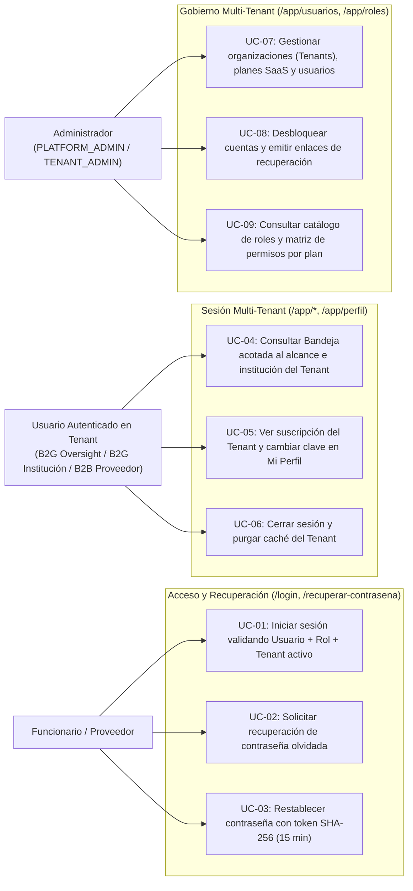
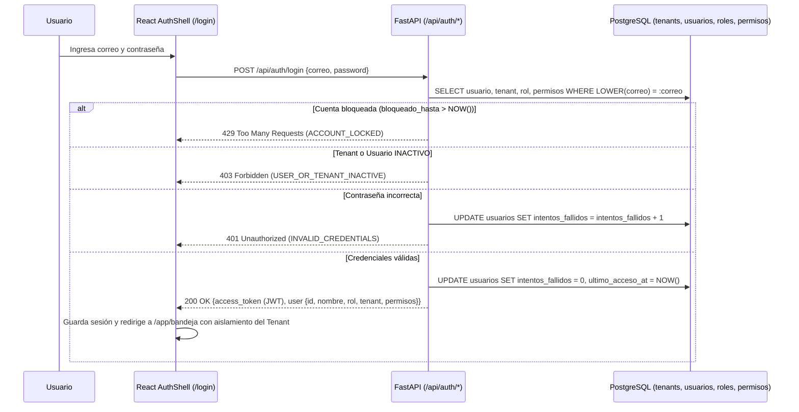

# Requirements: Autenticación Institucional Multi-Tenant, Usuarios y Control de Acceso Relacional (`autenticacion-rbac`)

> 📋 Generated by `requirements-analyst` · 2026-10-19
> ✅ Approved by: Jeremy Michel Solano Frías (2026-10-19)

## Traceability
- **Work Item**: Pendiente (sin PBI/Feature en ADO)
- **Parent**: [veedoria-core](../intake.md)
- **Branch**: `dev`
- **Design**: [design.md](./design.md)
- **Test Plan**: [test-plan.md](./test-plan.md)
- **Test Cases**: [test-cases.md](./test-cases.md)

## Overview
El módulo **Autenticación Institucional Multi-Tenant, Usuarios y Control de Acceso Relacional (`autenticacion-rbac`)** es la capa transversal de seguridad, aislamiento multi-inquilino (*Multi-Tenancy*), gobierno de identidades y autorización granular de **VeedorIA** (**NexoDigital Solutions, S.R.L.**), construida con el rigor arquitectónico del módulo `00-autenticacion-rbac` de `activos_fijos_system` y adaptada al modelo de negocio SaaS de VeedorIA (**Gobierno B2G** y **Proveedores B2B**).

Cada organización suscrita opera como un **Tenant (`Tenant`)** con un tipo de segmento (`GOV_OVERSIGHT` para entes rectores con alcance nacional como DGCP/Contraloría, `GOV_INSTITUTION` para ministerios/ayuntamientos vinculados a su `institution_id`, `B2B_SUPPLIER` para empresas proveedoras vinculadas a su `supplier_rpe`, y `PLATFORM` para la administración global de NexoDigital) y un **Plan SaaS (`plan_tier`)** que gobierna las capacidades contratadas:
- **Planes B2G (`B2G_BASIC`, `B2G_PREMIUM`, `B2G_ENTERPRISE`)**: `B2G_BASIC` habilita monitoreo de fraccionamiento y concentración de su institución; `B2G_PREMIUM` y `B2G_ENTERPRISE` desbloquean detección de sobreprecios con IA, grafos relacionales de colusión y acceso completo a herramientas forenses.
- **Planes B2B (`B2B_PYME`, `B2B_CORPORATE`)**: `B2B_PYME` habilita seguimiento acotado de categorías UNSPSC e historial de precios; `B2B_CORPORATE` desbloquea categorías ilimitadas, analítica competitiva y exportación masiva.

El módulo centraliza el inicio y cierre de sesión con contraseñas cifradas en **bcrypt (`cost >= 10`)**, emisión de sesiones firmadas con **JWT (`HS256`)** que portan los claims de identidad, rol (`ADMIN`, `TENANT_ADMIN`, `AUDITOR`, `PROVEEDOR`), permisos relacionales y contexto del tenant (`tenant_id`, `tenant_type`, `plan_tier`, `institution_id`, `supplier_rpe`), bloqueo automático por fuerza bruta (`5` intentos fallidos = bloqueo de `15` minutos), aislamiento automático de datos por tenant en las consultas (`tenant scoping`), recuperación/restablecimiento de contraseña con token criptográfico `SHA-256` (`15` min), cambio voluntario de clave (`/app/perfil`), gestión de usuarios y tenants (`/app/usuarios`) y matriz de roles y permisos (`/app/roles`).

## User Stories (EARS Notation)

### REQ-001: Inicio de Sesión Multi-Tenant y Mitigación de Fuerza Bruta (`/login` y `POST /api/auth/login`)
**Type:** Event-Driven
**Rule:** WHEN un usuario envía su correo institucional y contraseña en la pantalla de inicio de sesión (`/login`), the system SHALL verificar las credenciales contra el hash bcrypt almacenado (`cost >= 10`) en `usuarios`, comprobar que tanto el usuario (`usuarios.estado == 'ACTIVO'`), su rol (`roles.estado == 'ACTIVO'`) como su organización (`tenants.estado == 'ACTIVO'`) se encuentren activos, verificar que no exista un bloqueo temporal vigente (`bloqueado_hasta > NOW()`), emitir un token de sesión JWT firmado (`HS256`) con la identidad del usuario, su `rol`, su organización (`tenant`: `id`, `nombre`, `codigo`, `tipo`, `plan_tier`, `institution_id`, `supplier_rpe`) y la intersección efectiva de permisos (`permisos` del rol habilitados por el `plan_tier` del tenant), reiniciar `intentos_fallidos = 0`, actualizar `ultimo_acceso_at = NOW()` y redirigir a `callbackUrl` o `/app/bandeja`.
**Entities:** `Tenant` (`id`, `codigo`, `nombre`, `tipo`, `plan_tier`, `institution_id`, `supplier_rpe`, `max_categorias_unspsc`, `estado`, `created_at`, `updated_at`), `Usuario` (`id`, `tenant_id`, `nombre`, `correo`, `password_hash`, `rol_id`, `cargo`, `estado`, `intentos_fallidos`, `bloqueado_hasta`, `ultimo_acceso_at`, `created_at`, `updated_at`), `Rol` (`id`, `codigo`, `nombre`, `descripcion`, `es_sistema`, `estado`)
**Error Handling:** Si el correo no existe o la contraseña no coincide con el hash almacenado, el sistema SHALL incrementar `intentos_fallidos` y responder con `INVALID_CREDENTIALS` (`HTTP 401`: `"Correo institucional o contraseña incorrectos."`). Si el usuario alcanza `5` intentos fallidos consecutivos, el sistema SHALL fijar `bloqueado_hasta = NOW() + INTERVAL '15 minutes'` y responder con `ACCOUNT_LOCKED` (`HTTP 429`: `"Cuenta bloqueada temporalmente por 15 minutos debido a 5 intentos fallidos consecutivos."`). Si el usuario o su tenant tienen `estado = 'INACTIVO'` o `'SUSPENDIDO'`, SHALL responder con `USER_OR_TENANT_INACTIVE` (`HTTP 403`: `"Su cuenta u organización suscrita se encuentra inactiva. Contacte al administrador."`).

**Acceptance Criteria:**
- [x] Given un usuario activo perteneciente a un tenant activo, when ingresa su correo y contraseña válidos en `/login`, then el sistema valida el hash bcrypt, emite el JWT con el contexto del `tenant` (`tipo`, `plan_tier`, `institution_id` / `supplier_rpe`) y sus permisos efectivos, y redirige a `/app/bandeja` (o `callbackUrl`).
- [x] Given un usuario que ingresa una contraseña errónea, when envía el formulario en `/login`, then el sistema incrementa `intentos_fallidos` en PostgreSQL y muestra `"Correo institucional o contraseña incorrectos."` sin revelar si el correo existe.
- [x] Given un usuario que acumula `5` intentos fallidos consecutivos, when realiza el quinto o sexto intento dentro de la ventana de bloqueo, then el sistema fija `bloqueado_hasta = NOW() + 15 minutos` y responde `HTTP 429` bloqueando el acceso.
- [x] Given un usuario cuya cuenta o cuyo tenant tenga `estado = 'INACTIVO'`, when intenta iniciar sesión con su contraseña correcta, then el sistema rechaza el acceso con `HTTP 403`.

**Priority:** Must
**Dependencies:** None
**Tracker:** Pendiente

### REQ-002: Aislamiento de Datos por Tenant (Multi-Tenant Scoping), RBAC Relacional y Entitlements por Plan SaaS (`RequireAuth` y Dependencias FastAPI)
**Type:** Ubiquitous
**Rule:** The system SHALL interceptar toda navegación hacia rutas privadas (`/app/*`) mediante el guardia `RequireAuth` y toda petición a endpoints protegidos en FastAPI mediante las dependencias `get_current_user` y `require_permission(codigo_permiso)`, aplicando dos controles obligatorios:
1. **Aislamiento de alcance por Tenant (`Tenant Scope`)**:
   - Si `tenant.tipo == 'GOV_INSTITUTION'` (ej. un ministerio o ayuntamiento con `institution_id` asignado), las consultas y acciones en consola se acotan automáticamente a los procesos, contratos y anomalías de su `institution_id`.
   - Si `tenant.tipo == 'GOV_OVERSIGHT'` (ej. DGCP / Contraloría) o `'PLATFORM'`, el alcance abarca todas las instituciones del Estado (`institution_id = NULL` → visión nacional).
   - Si `tenant.tipo == 'B2B_SUPPLIER'` (proveedor del Estado con `supplier_rpe`), su contexto privado se vincula a su `supplier_rpe` y al límite de categorías de su plan (`max_categorias_unspsc = 3` en `B2B_PYME`, ilimitado en `B2B_CORPORATE`).
2. **Autorización combinada (`Rol -> RolPermiso -> Permiso` $\cap$ `Plan SaaS`)**:
   - Un tenant en plan `B2G_BASIC` tiene habilitados los permisos de auditoría base (`ANOMALY_READ`, `FRAGMENTATION_VIEW`), mientras que las capacidades avanzadas (`COLLUSION_NETWORK_VIEW`, `PRICE_AI_VIEW`, `AI_CALIBRATE`) requieren `B2G_PREMIUM`, `B2G_ENTERPRISE` o `PLATFORM_ADMIN`.
**Entities:** `Tenant`, `Usuario`, `Rol`, `RolPermiso`, `Permiso` (`id`, `codigo`, `modulo`, `plan_minimo`, `descripcion`)
**Error Handling:** Si una solicitud navega a `/app/*` sin sesión válida, `RequireAuth` SHALL redirigir a `/login?callbackUrl=[ruta_solicitada]`. Si el usuario carece del permiso exigido por su rol o por el `plan_tier` de su tenant, el backend SHALL responder con `FORBIDDEN_INSUFFICIENT_ROLE_OR_PLAN` (`HTTP 403`: `"Su rol o el plan actual de su organización no incluye permisos para ejecutar esta acción."`).

**Acceptance Criteria:**
- [x] Given un visitante no autenticado, when intenta acceder a `/app/bandeja`, `/app/usuarios`, `/app/roles` o `/app/perfil`, then es redirigido automáticamente a `/login?callbackUrl=...`.
- [x] Given un auditor autenticado perteneciente a un tenant `GOV_INSTITUTION` (ej. Ministerio de Educación con `institution_id` específico), when consulta la Bandeja de Auditoría (`GET /api/anomalies` y `GET /api/anomalies/stats`), then el backend filtra automáticamente los hallazgos y KPIs correspondientes a su institución (`tenant.institution_id`), mientras que un auditor de la `DGCP` (`GOV_OVERSIGHT`) visualiza el universo nacional completo.
- [x] Given un usuario de un tenant con plan `B2G_BASIC`, when visualiza el menú lateral en `DashboardLayout.tsx`, then las funciones exclusivas de planes superiores (`Red de Colusión`, `Configuración IA`) indican que requieren plan `B2G_PREMIUM` / `ENTERPRISE`, mientras que para un tenant `B2G_PREMIUM` o `B2G_ENTERPRISE` se encuentran desbloqueadas.
- [x] Given un usuario con rol `AUDITOR` o `PROVEEDOR` sin permiso `USER_ADMIN`, when intenta acceder a `/app/usuarios` o `/api/usuarios`, then el sistema bloquea el acceso con `HTTP 403`.

**Priority:** Must
**Dependencies:** REQ-001
**Tracker:** Pendiente

### REQ-003: Cierre de Sesión e Invalidación de Estado (`POST /api/auth/logout`)
**Type:** Event-Driven
**Rule:** WHEN un usuario autenticado acciona el botón `"Cerrar Sesión"` en el menú de usuario de `DashboardLayout.tsx`, the system SHALL invocar `POST /api/auth/logout`, eliminar el token JWT y limpiar todas las cachés de React Query (para evitar fugas de datos entre distintos tenants en el mismo navegador) y redirigir inmediatamente a `/login`.
**Entities:** `Usuario`, `Tenant`
**Error Handling:** Si el token ya había expirado al cerrar sesión, el cliente limpia igualmente el almacenamiento local y las cachés en memoria y redirige a `/login`.

**Acceptance Criteria:**
- [x] Given un usuario con sesión activa en `/app/*`, when hace clic en `"Cerrar Sesión"`, then el sistema limpia el token, purga `queryClient.clear()` y redirige a `/login`.
- [x] Given un usuario que cerró sesión e inicia sesión inmediatamente con una cuenta de otro tenant, when carga `/app/bandeja`, then visualiza exclusivamente los datos del nuevo tenant sin residuos en caché de la sesión anterior.

**Priority:** Must
**Dependencies:** REQ-001
**Tracker:** Pendiente

### REQ-004: Gestión Administrativa Multi-Tenant de Organizaciones y Usuarios (`/app/usuarios`, `/api/usuarios` y `/api/tenants`)
**Type:** Ubiquitous
**Rule:** The system SHALL proveer en `/app/usuarios` un directorio administrativo protegido por `USER_ADMIN` donde:
- Un administrador global (`PLATFORM_ADMIN` de NexoDigital) pueda listar, crear y gestionar cualquier `Tenant` (asignando `tipo`, `plan_tier`, `institution_id` o `supplier_rpe`) y crear/editar usuarios en cualquier tenant.
- Un administrador organizacional (`TENANT_ADMIN`) pueda gestionar únicamente los usuarios pertenecientes a su propio `tenant_id` sin ver ni modificar cuentas de otras instituciones o empresas.
**Entities:** `Tenant`, `Usuario`, `Rol`, `Institution`
**Error Handling:** Si el correo ya existe (`LOWER(correo)` duplicado), el backend SHALL responder `USER_DUPLICATE_EMAIL` (`HTTP 409`). Si la contraseña incumple la política (mínimo 8 caracteres, 1 mayúscula y 1 número), SHALL responder `WEAK_PASSWORD` (`HTTP 422`). Si un `TENANT_ADMIN` intenta crear o modificar un usuario con un `tenant_id` distinto al suyo, SHALL responder `CROSS_TENANT_FORBIDDEN` (`HTTP 403`). Si un administrador intenta desactivar su propia cuenta, SHALL responder `CANNOT_DEACTIVATE_SELF_ADMIN` (`HTTP 400`).

**Acceptance Criteria:**
- [x] Given un administrador en `/app/usuarios`, when registra un nuevo usuario indicando nombre, correo institucional, contraseña robusta, rol (`ADMIN`, `TENANT_ADMIN`, `AUDITOR`, `PROVEEDOR`) y organización (`tenant_id`), then el sistema cifra la contraseña con bcrypt, persiste el usuario vinculado al tenant y actualiza el listado.
- [x] Given un administrador en `/app/usuarios`, when visualiza la tabla o las tarjetas de organizaciones suscritas (`Tenants`), then observa el nombre del tenant, su segmento (`B2G Oversight`, `B2G Institución`, `B2B Proveedor`), su plan activo (`B2G Básico`, `B2G Premium`, `B2G Enterprise`, `B2B Pyme`, `B2B Corporativo`), y puede cambiar el plan SaaS del tenant en tiempo real.
- [x] Given un administrador logueado, when intenta inactivar su propia cuenta, then el sistema rechaza la operación con `HTTP 400`.

**Priority:** Must
**Dependencies:** REQ-001, REQ-002
**Tracker:** Pendiente

### REQ-005: Solicitud de Recuperación de Contraseña Olvidada (`/recuperar-contrasena` y `POST /api/auth/forgot-password`)
**Type:** Event-Driven
**Rule:** WHEN un usuario envía su correo institucional en `/recuperar-contrasena`, the system SHALL generar un token criptográfico aleatorio de 32 bytes (`64` caracteres hexadecimales), almacenar únicamente su hash `SHA-256` en `password_reset_tokens` con vigencia exacta de `15` minutos (`expira_at = NOW() + INTERVAL '15 minutes'`, `utilizado = false`), y registrar/emitir el enlace de recuperación `/restablecer-contrasena?token=[TOKEN]`.
**Entities:** `Usuario`, `PasswordResetToken` (`id`, `token_hash`, `usuario_id`, `expira_at`, `utilizado`, `created_at`)
**Error Handling:** Para prevenir enumeración de cuentas, el endpoint SHALL responder siempre con `HTTP 200` y el mensaje neutro: `"Si el correo ingresado coincide con una cuenta activa, recibirá un enlace para restablecer su contraseña en breve."`. Si una misma cuenta solicita otro token antes de transcurrir `2` minutos, el sistema SHALL responder `HTTP 429 RATE_LIMIT_EXCEEDED`.

**Acceptance Criteria:**
- [x] Given un usuario en `/recuperar-contrasena`, when ingresa el correo de una cuenta activa y envía el formulario, then el sistema almacena el hash `SHA-256` del token en `password_reset_tokens` con expiración de 15 minutos y muestra la confirmación neutral.
- [x] Given un correo inexistente, when se envía el formulario, then el sistema no genera token en base de datos y retorna exactamente el mismo mensaje neutral.

**Priority:** Must
**Dependencies:** REQ-001
**Tracker:** Pendiente

### REQ-006: Restablecimiento de Contraseña con Token Criptográfico (`/restablecer-contrasena` y `POST /api/auth/reset-password`)
**Type:** Event-Driven
**Rule:** WHEN un usuario accede a `/restablecer-contrasena?token=[TOKEN]` y envía una nueva contraseña válida junto con su confirmación, the system SHALL calcular el digest `SHA-256` del token, verificar en `password_reset_tokens` que exista, que `utilizado == false` y que `expira_at > NOW()`, actualizar `password_hash` con bcrypt (`cost >= 10`), limpiar `intentos_fallidos = 0` y `bloqueado_hasta = NULL`, y marcar `utilizado = true`.
**Entities:** `Usuario`, `PasswordResetToken`
**Error Handling:** Si el token no existe, ya fue utilizado o expiró, el sistema SHALL responder `INVALID_OR_EXPIRED_RESET_TOKEN` (`HTTP 400`: `"El enlace de recuperación es inválido o ha expirado. Solicite un nuevo enlace."`). Si la nueva contraseña incumple la política de seguridad, SHALL responder `PASSWORD_POLICY_VIOLATION` (`HTTP 422`).

**Acceptance Criteria:**
- [x] Given un token válido y vigente en `/restablecer-contrasena?token=...`, when el usuario ingresa una nueva contraseña robusta y su confirmación, then el sistema actualiza el hash bcrypt, marca el token como `utilizado = true` y redirige a `/login`.
- [x] Given un token expirado o ya utilizado, when el usuario intenta enviar el formulario, then el sistema rechaza el cambio con `HTTP 400`.

**Priority:** Must
**Dependencies:** REQ-005
**Tracker:** Pendiente

### REQ-007: Cambio Voluntario de Contraseña y Resumen de Suscripción en Mi Perfil (`/app/perfil` y `PUT /api/auth/change-password`)
**Type:** Event-Driven
**Rule:** WHEN un usuario autenticado accede a `/app/perfil`, the system SHALL mostrar sus datos de identidad, su rol relacional, los datos de su organización (`Tenant`: nombre, tipo, `plan_tier`, institución o RPE vinculado y permisos activos) y el formulario para actualizar su contraseña verificando primero `password_actual` contra el hash bcrypt almacenado.
**Entities:** `Usuario`, `Tenant`, `Rol`
**Error Handling:** Si `password_actual` es incorrecta, el sistema SHALL responder `CURRENT_PASSWORD_INCORRECT` (`HTTP 400`: `"La contraseña actual no es correcta."`). Si `nueva_password` es igual a la actual o no cumple la política de robustez, SHALL responder `NEW_PASSWORD_INVALID` (`HTTP 422`).

**Acceptance Criteria:**
- [x] Given un usuario autenticado en `/app/perfil`, when visualiza la página, then observa su información de cuenta, el detalle de su organización (`Tenant`) y su plan SaaS activo, y puede actualizar su contraseña ingresando su clave actual correcta y una nueva clave válida.
- [x] Given un intento de cambio de clave en `/app/perfil`, when la contraseña actual es incorrecta, then el sistema rechaza la operación con `HTTP 400`.

**Priority:** Should
**Dependencies:** REQ-001
**Tracker:** Pendiente

### REQ-008: Desbloqueo Administrativo de Cuentas y Enlace Manual de Recuperación (`POST /api/usuarios/{id}/unlock` y `POST /api/usuarios/{id}/reset-link`)
**Type:** Event-Driven
**Rule:** WHEN una cuenta se encuentra bloqueada por intentos fallidos (`bloqueado_hasta > NOW()` o `intentos_fallidos >= 5`) o requiere recuperación asistida, un administrador con permiso `USER_ADMIN` en `/app/usuarios` SHALL poder desbloquearla inmediatamente (`intentos_fallidos = 0`, `bloqueado_hasta = NULL`) o generar un enlace temporal de recuperación de uso único (respetando el aislamiento de `tenant_id` si es `TENANT_ADMIN`).
**Entities:** `Usuario`, `PasswordResetToken`
**Error Handling:** Si un usuario sin permiso `USER_ADMIN` intenta invocar estos endpoints, el backend SHALL responder `HTTP 403 Forbidden`.

**Acceptance Criteria:**
- [x] Given una cuenta bloqueada en `/app/usuarios`, when el administrador presiona `"Desbloquear Cuenta"`, then el sistema limpia `intentos_fallidos = 0` y `bloqueado_hasta = NULL` permitiendo el acceso inmediato.
- [x] Given un usuario en `/app/usuarios`, when el administrador selecciona `"Generar Enlace de Recuperación"`, then el sistema genera un token válido por 15 minutos y entrega la URL de restablecimiento lista para copiar.

**Priority:** Should
**Dependencies:** REQ-001, REQ-004
**Tracker:** Pendiente

### REQ-009: Catálogo de Roles, Matriz de Permisos y Planes SaaS (`/app/roles` y `GET /api/roles`)
**Type:** Ubiquitous
**Rule:** The system SHALL mantener en PostgreSQL el catálogo de roles (`roles`: `PLATFORM_ADMIN`, `TENANT_ADMIN`, `AUDITOR`, `PROVEEDOR`) y la matriz relacional de permisos (`permisos`, `roles_permisos`) con indicación del plan mínimo requerido (`plan_minimo`), permitiendo consultar en `/app/roles` qué permisos otorga cada rol y qué capacidades desbloquea cada plan SaaS (`B2G_BASIC`, `B2G_PREMIUM`, `B2G_ENTERPRISE`, `B2B_PYME`, `B2B_CORPORATE`), protegiendo los roles base (`es_sistema = true`) contra eliminación.
**Entities:** `Rol`, `Permiso`, `RolPermiso`
**Error Handling:** Si se intenta eliminar o desactivar un rol con `es_sistema = true`, el sistema SHALL rechazar la operación con `CANNOT_MODIFY_SYSTEM_ROLE` (`HTTP 400`).

**Acceptance Criteria:**
- [x] Given un usuario autorizado en `/app/roles`, when visualiza la matriz de control de acceso, then observa los roles institucionales, los permisos por módulo (`AUDITORIA`, `PROCESOS`, `DETECCION`, `PROVEEDORES`, `SEGURIDAD`) y la correspondencia con los planes SaaS B2G y B2B.

**Priority:** Should
**Dependencies:** REQ-002
**Tracker:** Pendiente

### REQ-010: Shell de Autenticación (`AuthShell`) y Cabecera Institucional Multi-Tenant en `DashboardLayout`
**Type:** Ubiquitous
**Rule:** The system SHALL presentar las vistas públicas de acceso (`/login`, `/recuperar-contrasena`, `/restablecer-contrasena`) dentro de un `AuthShell` institucional de doble columna (panel izquierdo oscuro con identidad de VeedorIA y narrativa limpia sin badges decorativos de IA; panel derecho con el formulario), y en `DashboardLayout.tsx` SHALL eliminar el selector ficticio `"Simular Rol"`, mostrando en la cabecera y barra lateral el nombre de la organización activa (`tenant.nombre`), su plan SaaS (`tenant.plan_tier`), el nombre y correo reales del usuario autenticado, su rol relacional y el menú con acceso a `"Mi Perfil"` (`/app/perfil`), `"Usuarios y Tenants"` (`/app/usuarios`), `"Roles y Permisos"` (`/app/roles`) y `"Cerrar Sesión"`.
**Entities:** `Usuario`, `Tenant`, `Rol`
**Error Handling:** Mientras el cliente valida el token inicial contra `GET /api/auth/me`, `RequireAuth` muestra un estado de carga limpio sin parpadeos antes de renderizar la vista privada o redirigir a `/login`.

**Acceptance Criteria:**
- [x] Given las pantallas `/login`, `/recuperar-contrasena` y `/restablecer-contrasena`, when se renderizan, then utilizan el `AuthShell` institucional de dos columnas con diseño limpio y sobrio.
- [x] Given un usuario autenticado en `/app/*`, when se renderiza `DashboardLayout.tsx`, then ya no existe el botón `"Simular Rol"`: la barra superior muestra la organización (`tenant.nombre`) y su plan (`B2G Enterprise`, `B2G Básico`, `B2B Corporativo`, etc.), el menú lateral habilita las secciones según los permisos reales de su sesión y el pie del sidebar muestra el usuario real con acceso a `"Mi Perfil"` y `"Cerrar Sesión"`.

**Priority:** Must
**Dependencies:** REQ-001, REQ-002, REQ-003
**Tracker:** Pendiente

## Non-Functional Requirements

### Security
- **Hashing Criptográfico Bcrypt (`NFR-AUTH-001`)**: Todas las contraseñas se almacenan como hashes `bcrypt` con factor de costo `>= 10` rondas; jamás se almacenan ni registran en texto plano.
- **Tokens Criptográficos SHA-256 (`NFR-AUTH-002`)**: Los tokens de restablecimiento de contraseña se generan con `secrets.token_hex(32)` (256 bits) y en base de datos solo se persiste su digest `SHA-256`.
- **Aislamiento Estricto Multi-Tenant (`NFR-AUTH-003`)**: Toda consulta autenticada de un tenant `GOV_INSTITUTION` o `B2B_SUPPLIER` aplica filtrado de alcance en el servidor a partir de los claims verificados del usuario en base de datos, impidiendo que la manipulación de parámetros query exponga datos privados de otro tenant.

### Performance
- **Validación de sesión sub-100ms (`NFR-AUTH-004`)**: La resolución de identidad, tenant, rol y permisos en `GET /api/auth/me` responde en `< 100ms` mediante índices BTREE sobre `LOWER(correo)`, `tenant_id` y `rol_id`.

## Edge Cases & Error Scenarios
| # | Scenario | Expected behavior |
|---|----------|-------------------|
| 1 | Un auditor de un ministerio con plan `B2G_BASIC` intenta invocar un endpoint exclusivo de `B2G_PREMIUM` o consultar datos de otra institución | El backend verifica el `tenant.institution_id` y la intersección de permisos del `plan_tier`, rechazando o acotando la consulta al alcance de su propio tenant. |
| 2 | Un usuario bloqueado por 5 intentos fallidos vuelve a iniciar sesión después de transcurridos los 15 minutos (`bloqueado_hasta <= NOW()`) | El backend limpia automáticamente el bloqueo expirado y valida las credenciales normalmente. |
| 3 | Un administrador suspende un `Tenant` (`tenants.estado = 'INACTIVO'`) mientras sus usuarios tienen sesiones abiertas | En la siguiente petición a `GET /api/auth/me` o a cualquier endpoint protegido, el backend comprueba `tenant.estado == 'ACTIVO'` y revoca el acceso con `HTTP 403`. |

## Diagrams

### Use Case Diagram

### Supporting Diagram

## Dependencies
| Feature | Capability needed | Status | Workaround |
|---------|------------------|--------|------------|
| `ingesta-sincronizacion-dgcp` | Tablas `institution` y `supplier` para vincular cada `Tenant` B2G o B2B a su entidad real en la base de datos | Implementado (`🟢 active`) | — |
| `consola-auditoria` | `DashboardLayout.tsx`, `AuditorPage.tsx` y `/api/anomalies` para aplicar el filtrado automático por `tenant.institution_id` | Implementado (`🟢 active`) | — |

## Assumptions
| # | Assumption | Temporary stub | Replaced when |
|---|-----------|----------------|---------------|
| 1 | El seed inicial creará organizaciones (`tenants`) y cuentas institucionales reales listas para probar todos los escenarios del modelo de negocio: (1) **NexoDigital Platform Admin** (`admin@veedoria.gob.do`), (2) **DGCP — Ente Rector Nacional (`GOV_OVERSIGHT`, `B2G_ENTERPRISE`)** (`auditor@dgcp.gob.do`), (3) **Ministerio de Obras Públicas (`GOV_INSTITUTION`, `B2G_PREMIUM`)** (`auditor@mopc.gob.do`), (4) **Ministerio de Educación (`GOV_INSTITUTION`, `B2G_BASIC`)** (`auditor@minerd.gob.do`), y (5) **Proveedor del Estado (`B2B_SUPPLIER`, `B2B_CORPORATE`)** (`proveedor@constructora.do`) | Cuentas y tenants semilla en PostgreSQL con hashes bcrypt reales | Administrables dinámicamente desde `/app/usuarios` |

## Out of Scope
- Pasarela de cobro automático con tarjeta de crédito (Stripe/Azul); el cambio de plan SaaS (`plan_tier`) de cada tenant se gestiona desde el panel administrativo `/app/usuarios`.

## Approval
- [x] Analyst: Jeremy Michel Solano Frías Date: 2026-10-19

---
> 📍 Pendiente (sin PBI/Feature en ADO) · 🌿 `dev` · Generated by SDD Standard