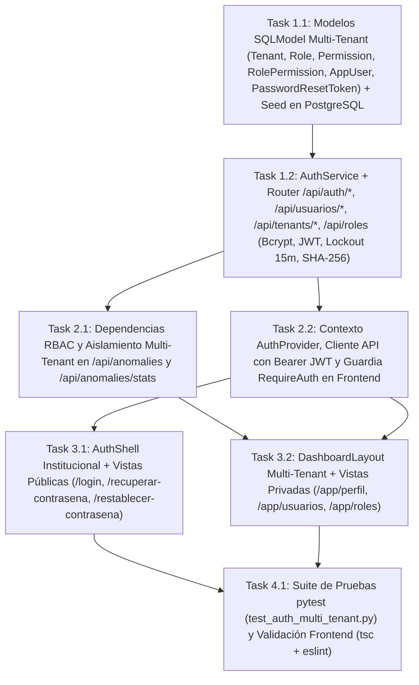

# Tasks: Autenticación Institucional Multi-Tenant, Usuarios y Control de Acceso Relacional (`autenticacion-rbac`)

> 📋 Generated by `solution-designer` · 2026-10-19
> ✅ Approved by: Jeremy Michel Solano Frías (2026-10-19)

## Traceability
- **Work Item**: Pendiente (sin PBI/Feature en ADO)
- **Branch**: `dev`

## Metadata
- **Based on:** [design.md](./design.md)
- **Total estimate:** ~18h (incluye 20% buffer)
- **Number of waves:** 4 (Wave 1, Wave 2, Wave 3, Wave 4)
- **Number of tasks:** 7
- **Sprint:** [TBD]
- **Assignee:** Jeremy Michel Solano Frías

## Estimation Rules

See `estimation-strategy.md` for full estimation rules, AI multipliers, and architecture impact.

**Quick reference:**
- Maximum **4 hours** per task (break larger tasks into subtasks)
- Estimates include implementation + unit tests + code review
- If a task exceeds 4h during implementation, split it immediately
- Add **20% buffer** to total estimate for unknowns
- If using agentic IDEs + SDD: apply multipliers from `estimation-strategy.md` §Scenario B
- Track actual vs estimated for future calibration (see `estimation-strategy.md` §Calibration)

## Dependency Graph

---

## Wave 1: Database Models, Seeding & Backend Auth Engine (~5.5h)

### Task 1.1: Modelos Relacionales Multi-Tenant y Seed Inicial en PostgreSQL (`REQ-001`, `REQ-002`, `REQ-009`) (~2.5h)
- **Description:** Crear `app/backend/src/models/auth.py` con las entidades `Tenant`, `Role`, `Permission`, `RolePermission`, `AppUser` y `PasswordResetToken`, registrarlas en `src/models/__init__.py` y crear la rutina idempotente de inicialización (`ensure_auth_schema_and_seed`) que cree las tablas en PostgreSQL y siembre:
  - Roles base (`PLATFORM_ADMIN`, `TENANT_ADMIN`, `AUDITOR`, `PROVEEDOR`) con `es_sistema = True`.
  - Catálogo de permisos (`ANOMALY_READ`, `ANOMALY_REVIEW`, `DETECTION_RUN`, `COLLUSION_VIEW`, `PRICE_AI_VIEW`, `PROCESS_READ`, `SYNC_TRIGGER`, `AI_CALIBRATE`, `B2B_ANALYTICS`, `USER_ADMIN`, `TENANT_ADMIN`, `ROLE_VIEW`) y su asignación `role_permission`.
  - 5 organizaciones (`Tenant`) vinculadas a instituciones/proveedores reales de la base de datos:
    1. `NEXODIGITAL` (`PLATFORM`, `PLATFORM_GLOBAL`) — `admin@veedoria.gob.do` (`PLATFORM_ADMIN`).
    2. `DGCP-OVERSIGHT` (`GOV_OVERSIGHT`, `B2G_ENTERPRISE`) — `auditor@dgcp.gob.do` (`AUDITOR`).
    3. `MOPC-B2G` (`GOV_INSTITUTION`, `B2G_PREMIUM`, `institution_id` del MOPC) — `auditor@mopc.gob.do` (`AUDITOR`) y `admin@mopc.gob.do` (`TENANT_ADMIN`).
    4. `MINERD-B2G` (`GOV_INSTITUTION`, `B2G_BASIC`, `institution_id` del MINERD) — `auditor@minerd.gob.do` (`AUDITOR`).
    5. `CONSTRUCTORA-B2B` (`B2B_SUPPLIER`, `B2B_CORPORATE`, `supplier_rpe` real) — `proveedor@constructora.do` (`PROVEEDOR`).
- **Acceptance criteria:**
  - [x] Las 6 tablas existen en PostgreSQL (`veedoria-pg`) y el seed es 100% idempotente con contraseñas cifradas en `bcrypt` (`cost=10`).
- **Dependencies:** None
- **Files to create/modify:** `app/backend/src/models/auth.py`, `app/backend/src/models/__init__.py`

### Task 1.2: Servicio `AuthService` y Router `/api/auth/*`, `/api/usuarios/*`, `/api/tenants/*`, `/api/roles` (`REQ-001`, `REQ-003`, `REQ-004`, `REQ-005`, `REQ-006`, `REQ-007`, `REQ-008`, `REQ-009`) (~3h)
- **Description:** Implementar `app/backend/src/services/auth_service.py` y `app/backend/src/presentation/routers/auth_router.py`:
  - `POST /api/auth/login` (verificación bcrypt, control de estado de usuario y tenant, contador `intentos_fallidos`, bloqueo de 15 min al 5.º intento fallido `HTTP 429`, cálculo de permisos efectivos `Rol ∩ Plan SaaS` y emisión de JWT `HS256`).
  - `GET /api/auth/me` y `POST /api/auth/logout`.
  - `POST /api/auth/forgot-password` (token aleatorio de 32 bytes → hash `SHA-256` en `password_reset_token` con expiración de 15 min y respuesta neutra anti-enumeración) y `POST /api/auth/reset-password`.
  - `PUT /api/auth/change-password`.
  - `GET /api/usuarios`, `POST /api/usuarios`, `PUT /api/usuarios/{id}`, `POST /api/usuarios/{id}/unlock`, `POST /api/usuarios/{id}/reset-link` (con aislamiento `tenant_id` para `TENANT_ADMIN`).
  - `GET /api/tenants`, `POST /api/tenants`, `PUT /api/tenants/{id}` y `GET /api/roles`.
- **Acceptance criteria:**
  - [x] Todos los endpoints responden con las estructuras y códigos HTTP especificados en `design.md` (`200`, `400`, `401`, `403`, `409`, `422`, `429`).
- **Dependencies:** Task 1.1
- **Files to create/modify:** `app/backend/src/services/auth_service.py`, `app/backend/src/presentation/routers/auth_router.py`, `app/backend/src/presentation/dependencies.py`, `app/backend/src/presentation/main.py`

---

## Wave 2: Multi-Tenant Data Scoping & Frontend Auth Core (~3.5h)

### Task 2.1: Aislamiento Automático Multi-Tenant en `AnomalyService` y `anomaly_router` (`REQ-002`) (~1.5h)
- **Description:** Actualizar `AnomalyService.get_anomalies` y `AnomalyService.get_stats` en `app/backend/src/services/anomaly_service.py` y los endpoints de `app/backend/src/presentation/routers/anomaly.py` para aceptar `institution_id: int | None = None` e inyectar automáticamente el alcance del usuario autenticado:
  - Si el usuario pertenece a un tenant `GOV_INSTITUTION` con `institution_id` asignado, filtrar tanto el listado paginado de anomalías como las estadísticas KPI exclusivamente por `Process.institution_id == user.tenant.institution_id`.
  - Proteger `PATCH /api/anomalies/{id}` con `ANOMALY_REVIEW` y `POST /api/anomalies/detect` con `DETECTION_RUN`.
- **Acceptance criteria:**
  - [x] Un auditor de MOPC o MINERD (`GOV_INSTITUTION`) solo recibe en `/api/anomalies` y `/api/anomalies/stats` los hallazgos de su institución; un auditor de DGCP (`GOV_OVERSIGHT`) recibe el total nacional.
- **Dependencies:** Task 1.2
- **Files to create/modify:** `app/backend/src/services/anomaly_service.py`, `app/backend/src/presentation/routers/anomaly.py`

### Task 2.2: `AuthContext`, Interceptor JWT en Cliente HTTP y Guardia `RequireAuth` (`REQ-001`, `REQ-002`, `REQ-003`) (~2h)
- **Description:** Crear `app/frontend/src/presentation/context/AuthContext.tsx`, `app/frontend/src/presentation/components/auth/RequireAuth.tsx` y `app/frontend/src/presentation/hooks/useAuthManagement.ts`, e integrar la cabecera `Authorization: Bearer <token>` en `app/frontend/src/infrastructure/api/anomalyApi.ts` para que todas las peticiones de consola porten el token JWT activo y limpien la caché de React Query al cerrar o cambiar de sesión.
- **Acceptance criteria:**
  - [x] Navegar a cualquier ruta bajo `/app/*` sin sesión activa redirige automáticamente a `/login?callbackUrl=...`.
  - [x] Al cerrar sesión se purga `queryClient.clear()` evitando fugas de datos entre tenants.
- **Dependencies:** Task 1.2
- **Files to create/modify:** `app/frontend/src/presentation/context/AuthContext.tsx`, `app/frontend/src/presentation/components/auth/RequireAuth.tsx`, `app/frontend/src/presentation/hooks/useAuthManagement.ts`, `app/frontend/src/infrastructure/api/anomalyApi.ts`

---

## Wave 3: Institutional Auth UI & Multi-Tenant Console Views (~4.5h)

### Task 3.1: `AuthShell` de Doble Columna y Vistas `/login`, `/recuperar-contrasena` y `/restablecer-contrasena` (`REQ-001`, `REQ-005`, `REQ-006`, `REQ-010`) (~2.2h)
- **Description:** Crear `app/frontend/src/presentation/components/auth/AuthShell.tsx` (inspirado en `auth-shell.tsx` de `activos_fijos_system`, con panel izquierdo institucional oscuro, narrativa limpia sin badges decorativos de IA y pie corporativo) y las páginas:
  - `LoginPage.tsx` (`/login`): formulario de correo institucional y contraseña con toggle `Eye`/`EyeOff`, casilla `"Recordarme"`, enlace a `/recuperar-contrasena`, manejo de errores (`401`, `403`, `429`) y selector discreto de cuentas multi-tenant preconfiguradas (NexoDigital Admin, DGCP Oversight, MOPC B2G Premium, MINERD B2G Básico, Proveedor B2B) para pruebas ágiles.
  - `ForgotPasswordPage.tsx` (`/recuperar-contrasena`) y `ResetPasswordPage.tsx` (`/restablecer-contrasena`).
- **Acceptance criteria:**
  - [x] Flujo completo `/login` ↔ `/recuperar-contrasena` ↔ `/restablecer-contrasena` operativo de extremo a extremo.
- **Dependencies:** Task 2.2
- **Files to create/modify:** `app/frontend/src/presentation/components/auth/AuthShell.tsx`, `app/frontend/src/presentation/pages/LoginPage.tsx`, `app/frontend/src/presentation/pages/ForgotPasswordPage.tsx`, `app/frontend/src/presentation/pages/ResetPasswordPage.tsx`

### Task 3.2: `DashboardLayout` Multi-Tenant + Vistas `/app/perfil`, `/app/usuarios` y `/app/roles` (`REQ-004`, `REQ-007`, `REQ-008`, `REQ-009`, `REQ-010`) (~2.3h)
- **Description:** Actualizar `DashboardLayout.tsx`, `Navbar.tsx` y `App.tsx`, e implementar las 3 vistas de gestión y autoservicio bajo `/app`:
  - `DashboardLayout.tsx`: eliminar por completo el botón ficticio `"Simular Rol"`; mostrar en la cabecera la organización activa (`tenant.nombre`), el badge del plan SaaS (`tenant.plan_tier`) y el alcance (`Nacional` vs `Institucional: MOPC / MINERD` vs `Proveedor RPE`); habilitar los ítems del sidebar según los permisos reales del usuario y su plan SaaS; mostrar en el pie del sidebar el nombre, correo y rol reales del usuario con menú hacia `"Mi Perfil"` (`/app/perfil`) y `"Cerrar Sesión"`.
  - `UserProfilePage.tsx` (`/app/perfil`): ficha de identidad, organización (`Tenant`), plan SaaS, permisos activos y formulario de cambio voluntario de contraseña (`REQ-007`).
  - `UsersManagementPage.tsx` (`/app/usuarios`): gestión de organizaciones suscritas (`Tenants` + cambio de `plan_tier`) y directorio de usuarios con creación, edición, activación/inactivación, botón `"Desbloquear Cuenta"` y `"Generar Enlace de Recuperación"` (`REQ-004`, `REQ-008`).
  - `RolesMatrixPage.tsx` (`/app/roles`): catálogo de roles del sistema y matriz visual de permisos × roles × planes SaaS (`REQ-009`).
- **Acceptance criteria:**
  - [x] `DashboardLayout.tsx` refleja la identidad y el tenant reales de la sesión sin selector `"Simular Rol"`.
  - [x] `/app/perfil`, `/app/usuarios` y `/app/roles` funcionan contra los endpoints reales de PostgreSQL.
- **Dependencies:** Task 2.1, Task 2.2
- **Files to create/modify:** `app/frontend/src/presentation/layouts/DashboardLayout.tsx`, `app/frontend/src/presentation/pages/UserProfilePage.tsx`, `app/frontend/src/presentation/pages/UsersManagementPage.tsx`, `app/frontend/src/presentation/pages/RolesMatrixPage.tsx`, `app/frontend/src/presentation/components/Navbar.tsx`, `app/frontend/src/App.tsx`

---

## Wave 4: Automated Testing & Quality Gates (~1.5h)

### Task 4.1: Pruebas Automatizadas Multi-Tenant (`pytest`) y Validación Estática Frontend (`tsc -b` + `eslint`) (~1.5h)
- **Description:** Crear `app/backend/tests/test_auth_multi_tenant.py` validando login exitoso, incremento de `intentos_fallidos` y bloqueo `HTTP 429` al 5.º intento, desbloqueo administrativo, recuperación y restablecimiento de contraseña con token `SHA-256`, cambio de clave, aislamiento multi-tenant en `/api/anomalies` (`DGCP` vs `MOPC` vs `MINERD`) y control de permisos RBAC (`403 Forbidden`), y verificar `0` errores en `tsc -b` y `eslint .`.
- **Acceptance criteria:**
  - [x] `pytest` pasa al 100% incluyendo `test_auth_multi_tenant.py`.
  - [x] `npx tsc -b` y `npx eslint .` finalizan con `0` errores.
- **Dependencies:** Task 3.1, Task 3.2
- **Files to create/modify:** `app/backend/tests/test_auth_multi_tenant.py`

## Implementation Order Summary
| Order | Task | Description | Est. | Depends On |
|-------|------|-------------|------|------------|
| 1 | 1.1 | Modelos relacionales multi-tenant + seed idempotente en PostgreSQL | ~2.5h | — |
| 2 | 1.2 | `AuthService` + router `/api/auth/*`, `/api/usuarios/*`, `/api/tenants/*`, `/api/roles` | ~3.0h | 1.1 |
| 3 | 2.1 | Aislamiento multi-tenant en `AnomalyService` y `anomaly_router` | ~1.5h | 1.2 |
| 4 | 2.2 | `AuthContext`, interceptor JWT en el cliente HTTP y guardia `RequireAuth` | ~2.0h | 1.2 |
| 5 | 3.1 | `AuthShell` + `/login`, `/recuperar-contrasena`, `/restablecer-contrasena` | ~2.2h | 2.2 |
| 6 | 3.2 | `DashboardLayout` multi-tenant + `/app/perfil`, `/app/usuarios`, `/app/roles` | ~2.3h | 2.1, 2.2 |
| 7 | 4.1 | Pruebas `pytest` multi-tenant + validación `tsc -b` y `eslint` | ~1.5h | 3.1, 3.2 |

## Total Estimate: ~18h (includes 20% buffer)

## Completion Checklist
- [x] All tasks completed (7/7)
- [x] All tests passing (`pytest`, incluido `tests/test_auth_multi_tenant.py` con los 3 escenarios de aislamiento, bloqueo y recuperación)
- [x] `npx tsc -b` y `npx eslint .` con `0` errores
- [x] Aislamiento multi-tenant verificado: DGCP (`GOV_OVERSIGHT`) recibe el total nacional y MOPC/MINERD solo los hallazgos de su institución
- [x] Bloqueo por intentos fallidos (`HTTP 429` a los 15 min) y desbloqueo administrativo operativos
- [x] Sin selector ficticio `"Simular Rol"`: el rol y la organización se resuelven del token en el servidor
- [x] Documentación global actualizada (`security-model.md`, `api-contract.md`, `data-model.md`, `system-design.md`)

## Approval
- [x] Developer: Jeremy Michel Solano Frías Date: 2026-10-19

---
> 📍 Pendiente (sin PBI/Feature en ADO) · 🌿 `dev` · Generated by SDD Standard