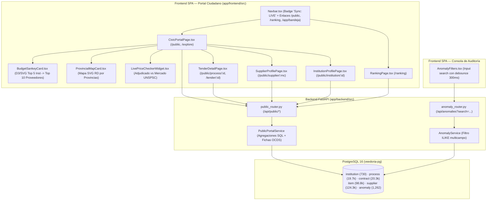
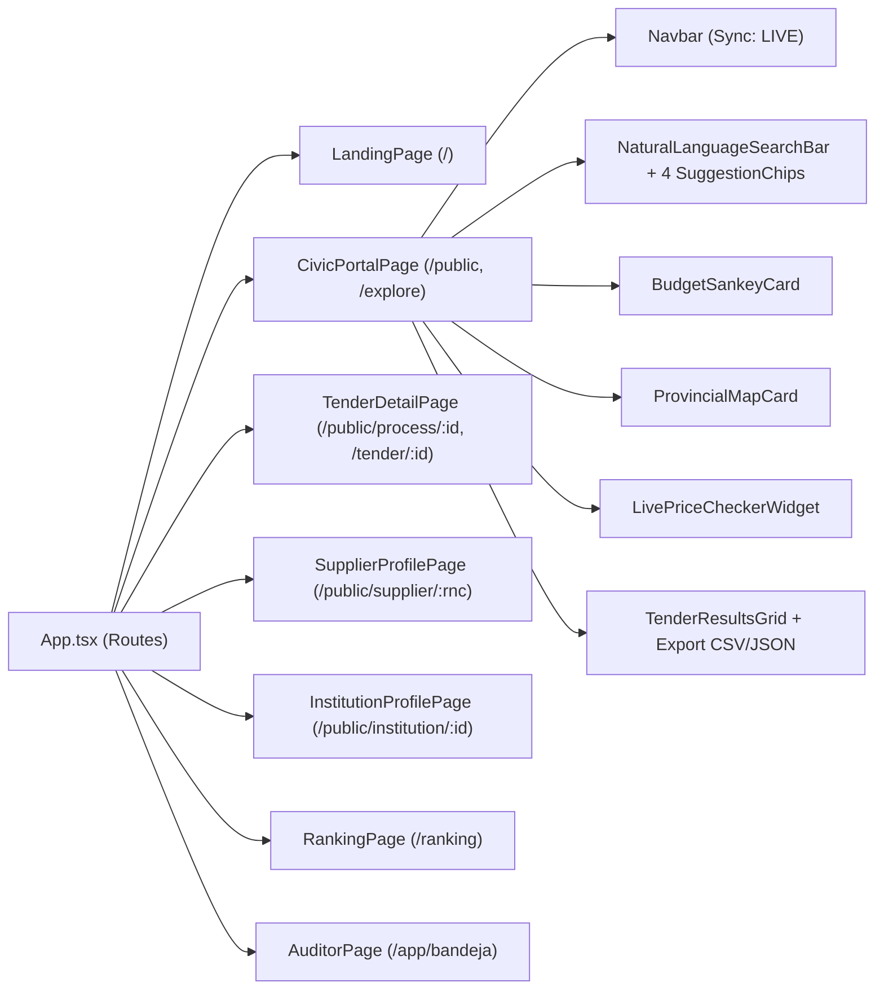

# Design: Portal de Veeduría Ciudadana y Mejoras de Navegación (`buscador-ciudadano`)

> 📋 Generated by `solution-designer` · 2026-10-19
> ✅ Approved by: JSolan0 (2026-10-19)

## Traceability
- **Work Item**: Pendiente (sin PBI/Feature en ADO)
- **Parent**: [veedoria-core](../intake.md)
- **Branch**: `dev`
- **Requirements**: [requirements.md](./requirements.md)
- **Test Plan**: [test-plan.md](./test-plan.md)
- **Test Cases**: [test-cases.md](./test-cases.md)

## Technology Decisions
- **Frontend**: **React `^19.2.6` + TypeScript `~6.0.2` + Vite `^8.0.12` + TailwindCSS `^4.3.1` + TanStack React Query `^5.99.0` + D3.js `^7.9.0` + `react-router-dom` `^7.14.0` + `i18next` `^26.0.3` + `lucide-react` `^1.16.0`** — Permite construir el Portal de Veeduría Ciudadana (`/public` y `/explore`) con carga diferida (`React.lazy()`), visualizaciones SVG interactivas (Diagrama Sankey Presupuestario y Mapa Geográfico Provincial de la República Dominicana), Comparador de Precios Unitarios en Tiempo Real, exportación de Datos Abiertos en CSV (UTF-8 con BOM) y JSON, y fichas públicas interconectadas (`/public/process/:id`, `/public/supplier/:rnc`, `/public/institution/:id`, `/ranking`).
- **Backend**: **Python `3.12+` + FastAPI `^0.135.3` + SQLModel `^0.0.38` + SQLAlchemy Async `^2.0.49` (`asyncpg`)** — Expone un nuevo router público sin autenticación (`src/presentation/routers/public_router.py` bajo `/api/public`) y amplía `AnomalyService.get_anomalies` (`GET /api/anomalies?search=...`) con búsqueda `ILIKE` multicampo sobre las tablas reales en PostgreSQL.
- **Database**: **PostgreSQL 16 (`veedoria-pg`)** — Consultas analíticas agregadas (`SUM`, `COUNT`, `AVG`, `CASE WHEN`) sobre las tablas existentes `institution` (`730`), `process` (`19,722`), `contract` (`20,380`), `item` (`98,869`), `supplier` (`124,361`) y `anomaly` (`1,262`) sin requerir migraciones destructivas.
- **Cloud Services**: Despliegue `monorepo-split` (Frontend SPA en CDN/Vercel + Backend FastAPI en contenedores Docker en Render/ECS) con promoción controlada multi-ambiente (`dev → cert → main`).
- **Theme**: `govtech` (*Civil Clarity* en modo claro `--background: #faf8ff`, `--primary: #003d9b`; *Sovereign Ledger* en modo oscuro `--background: #0c0e14`, `--primary: #b2c5ff`), tipografías `Manrope`, `Inter` y `JetBrains Mono`, cumpliendo **WCAG 2.1 AA**, **NORTIC A2:2024** y **NORTIC A4:2024**.

## Architecture

### System Overview

### Component Diagram

## Deployment
- **Pattern**: `monorepo-split` (SPA compilada con Vite en `app/frontend` y API REST asíncrona FastAPI en `app/backend`).
- **App**: Frontend en CDN / Vercel Static Hosting y Backend en contenedor Uvicorn sobre Render / AWS ECS.
- **Infra**: PostgreSQL 16 gestionado con índices sobre claves foráneas (`institution_id`, `process_id`, `contract_id`, `supplier_rpe`) y caché Redis 7.
- **CI/CD**: GitHub Actions ejecutando `pytest`, `eslint`, `tsc -b` y `vite build` en cada Pull Request y promoción controlada con compuertas de aprobación.
- **Justification**: Mantener las agregaciones de Sankey, Mapa Provincial, Comparador de Precios y Ranking en endpoints SQL dedicados bajo `/api/public/*` permite tiempos de respuesta `< 300ms` sin transferir decenas de miles de filas crudas al navegador.
- **Discarded**: Descargar los `20,380` contratos completos al cliente para filtrar en memoria (descartado por consumo excesivo de ancho de banda y memoria en dispositivos móviles).

### Environments
| Environment | Branch | Frontend URL | Backend API URL | Deploy trigger & Gate |
|-------------|--------|--------------|-----------------|-----------------------|
| **Local** | `feature/*` / `dev` | `http://localhost:5173/public` | `http://127.0.0.1:3001/api/public` | Manual (`npm run dev` + `uvicorn src.presentation.main:app --port 3001`) |
| **Preview (PR)** | PR hacia `dev` | `https://pr-{N}-veedoria.vercel.app/public` | `https://api-dev.veedoria.do/api/public` | Automático al abrir/actualizar PR (Vercel Preview efímero con auto-cleanup al cerrar PR) |
| **DEV / QA** | `dev` | `https://dev.veedoria.do/public` | `https://api-dev.veedoria.do/api/public` | Automático en merge a `dev` tras CI (`pytest` + `eslint` + `tsc -b` + `vite build`) |
| **CERT (Staging)** | `cert` / `release/*` | `https://cert.veedoria.do/public` | `https://api-cert.veedoria.do/api/public` | Promoción manual `dev → cert` · **Approval Gate: Dev + QA** (validación de pruebas E2E, accesibilidad WCAG 2.1 AA y exportación CSV/JSON) |
| **PROD** | `main` | `https://veedoria.do/public` | `https://api.veedoria.do/api/public` | Promoción manual `cert → main` + Release Tag `vX.Y.Z` · **Approval Gate: Dev + QA + BA** (nunca directo `dev → prod`) |

## Database Schema

### Table: `public_portal_read_models` (proyecciones SQL de solo lectura sobre `institution`, `process`, `contract`, `item`, `supplier` y `anomaly`)
| Column | Type | Constraints | Default | Description |
|--------|------|------------|---------|-------------|
| `contract_id` | `INTEGER` | `PK (contract.id)` | — | Identificador interno del contrato adjudicado |
| `contract_code` | `VARCHAR` | `NOT NULL` | — | Código oficial OCDS/DGCP del contrato (`contract.contract_id`) |
| `process_id` | `INTEGER` | `FK (process.id)` | — | Identificador del proceso de compra |
| `dgcp_code` | `VARCHAR` | `NOT NULL` | — | Código del proceso (`process.dgcp_code`) |
| `process_title` | `TEXT` | `NULLABLE` | `'Sin título'` | Título u objeto de la licitación (`process.title`) |
| `institution_id` | `INTEGER` | `FK (institution.id)` | — | Identificador de la institución compradora |
| `institution_name` | `VARCHAR` | `NOT NULL` | — | Nombre oficial de la institución (`institution.name`) |
| `supplier_rpe` | `VARCHAR` | `NULLABLE` | `'N/A'` | RPE/RNC del proveedor adjudicado (`contract.supplier_rpe`) |
| `supplier_name` | `VARCHAR` | `NULLABLE` | `'No especificado'` | Razón social del proveedor (`contract.supplier_name`) |
| `amount_adjudicated` | `DOUBLE PRECISION` | `NOT NULL` | `0.0` | Monto adjudicado en pesos dominicanos (`RD$`) |
| `anomaly_count` | `INTEGER` | `COMPUTED` | `0` | Cantidad de anomalías asociadas al contrato o a su proceso padre |
| `max_severity` | `DOUBLE PRECISION` | `COMPUTED` | `0.0` | Severidad máxima (`0..100`) de las anomalías asociadas |
| `transparency_score` | `DOUBLE PRECISION` | `COMPUTED` | `100.0` | Índice de transparencia institucional (`0..100%`) calculado sobre proporción libre de anomalías |

### Indexes
| Name | Columns | Type |
|------|---------|------|
| `ix_contract_process_id` | `contract(process_id)` | `B-Tree (existente)` |
| `ix_process_institution_id` | `process(institution_id)` | `B-Tree (existente)` |
| `ix_anomaly_contract_process` | `anomaly(contract_id, process_id)` | `B-Tree (existente)` |
| `ix_item_contract_id` | `item(contract_id)` | `B-Tree (existente)` |

## API Contracts

### GET /api/anomalies (ampliado con parámetro `search`)
- **Request**: Query params `page` (`int=1`), `limit` (`int=50`), `status` (`str | None`), `anomaly_type` (`str | None`), `min_severity` (`float | None`), `search` (`str | None`).
- **Response**: `200 OK` — `PaginatedAnomaliesResponse` filtrando con `ILIKE` sobre `Anomaly.description`, `Process.dgcp_code`, `Process.title`, `Contract.contract_id`, `Contract.supplier_name` e `Institution.name`.
- **Auth**: None (endpoint de consola de auditoría).
- **Errors**: `422 Unprocessable Entity` si los parámetros numéricos son inválidos.
- **Maps to**: REQ-002

### GET /api/public/tenders
- **Request**: Query params `page` (`int=1`), `limit` (`int=20`), `search` (`str | None`), `institution_id` (`int | None`), `province` (`str | None`), `min_amount` (`float | None`), `max_amount` (`float | None`), `only_with_anomalies` (`bool=False`).
- **Response**: `200 OK` — Objeto JSON con `total`, `page`, `limit`, `total_amount_filtered` y `data: PublicTenderSummary[]` (incluyendo conteo y severidad de alertas IA).
- **Auth**: None (acceso público ciudadano).
- **Errors**: `422 Unprocessable Entity` ante parámetros fuera de rango.
- **Maps to**: REQ-001, REQ-003

### GET /api/public/budget-overview
- **Request**: Sin parámetros requeridos.
- **Response**: `200 OK` — Objeto JSON con `sankey: { institutions: SankeyNode[], suppliers: SankeyNode[], links: SankeyLink[] }` (Top 5 Instituciones hacia Top 10 Proveedores) y `provinces: ProvincialSpendItem[]` (`province`, `region`, `total_amount`, `active_processes`, `critical_alerts`).
- **Auth**: None (acceso público ciudadano).
- **Errors**: `500 Internal Server Error` si la base de datos no está disponible.
- **Maps to**: REQ-004

### GET /api/public/price-comparison
- **Request**: Query param opcional `limit` (`int=10`).
- **Response**: `200 OK` — Lista `PriceComparisonItem[]` con `item_id`, `item_description`, `unspsc_code`, `adjudicated_unit_price`, `market_reference_price`, `overprice_pct`, `institution_name`, `institution_id`, `supplier_name`, `supplier_rpe`, `contract_id` y `dgcp_code`.
- **Auth**: None (acceso público ciudadano).
- **Errors**: `500 Internal Server Error` en fallo de conexión.
- **Maps to**: REQ-005

### GET /api/public/tenders/{contract_id}
- **Request**: Path param `contract_id` (`int`).
- **Response**: `200 OK` — Expediente completo OCDS (`contract`, `process`, `institution`, `items: PublicContractItem[]`, `anomalies: PublicAnomalyItem[]`).
- **Auth**: None (acceso público ciudadano).
- **Errors**: `404 Not Found` si `contract_id` no existe.
- **Maps to**: REQ-006

### GET /api/public/suppliers/{rnc}
- **Request**: Path param `rnc` (`str`, RPE o RNC del proveedor).
- **Response**: `200 OK` — Perfil público del proveedor (`rpe`, `name`, `status`, `total_adjudicated`, `contracts_count`, `anomalies_count`, `top_institutions`, `contracts: PublicTenderSummary[]`, `anomalies: PublicAnomalyItem[]`).
- **Auth**: None (acceso público ciudadano).
- **Errors**: `404 Not Found` si no se encuentra el proveedor.
- **Maps to**: REQ-006

### GET /api/public/institutions/{institution_id} & GET /api/public/ranking
- **Request**: Path param `institution_id` (`int`) para ficha individual; query param `search` (`str | None`) y `sort_by` (`'amount' | 'anomalies' | 'transparency'`) para `/api/public/ranking`.
- **Response**: `200 OK` — Perfil institucional detallado o tabla nacional con `institution_id`, `institution_name`, `processes_count`, `contracts_count`, `total_amount`, `anomalies_count` y `transparency_score` (`0..100%`).
- **Auth**: None (acceso público ciudadano).
- **Errors**: `404 Not Found` si `institution_id` no existe.
- **Maps to**: REQ-006

## Architecture Updates
- Se registrará el router `public_router.py` en `docs/architecture/api-contract.md` y en `src/presentation/main.py` una vez implementada la funcionalidad.

## Approval
- [x] Developer: JSolan0 Date: 2026-10-19

---
> 📍 Pendiente (sin PBI/Feature en ADO) · 🌿 `dev` · Generated by SDD Standard