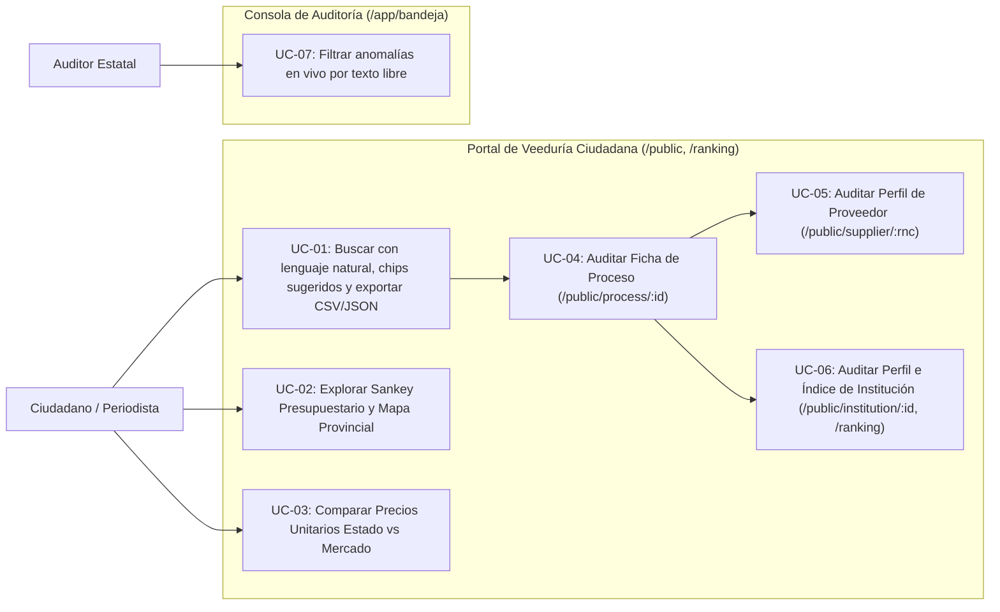
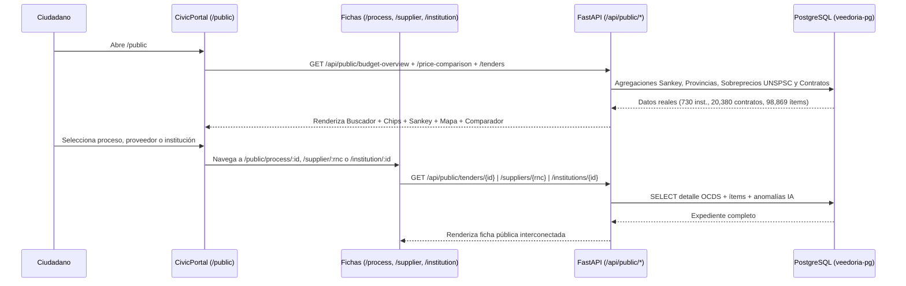

# Requirements: Portal de Veeduría Ciudadana y Mejoras de Navegación (`buscador-ciudadano`)

> 📋 Generated by `requirements-analyst` · 2026-10-19
> ✅ Approved by: JSolan0 (2026-10-19)

## Traceability
- **Work Item**: Pendiente (sin PBI/Feature en ADO)
- **Parent**: [veedoria-core](../intake.md)
- **Branch**: `dev`
- **Design**: [design.md](./design.md)
- **Test Plan**: [test-plan.md](./test-plan.md)
- **Test Cases**: [test-cases.md](./test-cases.md)

## Overview
El módulo **Portal de Veeduría Ciudadana y Mejoras de Navegación** (`buscador-ciudadano`) implementa de forma íntegra el **Bloque 1 (*Quick Wins*)** y el **Bloque 2 (Módulo I: Acceso Público y Veeduría Ciudadana — CivicTech, pantallas #1 a #8 de `complete_screen_map.md`, `pages_concept/civic_portal/design.md` y `pages_concept/public_layout.md`)** de **VeedorIA** (**NexoDigital Solutions, S.R.L.**). Conecta todos los controles de navegación de la portada pública (`/`) e incorpora el indicador en vivo `"Sync: LIVE"`, activa el filtrado textual en tiempo real en la Bandeja de Auditoría (`/app/bandeja`), y despliega sin requerir inicio de sesión el **Portal de Veeduría Ciudadana (`/public` y `/explore`)** con buscador en lenguaje natural y 4 chips de sugerencia interactivos, el **Diagrama Sankey de Distribución del Presupuesto Nacional**, el **Mapa Geográfico Interactivo de Gasto por Provincias**, el **Comparador de Precios Unitarios en Tiempo Real**, la **Descarga de Datos Abiertos (CSV/JSON — NORTIC A4:2024)** y las fichas públicas de **Proceso/Contrato (`/public/process/:id` y `/tender/:id`)**, **Proveedor (`/public/supplier/:rnc`)** e **Institución y Ranking Nacional (`/public/institution/:id` y `/ranking`)**, todo alimentado por los `19,722` procesos, `20,380` contratos, `98,869` ítems, `124,361` proveedores, `730` instituciones y `1,262` anomalías reales en PostgreSQL.

## User Stories (EARS Notation)

### REQ-001: Cabecera Pública Unificada con Indicador `"Sync: LIVE"` y Navegación Interactiva (`Navbar`, `HeroSection`, `PortalsSection`, `CTABanner`)
**Type:** Event-Driven
**Rule:** WHEN un visitante interactúa con la barra superior pública (`Navbar.tsx`) o con las llamadas a la acción de la portada (`HeroSection.tsx`, `PortalsSection.tsx`, `CTABanner.tsx`), the system SHALL mostrar en la cabecera el badge en vivo `"Sync: LIVE"` con punto verde pulsante (`animate-pulse`), dirigir los accesos ciudadanos (`Buscador Ciudadano`, `Buscar una Licitación Gratis`, tarjeta `CivicTech`) hacia `/public` (manteniendo `/explore` como ruta alias compatible), ejecutar desplazamiento suave (`smooth scroll`) o navegación en los enlaces `"Para Empresas"` (sección B2B) y `"Para Instituciones"` (sección B2G / `/ranking`), y dirigir los accesos operativos (`Entrar al Sistema`, `Solicitar Demostración B2G`, tarjeta `Auditoría B2G`) hacia `/app/bandeja`.
**Entities:** `NavigationRoute`, `PublicHeaderState`
**Error Handling:** Si el usuario hace clic en `"Para Empresas"` o `"Para Instituciones"` estando fuera de `/`, el sistema navega a `/#empresas` o `/ranking` respectivamente sin perder el estado de idioma ni tema visual.

**Acceptance Criteria:**
- [ ] Given cualquier página pública (`/`, `/public`, `/ranking`), when se renderiza `Navbar.tsx`, then muestra el indicador `"Sync: LIVE"` con punto verde pulsante junto a los selectores `LanguageSwitcher`, `ThemeToggler` y el botón `"Entrar al Sistema"`.
- [ ] Given el usuario en `/`, when hace clic en `"Buscador Ciudadano"`, `"Buscar una Licitación Gratis"` o en la tarjeta `"CivicTech"`, then navega mediante `react-router-dom` a `/public`.
- [ ] Given el usuario en `/`, when hace clic en `"Entrar al Sistema"` o en la tarjeta `"Auditoría B2G"`, then navega a `/app/bandeja`.

**Priority:** Must
**Dependencies:** None
**Tracker:** Pendiente

### REQ-002: Filtrado Textual en Vivo en Bandeja de Auditoría (`/app/bandeja` y `GET /api/anomalies`)
**Type:** Event-Driven
**Rule:** WHEN el auditor escribe un término de búsqueda en el campo `search` de `AnomalyFilters.tsx` en `/app/bandeja`, the system SHALL propagar el parámetro `search` (con debounce de `300ms`) a `useAnomalies(filters)` (`GET /api/anomalies?search=...`), y el backend (`AnomalyService.get_anomalies`) SHALL filtrar de forma insensible a mayúsculas (`ILIKE`) las anomalías cuya descripción, código de proceso (`Process.dgcp_code`), título de proceso (`Process.title`), código de contrato (`Contract.contract_id`), proveedor (`Contract.supplier_name`) o institución (`Institution.name`) contengan el texto buscado.
**Entities:** `Anomaly`, `Process`, `Contract`, `Institution`
**Error Handling:** Si el término `search` está vacío o contiene solo espacios en blanco, el backend ignora el filtro textual y aplica únicamente los filtros seleccionados de `status`, `anomaly_type` y `min_severity`.

**Acceptance Criteria:**
- [ ] Given la vista `/app/bandeja`, when el auditor escribe el nombre de un proveedor, institución o código de contrato en `AnomalyFilters`, then `GET /api/anomalies` incluye `search` y retorna únicamente las anomalías coincidentes actualizando el contador total.
- [ ] Given un término de búsqueda activo, when el auditor borra el texto del input, then la bandeja restaura el listado general según los demás filtros activos.

**Priority:** Must
**Dependencies:** None
**Tracker:** Pendiente

### REQ-003: Buscador Ciudadano con Sugerencias en Lenguaje Natural, Filtros Multicriterio y Exportación de Datos Abiertos CSV/JSON (`/public`, `/explore` y `GET /api/public/tenders`)
**Type:** Event-Driven
**Rule:** WHEN un ciudadano o periodista accede a `/public` (o `/explore`), the system SHALL presentar el encabezado `"Portal de Veeduría Ciudadana"`, el buscador central con placeholder `"¿Qué deseas fiscalizar hoy? (ej. Laptops en MINERD, Asfalto en Obras Públicas)"`, los **4 chips interactivos de sugerencia en lenguaje natural** (`"¿Cuánto gastó mi provincia?"`, `"Laptops con sobreprecio en MINERD"`, `"Proveedores con alertas en Obras Públicas"`, `"Contratos de asfalto en Santiago"`), los filtros por institución (`institution_id`), provincia (`province`), rango de monto (`min_amount`, `max_amount`) y switch `"Solo con alertas de IA"` (`only_with_anomalies`), mostrar las tarjetas paginadas de contratos/procesos desde `GET /api/public/tenders`, y permitir exportar el conjunto de resultados en **CSV (UTF-8 con BOM `\uFEFF`)** y **JSON** conforme a **NORTIC A4:2024**.
**Entities:** `Contract`, `Process`, `Institution`, `Supplier`, `Anomaly`
**Error Handling:** Si la combinación de filtros no arroja resultados, muestra un estado vacío informativo con botón para restablecer todos los filtros en un clic.

**Acceptance Criteria:**
- [ ] Given la página `/public`, when el usuario hace clic en cualquiera de los 4 chips de sugerencia (`"¿Cuánto gastó mi provincia?"`, `"Laptops con sobreprecio en MINERD"`, `"Proveedores con alertas en Obras Públicas"`, `"Contratos de asfalto en Santiago"`), then el buscador aplica automáticamente los filtros o términos correspondientes y actualiza los resultados desde PostgreSQL.
- [ ] Given resultados visibles en `/public`, when el usuario hace clic en `"Exportar CSV"` o `"Exportar JSON"`, then el navegador descarga el archivo de datos abiertos (`veedoria-contrataciones.csv` o `veedoria-contrataciones.json`) con los contratos, montos en `RD$`, instituciones, proveedores y conteo de alertas de IA.

**Priority:** Must
**Dependencies:** REQ-001
**Tracker:** Pendiente

### REQ-004: Diagrama Sankey de Flujo del Presupuesto Nacional y Distribución Real por Provincia del Proveedor (`/public`, `/public/budget-flow` y `GET /api/public/budget-overview`)
**Type:** Event-Driven
**Rule:** WHEN se carga el Portal de Veeduría Ciudadana (`/public`), the system SHALL consultar `GET /api/public/budget-overview` y renderizar dos visualizaciones interactivas conforme a `pages_concept/civic_portal/design.md`: (1) la tarjeta `"Distribución del Presupuesto Nacional de Compras"` con un **Diagrama de Flujo Sankey SVG** que conecta las **Top 5 Instituciones Públicas** (izquierda) con los **Top 10 Proveedores Adjudicados** (derecha) mostrando en hover el monto transferido en `RD$` y el porcentaje del flujo, y (2) la tarjeta `"Distribución del Gasto por Provincia del Proveedor"` con un **ranking real de todas las provincias presentes en `supplier.province`** (barra proporcional al monto adjudicado, ordenada de mayor a menor) que al seleccionar una provincia muestra `Total Adjudicado`, `Procesos con adjudicación` y `Hallazgos de auditoría`, y filtra el buscador por esa provincia; la tarjeta declara explícitamente qué porcentaje del monto nacional quedó atribuido (`provinces_meta.coverage_pct`).
**Entities:** `Institution`, `Contract`, `Supplier` (campo `province`), `Anomaly`, `ProvincialSpendNode`, `SankeyLink`
**Error Handling:** Si un proveedor o institución tiene nombre extenso, el nodo del diagrama Sankey trunca la etiqueta visualmente y muestra el nombre completo junto al monto exacto en el tooltip.

**Acceptance Criteria:**
- [ ] Given la vista `/public`, when se renderiza la sección `"Distribución del Presupuesto Nacional de Compras"`, then muestra el diagrama Sankey conectando las principales instituciones contratantes con sus proveedores adjudicados usando datos reales de `contract` e `institution`.
- [ ] Given la tarjeta `"Distribución del Gasto por Provincia del Proveedor"`, when el usuario pasa el cursor o hace clic sobre una provincia del ranking, then visualiza `Total Adjudicado`, `Procesos con adjudicación` y `Hallazgos de auditoría` calculados por agregación real sobre `supplier.province` (no proporciones fijas), y el monto mostrado en la tarjeta coincide con el `total_amount_filtered` que devuelve `GET /api/public/tenders?province=<provincia>`.

**Priority:** Must
**Dependencies:** REQ-003
**Tracker:** Pendiente

### REQ-005: Comparador de Precios Unitarios en Tiempo Real (`/public` y `GET /api/public/price-comparison`)
**Type:** Event-Driven
**Rule:** WHEN el ciudadano visualiza el widget `"Comparador de Precios Unitarios en Tiempo Real"` en `/public` o selecciona un rubro/artículo auditado, the system SHALL consultar `GET /api/public/price-comparison` sobre las tablas `item`, `contract`, `institution` y `anomaly` (`PRICE_ANOMALY`), y mostrar lado a lado el **Precio Adjudicado Estado** (monto unitario en `RD$`, institución compradora, proveedor y código de proceso) frente al **Precio Promedio / Mediana de Mercado UNSPSC** (en `RD$`, calculado sobre el histórico de los `98,869` ítems), resaltando en el centro la píldora de alerta `"SOBREPRECIO DETECTADO: +X%"` y permitiendo alternar entre los principales hallazgos de sobreprecio detectados.
**Entities:** `Item`, `Contract`, `Institution`, `Anomaly`
**Error Handling:** Si el precio de referencia de mercado es `0` o nulo para un ítem, el backend excluye dicho renglón del comparador público para evitar divisiones por cero.

**Acceptance Criteria:**
- [ ] Given la vista `/public`, when se carga el widget `"Comparador de Precios Unitarios en Tiempo Real"`, then presenta el contraste visual entre `"Precio Adjudicado Estado"` (en rojo alerta) y `"Precio Promedio Mercado"` (en verde esmeralda) junto al badge central `"SOBREPRECIO DETECTADO: +X%"` y selector para cambiar de artículo auditado.

**Priority:** Must
**Dependencies:** REQ-003
**Tracker:** Pendiente

### REQ-006: Fichas Públicas de Proceso/Contrato (`/public/process/:id` y `/tender/:id`), Proveedor (`/public/supplier/:rnc`) e Institución / Ranking (`/public/institution/:id` y `/ranking`)
**Type:** Event-Driven
**Rule:** WHEN el ciudadano selecciona un proceso/contrato, un proveedor o una institución desde los resultados de `/public`, the system SHALL navegar a su ficha pública dedicada:
1. **Ficha de Proceso y Contrato (`/public/process/:id` y `/tender/:id` → `GET /api/public/tenders/{id}`)**: muestra metadatos OCDS completos, tabla de renglones adjudicados (`Item`: descripción, código `unspsc_code`, cantidad, unidad, precio unitario y total en `RD$`) y tarjetas de anomalías de IA (`PRICE_ANOMALY`, `FRAGMENTATION`, `COLLUSION`) con enlaces directos a la ficha del proveedor y de la institución.
2. **Perfil Público de Proveedor (`/public/supplier/:rnc` → `GET /api/public/suppliers/{rnc}`)**: muestra razón social, RPE/RNC, estado, monto total adjudicado en `RD$`, número de contratos ganados, instituciones principales a las que vende y alertas de IA registradas en sus contratos.
3. **Perfil Público de Institución (`/public/institution/:id` → `GET /api/public/institutions/{id}`) y Ranking Nacional (`/ranking` → `GET /api/public/ranking`)**: muestra el perfil de compras de la entidad estatal (volumen contratado, procesos, contratos, proveedores recurrentes, alertas) y la tabla nacional con el **Índice de Transparencia Institucional (`0..100%`)**.
**Entities:** `Process`, `Contract`, `Item`, `Supplier`, `Institution`, `Anomaly`
**Error Handling:** Si el identificador solicitado (`id` o `rnc`) no existe en PostgreSQL, la vista presenta un estado `404` amigable con botón de retorno a `/public`.

**Acceptance Criteria:**
- [ ] Given un contrato en `/public`, when el usuario abre `/public/process/:id` (o `/tender/:id`), then visualiza el detalle del contrato y proceso, la tabla de ítems UNSPSC, las alertas de IA y enlaces clicables hacia `/public/supplier/:rnc` y `/public/institution/:id`.
- [ ] Given la ruta `/public/supplier/:rnc`, when se carga el perfil del proveedor, then muestra sus métricas agregadas en `RD$`, el listado de sus contratos adjudicados y sus alertas asociadas.
- [ ] Given las rutas `/public/institution/:id` y `/ranking`, when el usuario las consulta, then visualiza el desglose institucional y el ranking nacional con semáforo de transparencia (`>= 85%` verde, `60..84%` ámbar, `< 60%` rojo).

**Priority:** Must
**Dependencies:** REQ-003
**Tracker:** Pendiente

## Non-Functional Requirements

### Performance
- **Consultas SQL paginadas y agregadas en servidor**: Todos los endpoints bajo `/api/public/*` ejecutan agregaciones SQL (`SUM`, `COUNT`, `AVG`) y paginación (`LIMIT`/`OFFSET`) directamente en PostgreSQL respondiendo en `< 300ms`.
- **Carga diferida (`React.lazy()`)**: Las vistas ciudadanas (`ExplorePage`, `TenderDetailPage`, `SupplierProfilePage`, `InstitutionProfilePage`, `RankingPage`) se cargan con `React.lazy()` en `App.tsx`.

### Security & Compliance
- **Cumplimiento NORTIC A2:2024 y NORTIC A4:2024**: Datos públicos servidos en formatos abiertos (JSON y CSV UTF-8 con BOM) sin requerir credenciales para consulta ciudadana (**Ley 200-04 de Libre Acceso a la Información Pública**).
- **Consultas parametrizadas**: Todos los parámetros (`search`, `institution_id`, `province`, `rnc`) utilizan enlaces parametrizados de SQLAlchemy/SQLModel previniendo inyección SQL.

### Reliability
- **Tolerancia a valores nulos**: Contratos o ítems con campos opcionales nulos (`amount_adjudicated`, `supplier_rpe`, `unspsc_code`) se representan con valores de respaldo (`"No especificado"`, `"RD$ 0"`) sin errores de renderizado.

## Edge Cases & Error Scenarios
| # | Scenario | Expected behavior |
|---|----------|-------------------|
| 1 | Búsqueda con caracteres especiales (`%`, `_`, tildes) en `/public` o `/app/bandeja` | La consulta `ILIKE` parametrizada procesa el término de forma segura sin romper la sentencia SQL. |
| 2 | Contrato en `/public/process/:id` cuyo proceso padre posee anomalías `FRAGMENTATION` además de `PRICE_ANOMALY` en el contrato | El endpoint `GET /api/public/tenders/{id}` une anomalías tanto por `Anomaly.contract_id == contract.id` como por `Anomaly.process_id == contract.process_id`. |
| 3 | Proveedor cuyo identificador en URL contiene guiones o espacios | El endpoint `GET /api/public/suppliers/{rnc}` busca por coincidencia exacta de `rpe` o por nombre/identificador normalizado (`ILIKE`). |

## Diagrams

### Use Case Diagram

### Supporting Diagram

## Dependencies
| Feature | Capability needed | Status | Workaround |
|---------|------------------|--------|------------|
| `ingesta-sincronizacion-dgcp` | Tablas `institution`, `process`, `contract`, `item`, `supplier` pobladas en PostgreSQL | Implementado (`🟢 active`) | — |
| `deteccion-anomalias` | Tabla `anomaly` y servicio `AnomalyService` | Implementado (`🟢 active`) | — |
| `portal-civico-landing` | Componentes compartidos `Navbar`, `Footer`, `SectionContainer`, `GlassCard`, `Button` | Implementado (`🟢 active`) | — |

## Assumptions
| # | Assumption | Temporary stub | Replaced when |
|---|-----------|----------------|---------------|
| 1 | El dataset histórico DGCP no incluye coordenadas GPS por contrato, y ni `institution` ni `process` tienen columna geográfica, así que la única geografía real disponible es `supplier.province` (domicilio declarado del proveedor: 98.297 de 124.361 proveedores). `contract` guarda el `rpe` del proveedor pero no su RNC, por lo que el enlace con `supplier` se resuelve por igualdad exacta del nombre normalizado | Agregación determinista por provincia del proveedor, con `provinces_meta.coverage_pct` declarando el monto atribuido (92,5% del monto nacional) | Cuando `contract` persista el RNC del proveedor en la ingesta, o la DGCP publique geocodificación OCDS `deliveryAddresses` por proceso |

## Out of Scope
- Autenticación de usuarios (`/login`, `/register`, `/forgot-password`), cubierta en el Bloque 3.
- Vistas internas adicionales del auditor (`/app/overview`, `/app/processes`) y simulador B2B (`/b2b/*`), cubiertos en los Bloques 3 y 4.

## Approval
- [x] Analyst: JSolan0 Date: 2026-10-19

---
> 📍 Pendiente (sin PBI/Feature en ADO) · 🌿 `dev` · Generated by SDD Standard