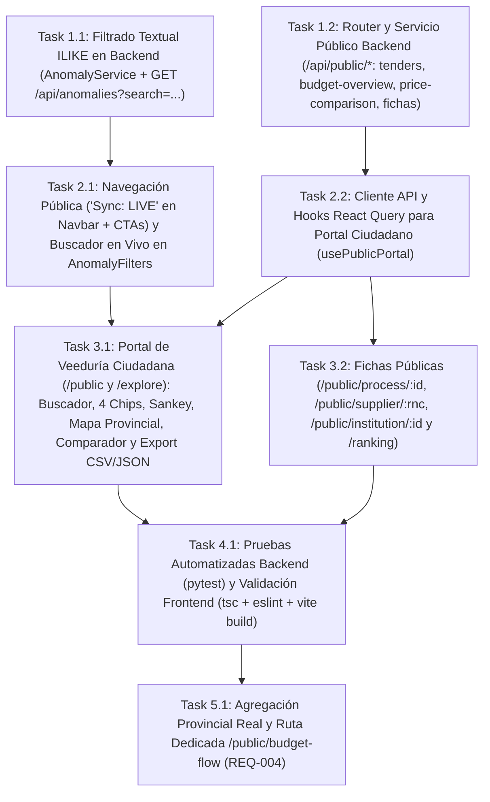

# Tasks: Portal de Veeduría Ciudadana y Mejoras de Navegación (`buscador-ciudadano`)

> 📋 Generated by `solution-designer` · 2026-10-19
> ✅ Approved by: JSolan0 (2026-10-19)

## Traceability
- **Work Item**: Pendiente (sin PBI/Feature en ADO)
- **Branch**: `dev`

## Metadata
- **Based on:** [design.md](./design.md)
- **Total estimate:** ~21h (incluye 20% buffer)
- **Number of waves:** 5 (Wave 1, Wave 2, Wave 3, Wave 4, Wave 5)
- **Number of tasks:** 8
- **Sprint:** [TBD]
- **Assignee:** JSolan0

## Estimation Rules

See `estimation-strategy.md` for full estimation rules, AI multipliers, and architecture impact.

**Quick reference:**
- Maximum **4 hours** per task (break larger tasks into subtasks)
- Estimates include implementation + unit tests + code review
- If a task exceeds 4h during implementation, split it immediately
- Add **20% buffer** to total estimate for unknowns
- If using agentic IDEs + SDD: apply multipliers from `estimation-strategy.md` §Scenario B
- Track actual vs estimated for future calibration (see `estimation-strategy.md` §Calibration)

## Dependency Graph

---

## Wave 1: Foundation & Setup (~5h)

### Task 1.1: Filtrado Textual `ILIKE` en Backend para Bandeja de Auditoría (`REQ-002`) (~2h)
- **Description:** Ampliar `AnomalyService.get_anomalies` en `app/backend/src/application/services/anomaly_service.py` y el endpoint `GET /api/anomalies` en `app/backend/src/presentation/routers/anomaly_router.py` para aceptar el parámetro opcional `search: str | None = None`, filtrando de forma insensible a mayúsculas (`ILIKE`) sobre `Anomaly.description`, `Process.dgcp_code`, `Process.title`, `Contract.contract_id`, `Contract.supplier_name` e `Institution.name`.
- **Acceptance criteria:**
  - [x] `GET /api/anomalies?search=MINERD` o por código de contrato/proceso retorna únicamente las anomalías coincidentes y el `total` exacto.
  - [x] Si `search` está vacío o contiene solo espacios, el comportamiento existente permanece intacto.
- **Dependencies:** None
- **Files to create/modify:** `app/backend/src/application/services/anomaly_service.py`, `app/backend/src/presentation/routers/anomaly_router.py`

### Task 1.2: Servicio y Router Público de Veeduría Ciudadana `/api/public/*` (`REQ-003`, `REQ-004`, `REQ-005`, `REQ-006`) (~3h)
- **Description:** Crear `app/backend/src/application/services/public_portal_service.py` y `app/backend/src/presentation/routers/public_router.py` (registrado en `src/presentation/main.py`) exponiendo sin requerir credenciales:
  - `GET /api/public/tenders` (filtros: `search`, `institution_id`, `province`, `min_amount`, `max_amount`, `only_with_anomalies`, `page`, `limit`).
  - `GET /api/public/budget-overview` (nodos y enlaces Sankey de las Top 5 Instituciones hacia Top 10 Proveedores + distribución real del gasto, procesos y hallazgos por provincia del proveedor, con `provinces_meta.coverage_pct`).
  - `GET /api/public/price-comparison` (comparación real de precios unitarios adjudicados vs. referencia de mercado UNSPSC sobre `item`, `contract`, `institution` y `anomaly`).
  - `GET /api/public/tenders/{contract_id}` (expediente OCDS completo con tabla de `Item` y alertas de IA).
  - `GET /api/public/suppliers/{rnc}` (perfil de proveedor con RPE/RNC, monto total adjudicado, contratos ganados, instituciones compradoras y alertas).
  - `GET /api/public/institutions/{institution_id}` y `GET /api/public/ranking` (perfil institucional y ranking nacional con Índice de Transparencia `0..100%`).
- **Acceptance criteria:**
  - [x] Los 7 endpoints públicos responden `200 OK` en `< 300ms` sobre la base de datos PostgreSQL real (`veedoria-pg`).
  - [x] Solicitudes con `contract_id`, `rnc` o `institution_id` inexistentes devuelven `404 Not Found` estructurado.
- **Dependencies:** None
- **Files to create/modify:** `app/backend/src/application/services/public_portal_service.py`, `app/backend/src/presentation/routers/public_router.py`, `app/backend/src/presentation/main.py`

---

## Wave 2: Core Implementation (~3.5h)

### Task 2.1: Cabecera Pública con `"Sync: LIVE"`, Navegación de Portada y Buscador en Vivo en `AnomalyFilters` (`REQ-001`, `REQ-002`) (~2h)
- **Description:** Actualizar `Navbar.tsx`, `HeroSection.tsx`, `PortalsSection.tsx` y `CTABanner.tsx` para incluir el badge `"Sync: LIVE"` con punto verde pulsante en la cabecera, navegar mediante `react-router-dom` a `/public`, `/ranking` y `/app/bandeja` (además de scroll suave a secciones B2B/B2G en `/`), y conectar el campo de texto de `AnomalyFilters.tsx` con debounce (`300ms`) hacia `useAnomalies.ts` (`GET /api/anomalies?search=...`).
- **Acceptance criteria:**
  - [x] `Navbar.tsx` muestra el indicador `"Sync: LIVE"` y todos los botones de acción de la portada navegan sin recargar la página.
  - [x] Escribir en el buscador de `/app/bandeja` actualiza en vivo las tarjetas de anomalías desde el backend.
- **Dependencies:** Task 1.1
- **Files to create/modify:** `app/frontend/src/components/layout/Navbar.tsx`, `app/frontend/src/presentation/components/HeroSection.tsx`, `app/frontend/src/presentation/components/PortalsSection.tsx`, `app/frontend/src/presentation/components/CTABanner.tsx`, `app/frontend/src/features/anomalies/components/AnomalyFilters.tsx`, `app/frontend/src/features/anomalies/hooks/useAnomalies.ts`, `app/frontend/src/features/anomalies/types/anomaly.ts`

### Task 2.2: Tipos TypeScript, Cliente API, Hooks React Query y Utilidades de Exportación CSV/JSON (`REQ-003`, `REQ-004`, `REQ-005`, `REQ-006`) (~1.5h)
- **Description:** Crear el módulo `app/frontend/src/features/public-portal/` con los tipos de dominio (`types/publicPortal.ts`), hooks de consulta (`hooks/usePublicPortal.ts` para `tenders`, `budget-overview`, `price-comparison`, `tenderDetail`, `supplierProfile`, `institutionProfile` y `ranking`) y utilidades de descarga de Datos Abiertos (`utils/exportOpenData.ts` generando CSV UTF-8 con BOM `\uFEFF` y JSON conforme a **NORTIC A4:2024**).
- **Acceptance criteria:**
  - [x] Hooks tipados sin uso de `any` y funciones `exportTendersToCsv` / `exportTendersToJson` listas para invocación directa.
- **Dependencies:** Task 1.2
- **Files to create/modify:** `app/frontend/src/features/public-portal/types/publicPortal.ts`, `app/frontend/src/features/public-portal/hooks/usePublicPortal.ts`, `app/frontend/src/features/public-portal/utils/exportOpenData.ts`

---

## Wave 3: UI & Integration (~4.5h)

### Task 3.1: Portal de Veeduría Ciudadana (`/public` y `/explore`): Buscador + 4 Chips + Sankey + Ranking Provincial + Comparador de Precios (`REQ-003`, `REQ-004`, `REQ-005`) (~2.5h)
- **Description:** Implementar `CivicPortalPage.tsx` y sus subcomponentes (`BudgetSankeyCard.tsx`, `ProvincialSpendCard.tsx`, `LivePriceCheckerWidget.tsx`) siguiendo fielmente `pages_concept/civic_portal/design.md`:
  - Buscador central `"¿Qué deseas fiscalizar hoy? (ej. Laptops en MINERD, Asfalto en Obras Públicas)"` y los **4 chips interactivos** (`"¿Cuánto gastó mi provincia?"`, `"Laptops con sobreprecio en MINERD"`, `"Proveedores con alertas en Obras Públicas"`, `"Contratos de asfalto en Santiago"`).
  - Tarjeta `"Distribución del Presupuesto Nacional de Compras"` con diagrama Sankey SVG interactivo (Top 5 Instituciones → Top 10 Proveedores).
  - Tarjeta de distribución provincial con filtro por provincia (en Task 5.1 se reemplazó el esquema SVG de 10 zonas por el ranking real de 31 provincias).
  - Widget `"Comparador de Precios Unitarios en Tiempo Real"` (`Precio Adjudicado Estado` vs. `Precio Promedio Mercado` + badge `"SOBREPRECIO DETECTADO: +X%"`).
  - Listado paginado de contrataciones con filtros multicriterio y botones `"Exportar CSV"` y `"Exportar JSON"`.
- **Acceptance criteria:**
  - [x] Los 4 chips de sugerencia, la distribución provincial, el Sankey, el comparador de precios y la exportación CSV/JSON funcionan de forma interactiva sobre los datos reales de PostgreSQL.
- **Dependencies:** Task 2.1, Task 2.2
- **Files to create/modify:** `app/frontend/src/presentation/components/public/BudgetSankeyCard.tsx`, `app/frontend/src/presentation/components/public/ProvincialSpendCard.tsx`, `app/frontend/src/presentation/components/public/LivePriceCheckerWidget.tsx`, `app/frontend/src/presentation/pages/CivicPortalPage.tsx`

### Task 3.2: Fichas Públicas de Proceso/Contrato (`/public/process/:id` y `/tender/:id`), Proveedor (`/public/supplier/:rnc`), Institución (`/public/institution/:id`) y Ranking (`/ranking`) (`REQ-006`) (~2h)
- **Description:** Implementar las páginas de detalle interconectadas y registrar todas las rutas con `React.lazy()` en `App.tsx`:
  - `TenderDetailPage.tsx` (`/public/process/:id` y `/tender/:id`): metadatos OCDS, tabla de renglones UNSPSC (`Item`), tarjetas de alertas de IA y enlaces al proveedor e institución.
  - `SupplierProfilePage.tsx` (`/public/supplier/:rnc`): RPE/RNC, razón social, estado, total adjudicado en `RD$`, historial de contratos ganados, instituciones compradoras y alertas de IA.
  - `InstitutionProfilePage.tsx` (`/public/institution/:id`) y `RankingPage.tsx` (`/ranking`): perfil de compras de la entidad y tabla nacional con Índice de Transparencia (`0..100%`) y semáforo.
- **Acceptance criteria:**
  - [x] Navegación fluida de extremo a extremo entre `/public` ↔ `/public/process/:id` ↔ `/public/supplier/:rnc` ↔ `/public/institution/:id` ↔ `/ranking`.
- **Dependencies:** Task 2.2
- **Files to create/modify:** `app/frontend/src/pages/TenderDetailPage.tsx`, `app/frontend/src/pages/SupplierProfilePage.tsx`, `app/frontend/src/pages/InstitutionProfilePage.tsx`, `app/frontend/src/pages/RankingPage.tsx`, `app/frontend/src/App.tsx`

---

## Wave 4: Testing & Polish (~2h)

### Task 4.1: Pruebas Automatizadas Backend (`pytest`), Validación Frontend (`tsc + eslint + vite build`) y Actualización de Arquitectura (~2h)
- **Description:** Crear la suite de pruebas `app/backend/tests/test_public_portal_api.py` verificando el filtro `GET /api/anomalies?search=...` y todos los endpoints de `/api/public/*`, actualizar `docs/architecture/api-contract.md` con los nuevos contratos públicos, y validar que `pytest`, `npx tsc -b`, `npm run lint` y `npm run build` pasen con `0` errores.
- **Acceptance criteria:**
  - [x] `pytest` pasa al 100% incluyendo los nuevos tests de `test_public_portal_api.py`.
  - [x] `npx tsc -b`, `npm run lint` y `npm run build` finalizan sin errores ni advertencias de tipos.
- **Dependencies:** Task 3.1, Task 3.2
- **Files to create/modify:** `app/backend/tests/test_public_portal_api.py`, `docs/architecture/api-contract.md`

---

## Wave 5: Corrección de la Distribución Provincial (`REQ-004`) (~2.5h)

### Task 5.1: Agregación Provincial Real y Ruta Dedicada `/public/budget-flow` (`REQ-004`) (~2.5h)
- **Description:** Reemplazar la distribución provincial fabricada de `get_budget_overview` (pesos fijos `[0.42, 0.16, 0.08, …]` sobre el total nacional) por agregación real sobre `supplier.province`, alinear el filtro `province` de `GET /api/public/tenders` a la misma fuente, y sustituir el esquema SVG de 10 zonas por un ranking real de provincias:
  - `public_portal_service.py`: helpers `province_key`, `province_display_name` y `supplier_province_subquery`; se elimina `DR_PROVINCES_META`.
  - `get_budget_overview`: `total_amount` = `sum(amount_adjudicated)`, `active_processes` = `count(distinct process_id)`, `critical_alerts` = `count(distinct anomaly.id)` y `share_pct` sobre el monto atribuido; se agrega `provinces_meta`.
  - `search_tenders`: `province` resuelve por domicilio del proveedor en lugar del `ILIKE` por palabras clave.
  - `ProvincialMapCard.tsx` → `ProvincialSpendCard.tsx`: ranking de todas las provincias con barra proporcional, nota de cobertura y panel de detalle.
  - `BudgetFlowPage.tsx` (`/public/budget-flow`, `lazy`): compone `BudgetSankeyCard` + `ProvincialSpendCard` con la misma `queryKey`; `/public` enlaza hacia ella y `Navbar` marca `Citizen Search` activo en la subruta.
- **Acceptance criteria:**
  - [x] `GET /api/public/budget-overview` devuelve 31 provincias con montos, procesos y hallazgos calculados, y `provinces_meta.coverage_pct = 92.54`.
  - [x] El monto de cada provincia coincide exactamente con `total_amount_filtered` de `GET /api/public/tenders?province=<provincia>` (verificado en Distrito Nacional, Azua y Santiago).
  - [x] `test_public_portal_api.py` ya no afirma 10 provincias ficticias: valida la agregación real (`share_pct`, `coverage_pct`).
  - [x] `/public/budget-flow` renderiza Sankey + ranking y la selección de provincia lleva a `/public?province=<provincia>` filtrado.
- **Dependencies:** Task 4.1
- **Files to create/modify:** `app/backend/src/services/public_portal_service.py`, `app/backend/tests/test_public_portal_api.py`, `app/frontend/src/presentation/components/public/ProvincialSpendCard.tsx`, `app/frontend/src/presentation/pages/BudgetFlowPage.tsx`, `app/frontend/src/presentation/pages/CivicPortalPage.tsx`, `app/frontend/src/domain/publicPortal.ts`, `app/frontend/src/App.tsx`, `docs/ui-inventory.md`

---

## Implementation Order Summary
| Order | Task | Description | Est. | Depends On |
|-------|------|-------------|------|------------|
| 1 | 1.1 | Filtrado Textual `ILIKE` en Backend para Bandeja de Auditoría (`REQ-002`) | ~2.0h | — |
| 2 | 1.2 | Servicio y Router Público de Veeduría Ciudadana `/api/public/*` (`REQ-003`..`REQ-006`) | ~3.0h | — |
| 3 | 2.1 | Cabecera Pública con `"Sync: LIVE"`, Navegación de Portada y Buscador en Vivo en `AnomalyFilters` | ~2.0h | 1.1 |
| 4 | 2.2 | Tipos TypeScript, Cliente API, Hooks React Query y Utilidades de Exportación CSV/JSON | ~1.5h | 1.2 |
| 5 | 3.1 | Portal de Veeduría Ciudadana (`/public` y `/explore`): Buscador + 4 Chips + Sankey + Ranking + Comparador | ~2.5h | 2.1, 2.2 |
| 6 | 3.2 | Fichas Públicas (`/public/process/:id`, `/public/supplier/:rnc`, `/public/institution/:id`, `/ranking`) | ~2.0h | 2.2 |
| 7 | 4.1 | Pruebas Automatizadas Backend (`pytest`), Validación Frontend (`tsc + eslint + vite build`) y Docs | ~2.0h | 3.1, 3.2 |
| 8 | 5.1 | Agregación provincial real + ruta `/public/budget-flow` (`REQ-004`) | ~2.5h | 4.1 |

## Total Estimate: ~21h (includes 20% buffer)

## Completion Checklist
- [x] All tasks completed
- [x] All tests passing / TypeScript & ESLint clean
- [x] Documentation updated (`requirements.md`, `design.md`, `tasks.md`, `test-plan.md`, `test-cases.md`)
- [x] Distribución provincial real (sin pesos fijos) validada contra `GET /api/public/tenders?province=<provincia>`

---
> 📍 Pendiente (sin PBI/Feature en ADO) · 🌿 `dev` · Generated by SDD Standard