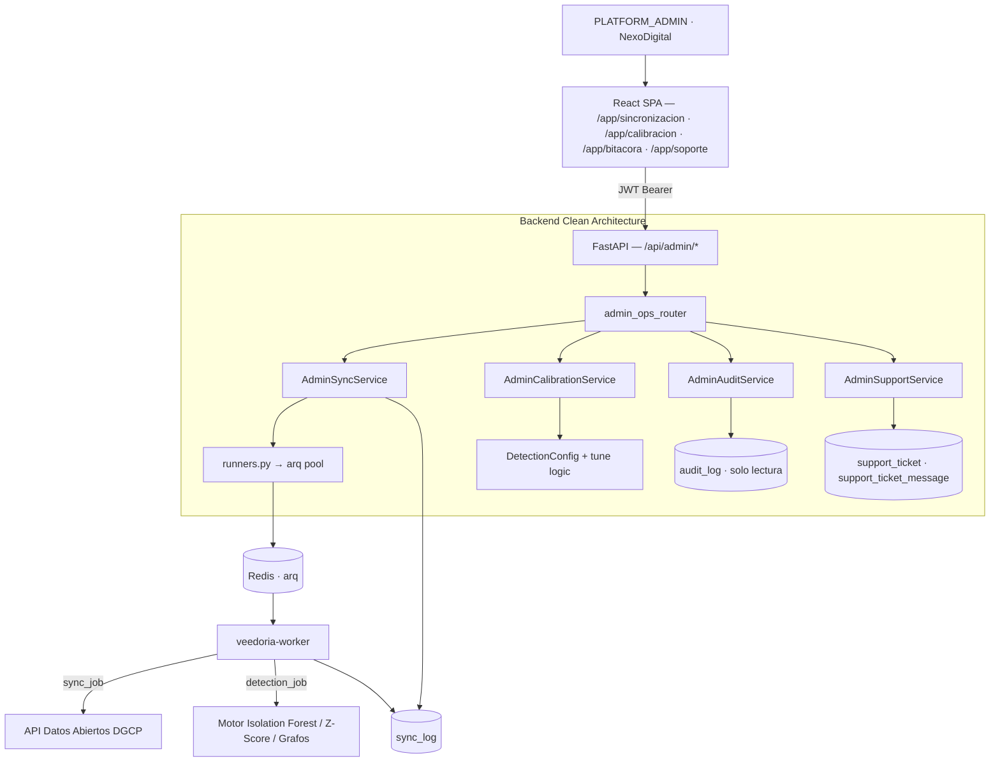
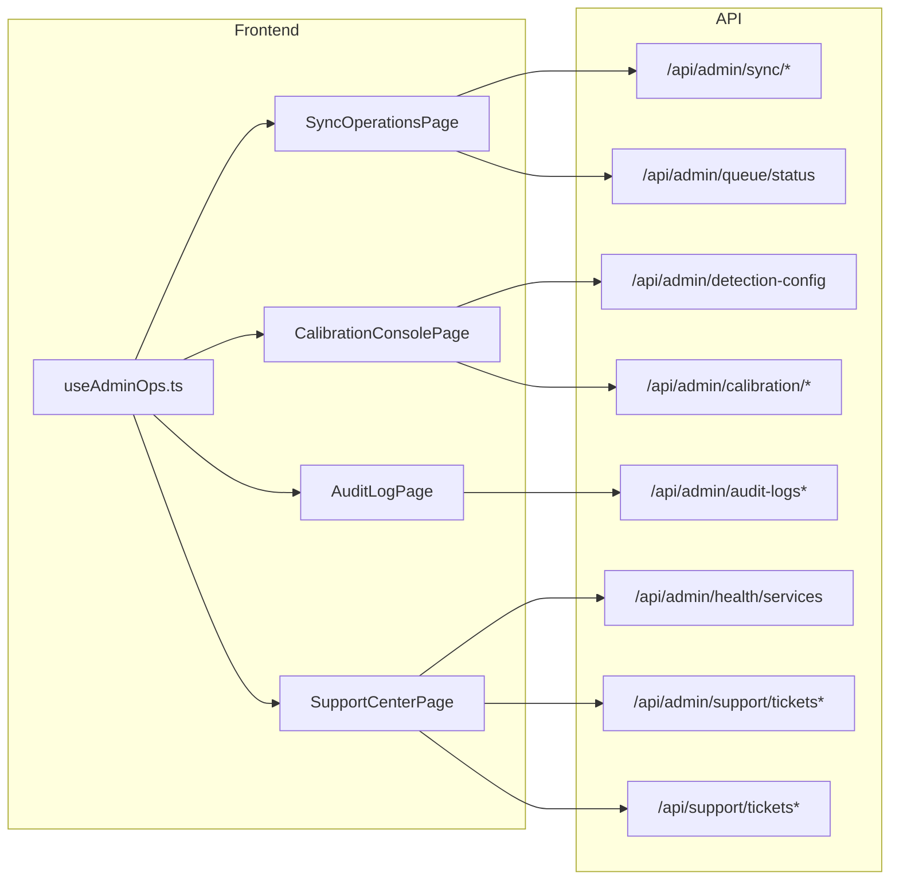

# Design: Consola de Administración Global y Operaciones (`consola-admin-operaciones`)

> 📋 Generated by `solution-designer` · 2026-10-21
> ✅ Approved by: JeremyJS (2026-10-21)

## Traceability
- **Work Item**: Pendiente (sin PBI/Feature en ADO)
- **Parent**: [veedoria-core](../intake.md)
- **Branch**: `dev`
- **Requirements**: [requirements.md](./requirements.md)
- **Test Plan**: [test-plan.md](./test-plan.md)
- **Test Cases**: [test-cases.md](./test-cases.md)

## Technology Decisions
- **Frontend**: React 19 + TypeScript 6 + Vite 8 + TailwindCSS 4 + HeroUI + TanStack Query — reutiliza el sistema de diseño GovTech, el layout `DashboardLayout` y los patrones de hooks existentes (`useAuditorB2G`, `useB2BSuite`); no se introducen dependencias nuevas.
- **Backend**: Python 3.11+ / FastAPI / SQLModel / SQLAlchemy 2.0 async — mismo stack del monorepo; se añade un router `admin_ops_router` bajo `/api/admin/*` con dependencias JWT existentes (`get_current_user`, `get_db`).
- **Database**: PostgreSQL (`asyncpg`) en Docker/Render y SQLite (`aiosqlite`) en local — se crea la entidad `SupportTicket` + `SupportTicketMessage` con migración Alembic reversible; las columnas temporales siguen la convención naive-UTC (`utcnow_naive`) documentada en `src/infrastructure/time_utils.py`.
- **Cola / Jobs**: `arq` + Redis (`veedoria-worker`) ya existentes; la consola reutiliza `run_sync` y `run_detection` de `src/presentation/runners.py` y añade introspección de cola vía `ArqRedis` (ping, profundidad, jobs fallidos).
- **Analítica de calibración**: reutiliza la lógica de `src/cli/tune_detection.py` extraída a `AdminCalibrationService` (TP/FP/FN, precision, recall, F1 y rejilla de umbrales) sin duplicar fórmulas.
- **Cloud Services**: Vercel (frontend), Render (API + worker + Redis) — sin cambios de infraestructura.
- **Theme**: GovTech institucional (claro/oscuro), sin badges decorativos y con navegación 100% interna bajo `/app/*`.

## Architecture

### System Overview

### Component Diagram

## Deployment
- **Pattern**: `monorepo-split` (sin cambios)
- **App**: Vercel (frontend) + Render (API `veedoria-api`, worker `veedoria-worker`, Redis `veedoria-redis`)
- **Infra**: Docker local (`docker-compose.yml`) y Render Blueprint (`render.yaml`)
- **CI/CD**: GitHub Actions/flujo actual del monorepo; quality gates `pytest` (backend) + `tsc -b` + `eslint` + `vite build` (frontend)
- **Justification**: la consola consume endpoints existentes y el mismo worker `arq`; no requiere servicios nuevos salvo la tabla de tickets.
- **Discarded**: (a) panel de administración en servicio separado → duplicaría auth y desplegaría infraestructura extra; (b) acceso directo del frontend a Redis → viola aislamiento y seguridad.

### Environments
| Environment | URL | Deploy trigger |
|-------------|-----|----------------|
| Local | `http://localhost:5173` (frontend) / `http://localhost:3001` (API) | `docker compose up` o `npm run dev` + `uvicorn` |
| Production | Vercel + Render (según `.sdd-config.json` → `deployment`) | Merge a `dev` (preview) / promoción a `main` |

## Database Schema

### Table: `support_ticket` (nueva — `app/backend/src/models/support_ticket.py`)
| Column | Type | Constraints | Default | Description |
|--------|------|------------|---------|-------------|
| `id` | `int` | PK, autoincrement | — | Identificador interno |
| `code` | `varchar(20)` | UNIQUE, IDX | generado (`SUP-YYYY-NNNN`) | Código visible del ticket |
| `subject` | `varchar(200)` | NOT NULL | — | Asunto del ticket |
| `category` | `varchar(30)` | NOT NULL | `SOPORTE_FUNCIONAL` | `SOPORTE_FUNCIONAL`, `ERROR_TECNICO`, `SOLICITUD_DATOS`, `FACTURACION` |
| `module` | `varchar(40)` | NOT NULL | `OTRO` | `SINCRONIZACION`, `CALIBRACION`, `BITACORA`, `DETECCION`, `ACCESOS`, `OTRO` |
| `priority` | `varchar(10)` | NOT NULL | `MEDIA` | `ALTA`, `MEDIA`, `BAJA` |
| `description` | `text` | NOT NULL | — | Descripción del incidente |
| `status` | `varchar(20)` | NOT NULL, IDX | `ABIERTO` | `ABIERTO`, `EN_PROGRESO`, `RESUELTO`, `CERRADO` |
| `reporter_id` | `int` | FK (`app_user.id`), IDX | — | Usuario solicitante |
| `reporter_tenant_id` | `int` | FK (`tenant.id`), IDX | — | Organización del solicitante |
| `assigned_to_id` | `int` | FK (`app_user.id`), NULL | `NULL` | Responsable de soporte |
| `created_at` | `timestamp` | NOT NULL | `utcnow_naive()` | Creación (naive UTC) |
| `updated_at` | `timestamp` | NOT NULL | `utcnow_naive()` | Última actualización (naive UTC) |
| `closed_at` | `timestamp` | NULL | `NULL` | Cierre del ticket |

### Table: `support_ticket_message` (nueva — `app/backend/src/models/support_ticket.py`)
| Column | Type | Constraints | Default | Description |
|--------|------|------------|---------|-------------|
| `id` | `int` | PK, autoincrement | — | Identificador del mensaje |
| `ticket_id` | `int` | FK (`support_ticket.id`), IDX, ON DELETE CASCADE | — | Ticket asociado |
| `author_id` | `int` | FK (`app_user.id`), IDX | — | Autor de la respuesta |
| `body` | `text` | NOT NULL | — | Contenido del mensaje |
| `created_at` | `timestamp` | NOT NULL | `utcnow_naive()` | Fecha de creación (naive UTC) |

### Table: `audit_log` (existente — solo lectura desde `AdminAuditService`)
`id`, `action_type`, `user_id`, `entity_type`, `entity_id`, `old_value` (JSON), `new_value` (JSON), `ip_address`, `timestamp` (naive UTC). Sin cambios de esquema: la bitácora se consume con filtros y paginación.

### Table: `detection_config` (existente — escalar global de 13 claves)
`key` (PK), `value` (float), `updated_at` (naive UTC). La consola global reutiliza el catálogo `DEFAULT_DETECTION_CONFIG` (3 pesos, 3 umbrales, 7 topes DGCP + `FRAGMENTATION_THRESHOLD_DOP`).

### Indexes
| Name | Columns | Type |
|------|---------|------|
| `ix_support_ticket_code` | `support_ticket.code` | UNIQUE BTREE |
| `ix_support_ticket_status` | `support_ticket.status` | BTREE |
| `ix_support_ticket_reporter` | `support_ticket.reporter_id`, `reporter_tenant_id` | BTREE compuesto |
| `ix_support_ticket_assigned` | `support_ticket.assigned_to_id` | BTREE |
| `ix_support_ticket_message_ticket` | `support_ticket_message.ticket_id` | BTREE |
| `ix_audit_log_action_type` | `audit_log.action_type` | BTREE (existente) |
| `ix_audit_log_timestamp` | `audit_log.timestamp` | BTREE (existente) |
| `ix_audit_log_user_id` | `audit_log.user_id` | BTREE (existente) |
| `ix_audit_log_entity_type` | `audit_log.entity_type` | BTREE (nuevo) |

### Migration Alembic (obligatoria)
- `upgrade`: crea `support_ticket` y `support_ticket_message` con FKs, defaults e índices; añade `ix_audit_log_entity_type`.
- `downgrade`: elimina índices y tablas en orden inverso. Reversible y sin pérdida de datos existentes.

## API Contracts

### `GET /api/admin/sync/overview` (`REQ-001`, `REQ-002` — `#32 /app/sincronizacion`)
- **Request**: query `limit` (default 10, max 50)
- **Response**: `{ kpis: {last_sync, records_total, avg_duration_s, failures_24h, running}, syncs: [...], detections: [...] }` con cada fila `SyncLog` serializada (`id`, `process_type`, `status`, `records`, `started_at`, `completed_at`, `error`, `triggered_by`, `sync_type`).
- **Auth**: JWT `PLATFORM_ADMIN`
- **Errors**: `403 FORBIDDEN_ADMIN`
- **Maps to**: REQ-001, REQ-002

### `POST /api/admin/sync/trigger` (`REQ-001`)
- **Request**: `{ full: bool, skip_institutions: bool, skip_processes: bool, skip_contracts: bool, skip_items: bool, skip_suppliers: bool, days_back: int|null, rate_limit: float }`
- **Response**: `202 { success: true, data: { task, sync_type } }`
- **Auth**: JWT `PLATFORM_ADMIN`
- **Errors**: `409 SYNC_ALREADY_RUNNING` (BR-RES-001), `503 QUEUE_UNAVAILABLE` (Redis/arq caído), `422 VALIDATION_ERROR`
- **Maps to**: REQ-001

### `GET /api/admin/queue/status` (`REQ-002`, `REQ-006`)
- **Request**: —
- **Response**: `{ redis: "OK"|"OFFLINE", worker: "OK"|"DOWN", queue_depth: int, failed_jobs_24h: int, checked_at }`
- **Auth**: JWT `PLATFORM_ADMIN`
- **Errors**: `403 FORBIDDEN_ADMIN`; degradación: responde `200` con `redis: "OFFLINE"` si el pool no responde.
- **Maps to**: REQ-002, REQ-006

### `GET /api/admin/detection-config` & `PUT /api/admin/detection-config` (`REQ-003`)
- **Request PUT**: `{ parameters: { "PRICE_VARIATION_PCT_THRESHOLD": 35.0, "FRAGMENTATION_WINDOW_DAYS": 45 } }`
- **Response**: catálogo completo con `key`, `label`, `category`, `value`, `default_value`, `min`, `max`, `step`, `description`, `updated_at`
- **Auth**: JWT `PLATFORM_ADMIN` (alcance global, `entity_id = 'global'`)
- **Errors**: `403 FORBIDDEN_CONFIG_EDIT`, `422 VALIDATION_ERROR`; valores fuera de rango se ajustan al límite y se informan.
- **Maps to**: REQ-003

### `POST /api/admin/detection-config/reset` (`REQ-003`)
- **Request**: `{ keys: ["THRESHOLD_CD_DOP"] }` (vacío = todos)
- **Response**: catálogo restaurado + `audit_log.action_type = DETECTION_CONFIG_RESET`
- **Auth**: JWT `PLATFORM_ADMIN`
- **Errors**: `403 FORBIDDEN_CONFIG_EDIT`, `422 VALIDATION_ERROR`
- **Maps to**: REQ-003

### `GET /api/admin/calibration/analysis` (`REQ-004`)
- **Request**: query `anomaly_type` opcional (`PRICE_ANOMALY`, `FRAGMENTATION`, `COLLUSION`)
- **Response**: `{ generated_at, types: [{ anomaly_type, reviews, tp, fp, fn, precision, recall, f1, current_threshold, recommended_threshold, grid: [...] }], insufficient_data: [tipo] }`
- **Auth**: JWT `PLATFORM_ADMIN`
- **Errors**: `403 FORBIDDEN_ADMIN`; tipos sin dictámenes se reportan en `insufficient_data` sin abortar.
- **Maps to**: REQ-004

### `POST /api/admin/calibration/apply` (`REQ-004`)
- **Request**: `{ changes: { "price_zscore_threshold": 2.5, "price_min_deviation_pct": 50, "fragmentation_threshold_dop": 6500000 } }` (solo claves de calibración)
- **Response**: catálogo actualizado + `audit_log.action_type = CALIBRATION_APPLY` con diff
- **Auth**: JWT `PLATFORM_ADMIN`
- **Errors**: `403 FORBIDDEN_CONFIG_EDIT`, `422 VALIDATION_ERROR`
- **Maps to**: REQ-004

### `POST /api/admin/detection/run` (`REQ-004`)
- **Request**: —
- **Response**: `202 { task }`
- **Auth**: JWT `PLATFORM_ADMIN`
- **Errors**: `409 DETECTION_ALREADY_RUNNING`, `503 QUEUE_UNAVAILABLE`
- **Maps to**: REQ-004

### `GET /api/admin/audit-logs` (`REQ-005`)
- **Request**: query `action_type`, `user_id`, `entity_type`, `entity_id`, `date_from`, `date_to`, `page` (default 1), `limit` (default 25, max 100)
- **Response**: `{ total, page, limit, items: [{ id, action_type, user_email, entity_type, entity_id, old_value, new_value, ip_address, timestamp }] }` ordenado por `timestamp` DESC
- **Auth**: JWT `PLATFORM_ADMIN`
- **Errors**: `403 FORBIDDEN_ADMIN`, `422 INVALID_DATE_RANGE` (`date_from > date_to`)
- **Maps to**: REQ-005

### `GET /api/admin/audit-logs/export` (`REQ-005`)
- **Request**: mismos filtros + `format=csv|json`
- **Response**: `text/csv` o `application/json` con todas las filas del filtro (tope 10,000) + `X-Checksum-SHA256`; registra `audit_log.action_type = AUDIT_LOG_EXPORT`
- **Auth**: JWT `PLATFORM_ADMIN`
- **Errors**: `403 FORBIDDEN_ADMIN`, `413 EXPORT_TOO_LARGE` (> 10,000 filas → refinar filtros)
- **Maps to**: REQ-005

### `GET /api/admin/health/services` (`REQ-006`)
- **Response**: `{ checked_at, components: [{ key, label, status: "OK"|"DEGRADED"|"DOWN", detail, latency_ms }] }` con `api`, `database`, `redis_worker`, `last_sync`, `last_detection`, `scheduler`
- **Auth**: JWT `PLATFORM_ADMIN`
- **Errors**: `403 FORBIDDEN_ADMIN`; cada check aislado con timeout propio.
- **Maps to**: REQ-006

### `GET /api/admin/support/tickets` & `PATCH /api/admin/support/tickets/{ticket_id}` (`REQ-007`)
- **Request PATCH**: `{ status?: "EN_PROGRESO", assigned_to_id?: 6, reply?: "..." }`
- **Response**: ticket con `messages[]`; cada transición registra `audit_log.action_type = TICKET_STATUS_CHANGED` / `TICKET_ASSIGNED` / `TICKET_REPLIED`
- **Auth**: JWT `PLATFORM_ADMIN`
- **Errors**: `403 FORBIDDEN_ADMIN`, `404 TICKET_NOT_FOUND`, `409 TICKET_CLOSED` (sin reapertura explícita)
- **Maps to**: REQ-007

### `POST /api/support/tickets` & `GET /api/support/tickets` (`REQ-007`)
- **Request POST**: `{ subject, category, module, priority, description }`
- **Response**: ticket creado con `code = SUP-YYYY-NNNN`; GET devuelve solo los tickets del usuario/organización autenticada
- **Auth**: JWT (cualquier rol autenticado)
- **Errors**: `422 VALIDATION_ERROR`, `403 FORBIDDEN_SEGMENT` (tickets de otra organización)
- **Maps to**: REQ-007

## Metodología Analítica de Calibración (`/app/calibracion` — REQ-004)

### 1. Métricas de calidad sobre dictámenes humanos
Para cada tipo de anomalía, con umbral de decisión `t`:
- `TP = #{score ≥ t ∧ status = CONFIRMED}`, `FP = #{score ≥ t ∧ status = DISMISSED}`, `FN = #{score < t ∧ status = CONFIRMED}`
- `Precision = TP / (TP + FP)`, `Recall = TP / (TP + FN)`, `F1 = 2 · Precision · Recall / (Precision + Recall)`
- Umbral recomendado: el `argmax_t F1` sobre la rejilla del tipo.

### 2. Rejillas de umbrales
- `PRICE_ANOMALY` — z-score: `[0.5, 1.0, 1.5, 2.0, 2.5, 3.0, 3.5, 4.0]`; desviación mínima (%): `[25, 50, 75, 100, 125, 150]`.
- `FRAGMENTATION` — monto acumulado (DOP): `[3M, 5M, 7M, 8M, 10M, 12M]`.
- `COLLUSION` — sin rejilla numérica: se reporta la tasa de confirmación por nivel de confianza (`ALTA`, `MEDIA`, `BAJA`).

### 3. Guardas operativas
- Exclusión mutua por `sync_log.process_type` (BR-RES-001) para sync y detección.
- Reconciliación `running → failed (server_restart)` en el `lifespan` (BR-MAN-001).
- Preservación absoluta de anomalías `CONFIRMED`/`DISMISSED` tras re-ejecutar el motor.
- Toda escritura temporal en columnas naive usa `utcnow_naive()` (convención Postgres/asyncpg).

## Runbook de Operaciones (`/app/sincronizacion` — REQ-001/REQ-002)
1. **Ingesta manual**: elegir tipo (incremental/completo), fases, `days_back` y `rate_limit`; el backend valida mutex y encola `sync_job` en `arq` (respuesta `202`).
2. **Errores DGCP 429/5xx**: `DGCPClient` reintenta con backoff exponencial (máx. 3); si agota, `sync_log.status = failed` con `error_message` visible y botón "Relanzar".
3. **Reinicio del servidor**: cualquier `running` se marca `failed (server_restart)`; el operador relanza manualmente la corrida.
4. **Redis/worker caído**: la consola muestra `OFFLINE/DOWN`, mantiene el histórico desde base de datos y deshabilita los disparos.
5. **Detección**: se encola `detection_job` solo si no hay corrida activa; la preservación de dictámenes está garantizada por el motor.

## Design Coherence
- Coherente con `requirements.md` REQ-001..REQ-007 y NFR-001..NFR-005.
- Reutiliza patrones existentes: `ApiResponse`, `HTTPException` con `detail.code`, servicios por dominio, hooks React Query y drawers internos.
- No introduce dependencias nuevas ni cambios de stack.
- Respeta la separación de capas: routers (presentación) → servicios → modelos, con acceso a datos vía SQLModel.

## Requirements Coverage
| REQ | Endpoints / Componentes | Pantalla |
|-----|-------------------------|----------|
| REQ-001 | `GET /api/admin/sync/overview`, `POST /api/admin/sync/trigger`, `SyncOperationsPage` | `#32 /app/sincronizacion` |
| REQ-002 | `GET /api/admin/queue/status`, reconciliación `server_restart`, `SyncOperationsPage` | `#32 /app/sincronizacion` |
| REQ-003 | `GET/PUT /api/admin/detection-config`, `POST /api/admin/detection-config/reset`, `CalibrationConsolePage` | `#33 /app/calibracion` |
| REQ-004 | `GET /api/admin/calibration/analysis`, `POST /api/admin/calibration/apply`, `POST /api/admin/detection/run`, `CalibrationConsolePage` | `#33 /app/calibracion` |
| REQ-005 | `GET /api/admin/audit-logs`, `GET /api/admin/audit-logs/export`, `AuditLogPage` | `#35 /app/bitacora` |
| REQ-006 | `GET /api/admin/health/services`, `SupportCenterPage` | `#36 /app/soporte` |
| REQ-007 | `GET/PATCH /api/admin/support/tickets`, `POST/GET /api/support/tickets`, `SupportCenterPage` | `#36 /app/soporte` |

## Architecture Updates
- `docs/architecture/api-contract.md`: 12 endpoints `/api/admin/*` + 2 `/api/support/*` con auth, payloads y errores.
- `docs/architecture/data-model.md`: tablas `support_ticket` y `support_ticket_message`, FKs e índices; migración Alembic.
- `docs/architecture/security-model.md`: fila de matriz para `/app/sincronizacion`, `/app/calibracion`, `/app/bitacora` y `/app/soporte` (solo `PLATFORM_ADMIN`), y acciones auditadas.
- `docs/architecture/system-design.md`: runbook de sincronización `arq` + Redis, metodología de calibración global y trazabilidad de la bitácora; catálogo final de las 36 pantallas al cierre del paquete.
- `product.md`: actualización del estado del roadmap al completar las 36 pantallas.

## Approval
- [x] Developer: JeremyJS Date: 2026-10-21

---
> 📍 Pendiente (sin PBI/Feature en ADO) · 🌿 `dev` · Generated by SDD Standard
