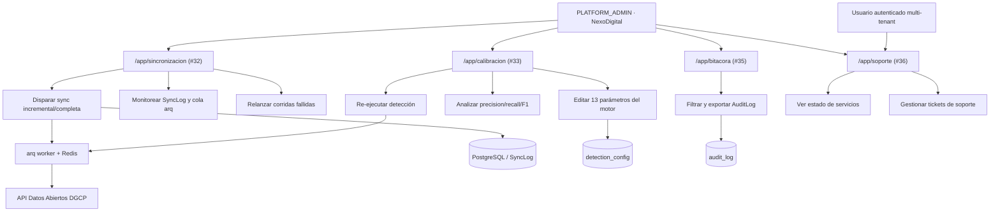
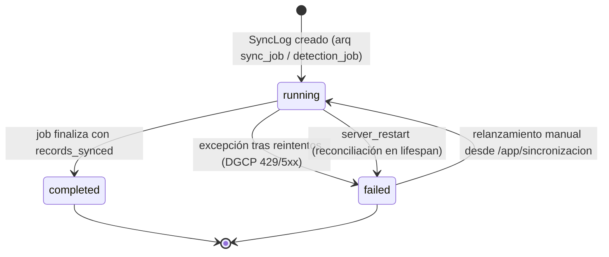

# Requirements: Consola de Administración Global y Operaciones (`consola-admin-operaciones`)

> 📋 Generated by `requirements-analyst` · 2026-10-21
> ✅ Approved by: JeremyJS (2026-10-21)

## Traceability
- **Work Item**: Pendiente (sin PBI/Feature en ADO)
- **Parent**: [veedoria-core](../intake.md)
- **Branch**: `dev`
- **Design**: [design.md](./design.md)
- **Test Plan**: [test-plan.md](./test-plan.md)
- **Test Cases**: [test-cases.md](./test-cases.md)

## Overview

Este módulo implementa las **4 pantallas del Paquete 4 (Consola de Administración Global y Operaciones)** definidas en el Mapa Completo de 36 Pantallas (`#32`, `#33`, `#35` y `#36`), entregando a **NexoDigital (PLATFORM_ADMIN)** el gobierno operativo de extremo a extremo de la plataforma: control y observabilidad de la ingesta ETL desde la API OCDS de la DGCP, monitoreo de la cola asíncrona `arq` + Redis y recuperación ante reinicios; calibración global del motor estadístico (`DetectionConfig`, 13 parámetros) y re-entrenamiento/re-ejecución del motor con métricas de calidad (precision/recall/F1) calculadas sobre los dictámenes humanos (`CONFIRMED`/`DISMISSED`); lectura inmutable y exportable de la bitácora de auditoría (`AuditLog`) con trazabilidad de cada acción sensible; y un Centro de Soporte con estado de servicios, base de conocimiento y ticketing interno. Todas las pantallas viven bajo `/app/*` con navegación interna y reutilizan exclusivamente los tokens del sistema de diseño GovTech, sin badges decorativos ni pestañas redundantes con el sidebar.

Pantallas cubiertas:
1. **Consola de Sincronización de Datos DGCP (`/app/sincronizacion` — `#32`)**: monitor en vivo de las corridas ETL (`SyncLog`), disparo manual (incremental/completo) con selección de fases, `days_back`, `rate_limit` y bloqueo de concurrencia, además de observabilidad de la cola `arq`/Redis y recuperación de ejecuciones interrumpidas por reinicio (`server_restart`).
2. **Control y Calibración de Modelos Estadísticos (`/app/calibracion` — `#33`)**: lectura/escritura de los 13 parámetros del motor (pesos, umbrales y topes DGCP), análisis de calibración con precision/recall/F1 sobre el histórico de dictámenes, aplicación de umbrales recomendados con confirmación explícita, restauración a valores por defecto y re-ejecución del motor de detección.
3. **Lector de Bitácora del Sistema (`/app/bitacora` — `#35`)**: consulta inmutable y paginada de `AuditLog` con filtros por acción, usuario, entidad y rango de fechas, inspección de diffs `old_value`/`new_value`, y exportación CSV/JSON.
4. **Centro de Soporte Técnico (`/app/soporte` — `#36`)**: estado agregado de servicios (API, base de datos, Redis/worker `arq`, última sincronización, motor de detección y jobs programados), guía de resolución por módulo y gestión de tickets internos de soporte con estados y responsables.

## User Stories (EARS Notation)

### REQ-001: Consola de Sincronización de Datos DGCP (`/app/sincronizacion` — `#32`)
**Type:** Event-Driven
**Rule:** WHEN un usuario `PLATFORM_ADMIN` accede a `/app/sincronizacion`, the system SHALL presentar un tablero operativo de la ingesta ETL con los KPIs de la última corrida completada (fecha/hora de inicio y fin, duración, registros sincronizados, tipo de sincronización, disparador), el estado en vivo de cualquier corrida activa (`running`) y el histórico paginado reciente de `SyncLog` (sincronizaciones y detecciones), permitiendo disparar manualmente una nueva sincronización **incremental** o **completa** con selección individual de fases (`institutions`, `processes`, `contracts`, `items`, `suppliers`), ventana `days_back` (90 por defecto) y control de tasa `rate_limit` (5.0 req/s por defecto), recibiendo `202 Accepted` con el identificador del job encolado en `arq`.
**Entities:** `SyncLog`, `Institution`, `Process`, `Contract`, `Item`, `Supplier`, `Tenant`
**Error Handling:** Si ya existe un `SyncLog` con `status = 'running'` (BR-RES-001), el botón de disparo se deshabilita y el sistema responde con el mensaje controlado "Sync ya está en progreso" sin encolar un segundo job; si el pool `arq`/Redis no está disponible, se muestra el estado `OFFLINE` con la acción deshabilitada y la causa (sin lanzar excepción 500).

**Acceptance Criteria:**
- [x] Given un administrador global en `/app/sincronizacion`, when la última corrida está en `completed`, then el tablero muestra su rango temporal, duración calculada (`completed_at − started_at`), total de `records_synced`, `sync_type` (`full`, `incremental` o combinación de fases con `+`) y `triggered_by`.
- [x] Given una corrida activa, when el panel se refresca por polling, then el estado `running` se muestra con indicador de progreso y sin permitir un segundo disparo concurrente.
- [x] Given el formulario de disparo, when el administrador selecciona "Completa" y desmarca `items` y `suppliers` con `days_back = 30` y `rate_limit = 3.0`, then el sistema encola el job con esa configuración, responde `202` con `task` (job id) y `sync_type` calculado, y la fila aparece como `running` en el histórico.
- [x] Given el histórico, when una corrida terminó en `failed`, then se muestra `error_message` completo y la opción de reintentar con la misma configuración.

**Priority:** Must
**Dependencies:** None
**Tracker:** Pendiente

### REQ-002: Observabilidad de Cola `arq`/Redis y Recuperación ante Reinicio (`/app/sincronizacion` — `#32`)
**Type:** State-Driven
**Rule:** WHILE el administrador permanece en `/app/sincronizacion`, the system SHALL exponer el estado de salud de la infraestructura asíncrona (ping a Redis, disponibilidad del worker `veedoria-worker`, profundidad de la cola y jobs fallidos recientes) y, cuando detecte ejecuciones interrumpidas por reinicio del servidor (`error_message = 'server_restart'`), SHALL marcarlas como `failed` con recomendación explícita de relanzarlas manualmente, sin re-ejecutar automáticamente ningún job ni alterar el histórico previo.
**Entities:** `SyncLog`, `arq` (Redis), `APScheduler`
**Error Handling:** Si Redis no responde, la pantalla entra en modo degradado: muestra `REDIS: OFFLINE`, mantiene visible el histórico de `SyncLog` desde base de datos y deshabilita las acciones que dependen de la cola; si el worker está caído pero Redis responde, muestra `WORKER: DOWN` con los jobs pendientes y la recomendación de levantar el contenedor `veedoria-worker`.

**Acceptance Criteria:**
- [x] Given Redis y worker operativos, when se abre la consola, then se muestran `REDIS: OK`, `WORKER: OK`, profundidad de cola y contador de jobs fallidos de las últimas 24 horas.
- [x] Given un reinicio del servidor con un job `running`, when la aplicación arranca y ejecuta el `lifespan` (BR-MAN-001), then la corrida aparece como `failed` con `error_message = 'server_restart'` y la consola ofrece el botón "Relanzar".
- [x] Given Redis caído en desarrollo local, when se abre la consola, then la pantalla funciona en modo degradado sin errores 500 y con mensaje accionable.

**Priority:** Must
**Dependencies:** REQ-001
**Tracker:** Pendiente

### REQ-003: Control y Calibración de Modelos Estadísticos (`/app/calibracion` — `#33`)
**Type:** Event-Driven
**Rule:** WHEN un `PLATFORM_ADMIN` accede a `/app/calibracion`, the system SHALL mostrar los **13 parámetros** persistidos en `detection_config`, agrupados por categoría (`PESOS`, `UMBRALES`, `UMBRALES_DGCP`), con valor vigente, valor por defecto, rango `[min, max]`, `step`, descripción funcional y fecha de última modificación, y SHALL permitir actualizarlos en bloque con validación de rango (`clamp` a `[min, max]`), registro obligatorio en `AuditLog` (`action_type = 'UPDATE_DETECTION_CONFIG'` con `old_value` y `new_value` por clave) y opción de restaurar cualquier parámetro a su valor por defecto.
**Entities:** `DetectionConfig`, `AuditLog`, `Anomaly`
**Error Handling:** Si un valor recibido está fuera de rango, el sistema lo ajusta al límite más cercano y lo informa en la respuesta; si el rol no es `PLATFORM_ADMIN`/`TENANT_ADMIN`/`CONTRALOR`, responde `403 FORBIDDEN_CONFIG_EDIT` sin escribir en base de datos; si la escritura falla, no se aplica ningún parámetro del lote (operación atómica).

**Acceptance Criteria:**
- [x] Given la consola de calibración, when se carga, then se listan los 13 parámetros con exactamente estas claves: `PRICE_ANOMALY_WEIGHT`, `FRAGMENTATION_WEIGHT`, `COLLUSION_WEIGHT`, `MIN_CRITICAL_SEVERITY`, `PRICE_VARIATION_PCT_THRESHOLD`, `FRAGMENTATION_WINDOW_DAYS`, `THRESHOLD_CD_DOP`, `THRESHOLD_CM_DOP`, `THRESHOLD_CP_DOP`, `THRESHOLD_PEIN_DOP`, `THRESHOLD_LPN_DOP`, `THRESHOLD_PEEN_DOP`, `FRAGMENTATION_THRESHOLD_DOP`.
- [x] Given un cambio de `PRICE_VARIATION_PCT_THRESHOLD` de `50.0` a `35.0` y `FRAGMENTATION_WINDOW_DAYS` a `45`, when se guarda, then ambos valores se persisten, se muestra `updated_at` renovado y queda una entrada `UPDATE_DETECTION_CONFIG` en `AuditLog` con el diff exacto `{old: 50.0, new: 35.0}`.
- [x] Given un valor fuera del rango permitido (`THRESHOLD_CD_DOP = 9,000,000` con `max = 1,000,000`), when se guarda, then el valor se ajusta a `1,000,000` y la UI lo notifica como ajuste aplicado.
- [x] Given un parámetro modificado, when el administrador pulsa "Restaurar valor por defecto", then se reescribe su `default_value` y se registra la acción correspondiente en `AuditLog`.

**Priority:** Must
**Dependencies:** None
**Tracker:** Pendiente

### REQ-004: Recalibración Estadística y Re-ejecución del Motor (`/app/calibracion` — `#33`)
**Type:** Event-Driven
**Rule:** WHEN el administrador ejecuta el análisis de calibración, the system SHALL calcular sobre el histórico de anomalías ya dictaminadas (`CONFIRMED` / `DISMISSED`) las métricas de calidad del motor (TP, FP, FN, precision, recall y F1) por tipo de anomalía (`PRICE_ANOMALY`, `FRAGMENTATION`, `COLLUSION`), evaluar una rejilla de umbrales candidatos (z-score `0.5–4.0`, desviación mínima `25–150 %`, monto de fraccionamiento `RD$3M–RD$12M`) y recomendar el umbral con mejor F1, permitiendo aplicarlo en `detection_config` solo tras confirmación explícita del administrador, y SHALL permitir disparar una nueva corrida de detección (`run_detection`) vía `arq` respetando la exclusión mutua (BR-RES-001) y la preservación absoluta de los dictámenes humanos existentes.
**Entities:** `Anomaly`, `DetectionConfig`, `SyncLog`, `AuditLog`
**Error Handling:** Si no existen dictámenes suficientes para un tipo de anomalía, el sistema informa "Sin dictámenes suficientes" y omite ese bloque sin abortar el análisis global; si ya hay una detección `running`, rechaza el disparo con mensaje controlado; al re-ejecutar, ninguna anomalía `CONFIRMED`/`DISMISSED` puede volver a `PENDING`.

**Acceptance Criteria:**
- [x] Given al menos un dictamen por tipo, when se ejecuta el análisis, then se muestran TP/FP/FN, precision, recall, F1 y el umbral recomendado por tipo, junto con la comparación contra el umbral vigente.
- [x] Given una recomendación de umbral, when el administrador aplica el cambio, then se requiere confirmación en modal, se persiste en `detection_config` y se registra en `AuditLog` con el valor anterior y el nuevo.
- [x] Given un disparo de detección, when no hay corridas activas, then se encola el job, se responde `202` con el id y la corrida aparece en el histórico de `SyncLog` con `process_type = 'detection'`.
- [x] Given los dictámenes existentes, when finaliza una re-ejecución completa, then el 100 % de las anomalías `CONFIRMED`/`DISMISSED` conserva su estado y su `reviewer_id`.

**Priority:** Must
**Dependencies:** REQ-003
**Tracker:** Pendiente

### REQ-005: Lector Inmutable de Bitácora del Sistema (`/app/bitacora` — `#35`)
**Type:** State-Driven
**Rule:** WHILE un `PLATFORM_ADMIN` consulta `/app/bitacora`, the system SHALL exponer la bitácora `AuditLog` en modo estrictamente de solo lectura, paginada y ordenada por `timestamp` descendente, con filtros combinables por `action_type`, usuario (`user_id` y correo del actor), `entity_type`, `entity_id` y rango de fechas (desde/hasta), mostrando en el detalle el diff estructurado entre `old_value` y `new_value`, la IP de origen cuando exista, y permitiendo exportar el resultado filtrado a CSV o JSON sin posibilidad alguna de editar, ocultar ni eliminar registros desde la interfaz.
**Entities:** `AuditLog`, `AppUser`
**Error Handling:** Si el rango de fechas es inválido (`desde > hasta`), se valida en el formulario sin ejecutar la consulta; si el filtro no arroja resultados, se muestra estado vacío con opción de limpiar filtros; cualquier intento de escritura sobre la bitácora no está expuesto por la API (`405`/`404`).

**Acceptance Criteria:**
- [x] Given la bitácora con entradas de múltiples módulos, when se filtra por `action_type = 'UPDATE_DETECTION_CONFIG'` y rango de fechas, then la tabla muestra solo esas entradas con fecha, actor, entidad y resumen legible.
- [x] Given una entrada con `old_value` y `new_value` JSON, when se abre el detalle, then se visualiza el diff campo por campo (antes/después).
- [x] Given un resultado filtrado, when el administrador exporta, then se descarga un archivo CSV con todas las filas del filtro (no solo la página visible) y el evento de exportación queda registrado en `AuditLog`.
- [x] Given cualquier rol distinto de `PLATFORM_ADMIN`, when intenta consultar `/api/admin/audit-logs`, then recibe `403`.

**Priority:** Must
**Dependencies:** None
**Tracker:** Pendiente

### REQ-006: Estado Agregado de Servicios del Sistema (`/app/soporte` — `#36`)
**Type:** State-Driven
**Rule:** WHEN se abre `/app/soporte`, the system SHALL agregar en una sola vista el estado operativo de los servicios de la plataforma — API (versión y disponibilidad), base de datos (motor y latencia de consulta), Redis/worker `arq` (ping y profundidad de cola), última sincronización DGCP y última corrida de detección (`SyncLog`), y jobs programados (`APScheduler`) — clasificando cada componente como `OK`, `DEGRADED` o `DOWN` con su última verificación y una acción sugerida cuando no esté `OK`.
**Entities:** `SyncLog`, `arq`, `APScheduler`, `AppUser`
**Error Handling:** Cada comprobación es independiente y aislada: si una falla, solo ese componente aparece como `DOWN` y el resto del panel sigue operativo; los tiempos de espera de cada comprobación están acotados para no bloquear la vista.

**Acceptance Criteria:**
- [x] Given todos los servicios operativos, when se abre el centro de soporte, then los seis componentes aparecen en `OK` con timestamp de verificación.
- [x] Given Redis caído, when se abre la pantalla, then `Redis/Worker` figura en `DOWN` y el resto de componentes se evalúa con normalidad.
- [x] Given una última sincronización fallida, when se revisa el panel, then se muestra el error registrado y la acción sugerida ("Revisar /app/sincronizacion").

**Priority:** Must
**Dependencies:** REQ-001
**Tracker:** Pendiente

### REQ-007: Ticketing Interno de Soporte y Base de Conocimiento (`/app/soporte` — `#36`)
**Type:** Event-Driven
**Rule:** WHEN un usuario autenticado de cualquier organización registra un ticket de soporte, the system SHALL crear el ticket con código único, asunto, categoría (soporte funcional, error técnico, solicitud de datos, facturación), módulo afectado, prioridad, descripción y evidencia adjunta opcional, con estado inicial `ABIERTO`, y SHALL permitir al `PLATFORM_ADMIN` listar, filtrar, asignar responsable, responder y transicionar el ticket entre `ABIERTO`, `EN_PROGRESO`, `RESUELTO` y `CERRADO`, registrando cada transición en `AuditLog`; además, la pantalla SHALL ofrecer una base de conocimiento estática por módulo (sincronización, calibración, bitácora, detección, accesos) con respuestas a las incidencias frecuentes.
**Entities:** `SupportTicket` (nueva entidad), `AuditLog`, `AppUser`
**Error Handling:** Si falta el asunto o la descripción, la validación impide el envío; si el ticket ya está `CERRADO`, no admite nuevas respuestas (solo lectura) y ofrece reapertura explícita por el administrador.

**Acceptance Criteria:**
- [x] Given un usuario autenticado, when envía un ticket completo, then recibe un código único (`SUP-YYYY-NNNN`) y el ticket aparece en `ABIERTO` en su bandeja y en la bandeja del administrador.
- [x] Given la bandeja del administrador, when cambia el estado a `EN_PROGRESO`, asigna responsable y responde, then el cambio y la respuesta quedan visibles para el solicitante y trazados en `AuditLog`.
- [x] Given un ticket `CERRADO`, when el solicitante intenta responder, then la acción está bloqueada y se ofrece la opción de reapertura solo al administrador.

**Priority:** Should
**Dependencies:** REQ-006
**Tracker:** Pendiente

## Non-Functional Requirements

### NFR-001: Aislamiento por rol y segmento
**Category:** Security
**Rule:** Todos los endpoints de esta consola (`/api/admin/*`) SHALL exigir JWT válido y rol `PLATFORM_ADMIN` (o permiso equivalente), devolviendo `403` a cualquier otro rol u organización, y la UI SHALL ocultar las entradas de navegación cuando el rol no corresponda.
**Metric:** 100 % de endpoints protegidos; 0 accesos cruzados entre tenants en pruebas automatizadas.
**Priority:** Must

### NFR-002: Rendimiento de consultas operativas
**Category:** Performance
**Rule:** Las lecturas de la consola (histórico de `SyncLog`, parámetros, bitácora paginada y estado de servicios) SHALL responder dentro de los umbrales del intake, y los disparos de jobs SHALL ser asíncronos con `202 Accepted`.
**Metric:** Lecturas < 200 ms p95; disparos < 500 ms con `202`; bitácora paginada < 400 ms p95 con índices sobre `action_type`, `timestamp`, `user_id` y `entity_type`.
**Priority:** Must

### NFR-003: Inmutabilidad y completitud de la auditoría
**Category:** Reliability
**Rule:** Toda acción sensible de la consola (disparo de sync/detección, cambio de parámetros, aplicación de umbrales, exportación de bitácora, transición de tickets) SHALL registrarse en `AuditLog` con actor, timestamp y diff cuando aplique; la API no SHALL permitir modificar ni eliminar entradas de la bitácora.
**Metric:** 100 % de acciones sensibles auditadas; 0 endpoints de escritura sobre `AuditLog`.
**Priority:** Must

### NFR-004: Degradación elegante y recuperación
**Category:** Reliability
**Rule:** La consola SHALL seguir siendo operable en modo degradado cuando Redis o el worker no estén disponibles, y SHALL reconciliar al arranque las corridas interrumpidas (`running` → `failed` con `server_restart`).
**Metric:** 0 errores 500 por servicios caídos; 100 % de corridas huérfanas reconciliadas en el `lifespan`.
**Priority:** Must

### NFR-005: Consistencia visual e internacionalización
**Category:** Accessibility
**Rule:** Las 4 pantallas SHALL reutilizar el sistema de diseño GovTech (tema claro/oscuro, tokens semánticos), mantener navegación 100 % interna bajo `/app/*`, soportar ES/EN con `i18next` y no introducir badges decorativos, cabeceras redundantes ni pestañas duplicadas con el sidebar (NFR-001 del estándar de diseño).
**Metric:** 0 badges decorativos; 0 enlaces a rutas públicas desde la consola; contraste AA en textos y estados.
**Priority:** Should

## Diagrams

### Use Case Diagram

### Supporting Diagram — Máquina de estados de una corrida ETL/Detección

## Dependencies
| Feature | Capability needed | Status | Workaround |
|---------|------------------|--------|------------|
| `ingesta-sincronizacion-dgcp` | `POST /api/sync/dgcp`, `GET /api/sync/status`, `SyncLog`, `DGCPClient` y jobs `arq` | ✅ Implementado | — |
| `deteccion-anomalias` | `POST /api/anomalies/detect`, `run_detection`, lógica de `tune_detection` y tabla `detection_config` | ✅ Implementado | Reutilizar el CLI `src/cli/tune_detection.py` como referencia de cálculo |
| `herramientas-auditoria-b2g` | Consola de parámetros por institución (`get/update_detection_config`) y `AuditLog` de cambios | ✅ Implementado | La variante global reutiliza el mismo servicio con alcance de plataforma |
| `autenticacion-rbac` | JWT, roles (`PLATFORM_ADMIN`) y protección de rutas `/app/*` | ✅ Implementado | — |

## Assumptions
| # | Assumption | Temporary stub | Replaced when |
|---|-----------|----------------|---------------|
| 1 | En producción existe un worker `arq` (`veedoria-worker`) y Redis (`veedoria-redis`) operativos según `docker-compose`/Render | Estado `OFFLINE` con mensaje accionable | Infraestructura caída de forma sostenida |
| 2 | La calibración global opera sobre `detection_config` compartido (no por institución) | Alcance de plataforma con `entity_id = 'global'` | Se requiera calibración segmentada por tenant |
| 3 | Los tickets de soporte se persisten en una nueva entidad `SupportTicket` definida en `design.md` | Bandeja local del administrador | Se integre un helpdesk externo |
| 4 | Las exportaciones CSV/JSON se generan de forma síncrona con el resultado filtrado | Tope de 10,000 filas por exportación | Se requiera exportación asíncrona masiva |

## Out of Scope
- Administración de organizaciones, licencias y bloqueo de inquilinos (`#34`), ya cubierta por `/app/usuarios` y `/app/roles` del módulo de autenticación.
- Pasarela real de pagos/facturación (Stripe/Azul): la suscripción permanece como gestión interna.
- Modificación de los algoritmos del motor (Isolation Forest, Z-Score, grafos) o de la estructura de datos de la DGCP.
- Borrado, purga o “ocultamiento” de registros de `AuditLog`; notificaciones por correo o push de los tickets.
- Re-entrenamiento automático programado: el re-entrenamiento es un disparo manual auditado desde `/app/calibracion`.

## Approval
- [x] Analyst: JeremyJS Date: 2026-10-21

---
> 📍 Pendiente (sin PBI/Feature en ADO) · 🌿 `dev` · Generated by SDD Standard
