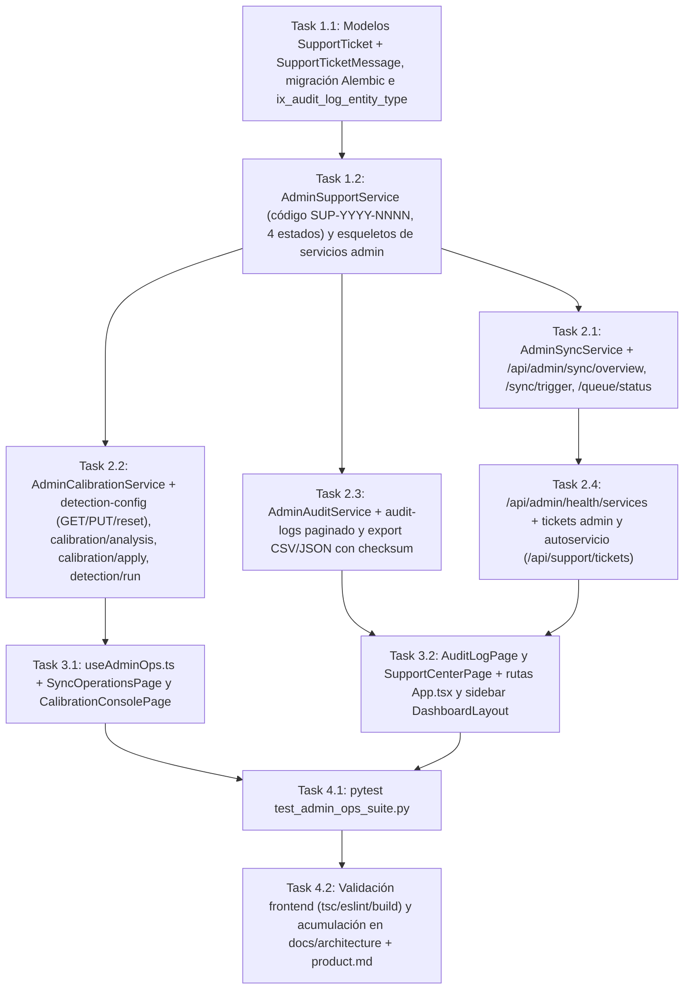

# Tasks: Consola de Administración Global y Operaciones (`consola-admin-operaciones`)

> 📋 Generated by `solution-designer` · 2026-10-21
> ✅ Approved by: JeremyJS (2026-10-21)

## Traceability
- **Work Item**: Pendiente (sin PBI/Feature en ADO)
- **Branch**: `dev`

## Metadata
- **Based on:** [design.md](./design.md)
- **Total estimate:** ~15.4h (incluye 20% buffer)
- **Number of waves:** 4 (Wave 1, Wave 2, Wave 3, Wave 4)
- **Number of tasks:** 10
- **Sprint:** [TBD]
- **Assignee:** JeremyJS

## Estimation Rules
- Maximum **4 hours** per task
- Estimates include implementation + unit tests + code review
- Work strictly **wave by wave** with explicit approval between waves

## Dependency Graph

---

## Wave 1: Modelo, Migración y Base de Servicios Admin (~2.8h)

### Task 1.1: Modelos `SupportTicket` + `SupportTicketMessage`, migración Alembic reversible e índice `ix_audit_log_entity_type` (`REQ-007`, `NFR-003`) (~1.4h)
- **Description:** Crear `app/backend/src/models/support_ticket.py` con las entidades `SupportTicket` (`id`, `code` UNIQUE, `subject`, `category`, `module`, `priority`, `description`, `status`, `reporter_id` FK `app_user.id`, `reporter_tenant_id` FK `tenant.id`, `assigned_to_id` FK `app_user.id`, `created_at`/`updated_at`/`closed_at` con `utcnow_naive`) y `SupportTicketMessage` (`id`, `ticket_id` FK con `ON DELETE CASCADE`, `author_id` FK `app_user.id`, `body`, `created_at` con `utcnow_naive`), respetando la convención naive-UTC documentada en `src/infrastructure/time_utils.py`. Añadir la migración Alembic reversible (upgrade crea tablas + índices y `ix_audit_log_entity_type`; downgrade los elimina en orden inverso) y registrar los modelos para `create_all` en tests.
- **Acceptance criteria:**
  - [x] `alembic upgrade head` crea `support_ticket`, `support_ticket_message` y `ix_audit_log_entity_type`; `alembic downgrade -1` revierte sin errores ni pérdida de datos existentes.
  - [x] Las columnas `created_at`/`updated_at`/`closed_at` son `TIMESTAMP WITHOUT TIME ZONE` y se poblan con `utcnow_naive()` (naive).
  - [x] `SupportTicket.code` es único y la relación 1:N con `SupportTicketMessage` funciona con borrado en cascada.
- **Dependencies:** None
- **Files to create/modify:** `app/backend/src/models/support_ticket.py`, `app/backend/migrations/versions/<rev>_support_tickets.py`

### Task 1.2: `AdminSupportService` completo y esqueletos de `AdminSyncService`, `AdminCalibrationService` y `AdminAuditService` (`REQ-007`, `NFR-003`, `NFR-004`) (~1.4h)
- **Description:** Crear `app/backend/src/services/admin_support_service.py` con: generación atómica del código `SUP-YYYY-NNNN` (correlativo por año, sin colisiones), `create_ticket(current_user, payload)`, `list_my_tickets(current_user, ...)`, `list_tickets(current_user, status, category, q, page, limit)`, `update_ticket(current_user, ticket_id, payload)` con transiciones `ABIERTO → EN_PROGRESO → RESUELTO → CERRADO`, asignación de responsable, respuestas (`SupportTicketMessage`) y auditoría (`TICKET_CREATED`, `TICKET_STATUS_CHANGED`, `TICKET_ASSIGNED`, `TICKET_REPLIED`, `TICKET_REOPENED`) usando `utcnow_naive`. Crear además los esqueletos `admin_sync_service.py`, `admin_calibration_service.py` y `admin_audit_service.py` con contratos de métodos y `AdminOpsError` (códigos `FORBIDDEN_ADMIN`, `FORBIDDEN_CONFIG_EDIT`, `SYNC_ALREADY_RUNNING`, `DETECTION_ALREADY_RUNNING`, `QUEUE_UNAVAILABLE`, `TICKET_NOT_FOUND`, `TICKET_CLOSED`, `INVALID_DATE_RANGE`, `EXPORT_TOO_LARGE`).
- **Acceptance criteria:**
  - [x] Crear dos tickets en el mismo año produce códigos consecutivos `SUP-2026-0001` y `SUP-2026-0002` sin colisiones bajo concurrencia (reintento ante `IntegrityError`).
  - [x] Un ticket `CERRADO` no acepta `reply` (`409 TICKET_CLOSED`); la reapertura solo la ejecuta `PLATFORM_ADMIN` y deja traza `TICKET_REOPENED`.
  - [x] `list_my_tickets` aísla estrictamente por `reporter_id`/`reporter_tenant_id` y `list_tickets` solo responde a `PLATFORM_ADMIN` (`403 FORBIDDEN_ADMIN` en otro caso).
- **Dependencies:** Task 1.1
- **Files to create/modify:** `app/backend/src/services/admin_support_service.py`, `app/backend/src/services/admin_sync_service.py`, `app/backend/src/services/admin_calibration_service.py`, `app/backend/src/services/admin_audit_service.py`

---

## Wave 2: Endpoints Admin (`/api/admin/*` y `/api/support/*`) (~5.5h)

### Task 2.1: `AdminSyncService` y `admin_ops_router` — sync overview, trigger y queue status (`REQ-001`, `REQ-002`, `NFR-004`) (~1.5h)
- **Description:** Implementar `overview(current_user, limit)` (KPIs de última corrida completada, fila `running`, histórico de sync y detección, `failures_24h`), `trigger_sync(current_user, payload)` (validación de mutex BR-RES-001, reutilización de `run_sync` de `runners.py`, `202` con `task` y `sync_type` calculado, auditoría `SYNC_TRIGGERED`, `503 QUEUE_UNAVAILABLE` si Redis no responde) y `queue_status(current_user)` (ping Redis con timeout, presencia de worker, profundidad de cola, `failed_jobs_24h`, degradación `200` con `redis: "OFFLINE"`). Registrar `app/backend/src/presentation/routers/admin_ops_router.py` con prefix `/admin` en `dependencies.py` y `main.py`, y guard `_assert_platform_admin(current_user)`.
- **Acceptance criteria:**
  - [x] `GET /api/admin/sync/overview` responde KPIs e histórico ordenado por `started_at` DESC; `POST /api/admin/sync/trigger` devuelve `202` con `task`/`sync_type` y falla `409 SYNC_ALREADY_RUNNING` si existe corrida `running`.
  - [x] `GET /api/admin/queue/status` responde `200` en modo degradado (`redis: OFFLINE`, `worker: DOWN`) sin lanzar `500` cuando Redis está caído.
  - [x] Cualquier rol distinto de `PLATFORM_ADMIN` recibe `403 FORBIDDEN_ADMIN` en los tres endpoints.
- **Dependencies:** Task 1.2
- **Files to create/modify:** `app/backend/src/services/admin_sync_service.py`, `app/backend/src/presentation/routers/admin_ops_router.py`, `app/backend/src/presentation/dependencies.py`, `app/backend/src/presentation/main.py`

### Task 2.2: `AdminCalibrationService` — detection-config global, analysis/apply y detection run (`REQ-003`, `REQ-004`) (~1.8h)
- **Description:** Implementar `get_detection_config`, `update_detection_config` (clamp `[min,max]`, auditoría `UPDATE_DETECTION_CONFIG` con diff, alcance `global`), `reset_detection_config(keys)` (auditoría `DETECTION_CONFIG_RESET`), `get_calibration_analysis(anomaly_type)` extrayendo las fórmulas de `src/cli/tune_detection.py` (TP/FP/FN, precision, recall, F1 y rejillas z-score `0.5–4.0`, desviación `25–150`, monto `3M–12M`, con `insufficient_data` por tipo), `apply_calibration(changes)` (auditoría `CALIBRATION_APPLY`) y `trigger_detection` (mutex BR-RES-001, `run_detection`, `202`, auditoría `DETECTION_TRIGGERED`). Exponer los 6 endpoints en el router.
- **Acceptance criteria:**
  - [x] `GET /api/admin/detection-config` devuelve exactamente los 13 parámetros con `min`, `max`, `step`, `default_value` y `updated_at`; `PUT` ajusta valores fuera de rango al límite y deja una entrada `UPDATE_DETECTION_CONFIG` con `old_value`/`new_value`.
  - [x] `GET /api/admin/calibration/analysis` calcula P/R/F1 por tipo y ubica en `insufficient_data` los tipos sin dictámenes, sin abortar la respuesta.
  - [x] `POST /api/admin/calibration/apply` solo persiste claves de calibración válidas y `POST /api/admin/detection/run` responde `202` o `409 DETECTION_ALREADY_RUNNING`.
- **Dependencies:** Task 1.2
- **Files to create/modify:** `app/backend/src/services/admin_calibration_service.py`, `app/backend/src/presentation/routers/admin_ops_router.py`

### Task 2.3: `AdminAuditService` — bitácora paginada y exportación auditada (`REQ-005`, `NFR-002`, `NFR-003`) (~1.0h)
- **Description:** Implementar `list_audit_logs(current_user, action_type, user_id, entity_type, entity_id, date_from, date_to, page, limit)` (validación de rango, orden `timestamp` DESC, `total` + `items` con correo del actor resuelto) y `export_audit_logs(..., format)` (CSV/JSON de todas las filas del filtro con tope 10,000, header `X-Checksum-SHA256`, auditoría `AUDIT_LOG_EXPORT`, `413 EXPORT_TOO_LARGE` al exceder), sin exponer ningún método de escritura sobre `AuditLog`.
- **Acceptance criteria:**
  - [x] `GET /api/admin/audit-logs` filtra por los 5 criterios combinables y pagina con `total` correcto; `date_from > date_to` responde `422 INVALID_DATE_RANGE`.
  - [x] `GET /api/admin/audit-logs/export?format=csv` descarga todas las filas del filtro (no solo la página) con `X-Checksum-SHA256` verificable y registra `AUDIT_LOG_EXPORT`.
  - [x] No existe endpoint `POST/PUT/PATCH/DELETE` sobre `/api/admin/audit-logs*` (solo lectura estricta).
- **Dependencies:** Task 1.2
- **Files to create/modify:** `app/backend/src/services/admin_audit_service.py`, `app/backend/src/presentation/routers/admin_ops_router.py`

### Task 2.4: Health de servicios y endpoints de tickets (`REQ-006`, `REQ-007`) (~1.2h)
- **Description:** Implementar `get_services_health(current_user)` con 6 comprobaciones aisladas y timeout propio (`api`, `database` con latencia, `redis_worker`, `last_sync`, `last_detection`, `scheduler`), clasificando `OK`/`DEGRADED`/`DOWN` con `detail` y `latency_ms`. Exponer `GET /api/admin/health/services`, `GET /api/admin/support/tickets`, `PATCH /api/admin/support/tickets/{ticket_id}`, `POST /api/support/tickets` y `GET /api/support/tickets` (autoservicio para cualquier usuario autenticado).
- **Acceptance criteria:**
  - [x] `GET /api/admin/health/services` responde los 6 componentes y, si Redis falla, solo `redis_worker` queda `DOWN` sin afectar al resto.
  - [x] Un usuario autenticado puede crear y listar únicamente sus propios tickets; el administrador ve y actualiza la bandeja completa con asignación y respuestas auditadas.
  - [x] Todos los endpoints de tickets validan `422 VALIDATION_ERROR` (asunto/descripción vacíos), `404 TICKET_NOT_FOUND` y `409 TICKET_CLOSED`.
- **Dependencies:** Task 2.1
- **Files to create/modify:** `app/backend/src/services/admin_sync_service.py`, `app/backend/src/services/admin_support_service.py`, `app/backend/src/presentation/routers/admin_ops_router.py`

---

## Wave 3: Frontend (`/app/sincronizacion`, `/app/calibracion`, `/app/bitacora`, `/app/soporte`) (~2.4h)

### Task 3.1: `useAdminOps.ts` + `SyncOperationsPage` y `CalibrationConsolePage` (`REQ-001`..`REQ-004`, `NFR-005`) (~1.3h)
- **Description:** Crear `app/frontend/src/presentation/hooks/useAdminOps.ts` con las interfaces TypeScript y hooks React Query (`useSyncOverview` con `refetchInterval` mientras hay corrida `running`, `useTriggerSync`, `useQueueStatus`, `useDetectionConfig`, `useUpdateDetectionConfig`, `useResetDetectionConfig`, `useCalibrationAnalysis`, `useApplyCalibration`, `useRunDetection`), invalidando cachés cruzados. Crear `SyncOperationsPage.tsx` (KPIs de última corrida, estado Redis/worker, tabla histórica con errores y botón "Relanzar", formulario de disparo con fases/`days_back`/`rate_limit` y confirmación) y `CalibrationConsolePage.tsx` (13 parámetros agrupados por categoría con sliders/inputs validados y restaurar defaults; panel de calibración con TP/FP/FN, P/R/F1, umbral recomendado y aplicación con modal de confirmación; disparo de detección).
- **Acceptance criteria:**
  - [x] `0` tipos `any`; `tsc -b` y `eslint` sin errores; estados de carga, vacío, error y degradado (`Redis OFFLINE`) cubiertos en ambas páginas.
  - [x] El disparo de sync y la aplicación de umbrales exigen confirmación explícita, muestran el resultado real de la API (`202`, `409`, `403`) y refrescan los KPIs.
  - [ ] Ninguna página enlaza rutas públicas ni duplica pestañas del sidebar (`NFR-005`).
    > ⚠️ **Parcial**: sin enlaces a rutas públicas. Persiste la duplicación conocida `/app/configuracion-deteccion` (parámetros) vs `/app/calibracion` (calibración global); el admin ve ambas y la resolvemos en la fase de polish (opción registrada: `detection_config` por organización).
- **Dependencies:** Task 2.2
- **Files to create/modify:** `app/frontend/src/presentation/hooks/useAdminOps.ts`, `app/frontend/src/presentation/pages/SyncOperationsPage.tsx`, `app/frontend/src/presentation/pages/CalibrationConsolePage.tsx`

### Task 3.2: `AuditLogPage`, `SupportCenterPage`, rutas y navegación (`REQ-005`..`REQ-007`, `NFR-001`, `NFR-005`) (~1.1h)
- **Description:** Crear `AuditLogPage.tsx` (filtros por acción, usuario, entidad y rango de fechas, tabla paginada, drawer de detalle con diff `old_value`/`new_value`, exportación CSV/JSON) y `SupportCenterPage.tsx` (tarjetas de estado de los 6 servicios con color semántico y acción sugerida, base de conocimiento por módulo, formulario de ticket y bandeja administrativa con cambio de estado, asignación y respuestas). Registrar las 4 rutas en `App.tsx` bajo `RequireAuth` y añadir las entradas del sidebar en `DashboardLayout.tsx` visibles solo para `PLATFORM_ADMIN`.
- **Acceptance criteria:**
  - [x] Las 4 rutas `/app/sincronizacion`, `/app/calibracion`, `/app/bitacora` y `/app/soporte` navegan correctamente y no aparecen en el sidebar para roles distintos de `PLATFORM_ADMIN`.
  - [x] La bitácora es estrictamente de solo lectura en UI (sin acciones de edición/borrado) y el detalle muestra el diff JSON campo por campo.
  - [x] El centro de soporte muestra los 6 componentes con `OK`/`DEGRADED`/`DOWN` y permite crear un ticket que aparece de inmediato en la bandeja.
- **Dependencies:** Task 2.3, Task 2.4
- **Files to create/modify:** `app/frontend/src/presentation/pages/AuditLogPage.tsx`, `app/frontend/src/presentation/pages/SupportCenterPage.tsx`, `app/frontend/src/App.tsx`, `app/frontend/src/presentation/layouts/DashboardLayout.tsx`

---

## Wave 4: Pruebas y Documentación Global (~2.1h)

### Task 4.1: Suite `pytest` `test_admin_ops_suite.py` (`REQ-001`..`REQ-007`, `NFR-001`..`NFR-004`) (~1.2h)
- **Description:** Crear `app/backend/tests/test_admin_ops_suite.py` cubriendo: guards `403` por rol en todos los endpoints admin; sync overview/trigger con mutex y degradación Redis; queue status; los 13 parámetros, clamp, defaults y auditoría; analysis/apply de calibración con `insufficient_data`; detección `202`/`409`; bitácora con filtros, paginación, export con checksum y ausencia de endpoints de escritura; health con componente caído aislado; ciclo completo de ticket (crear → asignar → responder → `RESUELTO` → `CERRADO` → rechazo de reply y reapertura). Registrar `admin_ops_router` en `conftest.py`.
- **Acceptance criteria:**
  - [x] `pytest tests/test_admin_ops_suite.py` pasa al 100% y la suite completa del backend sigue verde.
  - [x] Se verifica que cada acción sensible deja su entrada correspondiente en `AuditLog` (`SYNC_TRIGGERED`, `DETECTION_TRIGGERED`, `UPDATE_DETECTION_CONFIG`, `CALIBRATION_APPLY`, `DETECTION_CONFIG_RESET`, `AUDIT_LOG_EXPORT`, `TICKET_*`).
  - [x] Se verifica que un ticket `CERRADO` no admite respuestas y que `list_my_tickets` no filtra tickets de otra organización.
- **Dependencies:** Task 3.1, Task 3.2
- **Files to create/modify:** `app/backend/tests/test_admin_ops_suite.py`, `app/backend/tests/conftest.py`

### Task 4.2: Validación frontend y acumulación documental global (`NFR-005`, `Product`) (~0.9h)
- **Description:** Ejecutar `npx tsc -b`, `npx eslint src --max-warnings 0` y `npm run build` con `0` errores. Acumular en los documentos oficiales: `docs/architecture/api-contract.md` (14 endpoints nuevos con auth, payloads y errores), `docs/architecture/data-model.md` (`support_ticket`, `support_ticket_message`, índices y migración), `docs/architecture/security-model.md` (matriz solo `PLATFORM_ADMIN` y acciones auditadas), `docs/architecture/system-design.md` (runbook `arq`/Redis, metodología de calibración y esquema de bitácora) y `product.md` (catálogo final de las 36 pantallas y cierre del roadmap de 4 paquetes).
- **Acceptance criteria:**
  - [x] `tsc -b`, `eslint` y `vite build` pasan con `0` errores.
  - [x] Los 4 documentos de `docs/architecture/` y `product.md` reflejan los endpoints, tablas, permisos y metodología implementados, sin archivos sueltos nuevos (solo los 5 oficiales).
  - [ ] El catálogo de las 36 pantallas queda completo con ruta, componente, endpoint(s), rol y plan requerido.
    > ⚠️ **Parcial**: `product.md` § *Screen Catalog* documenta las **33 rutas implementadas** (32 componentes) con ruta, componente, endpoints, rol y plan. Las pantallas restantes del mapa de 36 (#30, #31, #34 y siguientes) siguen pendientes por roadmap.
- **Dependencies:** Task 4.1
- **Files to create/modify:** `docs/architecture/api-contract.md`, `docs/architecture/data-model.md`, `docs/architecture/security-model.md`, `docs/architecture/system-design.md`, `product.md`

---

## Implementation Order Summary
| Order | Task | Description | Est. | Depends On |
|-------|------|-------------|------|------------|
| 1 | 1.1 | Modelos `SupportTicket`/`SupportTicketMessage` + migración Alembic | ~1.4h | — |
| 2 | 1.2 | `AdminSupportService` + esqueletos de servicios admin | ~1.4h | 1.1 |
| 3 | 2.1 | Sync overview/trigger + queue status | ~1.5h | 1.2 |
| 4 | 2.2 | Detection-config global + calibration analysis/apply + detection run | ~1.8h | 1.2 |
| 5 | 2.3 | Bitácora paginada + export CSV/JSON | ~1.0h | 1.2 |
| 6 | 2.4 | Health de servicios + endpoints de tickets | ~1.2h | 2.1 |
| 7 | 3.1 | `useAdminOps.ts` + Sync y Calibration pages | ~1.3h | 2.2 |
| 8 | 3.2 | AuditLog y SupportCenter pages + rutas/sidebar | ~1.1h | 2.3, 2.4 |
| 9 | 4.1 | Suite `pytest` admin ops | ~1.2h | 3.1, 3.2 |
| 10 | 4.2 | Validación frontend + documentación global | ~0.9h | 4.1 |

## Total Estimate: ~15.4h (includes 20% buffer)

## Completion Checklist
- [x] All tasks completed
- [x] All tests passing (`pytest` + `tsc -b` + `eslint` + `vite build`)
- [x] Los 13 parámetros del motor editables con auditoría y restauración de defaults
- [x] Bitácora estrictamente inmutable y exportación con checksum verificable
- [x] Todos los endpoints `/api/admin/*` restringidos a `PLATFORM_ADMIN` (`403` para el resto)
- [x] Degradación elegante verificada (Redis/worker caídos sin errores `500`)
- [x] `0` badges decorativos en cabeceras y `0` pestañas duplicadas con el sidebar (`NFR-001` de diseño)
- [x] Documentación global (`api-contract`, `data-model`, `security-model`, `system-design`) y `product.md` actualizados

---
> 📍 Pendiente (sin PBI/Feature en ADO) · 🌿 `dev` · Generated by SDD Standard
