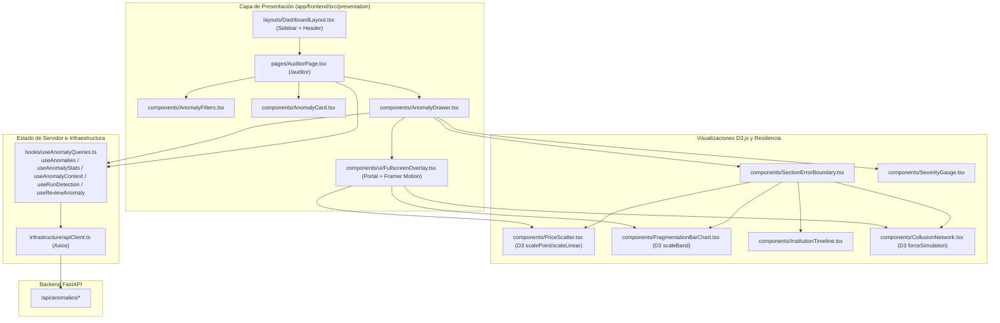
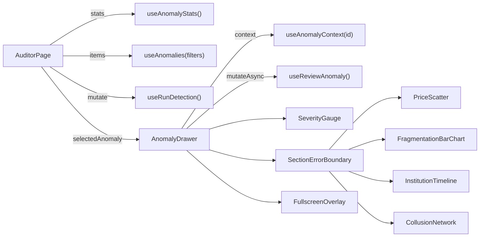

# Design: Consola y Bandeja de Auditoría (`consola-auditoria`)

> 📋 Generated by `solution-designer` · 2026-10-18
> 📋 As-Built — reverse-engineered from code
> ✅ Approved by: Jeremy Michel Solano Frías (2026-10-18)

## Traceability
- **Work Item**: Pendiente (sin PBI/Feature en ADO)
- **Parent**: [veedoria-core](../intake.md)
- **Branch**: `dev`
- **Requirements**: [requirements.md](./requirements.md)
- **Test Plan**: [test-plan.md](./test-plan.md)
- **Test Cases**: [test-cases.md](./test-cases.md)

## Technology Decisions
- **Frontend**: **React `^19.2.6` + TypeScript `~6.0.2` + Vite `^8.0.12` + TailwindCSS `^4.3.1` + HeroUI `@heroui/react` `^3.2.1` + D3.js `^7.9.0` + TanStack React Query `^5.101.2` + Framer Motion `^12.40.0` + `react-i18next`** — D3.js permite manipulaciones SVG de alta precisión para dispersión de precios, barras de umbral y simulación de fuerzas de grafos; TanStack React Query gestiona la caché (`staleTime = 30s`) e invalidación tras emitir dictámenes; y HeroUI (`toast`) + TailwindCSS implementan el tema institucional `govtech`.
- **Backend**: Consume los endpoints REST del módulo `deteccion-anomalias` (`/api/anomalies/*`) mediante el cliente Axios centralizado (`src/infrastructure/apiClient.ts`).
- **Database**: Sin persistencia local de base de datos en cliente (usa `localStorage.getItem("user_id")` para identificar al revisor y persiste el estado en el backend PostgreSQL/SQLite vía API).
- **Cloud Services**: Despliegue estático SPA / CDN conectado a `veedoria-api` en Render.
- **Theme**: `govtech` (tokens semánticos CSS `--color-primary`, `--color-error`, `--color-warning`, `--color-success`, `--color-surface`, `--color-background` con soporte claro/oscuro).

## Architecture

### System Overview

### Component Diagram

## Deployment
- **Pattern**: `monorepo-split` (Frontend SPA compilado con `tsc -b && vite build` en `app/frontend/dist`, consumiendo `VITE_API_URL` hacia `veedoria-api`).
- **App**: Servidor estático / CDN (Vercel / Render Static Site) y servidor Vite en desarrollo (`http://localhost:5173/auditor`).
- **Infra**: Construcción estática libre de estado en servidor frontend.
- **CI/CD**: Validación local con `eslint` (`eslint.config.js`) y `tsc -b`.
- **Justification**: Separar el bundle React/D3 permite servir los activos estáticos desde CDN con carga instantánea mientras las consultas analíticas se resuelven contra `veedoria-api`.
- **Discarded**: Renderizado de gráficos en servidor (descartado porque las simulaciones de fuerza D3 y tooltips requieren interactividad directa en el DOM del cliente).

### Environments
| Environment | Branch | Frontend URL | Backend API Target (`VITE_API_URL`) | Deploy trigger & Gate |
|-------------|--------|--------------|-------------------------------------|-----------------------|
| **Local** | `feature/*` / `dev` | `http://localhost:5173/auditor` | `http://localhost:3001/api` | Manual (`npm run dev` en `app/frontend`) |
| **Preview (PR)** | PR hacia `dev` | `https://pr-{N}-veedoria.vercel.app/auditor` | `https://dev-api.veedoria.do/api` | Automático al abrir/actualizar PR (Vercel Preview efímero con auto-cleanup al cerrar PR) |
| **DEV / QA** | `dev` | `https://dev.veedoria.do/auditor` | `https://dev-api.veedoria.do/api` | Automático en merge a `dev` tras CI (`eslint` + `tsc -b` + `vite build`) |
| **CERT (Staging)** | `cert` / `release/*` | `https://cert.veedoria.do/auditor` | `https://cert-api.veedoria.do/api` | Promoción manual `dev → cert` · **Approval Gate: Dev + QA** (smoke tests y pruebas E2E Playwright) |
| **PROD** | `main` | `https://veedoria.do/auditor` | `https://api.veedoria.do/api` | Promoción manual `cert → main` + Release Tag `vX.Y.Z` · **Approval Gate: Dev + QA + BA** (nunca directo `dev → prod`) |

## Database Schema

### Table: `anomaly` (consumida vía API REST — modelo de dominio `src/domain/anomaly.ts`)
| Column | Type | Constraints | Default | Description |
|--------|------|------------|---------|-------------|
| `id` | `string` | `REQUIRED` | — | UUID de la anomalía |
| `process_id` | `number \| null` | `OPTIONAL` | `null` | ID numérico del proceso |
| `contract_id` | `number \| null` | `OPTIONAL` | `null` | ID numérico del contrato |
| `anomaly_type` | `'PRICE_ANOMALY' \| 'FRAGMENTATION' \| 'COLLUSION'` | `REQUIRED` | — | Tipología que determina la visualización D3 activa |
| `severity` | `number` | `0.0..1.0` | `0.0` | Índice de severidad renderizado en `AnomalyCard` y `SeverityGauge` |
| `score` | `number \| null` | `OPTIONAL` | `null` | Puntaje estadístico o densidad de red |
| `confidence` | `'ALTA' \| 'MEDIA' \| 'BAJA' \| 'INFO'` | `OPTIONAL` | `'MEDIA'` | Nivel de confianza mostrado en badges |
| `signals_count` | `number` | `OPTIONAL` | `0` | Cantidad de señales de colusión |
| `detection_metadata` | `Record<string, unknown> \| null` | `OPTIONAL` | `null` | Diccionario de señales renderizado como chips en `AnomalyDrawer` |
| `status` | `'PENDING' \| 'CONFIRMED' \| 'DISMISSED'` | `REQUIRED` | `'PENDING'` | Estado actual de revisión |
| `dismissal_reason` | `'FALSE_POSITIVE' \| 'DUPLICATE' \| 'DATA_ERROR' \| 'ALREADY_KNOWN' \| null` | `OPTIONAL` | `null` | Motivo de descarte seleccionado |

### Indexes
| Name | Columns | Type |
|------|---------|------|
| `react_query_cache_anomalies` | `["anomalies", filters]` | `In-Memory Query Cache (staleTime: 30s)` |
| `react_query_cache_stats` | `["anomaly-stats"]` | `In-Memory Query Cache (staleTime: 30s)` |
| `react_query_cache_context` | `["anomaly-context", id]` | `In-Memory Query Cache (staleTime: 30s)` |

## API Contracts

### GET /api/anomalies (consumido por `useAnomalies`)
- **Request**: Query params `anomaly_type`, `status`, `min_severity`, `offset`, `limit=50`.
- **Response**: `ApiResponse<PaginatedResponse<Anomaly>>`.
- **Auth**: Optional (en estado *As-Built*).
- **Errors**: Lanza `Error(data.message || "Error al cargar anomalías")` si `data.success` es `false`.
- **Maps to**: REQ-001

### GET /api/anomalies/stats (consumido por `useAnomalyStats`)
- **Request**: Sin parámetros.
- **Response**: `ApiResponse<AnomalyStats>` (`total`, `total_by_type`, `total_by_status`, `avg_severity`).
- **Auth**: Optional.
- **Errors**: Lanza `Error("Error al cargar estadísticas")` si falla.
- **Maps to**: REQ-001

### POST /api/anomalies/detect (consumido por `useRunDetection`)
- **Request**: Sin cuerpo.
- **Response**: `202 Accepted` — `ApiResponse<Record<string, number>>`; al completarse invalida `["anomalies"]` y `["anomaly-stats"]`.
- **Auth**: Optional.
- **Errors**: Lanza `Error(data.message || "Error al ejecutar detección")`.
- **Maps to**: REQ-002

### GET /api/anomalies/{id}/context (consumido por `useAnomalyContext`)
- **Request**: Path param `id: string`.
- **Response**: `ApiResponse<AnomalyContext>` con `market_prices`, `recent_contracts` y `collusion_links`.
- **Auth**: Optional.
- **Errors**: Lanza `Error(data.message || "Error al cargar contexto")`.
- **Maps to**: REQ-003, REQ-004, REQ-005

### PATCH /api/anomalies/{id} (consumido por `useReviewAnomaly`)
- **Request**: Path param `id: string`, Body `AnomalyReviewPayload` (`status`, `reviewer_id`, `notes`, `dismissal_reason`).
- **Response**: `ApiResponse<Anomaly>`; al completarse invalida `["anomalies"]` y `["anomaly-stats"]`.
- **Auth**: Optional.
- **Errors**: Validación previa en cliente (`toast.danger`) si `CONFIRMED` tiene `notes.length < 10` o `DISMISSED` carece de `dismissal_reason`.
- **Maps to**: REQ-006

## Architecture Updates
- No global architecture changes required (documentado en `docs/architecture/system-design.md` y `docs/architecture/api-contract.md`).

## Approval
- [x] Developer: Jeremy Michel Solano Frías Date: 2026-10-18

---
> 📍 Pendiente (sin PBI/Feature en ADO) · 🌿 `dev` · Generated by SDD Standard