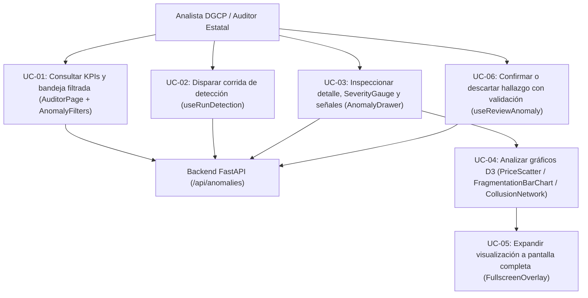
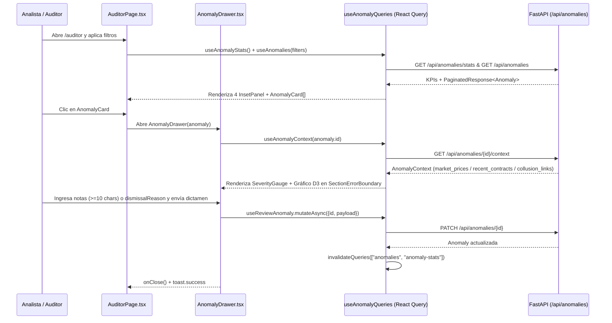

# Requirements: Consola y Bandeja de Auditoría (`consola-auditoria`)

> 📋 Generated by `requirements-analyst` · 2026-10-18
> 📋 As-Built — reverse-engineered from code (`7912d66`) and `specs/veedoria-core/intake.md`
> ✅ Approved by: Jeremy Michel Solano Frías (2026-10-18)

## Traceability
- **Work Item**: Pendiente (sin PBI/Feature en ADO)
- **Parent**: [veedoria-core](../intake.md)
- **Branch**: `dev`
- **Design**: [design.md](./design.md)
- **Test Plan**: [test-plan.md](./test-plan.md)
- **Test Cases**: [test-cases.md](./test-cases.md)

## Overview
El módulo **Consola y Bandeja de Auditoría** (`/auditor` — `AuditorPage.tsx`) provee la interfaz especializada de **VeedorIA** (**NexoDigital Solutions, S.R.L.**) para que analistas de la **DGCP**, auditores estatales (Contraloría, Cámara de Cuentas, PEPCA) y fiscalizadores investiguen los hallazgos generados por el motor de detección. Incluye paneles de indicadores (KPIs) en tiempo real, filtrado multicriterio (`AnomalyFilters`), tarjetas resumidas (`AnomalyCard`), un cajón lateral de investigación (`AnomalyDrawer`) con visualizaciones interactivas en **D3.js v7** (`PriceScatter`, `FragmentationBarChart`, `CollusionNetwork`, `InstitutionTimeline`) ampliables a pantalla completa (`FullscreenOverlay`), y el flujo de emisión de dictámenes (`CONFIRMED` / `DISMISSED`) que alimenta el bucle de retroalimentación del modelo.

## User Stories (EARS Notation)

### REQ-001: Visualización de KPIs de bandeja y listado filtrado de anomalías (`AuditorPage`, `AnomalyFilters`, `AnomalyCard`)
**Type:** Event-Driven
**Rule:** WHEN un auditor accede a la ruta `/auditor` o modifica los filtros en `AnomalyFilters` (`status`, `anomalyType`, `severity`, `search`), the system SHALL consultar de forma reactiva mediante TanStack React Query (`useAnomalyStats` y `useAnomalies` con `staleTime = 30,000ms`) las estadísticas globales para renderizar 4 paneles `InsetPanel` (`total`, `PENDING`, `CONFIRMED`, `DISMISSED`) y la lista de hasta `50` tarjetas `AnomalyCard` con codificación visual por severidad (`>= 0.7` crítico/rojo, `>= 0.4` alto/ámbar, `>= 0.2` medio/azul, `< 0.2` bajo/verde), tipo de anomalía, nivel de confianza (`ALTA`, `MEDIA`, `BAJA`, `INFO`), conteo de señales, código de proceso/contrato, monto en `RD$` (`es-DO`), proveedor y fecha.
**Entities:** `Anomaly`, `AnomalyStats`
**Error Handling:** Mientras las consultas están en curso (`isLoading`), muestra estados de carga localizados (`t("anomalies.loading")`); si la consulta devuelve una lista vacía, presenta el estado vacío `t("anomalies.no_anomalies")`.

**Acceptance Criteria:**
- [ ] Given la carga de `/auditor`, when `useAnomalyStats` resuelve los datos de `/api/anomalies/stats`, then los 4 `InsetPanel` superiores muestran el total general y los totales por estado (`PENDING`, `CONFIRMED`, `DISMISSED`).
- [ ] Given la selección de un filtro de estado (`PENDING`, `CONFIRMED`, `DISMISSED`), tipo (`PRICE_ANOMALY`, `FRAGMENTATION`, `COLLUSION`) o severidad mínima (`0.7`, `0.4`, `0.1`), when cambia el valor en `AnomalyFilters`, then `useAnomalies` actualiza la clave de consulta `["anomalies", filters]` y refresca las tarjetas `AnomalyCard`.
- [ ] Given una tarjeta de tipo `COLLUSION`, when se renderiza `AnomalyCard`, then muestra adicionalmente el badge de `confidence` (`ALTA`, `MEDIA`, `BAJA`, `INFO`) y la etiqueta `{signals_count} señal(es)`.

**Priority:** Must
**Dependencies:** None
**Tracker:** Pendiente

### REQ-002: Disparo manual de corrida de detección desde la consola (`useRunDetection`)
**Type:** Event-Driven
**Rule:** WHEN el auditor presiona el botón de ejecución de detección en `AuditorPage`, the system SHALL invocar la mutación `useRunDetection()` (`POST /api/anomalies/detect`), deshabilitar el botón mostrando el texto `t("anomalies.detect_running")` mientras la petición está pendiente, e invalidar automáticamente las cachés `["anomalies"]` y `["anomaly-stats"]` al completarse con éxito.
**Entities:** `Anomaly`, `SyncLog`
**Error Handling:** Si el backend responde con `success: false` (ej. detección ya en progreso), la mutación lanza un `Error` con el mensaje retornado por la API.

**Acceptance Criteria:**
- [ ] Given que no hay una petición de detección pendiente, when el auditor hace clic en el botón de ejecutar detección, then `detectMutation.mutate()` envía `POST /api/anomalies/detect` e invalida `["anomalies"]` y `["anomaly-stats"]` en `onSuccess`.

**Priority:** Must
**Dependencies:** REQ-001
**Tracker:** Pendiente

### REQ-003: Inspección detallada de caso, medidor de severidad y señales de colusión (`AnomalyDrawer`, `SeverityGauge`)
**Type:** Event-Driven
**Rule:** WHEN el auditor selecciona una tarjeta `AnomalyCard`, the system SHALL abrir el panel lateral `AnomalyDrawer` (`40%` del ancho de pantalla), consultar `useAnomalyContext(anomaly.id)` (`GET /api/anomalies/{id}/context`), renderizar el encabezado del caso (código de proceso/contrato, proveedor, institución y monto en `RD$`), el medidor circular SVG `SeverityGauge` (`0..100` con semáforo `#dc2626` para `>= 70`, `#e67e22` para `>= 50` y `#166534` para `< 50`, porcentaje de confianza y número de factores), la descripción justificativa de la IA y, para casos de `COLLUSION`, las etiquetas (`chips`) con ícono y valor de cada señal presente en `detection_metadata` (`📞 Teléfono`, `📍 Dirección`, `📧 Dominio de email`, `🔗 Prefijo RNC`, `📛 Nombre similar`).
**Entities:** `Anomaly`, `AnomalyContext`
**Error Handling:** Mientras `ctxLoading` es `true`, renderiza un esqueleto animado (`animate-pulse`) en lugar de los gráficos contextuales.

**Acceptance Criteria:**
- [ ] Given la selección de una `AnomalyCard`, when se monta `AnomalyDrawer`, then muestra `SeverityGauge` con el valor `anomaly.severity * 100` y los metadatos enriquecidos de `useAnomalyContext`.
- [ ] Given una anomalía `COLLUSION` con `detection_metadata` poblado, when se visualiza el bloque de detalle en `AnomalyDrawer`, then renderiza un chip formateado por cada señal reconocida en `SIGNAL_CONFIG`.

**Priority:** Must
**Dependencies:** REQ-001
**Tracker:** Pendiente

### REQ-004: Visualizaciones analíticas D3.js por tipología y aislamiento de errores (`PriceScatter`, `FragmentationBarChart`, `InstitutionTimeline`, `CollusionNetwork`, `SectionErrorBoundary`)
**Type:** State-Driven
**Rule:** WHILE `AnomalyDrawer` está abierto y `ctxLoading` es `false`, the system SHALL renderizar dentro de un `SectionErrorBoundary` la visualización **D3.js v7** correspondiente al `anomaly_type`:
1. Para `PRICE_ANOMALY`: `PriceScatter` con los precios unitarios de mercado (`market_prices`), línea horizontal punteada en la mediana (`contextMedian`), punto rojo resaltado para el contrato anómalo (`is_anomaly`) y tooltip interactivo con desviación porcentual.
2. Para `FRAGMENTATION`: `FragmentationBarChart` comparando los contratos recientes contra la línea de umbral (`FRAGMENTATION_THRESHOLD = 8,000,000` DOP) acompañado de `InstitutionTimeline` con la secuencia cronológica de adjudicaciones.
3. Para `COLLUSION`: `CollusionNetwork` con simulación de fuerzas D3 (`forceSimulation`, `forceLink`, `forceManyBody`, `forceCenter`, `forceCollide`), aristas coloreadas según `REASON_COLORS`, grosor proporcional a `weight`, tooltips con `signal_details` y tarjetas inferiores por cada enlace proveedor-proveedor.
**Entities:** `AnomalyContext`, `MarketPrice`, `TimelineEntry`, `CollusionLink`
**Error Handling:** Si cualquier visualización D3 lanza una excepción durante el renderizado, `SectionErrorBoundary` captura el fallo y muestra una tarjeta de error controlada sin colapsar `AnomalyDrawer` ni `AuditorPage`; si el arreglo de datos contextuales está vacío, muestra un mensaje informativo de ausencia de datos.

**Acceptance Criteria:**
- [ ] Given una anomalía `PRICE_ANOMALY` con `market_prices.length > 0`, when se renderiza `PriceScatter`, then calcula la mediana, traza la línea punteada de referencia y destaca el nodo `is_anomaly = true` en color de error.
- [ ] Given una anomalía `FRAGMENTATION` con `recent_contracts.length > 0`, when se renderiza la sección de fraccionamiento, then muestra tanto `FragmentationBarChart` con umbral en `RD$ 8,000,000` como `InstitutionTimeline`.
- [ ] Given una anomalía `COLLUSION` con `collusion_links.length > 0`, when se renderiza `CollusionNetwork`, then construye el grafo interactivo de fuerzas y la lista detallada de vínculos con sus señales.

**Priority:** Must
**Dependencies:** REQ-003
**Tracker:** Pendiente

### REQ-005: Modo pantalla completa para gráficos D3 (`FullscreenOverlay`)
**Type:** Event-Driven
**Rule:** WHEN el auditor hace clic en el botón de expandir (`Maximize2`) de cualquiera de las visualizaciones en `AnomalyDrawer` (`price`, `fragmentation` o `collusion`), the system SHALL abrir `FullscreenOverlay` mediante `createPortal` en `document.body` con animación `framer-motion`, bloquear el scroll del documento (`document.body.style.overflow = "hidden"`), renderizar el gráfico D3 con prop `fullscreen = true`, y permitir cerrarlo mediante clic en el botón `X`, clic en el fondo oscuro o presionando la tecla `Escape`.
**Entities:** `AnomalyContext`
**Error Handling:** Al desmontarse o cerrarse `FullscreenOverlay`, limpia el listener `keydown` de `Escape` y restaura `document.body.style.overflow = ""`.

**Acceptance Criteria:**
- [ ] Given un gráfico visible en `AnomalyDrawer`, when el auditor presiona el botón `Maximize2`, then se abre `FullscreenOverlay` ocupando `calc(100vw - 48px)` por `calc(100vh - 48px)` y al presionar `Escape` se cierra restableciendo el scroll.

**Priority:** Should
**Dependencies:** REQ-004
**Tracker:** Pendiente

### REQ-006: Validación y emisión de dictamen de auditoría (`handleReview` / `useReviewAnomaly`)
**Type:** Event-Driven
**Rule:** WHEN el auditor presiona el botón de confirmar (`CONFIRMED`) o descartar (`DISMISSED`) en el pie de `AnomalyDrawer`, the system SHALL validar previamente que: (1) si el estado es `CONFIRMED`, el campo `notes` tenga al menos `10` caracteres (`notes.trim().length >= 10`); (2) si el estado es `DISMISSED`, se haya seleccionado obligatoriamente un motivo en `dismissalReason` (`FALSE_POSITIVE`, `DUPLICATE`, `DATA_ERROR`, `ALREADY_KNOWN`); y una vez validado, enviar `useReviewAnomaly().mutateAsync` (`PATCH /api/anomalies/{id}`), mostrar notificación `toast.success`, invalidar las consultas `["anomalies"]` y `["anomaly-stats"]` y cerrar `AnomalyDrawer`.
**Entities:** `Anomaly`, `AnomalyReviewPayload`
**Error Handling:** Si la validación local falla, muestra `toast.danger` (`t("drawer.notes_required")` o `t("drawer.dismiss_reason_required")`) y aborta el envío HTTP.

**Acceptance Criteria:**
- [ ] Given que el auditor intenta confirmar (`CONFIRMED`) una anomalía con menos de `10` caracteres en `notes`, when hace clic en Confirmar, then el sistema muestra `toast.danger` y no invoca `PATCH /api/anomalies/{id}`.
- [ ] Given que el auditor intenta descartar (`DISMISSED`) una anomalía sin seleccionar `dismissalReason`, when hace clic en Descartar, then el sistema muestra `toast.danger` y no invoca `PATCH /api/anomalies/{id}`.
- [ ] Given datos válidos de revisión, when `reviewMutation.mutateAsync` finaliza con éxito, then se invalidan `["anomalies"]` y `["anomaly-stats"]` y se invoca `onClose()`.

**Priority:** Must
**Dependencies:** REQ-003
**Tracker:** Pendiente

## Non-Functional Requirements

### NFR-001: Caché reactiva y fluidez de interfaz en cambio de filtros y dictámenes
**Category:** Performance
**Rule:** The system SHALL mantener en caché las consultas de anomalías, estadísticas y contexto durante `30,000ms` (`staleTime`) con TanStack React Query y ejecutar animaciones de gráficos D3 y modales a `60fps` sin recargar la página completa.
**Metric:** Transición de apertura de `AnomalyDrawer` y `FullscreenOverlay` `< 200ms`.
**Priority:** Must

### NFR-002: Aislamiento de fallos de renderizado en visualizaciones de datos
**Category:** Reliability
**Rule:** The system SHALL envolver cada sección gráfica de `AnomalyDrawer` en un `SectionErrorBoundary` independiente para garantizar que un fallo en los datos de un gráfico D3 nunca impida al auditor leer la descripción ni emitir su dictamen (`CONFIRMED` / `DISMISSED`).
**Metric:** `100%` de disponibilidad del formulario de dictamen incluso ante fallos de renderizado SVG.
**Priority:** Must

### NFR-003: Internacionalización completa del espacio de trabajo de auditoría
**Category:** Accessibility
**Rule:** The system SHALL obtener los textos e indicadores de la consola a través del namespace `dashboard` de `react-i18next` (`public/locales/{es,en}/dashboard.json`) y soportar navegación por teclado (`Escape` en `FullscreenOverlay`).
**Metric:** Cobertura bilingüe ES/EN en etiquetas de estados, filtros, niveles de riesgo y motivos de descarte.
**Priority:** Should

## Diagrams

### Use Case Diagram

### Supporting Diagram

## Dependencies
| Feature | Capability needed | Status | Workaround |
|---------|------------------|--------|------------|
| `deteccion-anomalias` | Endpoints REST `/api/anomalies`, `/api/anomalies/stats`, `/api/anomalies/{id}/context`, `POST /api/anomalies/detect` y `PATCH /api/anomalies/{id}` | Implementado (`🟢 active`) | — |

## Assumptions
| # | Assumption | Temporary stub | Replaced when |
|---|-----------|----------------|---------------|
| 1 | Cuando aún no hay sesión autenticada en `localStorage.getItem("user_id")`, el cajón de auditoría utiliza un UUID por defecto (`"00000000-0000-0000-0000-000000000000"`) como `reviewer_id` | Fallback en `AnomalyDrawer.tsx` línea 48 | Al integrar en código el Módulo II de Autenticación JWT (`/login`) |
| 2 | El cuadro de búsqueda `search` en `AnomalyFilters` captura el estado en cliente preparado para filtrado textual | Estado `search` en `AuditorPage.tsx` | Al conectar el parámetro `q`/`search` en el endpoint `GET /api/anomalies` o filtro local |

## Out of Scope
- Exportación de reportes firmados en PDF desde la consola (`/dashboard/reports`, pantalla #19 de `complete_screen_map.md`).
- Historial dedicado de resoluciones del equipo (`/dashboard/audit-decisions`, pantalla #18 de `complete_screen_map.md`).

## Approval
- [x] Analyst: Jeremy Michel Solano Frías Date: 2026-10-18

---
> 📍 Pendiente (sin PBI/Feature en ADO) · 🌿 `dev` · Generated by SDD Standard