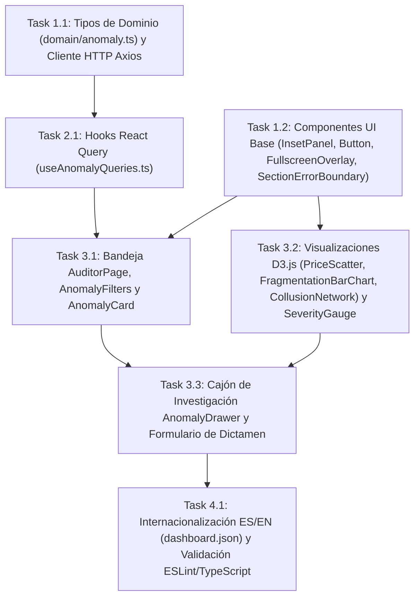

# Tasks: Consola y Bandeja de Auditoría (`consola-auditoria`)

> 📋 Generated by `solution-designer` · 2026-10-18
> 📋 As-Built — reverse-engineered from code
> ✅ Approved by: Jeremy Michel Solano Frías (2026-10-18)

## Traceability
- **Work Item**: Pendiente (sin PBI/Feature en ADO)
- **Branch**: `dev`

## Metadata
- **Based on:** [design.md](./design.md)
- **Total estimate:** ~20h (As-Built — 100% implementado)
- **Number of waves:** 4 (Wave 1, Wave 2, Wave 3, Wave 4)
- **Number of tasks:** 7
- **Sprint:** [TBD]
- **Assignee:** Jeremy Michel Solano Frías

## Estimation Rules

See `estimation-strategy.md` for full estimation rules, AI multipliers, and architecture impact.

**Quick reference:**
- Maximum **4 hours** per task (break larger tasks into subtasks)
- Estimates include implementation + unit tests + code review
- If a task exceeds 4h during implementation, split it immediately
- Add **20% buffer** to total estimate for unknowns
- If using agentic IDEs + SDD: apply multipliers from `estimation-strategy.md` §Scenario B
- Track actual vs estimated for future calibration (see `estimation-strategy.md` §Calibration)

## Dependency Graph

---

## Wave 1: Foundation & Setup (~3.5h)

### Task 1.1: Tipos de Dominio (`domain/anomaly.ts`) y Cliente HTTP Axios (`apiClient.ts`) (~1.5h)
- **Description:** Definir las interfaces TypeScript (`Anomaly`, `AnomalyContext`, `AnomalyStats`, `AnomalyReviewPayload`, `DismissalReason`, `MarketPrice`, `TimelineEntry`, `CollusionLink`, `ApiResponse`, `PaginatedResponse`) en `app/frontend/src/domain/anomaly.ts` y configurar `apiClient.ts` hacia `/api`.
- **Acceptance criteria:**
  - [x] Tipos estrictos exportados sin uso de `any` en contratos de dominio.
  - [x] Instancia Axios configurada con `baseURL` dinámica por ambiente (`VITE_API_URL`).
- **Dependencies:** None
- **Files to create/modify:** `app/frontend/src/domain/anomaly.ts`, `app/frontend/src/infrastructure/apiClient.ts`

### Task 1.2: Componentes UI Base (`InsetPanel`, `Button`, `FullscreenOverlay`, `SectionErrorBoundary`) (~2h)
- **Description:** Construir los contenedores reutilizables `InsetPanel`, `Button`, el portal modal `FullscreenOverlay` (`createPortal` + `framer-motion` + listener de tecla `Escape`) y la barrera de fallos `SectionErrorBoundary`.
- **Acceptance criteria:**
  - [x] `FullscreenOverlay` bloquea el scroll del body y se cierra con `Escape` o clic fuera.
  - [x] `SectionErrorBoundary` aísla errores de renderizado en sub-árboles gráficos.
- **Dependencies:** None
- **Files to create/modify:** `app/frontend/src/presentation/components/ui/InsetPanel.tsx`, `app/frontend/src/presentation/components/ui/Button.tsx`, `app/frontend/src/presentation/components/ui/FullscreenOverlay.tsx`, `app/frontend/src/presentation/components/SectionErrorBoundary.tsx`

---

## Wave 2: Core Implementation (~2.5h)

### Task 2.1: Hooks TanStack React Query (`useAnomalyQueries.ts`) (~2.5h)
- **Description:** Implementar `useAnomalies(filters)`, `useAnomalyStats()`, `useAnomaly(id)`, `useAnomalyContext(id)`, `useRunDetection()` y `useReviewAnomaly()` con `staleTime = 30,000ms` e invalidación automática de `["anomalies"]` y `["anomaly-stats"]` tras mutaciones.
- **Acceptance criteria:**
  - [x] Construcción dinámica de `URLSearchParams` en `useAnomalies`.
  - [x] Invalidación de cachés en `onSuccess` de `useRunDetection` y `useReviewAnomaly`.
- **Dependencies:** Task 1.1
- **Files to create/modify:** `app/frontend/src/presentation/hooks/useAnomalyQueries.ts`

---

## Wave 3: UI & Integration (~9h)

### Task 3.1: Bandeja `AuditorPage`, `AnomalyFilters` y `AnomalyCard` (~3h)
- **Description:** Implementar la vista `/auditor` (`AuditorPage.tsx`) con los 4 paneles KPI (`total`, `PENDING`, `CONFIRMED`, `DISMISSED`), la barra `AnomalyFilters.tsx` (búsqueda, estado, tipo, severidad), el botón de disparo manual de detección y el listado de tarjetas `AnomalyCard.tsx` (con borde por severidad, badges de tipo/confianza y conteo de señales).
- **Acceptance criteria:**
  - [x] Los 4 KPIs reflejan `useAnomalyStats()` en tiempo real.
  - [x] `AnomalyCard` formatea montos en `es-DO` (`RD$`) y resalta la tarjeta seleccionada.
- **Dependencies:** Task 1.2, Task 2.1
- **Files to create/modify:** `app/frontend/src/presentation/pages/AuditorPage.tsx`, `app/frontend/src/presentation/components/AnomalyFilters.tsx`, `app/frontend/src/presentation/components/AnomalyCard.tsx`

### Task 3.2: Visualizaciones Interactivas D3.js (`PriceScatter`, `FragmentationBarChart`, `CollusionNetwork`), `InstitutionTimeline` y `SeverityGauge` (~3.5h)
- **Description:** Implementar el medidor circular SVG `SeverityGauge.tsx`, el gráfico de dispersión D3 `PriceScatter.tsx` (con línea de mediana y tooltips), el gráfico de barras D3 `FragmentationBarChart.tsx` (con umbral `RD$ 8,000,000`), la línea de tiempo `InstitutionTimeline.tsx` y el grafo de fuerzas D3 `CollusionNetwork.tsx` (`forceSimulation` con enlaces coloreados por señal y tooltips de `signal_details`).
- **Acceptance criteria:**
  - [x] Los 3 gráficos D3 soportan modo compacto en el cajón y modo `fullscreen` dentro de `FullscreenOverlay`.
  - [x] `CollusionNetwork` muestra razón social, RNC, peso del vínculo y detalles de señales en el tooltip.
- **Dependencies:** Task 1.2
- **Files to create/modify:** `app/frontend/src/presentation/components/SeverityGauge.tsx`, `app/frontend/src/presentation/components/PriceScatter.tsx`, `app/frontend/src/presentation/components/FragmentationBarChart.tsx`, `app/frontend/src/presentation/components/InstitutionTimeline.tsx`, `app/frontend/src/presentation/components/CollusionNetwork.tsx`

### Task 3.3: Cajón de Investigación `AnomalyDrawer` y Formulario de Dictamen (~2.5h)
- **Description:** Implementar `AnomalyDrawer.tsx` integrando encabezado de caso, `SeverityGauge`, chips de `detection_metadata`, renderizado condicional de gráficos por `anomaly_type` dentro de `SectionErrorBoundary`, y el formulario de dictamen (`CONFIRMED` / `DISMISSED`) con validaciones previas (`notes >= 10` caracteres para confirmar y `dismissalReason` obligatorio para descartar) y notificaciones `@heroui/react` `toast`.
- **Acceptance criteria:**
  - [x] Chips de `SIGNAL_CONFIG` visibles para anomalías de colusión.
  - [x] Validaciones de notas y motivo de descarte bloquean envíos incompletos mostrando `toast.danger`.
- **Dependencies:** Task 3.1, Task 3.2
- **Files to create/modify:** `app/frontend/src/presentation/components/AnomalyDrawer.tsx`

---

## Wave 4: Testing & Polish (~1.5h)

### Task 4.1: Internacionalización ES/EN (`dashboard.json`) y Validación ESLint/TypeScript (~1.5h)
- **Description:** Completar todas las claves de traducción del namespace `dashboard` en `public/locales/es/dashboard.json` y `public/locales/en/dashboard.json`, y verificar compilación limpia con `tsc -b` y `eslint`.
- **Acceptance criteria:**
  - [x] Traducciones completas en español e inglés para filtros, tarjetas, cajón y motivos de descarte.
  - [x] Build de producción (`tsc -b && vite build`) sin errores de tipos.
- **Dependencies:** Task 3.3
- **Files to create/modify:** `app/frontend/public/locales/es/dashboard.json`, `app/frontend/public/locales/en/dashboard.json`

---

## Implementation Order Summary
| Order | Task | Description | Est. | Depends On |
|-------|------|-------------|------|------------|
| 1 | 1.1 | Tipos de Dominio (`domain/anomaly.ts`) y Cliente HTTP Axios (`apiClient.ts`) | ~1.5h | — |
| 2 | 1.2 | Componentes UI Base (`InsetPanel`, `Button`, `FullscreenOverlay`, `SectionErrorBoundary`) | ~2.0h | — |
| 3 | 2.1 | Hooks TanStack React Query (`useAnomalyQueries.ts`) | ~2.5h | 1.1 |
| 4 | 3.1 | Bandeja `AuditorPage`, `AnomalyFilters` y `AnomalyCard` | ~3.0h | 1.2, 2.1 |
| 5 | 3.2 | Visualizaciones Interactivas D3.js (`PriceScatter`, `FragmentationBarChart`, `CollusionNetwork`), `InstitutionTimeline` y `SeverityGauge` | ~3.5h | 1.2 |
| 6 | 3.3 | Cajón de Investigación `AnomalyDrawer` y Formulario de Dictamen | ~2.5h | 3.1, 3.2 |
| 7 | 4.1 | Internacionalización ES/EN (`dashboard.json`) y Validación ESLint/TypeScript | ~1.5h | 3.3 |

## Total Estimate: ~20h (includes 20% buffer)

## Completion Checklist
- [x] All tasks completed (As-Built)
- [x] All tests passing / TypeScript & ESLint clean
- [x] Documentation updated (`requirements.md`, `design.md`, `tasks.md`)

---
> 📍 Pendiente (sin PBI/Feature en ADO) · 🌿 `dev` · Generated by SDD Standard