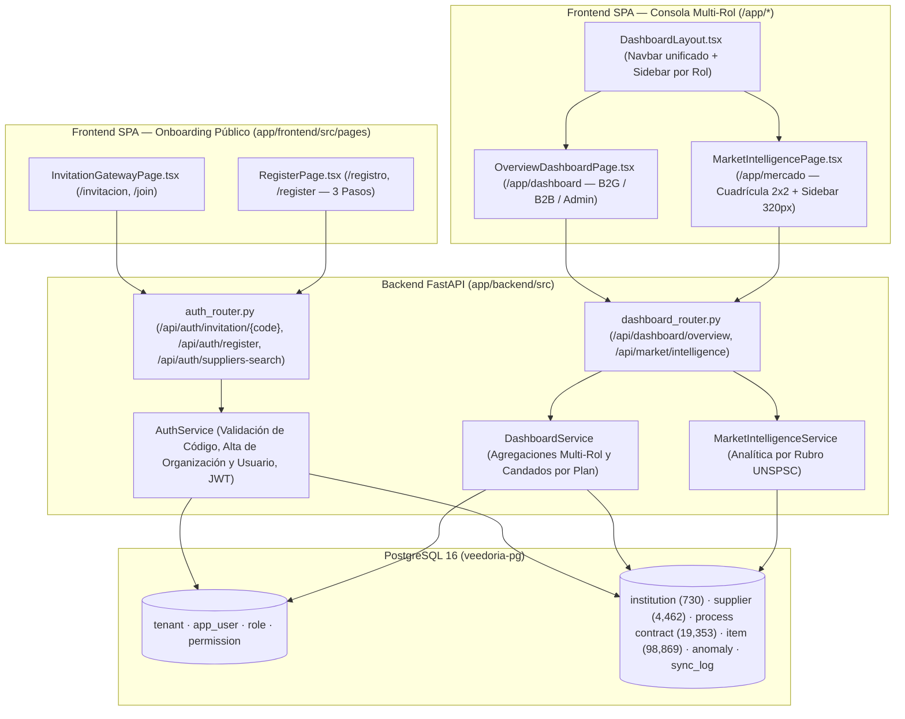
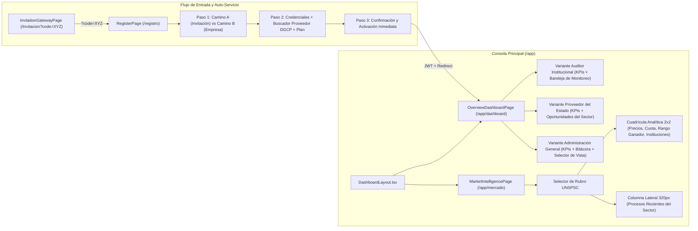

# Design: Consola Multi-Rol, Inteligencia de Mercado y Onboarding de Organizaciones (`consola-multi-rol-onboarding`)

> 📋 Generated by `solution-designer` · 2026-10-20
> ✅ Approved by: Jeremy Michel Solano Frías (2026-10-20)

## Traceability
- **Work Item**: Pendiente (sin PBI/Feature en ADO)
- **Parent**: [veedoria-core](../intake.md)
- **Branch**: `dev`
- **Requirements**: [requirements.md](./requirements.md)
- **Test Plan**: [test-plan.md](./test-plan.md)
- **Test Cases**: [test-cases.md](./test-cases.md)

## Technology Decisions
- **Frontend**: **React `^19.2.6` + TypeScript `~6.0.2` + Vite `^8.0.12` + TailwindCSS `^4.3.1` + TanStack React Query `^5.99.0` + `react-router-dom` `^7.14.0` + `lucide-react` `^1.16.0`** — Implementa las 4 vistas del Paquete 1 siguiendo los lineamientos de `design-system-theme.md`:
  1. `InvitationGatewayPage.tsx` (`/invitacion` y `/join` — tarjeta centrada `max-w-[450px]`).
  2. `RegisterPage.tsx` (`/registro` y `/register` — asistente de 3 pasos con Camino A por código de invitación y Camino B de auto-servicio para empresas proveedoras conectado al catálogo real de la DGCP).
  3. `OverviewDashboardPage.tsx` (`/app/dashboard` — Panorama Ejecutivo dinámico con variantes *Auditor Institucional*, *Proveedor del Estado* y *Administración General* más selector de vista en vivo para el Administrador General).
  4. `MarketIntelligencePage.tsx` (`/app/mercado` — Consola de Inteligencia de Mercado con selector de familia UNSPSC, cuadrícula analítica 2×2 y barra lateral derecha de `320px` con procesos recientes del sector).
- **Backend**: **Python `3.12+` / `3.14` + FastAPI `^0.135.3` + SQLModel / SQLAlchemy Async `^2.0.49` (`asyncpg`)** — Extiende `auth_router.py` / `AuthService` con validación pública de códigos de invitación (`GET /api/auth/invitation/{code}`), búsqueda pública de proveedores para auto-servicio (`GET /api/auth/suppliers-search`) y registro transaccional (`POST /api/auth/register`), e incorpora `dashboard_router.py` (`GET /api/dashboard/overview` y `GET /api/market/intelligence`) con consultas SQL agregadas sobre los `19,353` contratos y `98,869` ítems reales.
- **Database**: **PostgreSQL 16 (`veedoria-pg`)** — Reutiliza las tablas relacionales existentes (`tenant`, `app_user`, `role`, `supplier`, `institution`, `process`, `contract`, `item`, `anomaly`, `sync_log`, `audit_log`) sin requerir migraciones destructivas, apoyándose en índices sobre `tenant.codigo`, `contract.process_id`, `contract.rpe`, `item.unspsc_family` e `item.contract_id`.
- **Cloud Services**: Despliegue `monorepo-split` (Frontend SPA en Vercel CDN + Backend API FastAPI y Worker en Render Blueprint `render.yaml` sobre PostgreSQL 16 y Redis 7).
- **Theme**: `govtech` (*El Observatorio Dominicano* — `#002046`, `#1b365d`, `#a93800`, `#f8f9ff`, tipografías `Manrope`, `Inter` y `JetBrains Mono`, `0` términos técnicos prohibidos en interfaz y `0` insignias decorativas de IA).

## Architecture

### System Overview


### Component Diagram


## Deployment
- **Pattern**: `monorepo-split` (SPA estática en Vercel CDN + API FastAPI asíncrona en contenedor sobre Render Blueprint `render.yaml`).
- **App**: `app/frontend` (React 19 + Vite) y `app/backend` (FastAPI + SQLModel).
- **Infra**: PostgreSQL 16 (`veedoria-pg`) + Redis 7 (`veedoria-redis`).
- **CI/CD**: GitHub Actions (`pytest`, `ruff`, `eslint`, `tsc -b`, `vite build`).
- **Justification**: Las agregaciones de `/api/dashboard/overview` y `/api/market/intelligence` se ejecutan directamente en PostgreSQL mediante SQLAlchemy asíncrono (`asyncpg`), garantizando tiempos de respuesta inferiores a `500ms` (`NFR-002`) y control de acceso por suscripción en el servidor.
- **Discarded**: Cálculos agregados en el navegador descargando miles de contratos crudos (descartado por latencia, consumo de memoria y exposición innecesaria de datos bloqueados por plan).

### Environments
| Environment | Branch | Frontend URL | Backend API URL | Deploy trigger |
|-------------|--------|--------------|-----------------|----------------|
| **Local** | `dev` | `http://localhost:5173` | `http://127.0.0.1:3001` | Ejecución local (`npm run dev` + `uvicorn`) |
| **DEV / QA** | `dev` | `https://dev.veedoria.do` | `https://api-dev.veedoria.do` | Push / Merge a `dev` tras CI |
| **CERT (Staging)** | `cert` | `https://cert.veedoria.do` | `https://api-cert.veedoria.do` | Promoción manual `dev -> cert` (Gate: Dev + QA) |
| **PROD** | `main` | `https://veedoria.do` | `https://api.veedoria.do` | Promoción manual `cert -> main` + Tag `vX.Y.Z` |

## Database Schema

Este módulo opera sobre el esquema relacional vigente en PostgreSQL 16 sin alterar ni eliminar columnas existentes:

### Table: `tenant` & `app_user` (Onboarding y Suscripciones — `REQ-001`, `REQ-002`)
| Column | Table | Type | Constraints | Description |
|--------|-------|------|-------------|-------------|
| `id` | `tenant` | `INTEGER` | `PRIMARY KEY` | Identificador interno de la organización |
| `codigo` | `tenant` | `VARCHAR(40)` | `UNIQUE, INDEX` | Código de invitación/organización (ej. `MOPC-B2G`, `MINERD-B2G`, `CONSTRUCTORA-B2B` o autogenerado en Camino B) |
| `nombre` | `tenant` | `VARCHAR(180)` | `NOT NULL` | Nombre oficial de la institución o empresa proveedora |
| `tipo` | `tenant` | `VARCHAR(30)` | `NOT NULL` | `PLATFORM`, `GOV_OVERSIGHT`, `GOV_INSTITUTION` o `B2B_SUPPLIER` |
| `plan_tier` | `tenant` | `VARCHAR(30)` | `NOT NULL` | `PLATFORM_GLOBAL`, `B2G_BASIC`, `B2G_PREMIUM`, `B2G_ENTERPRISE`, `B2B_PYME`, `B2B_CORPORATE` |
| `institution_id` | `tenant` | `INTEGER` | `NULLABLE, INDEX` | Vinculación con `institution.id` para aislamiento institucional |
| `supplier_rpe` | `tenant` | `VARCHAR(50)` | `NULLABLE` | Vinculación con `supplier.rpe` / `contract.rpe` para proveedores del Estado |
| `max_categorias_unspsc` | `tenant` | `INTEGER` | `DEFAULT 3` | `3` en `B2B_PYME`, `9999` en `B2B_CORPORATE` e instituciones |
| `estado` | `tenant` | `VARCHAR(15)` | `DEFAULT 'ACTIVO'` | Estado de la organización (`ACTIVO`, `INACTIVO`) |

### Tables: `process`, `contract`, `item`, `anomaly`, `supplier`, `institution` (Consultas de Dashboard y Mercado — `REQ-003` a `REQ-006`)
| Column | Table | Type | Description |
|--------|-------|------|-------------|
| `id`, `dgcp_code`, `title`, `institution_id` | `process` | `INT / VARCHAR` | Procesos de compra vinculados a `institution.id` |
| `id`, `process_id`, `contract_id`, `amount_adjudicated`, `signed_date`, `supplier_name`, `rpe`, `status` | `contract` | `INT / FLOAT / TIMESTAMP / VARCHAR` | `19,353` contratos adjudicados con monto en `RD$`, fecha de firma y RPE del proveedor |
| `id`, `contract_id`, `description`, `quantity`, `unit`, `unit_price`, `total_amount`, `unspsc_code`, `unspsc_family`, `unspsc_class` | `item` | `INT / FLOAT / VARCHAR` | `98,869` líneas de artículos adjudicados con familia/clase UNSPSC y precio unitario |
| `id`, `process_id`, `contract_id`, `anomaly_type`, `risk_level`, `probability`, `explanation` | `anomaly` | `INT / VARCHAR / FLOAT` | Hallazgos de auditoría clasificados por tipo (`SOBREPRECIO`, `FRACCIONAMIENTO`, etc.) y severidad |

### Indexes
| Name | Table & Columns | Type | Purpose |
|------|-----------------|------|---------|
| `ix_tenant_codigo` | `tenant (codigo)` | `UNIQUE BTREE` | Resolución instantánea en `/api/auth/invitation/{code}` (`REQ-001`) |
| `ix_item_process_code` | `item (process_code)` | `BTREE` | Cruce rápido entre ítems y procesos |
| `ix_anomaly_process_id` | `anomaly (process_id)` | `BTREE` | Agregación de hallazgos por institución en `/api/dashboard/overview` (`REQ-003`) |

## API Contracts

### GET /api/auth/invitation/{code}
- **Request**: Parámetro de ruta `code` (ej. `MOPC-B2G`, `MINERD-B2G`, `CONSTRUCTORA-B2B`).
- **Response (`200 OK`)**:
```json
{
  "data": {
    "codigo": "MOPC-B2G",
    "nombre": "Ministerio de Obras Públicas y Comunicaciones (MOPC)",
    "tipo": "GOV_INSTITUTION",
    "tipo_etiqueta": "Institución Pública",
    "plan_tier": "B2G_PREMIUM",
    "plan_etiqueta": "Plan Institucional Avanzado",
    "alcance": "Ministerio de Obras Públicas y Comunicaciones (MOPC)",
    "rol_asignado": "Auditor Institucional",
    "estado": "ACTIVO"
  }
}
```
- **Auth**: Público.
- **Errors**: `404 INVITATION_CODE_INVALID` (*"El código de invitación ingresado no es válido o ha expirado."*).
- **Maps to**: REQ-001.

### GET /api/auth/suppliers-search
- **Request**: Query params `?q=constructora&limit=15`
- **Response (`200 OK`)**:
```json
{
  "data": [
    {
      "rpe": "132993",
      "nombre": "CONSTRUCTORA & SUMINISTROS DEL CARIBE SRL",
      "rnc": "131-84920-1",
      "clasificacion": "Empresa Nacional",
      "total_contratos": 14,
      "monto_total": 48520100.0
    }
  ]
}
```
- **Auth**: Público (utilizado en el Paso 2 del Camino B de `/registro` para autocompletar desde el catálogo de `4,462` proveedores de la DGCP).
- **Errors**: `422 VALIDATION_ERROR`.
- **Maps to**: REQ-002.

### POST /api/auth/register
- **Request**:
```json
{
  "modo": "NEW_COMPANY",
  "codigo_invitacion": null,
  "nombre": "Laura Méndez",
  "correo": "lmendez@suministrosdelcaribe.do",
  "cargo": "Gerente de Licitaciones",
  "password": "VeedorIA2026!",
  "empresa_nombre": "Suministros Quirúrgicos del Caribe SRL",
  "empresa_rpe": "88412",
  "empresa_rnc": "130-99412-2",
  "plan_tier": "B2B_CORPORATE"
}
```
*(Si `modo == "INVITATION"`, requiere `codigo_invitacion` válido y vincula al usuario a esa organización con el rol correspondiente: `AUDITOR` para instituciones o `PROVEEDOR` para empresas. Si `modo == "NEW_COMPANY"`, crea la organización `B2B_SUPPLIER` con código de invitación autogenerado, registra el proveedor en `supplier` si fue ingreso manual, crea el usuario con rol `TENANT_ADMIN` y emite el JWT de sesión).*
- **Response (`201 Created`)**:
```json
{
  "data": {
    "access_token": "eyJhbGciOiJIUzI1NiIs...",
    "token_type": "bearer",
    "expires_in": 28800,
    "user": {
      "id": 9,
      "nombre": "Laura Méndez",
      "correo": "lmendez@suministrosdelcaribe.do",
      "rol": { "codigo": "TENANT_ADMIN", "nombre": "Administrador de Organización" },
      "tenant": {
        "id": 6,
        "codigo": "SUMINISTROS-B2B",
        "nombre": "Suministros Quirúrgicos del Caribe SRL",
        "tipo": "B2B_SUPPLIER",
        "plan_tier": "B2B_CORPORATE"
      },
      "permisos": ["PUBLIC_READ", "BID_ANALYZER", "PRICE_SIMULATOR", "COMPETITOR_INTEL", "USER_ADMIN"]
    }
  }
}
```
- **Auth**: Público.
- **Errors**: `404 INVITATION_CODE_INVALID`, `409 EMAIL_ALREADY_REGISTERED`, `422 PASSWORD_POLICY_VIOLATION`.
- **Maps to**: REQ-002.

### GET /api/dashboard/overview
- **Request**: Query param opcional `?view_mode=B2G|B2B|ADMIN` (permitido únicamente cuando el usuario autenticado es `PLATFORM_ADMIN` para alternar vistas en vivo).
- **Response (`200 OK`)**:
```json
{
  "data": {
    "variant": "B2G",
    "scope_label": "Ministerio de Obras Públicas y Comunicaciones (MOPC)",
    "plan_tier": "B2G_PREMIUM",
    "plan_label": "Plan Institucional Avanzado",
    "kpis": [
      {
        "id": "procesos_auditados",
        "label": "Procesos Monitoreados",
        "value": "412",
        "sublabel": "Expedientes evaluados en la institución",
        "tone": "primary",
        "locked": false
      },
      {
        "id": "alertas_fraccionamiento",
        "label": "Alertas de Fraccionamiento",
        "value": "9",
        "sublabel": "Procesos subdivididos bajo el umbral",
        "tone": "warning",
        "locked": false
      },
      {
        "id": "monto_fiscalizado",
        "label": "Monto Total Fiscalizado",
        "value": "RD$ 1,842.5M",
        "sublabel": "Volumen acumulado auditado",
        "tone": "neutral",
        "locked": false
      },
      {
        "id": "indice_integridad",
        "label": "Índice de Integridad y Sobreprecios",
        "value": "91.4%",
        "sublabel": "14 alertas de sobreprecio unitario",
        "tone": "danger",
        "locked": false,
        "required_plan_label": "Plan Institucional Avanzado"
      }
    ],
    "table_title": "Bandeja de Monitoreo de Procesos Institucionales",
    "rows": [
      {
        "id": "MOPC-CCC-LPN-2025-0014",
        "process_code": "MOPC-CCC-LPN-2025-0014",
        "title": "Rehabilitación de Caminos Vecinales en Provincia San Cristóbal",
        "secondary_label": "Constructora del Sur SRL",
        "amount_dop": 45800000.0,
        "status_badge": "Riesgo Crítico",
        "status_tone": "critical",
        "detail_badge": "Sobreprecio +42.5%",
        "date_label": "2025-11-18",
        "locked": false
      }
    ]
  }
}
```
- **Auth**: Requerido (`Bearer JWT`).
- **Errors**: `401 UNAUTHENTICATED`.
- **Maps to**: REQ-003, REQ-004, REQ-005.

### GET /api/market/intelligence
- **Request**: Query param opcional `?unspsc_family=7214` (si no se envía, selecciona automáticamente la familia UNSPSC con mayor volumen de contratos adjudicados).
- **Response (`200 OK`)**:
```json
{
  "data": {
    "selected_family": {
      "code": "7214",
      "label": "Rubro UNSPSC 7214 — Servicios de Construcción Pesada y Viales",
      "total_contracts": 328,
      "total_amount_dop": 4215890000.0,
      "total_items": 1420
    },
    "available_families": [
      {
        "code": "7214",
        "label": "Rubro 7214 — Construcción y Obras Civiles",
        "total_contracts": 328,
        "total_amount_dop": 4215890000.0
      }
    ],
    "plan_tier": "B2B_CORPORATE",
    "history_months_limit": 60,
    "price_trend": [
      { "period": "2025-Q1", "avg_unit_price": 14250.0, "contracts_count": 48 },
      { "period": "2025-Q2", "avg_unit_price": 15120.0, "contracts_count": 53 }
    ],
    "supplier_share": {
      "locked": false,
      "required_plan_label": "Plan Proveedor Corporativo",
      "items": [
        {
          "rpe": "132993",
          "supplier_name": "CONSTRUCTORA & SUMINISTROS DEL CARIBE SRL",
          "contracts_won": 18,
          "amount_dop": 312400000.0,
          "share_pct": 14.8
        }
      ]
    },
    "winning_price_range": {
      "locked": false,
      "required_plan_label": "Plan Proveedor Corporativo",
      "min_price_dop": 4200.0,
      "p25_price_dop": 9850.0,
      "median_price_dop": 14600.0,
      "p75_price_dop": 21400.0,
      "max_price_dop": 48900.0,
      "unit_label": "Unidad / Ítem Adjudicado"
    },
    "top_institutions": [
      {
        "institution_id": 14,
        "institution_name": "Ministerio de Obras Públicas y Comunicaciones (MOPC)",
        "contracts_count": 64,
        "total_amount_dop": 1245000000.0
      }
    ],
    "recent_processes": [
      {
        "process_code": "MOPC-CCC-LPN-2025-0014",
        "title": "Adquisición de Materiales y Equipos para Mantenimiento Vial",
        "institution_name": "MOPC",
        "amount_dop": 18450000.0,
        "signed_date": "2025-11-12",
        "supplier_name": "CONSTRUCTORA & SUMINISTROS DEL CARIBE SRL"
      }
    ]
  }
}
```
- **Auth**: Requerido (`Bearer JWT`).
- **Errors**: `401 UNAUTHENTICATED`.
- **Maps to**: REQ-006.

## UI Geometry & Design System Compliance (`NFR-001`)
| Screen | Route | Layout Wrapper | Explicit Container Width | Plan Gate Behavior |
|--------|-------|----------------|--------------------------|--------------------|
| **Pasarela de Invitación** (`#11`) | `/invitacion`, `/join` | `AuthShell` / Tarjeta centrada sobre `#f8f9ff` | `max-w-[450px]` | Muestra organización, alcance y plan asociado al código |
| **Registro Multi-Paso** (`#10`) | `/registro`, `/register` | Tarjeta centrada con indicador de 3 pasos | `max-w-[450px]` (Paso 1) / `max-w-[560px]` (Pasos 2 y 3) | Selector interactivo *Plan Proveedor Pyme* vs *Plan Proveedor Corporativo* |
| **Dashboard Multi-Rol** (`#13/#21/#31`) | `/app/dashboard` | `DashboardLayout` | `max-w-[80rem]` | Candado en 4to KPI y filas de sobreprecio en `B2G_BASIC`; candado en 2do KPI de participación competitiva en `B2B_PYME` |
| **Inteligencia de Mercado** (`#22`) | `/app/mercado` | `DashboardLayout` | `max-w-[80rem]` + Sidebar `w-[320px]` | Candado en *Distribución de Adjudicaciones* y *Rango de Precios con Mayor Éxito* para `B2B_PYME` |

## Requirements Coverage Matrix
| Requirement | Backend Endpoint / Service | Frontend Component | Verification |
|-------------|----------------------------|--------------------|--------------|
| **REQ-001** (`/invitacion?code=XYZ`) | `GET /api/auth/invitation/{code}` (`AuthService.get_invitation_info`) | `InvitationGatewayPage.tsx` | Tarjeta `450px` con datos de organización válida o estado de error controlado |
| **REQ-002** (`/registro` Camino A y B) | `GET /api/auth/suppliers-search` + `POST /api/auth/register` (`AuthService.register_account`) | `RegisterPage.tsx` | Salto automático a Paso 2 con `?code=XYZ`; buscador DGCP + fallback manual en Camino B |
| **REQ-003** (`/app/dashboard` B2G) | `GET /api/dashboard/overview` (`DashboardService.get_b2g_overview`) | `OverviewDashboardPage.tsx` | 4 KPIs institucionales + Bandeja de Monitoreo + candado en `B2G_BASIC` |
| **REQ-004** (`/app/dashboard` B2B) | `GET /api/dashboard/overview` (`DashboardService.get_b2b_overview`) | `OverviewDashboardPage.tsx` | 4 KPIs de proveedor + Oportunidades del Sector + candado en `B2B_PYME` |
| **REQ-005** (`/app/dashboard` Admin) | `GET /api/dashboard/overview` (`DashboardService.get_admin_overview`) | `OverviewDashboardPage.tsx` | 4 KPIs globales + Bitácora del Sistema + selector de vista en vivo (`Admin / B2G / B2B`) |
| **REQ-006** (`/app/mercado` UNSPSC) | `GET /api/market/intelligence` (`MarketIntelligenceService.get_market_intelligence`) | `MarketIntelligencePage.tsx` | Selector de rubro UNSPSC + cuadrícula 2×2 + columna lateral `320px` de procesos recientes |
| **NFR-001** (`design-system-theme.md`) | — | Todas las vistas del Paquete 1 | `0` términos técnicos prohibidos, `0` badges de IA, anchos explícitos `max-w-[...]` |
| **NFR-002** (`< 500ms` p95) | Consultas SQL agregadas en PostgreSQL (`func.count`, `func.sum`, `func.percentile_cont`) | Caché React Query (`staleTime: 60_000`) | Respuesta `< 500ms` medida en pruebas de integración |

## Architecture Updates
- `docs/architecture/api-contract.md`: Documentar los nuevos endpoints `/api/auth/invitation/{code}`, `/api/auth/suppliers-search`, `/api/auth/register`, `/api/dashboard/overview` y `/api/market/intelligence`.
- `docs/architecture/system-design.md`: Registrar las vistas `InvitationGatewayPage`, `RegisterPage`, `OverviewDashboardPage` y `MarketIntelligencePage` dentro del mapa de componentes del Frontend.

## Approval
- [x] Developer: Jeremy Michel Solano Frías Date: 2026-10-20

---
> 📍 Pendiente (sin PBI/Feature en ADO) · 🌿 `dev` · Generated by SDD Standard