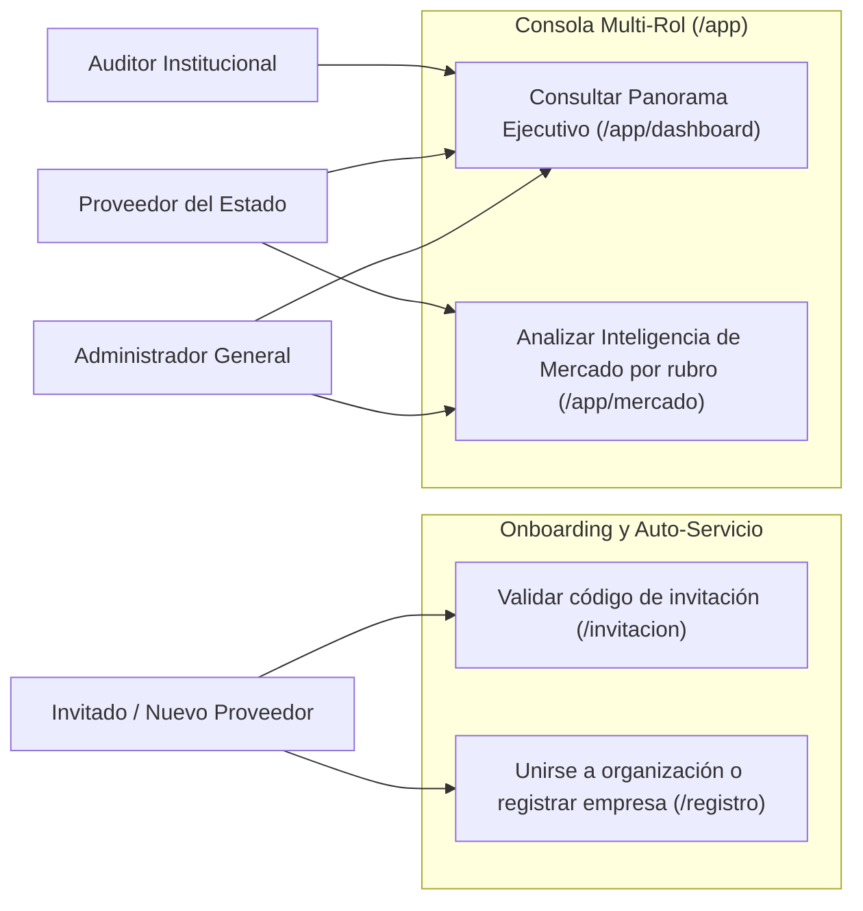
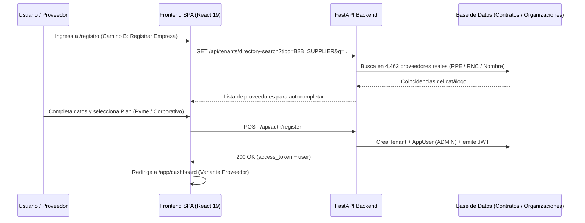

# Requirements: Consola Multi-Rol, Inteligencia de Mercado y Onboarding de Organizaciones (`consola-multi-rol-onboarding`)

> 📋 Generated by `requirements-analyst` · 2026-10-20
> ✅ Approved by: Jeremy Michel Solano Frías (2026-10-20)

## Traceability
- **Work Item**: Pendiente (sin PBI/Feature en ADO)
- **Parent**: [veedoria-core](../intake.md)
- **Branch**: `dev`
- **Design**: [design.md](./design.md)
- **Test Plan**: [test-plan.md](./test-plan.md)
- **Test Cases**: [test-cases.md](./test-cases.md)

## Overview
Este módulo implementa las **4 pantallas principales del Paquete 1** del ecosistema VeedorIA (pantallas `#10`, `#11`, `#13/#21/#31` y `#22` del Mapa Completo de 36 Pantallas), cerrando el ciclo de entrada de nuevas organizaciones/usuarios y las vistas principales de trabajo para **Auditores Institucionales (B2G)**, **Proveedores del Estado (B2B)** y **Administración General (NexoDigital)**:
1. **Pasarela de Aceptación de Invitaciones (`/invitacion?code=XYZ` / `/join?code=XYZ` — `#11`)**: Valida códigos de organización existentes y dirige al invitado a crear cuenta nueva o vincular su sesión existente.
2. **Registro Multi-Paso y Auto-Servicio (`/registro` / `/register` — `#10`)**: Soporta los dos caminos de entrada definidos en `onboarding_and_sales_flow.md` (**Camino A: Unirse con código de invitación** y **Camino B: Auto-servicio de nueva empresa proveedora** conectada al catálogo de `4,462` proveedores de la DGCP con fallback manual).
3. **Dashboard Principal Multi-Rol (`/app/dashboard` — `#13`, `#21`, `#31`)**: Vista panorámica dinámica que adapta sus tarjetas KPI, tabla central y candados de plan según el rol y suscripción activa (*Auditor Institucional Básico vs. Avanzado*, *Proveedor Pyme vs. Corporativo*, y *Administrador General*).
4. **Consola de Inteligencia de Mercado para Proveedores (`/app/mercado` — `#22`)**: Analítica comercial por rubro UNSPSC real sobre los `19,353` contratos y `98,869` ítems adjudicados (tendencia histórica de precios unitarios, cuota de mercado por proveedor/RNC, rango óptimo de precios adjudicados, principales instituciones compradoras y convocatorias recientes del rubro).

## User Stories (EARS Notation)

### REQ-001: Validación de Código en Pasarela de Invitación (`/invitacion` y `/join`)
**Type:** Event-Driven
**Rule:** WHEN un usuario accede a `/invitacion?code=XYZ` (o `/join?code=XYZ`), the system SHALL consultar en el backend la organización asociada al código `XYZ`, mostrar la tarjeta GovTech centrada de `450px` con los detalles de la organización y su plan de servicio si el código es válido, o mostrar el estado de error *"Código Inválido o Expirado"* si no existe o está inactivo.
**Entities:** `Tenant`
**Error Handling:** Si el código no existe o pertenece a una organización inactiva (`404`), se presenta la tarjeta de error con enlace de retorno al inicio (`/`) o entrada manual de otro código.

**Acceptance Criteria:**
- [ ] Given un código de organización válido (ej. `MOPC-B2G` o `CONSTRUCTORA-B2B`), when el usuario abre `/invitacion?code=MOPC-B2G`, then se muestra el nombre de la organización, el plan asociado, el alcance y los dos botones de acción (*"CREAR NUEVA CUENTA"* hacia `/registro?code=MOPC-B2G` e *"INICIAR SESIÓN CON CUENTA EXISTENTE"* hacia `/login?code=MOPC-B2G`).
- [ ] Given un código inexistente, when el usuario consulta la pasarela, then se muestra el mensaje *"Código Inválido o Expirado"* sin exponer detalles técnicos.

**Priority:** Must
**Dependencies:** None
**Tracker:** Pendiente

### REQ-002: Registro Multi-Paso por Invitación o Auto-Servicio de Empresa (`/registro`)
**Type:** Event-Driven
**Rule:** WHEN un usuario completa el flujo de 3 pasos en `/registro` (o `/register`), the system SHALL permitirle **Unirse a una Organización Existente** mediante código de invitación (**Camino A**) o **Registrar su Empresa Proveedora** buscando sus datos en el catálogo nacional de proveedores de la DGCP con opción de ingreso manual si es nueva y seleccionando su plan (*Proveedor Pyme* o *Proveedor Corporativo*) (**Camino B**), creando el usuario (y la organización en Camino B) y emitiendo inmediatamente su sesión autenticada.
**Entities:** `Tenant`, `AppUser`, `Role`, `Supplier`, `Contract`
**Error Handling:** Correo ya registrado (`409`), código de invitación inválido (`404`) o contraseña que no cumple los requisitos mínimos (`422`) muestran mensaje claro en español institucional dentro del paso activo.

**Acceptance Criteria:**
- [ ] Given que la URL incluye `?code=XYZ`, when se carga `/registro?code=XYZ`, then el asistente salta automáticamente el Paso 1, pre-carga y valida la organización del código `XYZ` y posiciona al usuario en el Paso 2 (*Datos de Cuenta*).
- [ ] Given que el usuario elige **Camino B (Registrar mi Empresa)** en el Paso 1, when pasa al Paso 2, then puede buscar su empresa por nombre, RPE o RNC en el catálogo real de la DGCP (o activar el ingreso manual si es nueva) y elegir entre *Plan Proveedor Pyme* y *Plan Proveedor Corporativo*.
- [ ] Given datos válidos en el Paso 3 (*Activación*), when el usuario confirma el registro, then el backend crea la cuenta (y la organización con código de invitación autogenerado en Camino B), inicia sesión automáticamente y redirige a `/app/dashboard`.

**Priority:** Must
**Dependencies:** REQ-001
**Tracker:** Pendiente

### REQ-003: Panorama Ejecutivo para Auditor Institucional (`/app/dashboard` — Variante B2G)
**Type:** State-Driven
**Rule:** WHILE el usuario autenticado pertenezca a una institución pública u órgano rector (`GOV_INSTITUTION` o `GOV_OVERSIGHT`), the system SHALL renderizar en `/app/dashboard` la variante **Auditor Institucional** con 4 tarjetas de indicadores reales (*Procesos Auditados*, *Alertas de Fraccionamiento*, *Monto Fiscalizado* e *Índice de Integridad / Sobreprecios*) y la tabla *"Bandeja de Monitoreo de Procesos"* acotada a su institución (o nacional si es órgano rector).
**Entities:** `Process`, `Contract`, `Anomaly`, `Tenant`
**Error Handling:** Si la institución tiene plan *Institucional Básico* (`B2G_BASIC`), la tarjeta de análisis de sobreprecios y las filas con riesgo de sobreprecio muestran el estado bloqueado con aviso de actualización a *Plan Institucional Avanzado*, tal como define `dashboard/design.md`.

**Acceptance Criteria:**
- [ ] Given un auditor de una institución con plan *Institucional Avanzado* (ej. `MOPC-B2G`), when accede a `/app/dashboard`, then visualiza los 4 indicadores calculados sobre los contratos reales de su institución y la tabla de procesos con nivel de riesgo (*Crítico*, *Advertencia*, *Bajo*).
- [ ] Given un auditor de una institución con plan *Institucional Básico* (ej. `MINERD-B2G`), when accede a `/app/dashboard`, then la cuarta tarjeta y el desglose de sobreprecio unitario muestran el candado de plan requerido (*Disponible en Plan Institucional Avanzado*).

**Priority:** Must
**Dependencies:** None
**Tracker:** Pendiente

### REQ-004: Panorama Ejecutivo para Proveedor del Estado (`/app/dashboard` — Variante B2B)
**Type:** State-Driven
**Rule:** WHILE el usuario autenticado pertenezca a una empresa proveedora (`B2B_SUPPLIER`), the system SHALL renderizar en `/app/dashboard` la variante **Proveedor del Estado** con 4 tarjetas de indicadores reales (*Contratos Registrados en el Sector*, *Participación Competitiva Estimada*, *Monto Total Adjudicado* y *Rubros UNSPSC Vinculados*) y la tabla *"Oportunidades y Procesos Recientes del Sector"*.
**Entities:** `Contract`, `Item`, `Process`, `Tenant`
**Error Handling:** Si la empresa tiene plan *Proveedor Pyme* (`B2B_PYME`), la tarjeta de tasa/participación competitiva muestra el candado *"Disponible en Plan Proveedor Corporativo"*.

**Acceptance Criteria:**
- [ ] Given un usuario proveedor (ej. `Constructora & Suministros del Caribe, RPE #132993`), when accede a `/app/dashboard`, then visualiza su monto real adjudicado, sus rubros UNSPSC activos y la tabla de procesos recientes en sus familias de productos/servicios con indicador de intensidad de competencia (*Alta*, *Media*, *Baja*).

**Priority:** Must
**Dependencies:** None
**Tracker:** Pendiente

### REQ-005: Panorama Ejecutivo de Administración General (`/app/dashboard` — Variante Admin)
**Type:** State-Driven
**Rule:** WHILE el usuario autenticado tenga rol de Administración General (`PLATFORM_ADMIN`), the system SHALL renderizar en `/app/dashboard` la variante **Administración General** con 4 indicadores de operación (*Usuarios y Organizaciones Activas*, *Estado de Sincronización de Datos*, *Total de Contratos / Hallazgos en Plataforma* y *Cobertura de Auditoría*) junto con la tabla *"Bitácora de Actividad Reciente del Sistema"* y un selector de previsualización para alternar en vivo entre las 3 vistas del Dashboard (*Admin*, *Auditor Institucional* y *Proveedor*).
**Entities:** `AppUser`, `Tenant`, `SyncLog`, `AuditLog`, `Anomaly`
**Error Handling:** Sin bloqueos ni candados de suscripción para el rol de Administración General.

**Acceptance Criteria:**
- [ ] Given el Administrador General (`admin@veedoria.gob.do`), when accede a `/app/dashboard`, then visualiza las métricas operativas globales, los eventos recientes registrados y puede previsualizar cualquiera de las variantes del Dashboard sin restricciones.

**Priority:** Must
**Dependencies:** REQ-003, REQ-004
**Tracker:** Pendiente

### REQ-006: Consola de Inteligencia de Mercado por Rubro UNSPSC (`/app/mercado`)
**Type:** Event-Driven
**Rule:** WHEN un usuario accede a `/app/mercado` y selecciona una familia o rubro del clasificador UNSPSC, the system SHALL consultar los contratos e ítems reales adjudicados en ese rubro y renderizar la cuadrícula analítica 2×2 (*Tendencia Histórica de Precios Unitarios*, *Distribución de Adjudicaciones por Proveedor*, *Rango de Precios Adjudicados con Mayor Frecuencia* y *Principales Instituciones Compradoras*) más la columna lateral de *Procesos Recientes del Sector*.
**Entities:** `Item`, `Contract`, `Process`, `Institution`, `Supplier`
**Error Handling:** Si el usuario pertenece a una empresa con plan *Proveedor Pyme* (`B2B_PYME`), las tarjetas de *Distribución de Adjudicaciones de Competidores* y *Rango Óptimo de Precio Ganador* muestran el candado de actualización a *Plan Proveedor Corporativo*, y la tendencia histórica indica alcance de 12 meses (`market_intelligence/design.md`).

**Acceptance Criteria:**
- [ ] Given las familias UNSPSC reales con mayor volumen en la base de datos, when el usuario abre `/app/mercado` y cambia el selector de rubro UNSPSC, then los 4 paneles analíticos y la lista lateral de procesos del sector se actualizan con cifras reales en `RD$`.
- [ ] Given una cuenta en plan *Proveedor Corporativo* o *Administración General*, when visualiza `/app/mercado`, then los 4 gráficos y tablas de competidores están completamente desbloqueados.

**Priority:** Must
**Dependencies:** None
**Tracker:** Pendiente

## Non-Functional Requirements

### NFR-001: Cumplimiento Estricto de `design-system-theme.md` (GovTech)
**Category:** Accessibility
**Rule:** The system SHALL aplicar en todas las pantallas del Paquete 1 los tokens de color, tipografía (`Manrope`, `Inter`, `JetBrains Mono`), geometría de tarjeta centrada de `450px` en `/invitacion` y Paso 1 de `/registro`, clases explícitas de ancho (`max-w-[450px]`, `max-w-[80rem]`) y prohibición total de jerga técnica o badges decorativos tipo IA.
**Metric:** `0` ocurrencias de términos prohibidos (`PostgreSQL`, `FastAPI`, `Tenant`, `SaaS`, `Isolation Forest`, `OCDS`, `RBAC`) en textos visibles al usuario y `0` usos de `max-w-sm/md/lg/xl`.
**Priority:** Must

### NFR-002: Rendimiento de Agregaciones de Dashboard y Mercado
**Category:** Performance
**Rule:** The system SHALL responder las consultas agregadas de `/api/dashboard/overview` y `/api/market/intelligence` en menos de `500ms` sobre la base de datos local de `19,353` contratos y `98,869` ítems.
**Metric:** Tiempo de respuesta HTTP `< 500ms` p95.
**Priority:** Must

## Diagrams

### Use Case Diagram

### Supporting Diagram

## Dependencies
| Feature | Capability needed | Status | Workaround |
|---------|------------------|--------|------------|
| `autenticacion-rbac` | Modelos `Tenant`, `AppUser`, `Role`, `Permission`, emisión JWT y buscador `/api/tenants/directory-search` | ✅ Activo | Ninguno requerido |
| `ingesta-sincronizacion-dgcp` | Tablas `Institution`, `Process`, `Contract`, `Item` y `Supplier` pobladas con datos reales | ✅ Activo | Ninguno requerido |

## Assumptions
| # | Assumption | Temporary stub | Replaced when |
|---|-----------|----------------|---------------|
| 1 | En el Paso 3 del Camino B de `/registro` (*Pago de Suscripción*), la validación de tarjeta opera como pasarela simulada de demostración sin cargos bancarios reales | Confirmación instantánea de suscripción en modo demostración | Integración futura con pasarela bancaria Azul / CardNET en producción |

## Out of Scope
- Las pantallas de los demás paquetes: consola B2G (`herramientas-auditoria-b2g`), suite comercial B2B (`suite-licitaciones-b2b`), consola de administración global (`consola-admin-operaciones`) y el portal público (`/public/*`).
- Autenticación y emisión de sesión (`/login`, recuperación y restablecimiento de contraseña): pertenecen a `autenticacion-rbac`; este módulo solo consume la sesión activa.
- Gestión de usuarios, organizaciones y permisos (`/app/usuarios`, `/app/roles`): pertenecen a `autenticacion-rbac`.
- Pasarela de pago real en el Paso 3 del Camino B de `/registro`: opera como demostración (ver `## Assumptions`); no se integra Azul/CardNET ni se ejecutan cargos.
- Nuevas tablas o migraciones: el módulo consume el modelo de identidad ya existente (`autenticacion-rbac`) y el catálogo de proveedores de la DGCP.
- Envío de correo transaccional para invitaciones y bienvenida: el código de invitación se valida y se resuelve en pantalla.
- Aplicación móvil nativa: la experiencia es web responsiva.

## Approval
- [x] Approved by: Jeremy Michel Solano Frías (2026-10-20)

---
> 📍 Pendiente (sin PBI/Feature en ADO) · 🌿 `dev` · Generated by SDD Standard
