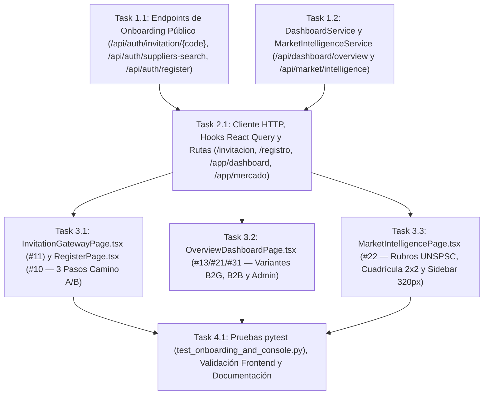

# Tasks: Consola Multi-Rol, Inteligencia de Mercado y Onboarding de Organizaciones (`consola-multi-rol-onboarding`)

> 📋 Generated by `solution-designer` · 2026-10-20
> ✅ Approved by: Jeremy Michel Solano Frías (2026-10-20)

## Traceability
- **Work Item**: Pendiente (sin PBI/Feature en ADO)
- **Branch**: `dev`

## Metadata
- **Based on:** [design.md](./design.md)
- **Total estimate:** ~16.0h (incluye 20% buffer)
- **Number of waves:** 4 (Wave 1, Wave 2, Wave 3, Wave 4)
- **Number of tasks:** 7
- **Sprint:** [TBD]
- **Assignee:** Jeremy Michel Solano Frías

## Estimation Rules

See `estimation-strategy.md` for full estimation rules, AI multipliers, and architecture impact.

**Quick reference:**
- Maximum **4 hours** per task (break larger tasks into subtasks)
- Estimates include implementation + unit tests + code review
- If a task exceeds 4h during implementation, split it immediately
- Add **20% buffer** to total estimate for unknowns
- If using agentic IDEs + SDD: apply multipliers from `estimation-strategy.md` §Scenario B
- Track actual vs estimated for future calibration (see `estimation-strategy.md` §Calibration)

## Dependency Graph

---

## Wave 1: Backend Onboarding & Multi-Role Aggregation Services (~5.0h)

### Task 1.1: Endpoints de Onboarding Público en `AuthService` y `auth_router.py` (`REQ-001`, `REQ-002`) (~2.2h)
- **Description:** Extender `app/backend/src/services/auth_service.py` y `app/backend/src/presentation/routers/auth_router.py` con los 3 endpoints públicos del ciclo de entrada:
  - `GET /api/auth/invitation/{code}`: valida el código de invitación/organización (`tenant.codigo`, case-insensitive), verifica que la organización esté `ACTIVA` y devuelve `codigo`, `nombre`, `tipo`, `tipo_etiqueta`, `plan_tier`, `plan_etiqueta`, `alcance` y `rol_asignado` sin exponer datos internos. Si no existe o está inactiva, retorna `404 INVITATION_CODE_INVALID`.
  - `GET /api/auth/suppliers-search`: consulta pública acotada al catálogo de `4,462` proveedores (`supplier` y contratos adjudicados) por nombre, RPE o RNC para autocompletar el Paso 2 del Camino B en `/registro`.
  - `POST /api/auth/register`: soporta `modo = "INVITATION"` (vincula el nuevo usuario a la organización del `codigo_invitacion` con rol `AUDITOR` o `PROVEEDOR`) y `modo = "NEW_COMPANY"` (crea una nueva organización `B2B_SUPPLIER` con código único autogenerado, vincula el `supplier_rpe` existente o inserta el registro en `supplier` si es ingreso manual, asigna el plan elegido `B2B_PYME` o `B2B_CORPORATE`, crea el usuario `TENANT_ADMIN` con contraseña cifrada en `bcrypt` y devuelve inmediatamente `access_token` + `user`).
- **Acceptance criteria:**
  - [x] `GET /api/auth/invitation/MOPC-B2G` retorna `200 OK` con los metadatos de la organización y un código inexistente retorna `404`.
  - [x] `POST /api/auth/register` permite tanto unirse por código (`INVITATION`) como registrar una empresa nueva o del catálogo DGCP (`NEW_COMPANY`) y emite un JWT válido.
- **Dependencies:** None
- **Files to create/modify:** `app/backend/src/services/auth_service.py`, `app/backend/src/presentation/routers/auth_router.py`

### Task 1.2: Servicios `DashboardService` y `MarketIntelligenceService` + Router `dashboard_router.py` (`REQ-003`, `REQ-004`, `REQ-005`, `REQ-006`, `NFR-002`) (~2.8h)
- **Description:** Crear `app/backend/src/services/dashboard_service.py` y `app/backend/src/presentation/routers/dashboard_router.py`, y registrarlos en `src/presentation/main.py`:
  - `GET /api/dashboard/overview`: detecta el segmento de la organización del usuario autenticado (`GOV_INSTITUTION`/`GOV_OVERSIGHT` -> variante `B2G`; `B2B_SUPPLIER` -> variante `B2B`; `PLATFORM` -> variante `ADMIN`, permitiendo a `PLATFORM_ADMIN` pasar `?view_mode=ADMIN|B2G|B2B` para previsualizar cualquiera de las 3 vistas):
    - **Variante `B2G`**: calcula 4 KPIs reales sobre su institución (o nacional si es `GOV_OVERSIGHT`): *Procesos Monitoreados*, *Alertas de Fraccionamiento*, *Monto Total Fiscalizado* e *Índice de Integridad y Sobreprecios* (marcado con `locked: true` cuando `plan_tier == "B2G_BASIC"`), más las filas de la *"Bandeja de Monitoreo de Procesos Institucionales"*.
    - **Variante `B2B`**: calcula 4 KPIs reales sobre el proveedor y sus rubros: *Contratos en el Sector*, *Tasa de Adjudicación Estimada* (`locked: true` cuando `plan_tier == "B2B_PYME"`), *Monto Total Adjudicado* y *Rubros UNSPSC Vinculados*, más la tabla *"Oportunidades y Procesos Recientes del Sector"* con insignia de competencia (*Alta*, *Media*, *Baja*).
    - **Variante `ADMIN`**: calcula 4 KPIs operativos globales (*Usuarios y Organizaciones Activas*, *Trabajos de Sincronización*, *Total de Contratos / Hallazgos en Plataforma* y *Cobertura de Auditoría*) más las filas de *"Bitácora de Actividad Reciente del Sistema"*.
  - `GET /api/market/intelligence`: recibe `?unspsc_family=XXXX` (o toma por defecto la familia UNSPSC con mayor volumen de contratos reales en PostgreSQL) y devuelve las familias disponibles más los 4 bloques de la cuadrícula 2×2 (*Tendencia Histórica de Precios Unitarios*, *Distribución de Adjudicaciones por Proveedor*, *Rango de Precios con Mayor Éxito* P25/Mediana/P75 y *Principales Instituciones Compradoras*) y la lista lateral de *Procesos Recientes del Sector*, aplicando `locked: true` en cuota de competidores y rango ganador cuando `plan_tier == "B2B_PYME"`.
- **Acceptance criteria:**
  - [x] `/api/dashboard/overview` retorna las 3 variantes con cifras reales de PostgreSQL en `< 500ms`.
  - [x] `/api/market/intelligence` retorna familias UNSPSC reales, serie histórica, competidores, cuartiles de precios, principales instituciones y procesos recientes del rubro en `< 500ms`.
- **Dependencies:** None
- **Files to create/modify:** `app/backend/src/services/dashboard_service.py`, `app/backend/src/presentation/routers/dashboard_router.py`, `app/backend/src/presentation/main.py`

---

## Wave 2: Frontend API Client, Types & Navigation Wiring (~2.0h)

### Task 2.1: Cliente HTTP, Hooks React Query y Enrutamiento en `App.tsx` y `DashboardLayout.tsx` (~2.0h)
- **Description:** Extender `app/frontend/src/infrastructure/api/anomalyApi.ts` y `app/frontend/src/presentation/hooks/useAuthManagement.ts` (o crear el módulo de hooks del Paquete 1) con las funciones tipadas para:
  - `fetchInvitationInfo(code)`, `searchPublicSuppliers(q)`, `registerAccount(payload)`.
  - `fetchDashboardOverview(viewMode?)` y `fetchMarketIntelligence(unspscFamily?)`.
  - Actualizar `App.tsx` y `DashboardLayout.tsx` para conectar las rutas públicas `/invitacion`, `/join`, `/registro`, `/register` y las rutas protegidas `/app/dashboard` (*Panorama Ejecutivo*) y `/app/mercado` (*Inteligencia de Mercado*), además de agregar en `/login` el enlace hacia `/registro` y soporte para `?code=XYZ` cuando un usuario con cuenta existente viene desde `/invitacion?code=XYZ`.
- **Acceptance criteria:**
  - [x] Todas las funciones de API están tipadas en TypeScript sin uso de `any`.
  - [x] El menú lateral de `DashboardLayout.tsx` enlaza activamente a `/app/dashboard` y `/app/mercado` según el rol activo.
- **Dependencies:** Task 1.1, Task 1.2
- **Files to create/modify:** `app/frontend/src/infrastructure/api/anomalyApi.ts`, `app/frontend/src/presentation/hooks/useAuthManagement.ts`, `app/frontend/src/presentation/layouts/DashboardLayout.tsx`, `app/frontend/src/presentation/pages/LoginPage.tsx`, `app/frontend/src/App.tsx`

---

## Wave 3: Public Onboarding & Multi-Role Console Views (~6.5h)

### Task 3.1: Vistas `InvitationGatewayPage.tsx` (`#11`) y `RegisterPage.tsx` (`#10`) (`REQ-001`, `REQ-002`, `NFR-001`) (~3.0h)
- **Description:** Construir las 2 páginas públicas de incorporación siguiendo fielmente `invitation_gateway/design.md`, `register/design.md` y `design-system-theme.md`:
  - `InvitationGatewayPage.tsx` (`/invitacion` y `/join`): tarjeta centrada `max-w-[450px]` sobre `#f8f9ff`, estados de carga, código inválido/expirado (con opción de ingresar otro código manualmente o volver al inicio) y código válido mostrando el escudo institucional/empresarial, nombre de la organización, plan asociado, alcance y los 2 botones de acción (*"CREAR NUEVA CUENTA"* -> `/registro?code=XYZ` e *"INICIAR SESIÓN CON CUENTA EXISTENTE"* -> `/login?code=XYZ`).
  - `RegisterPage.tsx` (`/registro` y `/register`): asistente de 3 pasos:
    - **Paso 1 (`max-w-[450px]`)**: selección de camino (**Camino A: Tengo un Código de Invitación**, **Camino B: Registrar mi Empresa Proveedora**, más enlace directo al Portal Ciudadano `/public`). Si la URL trae `?code=XYZ`, valida automáticamente el código y posiciona al usuario directamente en el Paso 2.
    - **Paso 2 (`max-w-[560px]`)**: datos de cuenta (nombre completo, correo, cargo, contraseña segura). En Camino B incluye además el buscador en vivo contra los `4,462` proveedores de la DGCP (por nombre, RPE o RNC) con opción *"Mi empresa aún no figura en el catálogo — Ingresar datos manualmente"* y el selector interactivo de tarjetas de suscripción (*Plan Proveedor Pyme* vs. *Plan Proveedor Corporativo*).
    - **Paso 3 (`max-w-[560px]`)**: resumen de confirmación de la organización y plan seleccionado (con formulario de suscripción en modo demostración para Camino B), botón de activación inmediata que invoca `POST /api/auth/register`, guarda la sesión JWT y redirige a `/app/dashboard`.
- **Acceptance criteria:**
  - [x] `/invitacion?code=MOPC-B2G` y `/invitacion?code=INVALIDO` renderizan ambos estados con ancho explícito `max-w-[450px]` y `0` términos técnicos prohibidos.
  - [x] `/registro` permite completar tanto el Camino A como el Camino B de principio a fin e inicia sesión automáticamente.
- **Dependencies:** Task 2.1
- **Files to create/modify:** `app/frontend/src/presentation/pages/InvitationGatewayPage.tsx`, `app/frontend/src/presentation/pages/RegisterPage.tsx`

### Task 3.2: Vista `OverviewDashboardPage.tsx` (`/app/dashboard` — `#13 / #21 / #31`) (`REQ-003`, `REQ-004`, `REQ-005`, `NFR-001`) (~2.0h)
- **Description:** Construir `app/frontend/src/presentation/pages/OverviewDashboardPage.tsx` con soporte completo para las 3 variantes de rol y suscripción definidas en `dashboard/design.md`:
  - **Variante Auditor Institucional (`B2G`)**: 4 tarjetas KPI + tabla *"Bandeja de Monitoreo de Procesos Institucionales"* con enlace hacia `/app/bandeja` y estado bloqueado con candado en el 4.º KPI y filas de sobreprecio cuando la institución tiene `B2G_BASIC` (ej. `MINERD-B2G`).
  - **Variante Proveedor del Estado (`B2B`)**: 4 tarjetas KPI + tabla *"Oportunidades y Procesos Recientes del Sector"* con insignia de competencia (*Alta*, *Media*, *Baja*), enlace hacia `/app/mercado` y candado en el 2.º KPI para `B2B_PYME`.
  - **Variante Administración General (`ADMIN`)**: 4 tarjetas KPI globales + tabla *"Bitácora de Actividad Reciente del Sistema"* + selector superior de previsualización (`Vista Administración`, `Vista Auditor Institucional`, `Vista Proveedor del Estado`) para alternar en vivo entre las 3 variantes.
- **Acceptance criteria:**
  - [x] Cada rol visualiza su variante correspondiente con datos reales y los candados de suscripción se activan según el `plan_tier`.
- **Dependencies:** Task 2.1
- **Files to create/modify:** `app/frontend/src/presentation/pages/OverviewDashboardPage.tsx`

### Task 3.3: Vista `MarketIntelligencePage.tsx` (`/app/mercado` — `#22`) (`REQ-006`, `NFR-001`) (~1.5h)
- **Description:** Construir `app/frontend/src/presentation/pages/MarketIntelligencePage.tsx` siguiendo `market_intelligence/design.md`:
  - Cabecera con selector de familia UNSPSC real (mostrando código, descripción, cantidad de contratos y volumen en `RD$`).
  - Cuadrícula analítica 2×2 en el área central (`flex-1`):
    1. *Tendencia Histórica de Precios Unitarios* (gráfico de barras/tendencia trimestral en `RD$`, indicando alcance de 12 meses si el plan es `B2B_PYME`).
    2. *Distribución de Adjudicaciones por Proveedor* (ranking de competidores con RNC/RPE, contratos ganados y porcentaje de participación; bloqueado con candado en `B2B_PYME`).
    3. *Rango de Precios Adjudicados con Mayor Éxito* (banda visual de cuartiles P25, Mediana P50 y P75 en `RD$`; bloqueado con candado en `B2B_PYME`).
    4. *Principales Instituciones Compradoras del Rubro* (ranking de instituciones con monto adjudicado y número de contratos).
  - Columna lateral derecha de `w-[320px]` con *"Procesos Recientes del Sector"*.
- **Acceptance criteria:**
  - [x] Cambiar el rubro UNSPSC actualiza en vivo los 4 paneles analíticos y la columna lateral de procesos recientes.
  - [x] Cuentas en `B2B_PYME` ven los candados de actualización a *Plan Proveedor Corporativo* en los paneles 2 y 3; cuentas en `B2B_CORPORATE` y `PLATFORM_ADMIN` ven los 4 paneles desbloqueados.
- **Dependencies:** Task 2.1
- **Files to create/modify:** `app/frontend/src/presentation/pages/MarketIntelligencePage.tsx`

---

## Wave 4: Testing, Verification & Architecture Sync (~2.5h)

### Task 4.1: Suite de Pruebas `pytest` (`test_onboarding_and_console.py`), Validación Frontend y Documentación (~2.5h)
- **Description:** Crear `app/backend/tests/test_onboarding_and_console.py` cubriendo `GET /api/auth/invitation/{code}`, `GET /api/auth/suppliers-search`, `POST /api/auth/register` (Camino A y Camino B), `GET /api/dashboard/overview` (variantes B2G Básico, B2G Avanzado, B2B y Admin) y `GET /api/market/intelligence`; ejecutar `pytest`, `tsc -b`, `eslint` y `vite build`; verificar las 4 pantallas en el navegador y actualizar `docs/architecture/api-contract.md` y `docs/architecture/system-design.md`.
- **Acceptance criteria:**
  - [x] `pytest` pasa al 100% incluyendo `test_onboarding_and_console.py`.
  - [x] `npm run build` y `npx eslint .` pasan con `0` errores.
  - [x] Documentos de arquitectura global sincronizados.
- **Dependencies:** Task 3.1, Task 3.2, Task 3.3
- **Files to create/modify:** `app/backend/tests/test_onboarding_and_console.py`, `docs/architecture/api-contract.md`, `docs/architecture/system-design.md`

---

## Implementation Order Summary
| Order | Task | Description | Est. | Depends On |
|-------|------|-------------|------|------------|
| 1 | 1.1 | Endpoints de Onboarding Público (`/api/auth/invitation/{code}`, `/api/auth/suppliers-search`, `/api/auth/register`) | ~2.2h | — |
| 2 | 1.2 | Servicios `DashboardService` y `MarketIntelligenceService` (`/api/dashboard/overview`, `/api/market/intelligence`) | ~2.8h | — |
| 3 | 2.1 | Cliente HTTP, Hooks React Query y Rutas en `App.tsx` / `DashboardLayout.tsx` | ~2.0h | 1.1, 1.2 |
| 4 | 3.1 | Vistas `InvitationGatewayPage.tsx` (`#11`) y `RegisterPage.tsx` (`#10`) | ~3.0h | 2.1 |
| 5 | 3.2 | Vista `OverviewDashboardPage.tsx` (`#13 / #21 / #31`) | ~2.0h | 2.1 |
| 6 | 3.3 | Vista `MarketIntelligencePage.tsx` (`#22`) | ~1.5h | 2.1 |
| 7 | 4.1 | Pruebas `pytest`, validación Frontend (`tsc` + `eslint` + `vite build`) y documentación | ~2.5h | 3.1, 3.2, 3.3 |

## Total Estimate: ~16.0h (includes 20% buffer)

## Completion Checklist
- [x] All tasks completed
- [x] All tests passing (`pytest` + `tsc -b` + `eslint` + `vite build`)
- [x] `0` ocurrencias de términos técnicos prohibidos y `0` usos de `max-w-sm/md/lg/xl` (`NFR-001`)
- [x] Tiempos de respuesta `< 500ms` en `/api/dashboard/overview` y `/api/market/intelligence` (`NFR-002`)

---
> 📍 Pendiente (sin PBI/Feature en ADO) · 🌿 `dev` · Generated by SDD Standard