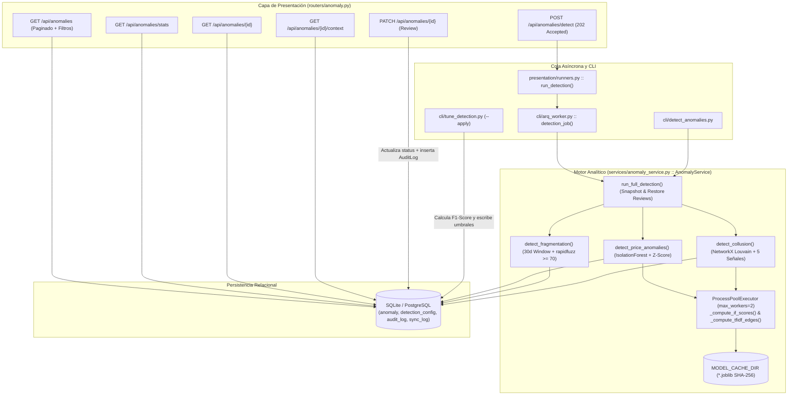
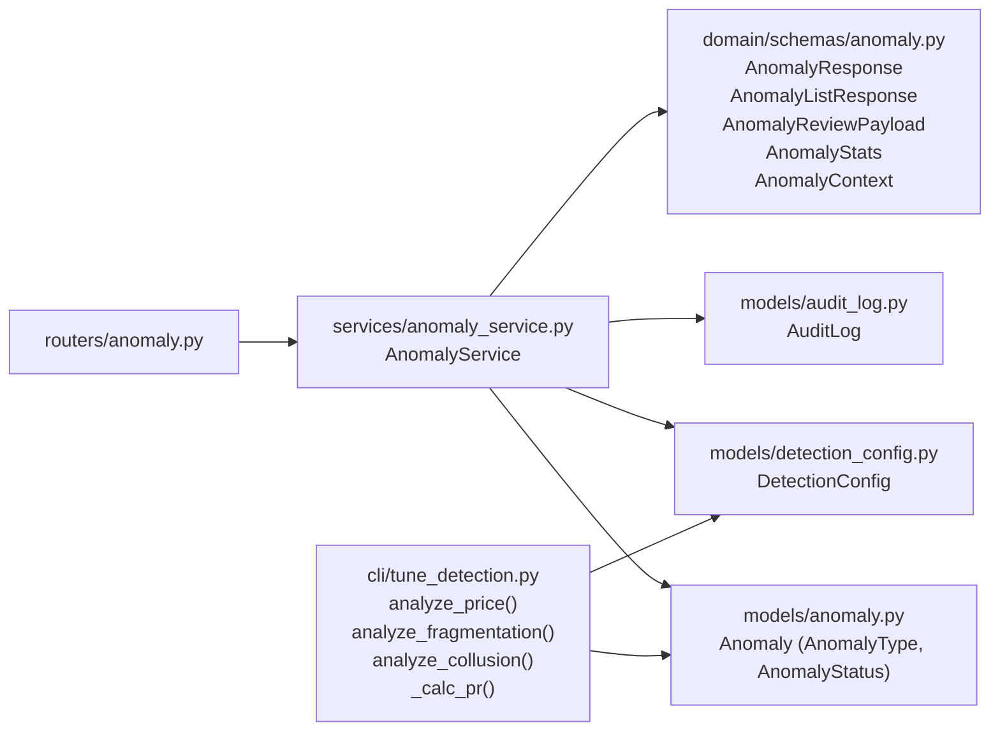

# Design: Motor de Detección de Anomalías (`deteccion-anomalias`)

> 📋 Generated by `solution-designer` · 2026-10-18
> 📋 As-Built — reverse-engineered from code (`a1ff941`)
> ✅ Approved by: Jeremy Michel Solano Frías (2026-10-18)

## Traceability
- **Work Item**: Pendiente (sin PBI/Feature en ADO)
- **Parent**: [veedoria-core](../intake.md)
- **Branch**: `dev`
- **Requirements**: [requirements.md](./requirements.md)
- **Test Plan**: [test-plan.md](./test-plan.md)
- **Test Cases**: [test-cases.md](./test-cases.md)

## Technology Decisions
- **Frontend**: Consumido por la Consola de Auditoría (`/auditor` vía `useAnomalyQueries.ts` en Feature 3) — desacoplado mediante contratos REST tipados con Pydantic v2.
- **Backend**: **FastAPI `^0.110.0` + `scikit-learn` `^1.4.1` + `networkx` `^3.2.1` + `rapidfuzz` `^3.6.1` + `joblib` `^1.3.2` + `numpy` `^1.26.4` + `arq` `^0.28.0`** — `IsolationForest` y `TfidfVectorizer` + `NearestNeighbors` se ejecutan en `ProcessPoolExecutor(max_workers=2)` para liberar el event loop de `asyncio`; `joblib` cachea modelos entrenados en `MODEL_CACHE_DIR` por firma SHA-256; `networkx` ejecuta detección de comunidades Louvain (`seed=42`); y `rapidfuzz` evalúa similitud difusa en C++.
- **Database**: **SQLModel `>=0.0.22,<0.1.0` sobre SQLite (`aiosqlite`) y PostgreSQL (`asyncpg`)** — persiste hallazgos en `anomaly` (con columna JSON `detection_metadata`), parámetros dinámicos en `detection_config` y bitácora inmutable en `audit_log`.
- **Cloud Services**: **Render** (`veedoria-api`, `veedoria-worker`, `veedoria-redis`) + Docker Compose.
- **Theme**: `govtech`.

## Architecture

### System Overview


### Component Diagram


## Deployment
- **Pattern**: `monorepo-split` (`veedoria-api` para consultas `< 200ms` y `PATCH` de dictamen + `veedoria-worker` con `ProcessPoolExecutor(max_workers=2)` para corridas pesadas de `run_full_detection`).
- **App**: Render Web Service (`veedoria-api`) y Render Background Worker (`veedoria-worker`).
- **Infra**: Render Blueprint (`app/backend/render.yaml`) + Docker (`app/backend/Dockerfile`).
- **CI/CD**: Validación local con hooks SDD, `ruff` y `pytest` (`app/backend/tests/unit/test_anomaly_service.py`).
- **Justification**: El cálculo de matrices TF-IDF y árboles `IsolationForest` es intensivo en CPU; aislarlo en `veedoria-worker` con `ProcessPoolExecutor` evita bloquear el bucle `asyncio` de la API.
- **Discarded**: Inferencia ML en el hilo principal de `uvicorn` (descartada por bloqueo del event loop) y recálculo sin caché de `IsolationForest` (descartado a favor de caché `joblib` por hash SHA-256).

### Environments
| Environment | URL | Deploy trigger |
|-------------|-----|----------------|
| Local Development | `http://localhost:3001/api/anomalies` | Manual (`uvicorn` / `python -m src.cli.detect_anomalies`) |
| Production (Render) | `https://veedoria-api.onrender.com/api/anomalies` | Push manual a rama desplegada según blueprint `render.yaml` |

## Database Schema

### Table: `anomaly`
| Column | Type | Constraints | Default | Description |
|--------|------|------------|---------|-------------|
| `id` | `VARCHAR` | `PRIMARY KEY` | `uuid4()` | UUID único del hallazgo |
| `process_id` | `INTEGER` | `FOREIGN KEY (process.id), NULLABLE` | `None` | Proceso asociado (`FRAGMENTATION`) |
| `contract_id` | `INTEGER` | `FOREIGN KEY (contract.id), NULLABLE` | `None` | Contrato asociado (`PRICE_ANOMALY`, `FRAGMENTATION`) |
| `anomaly_type` | `VARCHAR(50)` | `NOT NULL` | — | `PRICE_ANOMALY`, `FRAGMENTATION` o `COLLUSION` |
| `severity` | `FLOAT` | `NOT NULL (0.0..1.0)` | `0.0` | Severidad normalizada de `0.0` a `1.0` |
| `score` | `FLOAT` | `NULLABLE` | `None` | Score algorítmico (`decision_function`, `Z-Score` o densidad de subgrafo) |
| `confidence` | `VARCHAR(12)` | `NOT NULL` | `'MEDIA'` | Nivel de confianza (`ALTA`, `MEDIA`, `BAJA`, `INFO`) |
| `signals_count` | `INTEGER` | `NOT NULL` | `0` | Número de señales concurrentes en colusión (`1..5`) |
| `detection_metadata` | `JSON` | `NULLABLE` | `None` | Diccionario JSON con valores exactos de señales (`shared_phone`, `shared_address`, `shared_domain`, `shared_rnc_prefix`, `similar_name`) |
| `dismissal_reason` | `VARCHAR(20)` | `NULLABLE` | `None` | Motivo de descarte (`FALSE_POSITIVE`, `DUPLICATE`, `DATA_ERROR`, `ALREADY_KNOWN`) |
| `description` | `VARCHAR(2000)` | `NOT NULL` | — | Explicación justificativa en lenguaje natural |
| `status` | `VARCHAR(20)` | `NOT NULL` | `'PENDING'` | Estado (`PENDING`, `CONFIRMED`, `DISMISSED`) |
| `reviewer_id` | `VARCHAR` | `FOREIGN KEY (user.id), NULLABLE` | `None` | ID del auditor que emitió el dictamen |
| `created_at` | `TIMESTAMP` | `NOT NULL` | `utcnow()` | Fecha de detección |
| `updated_at` | `TIMESTAMP` | `NOT NULL` | `utcnow()` | Fecha de última actualización/revisión |
| `amount` | `FLOAT` | `NULLABLE` | `None` | Monto adjudicado del contrato vinculado |
| `process_code` | `VARCHAR(100)` | `NULLABLE` | `None` | Código DGCP del proceso desnormalizado para lectura rápida |
| `supplier_name` | `VARCHAR(500)` | `NULLABLE` | `None` | Razón social del proveedor adjudicado |
| `institution_name` | `VARCHAR(500)` | `NULLABLE` | `None` | Nombre de la institución compradora |

### Table: `detection_config`
| Column | Type | Constraints | Default | Description |
|--------|------|------------|---------|-------------|
| `key` | `VARCHAR(50)` | `PRIMARY KEY` | — | Nombre del parámetro (`price_zscore_threshold`, `price_min_deviation_pct`, `price_if_contamination`, `fragmentation_threshold_dop`) |
| `value` | `FLOAT` | `NOT NULL` | — | Valor numérico calibrado |
| `updated_at` | `TIMESTAMP` | `NOT NULL` | `utcnow()` | Fecha de última calibración (`tune_detection --apply`) |

### Table: `audit_log`
| Column | Type | Constraints | Default | Description |
|--------|------|------------|---------|-------------|
| `id` | `INTEGER` | `PRIMARY KEY` | Auto-increment | Identificador secuencial de bitácora |
| `action_type` | `VARCHAR(50)` | `INDEX, NOT NULL` | — | Tipo de acción (`ANOMALY_REVIEW`) |
| `user_id` | `VARCHAR` | `FOREIGN KEY (user.id), INDEX, NULLABLE` | `None` | Auditor que realizó la acción (`reviewer_id`) |
| `entity_type` | `VARCHAR(50)` | `NOT NULL` | — | Entidad afectada (`'anomaly'`) |
| `entity_id` | `VARCHAR(100)` | `NOT NULL` | — | UUID de la anomalía revisada |
| `old_value` | `JSON` | `NULLABLE` | `None` | Estado anterior (`{"status": "PENDING"}`) |
| `new_value` | `JSON` | `NULLABLE` | `None` | Nuevo estado (`{"status": "...", "notes": "...", "dismissal_reason": "..."}`) |
| `ip_address` | `VARCHAR(45)` | `NULLABLE` | `None` | Dirección IP opcional del cliente |
| `timestamp` | `TIMESTAMP` | `INDEX, NOT NULL` | `utcnow()` | Marca temporal del evento |

### Indexes
| Name | Columns | Type |
|------|---------|------|
| `pk_anomaly` | `anomaly(id)` | `PRIMARY KEY` |
| `pk_detection_config` | `detection_config(key)` | `PRIMARY KEY` |
| `ix_audit_log_action_type` | `audit_log(action_type)` | `BTREE` |
| `ix_audit_log_user_id` | `audit_log(user_id)` | `BTREE` |
| `ix_audit_log_timestamp` | `audit_log(timestamp)` | `BTREE` |

## API Contracts

### POST /api/anomalies/detect
- **Request**: Sin parámetros.
- **Response**: `202 Accepted` — `ApiResponse` JSON:
  ```json
  {
    "success": true,
    "data": { "task": "arq_job_id" },
    "message": "Detección de anomalías iniciada en segundo plano."
  }
  ```
- **Auth**: Optional (en estado *As-Built*).
- **Errors**: `202` con `{"success": false, "message": "La detección de anomalías ya está en progreso"}` si existe un job activo.
- **Maps to**: REQ-001, REQ-002, REQ-003, REQ-004

### GET /api/anomalies
- **Request**: Query parameters:
  - `anomaly_type: str | None = None` (`PRICE_ANOMALY`, `FRAGMENTATION`, `COLLUSION`)
  - `status: str | None = None` (`PENDING`, `CONFIRMED`, `DISMISSED`)
  - `min_severity: float | None = None` (`0.0..1.0`)
  - `limit: int = 50` (`1..200`)
  - `page: int = 1` (`>= 1`)
- **Response**: `200 OK` — `ApiResponse[AnomalyListResponse]` (`items`, `total`, `page`, `limit`).
- **Auth**: Optional.
- **Errors**: `422 Unprocessable Entity` si los parámetros violan rangos (`limit > 200` o `min_severity > 1.0`).
- **Maps to**: REQ-005

### GET /api/anomalies/stats
- **Request**: Sin parámetros.
- **Response**: `200 OK` — `ApiResponse[AnomalyStats]`:
  ```json
  {
    "success": true,
    "data": {
      "total": 412,
      "total_by_type": { "PRICE_ANOMALY": 120, "FRAGMENTATION": 42, "COLLUSION": 250 },
      "total_by_status": { "PENDING": 380, "CONFIRMED": 20, "DISMISSED": 12 },
      "avg_severity": 0.64
    }
  }
  ```
- **Auth**: Optional.
- **Errors**: `500 Internal Server Error` ante fallo de base de datos.
- **Maps to**: REQ-005

### GET /api/anomalies/{anomaly_id}
- **Request**: Path param `anomaly_id: str`.
- **Response**: `200 OK` — `ApiResponse[AnomalyResponse]`.
- **Auth**: Optional.
- **Errors**: `200 OK` con `{"success": false, "message": "Anomalía no encontrada"}` si no existe.
- **Maps to**: REQ-005

### GET /api/anomalies/{anomaly_id}/context
- **Request**: Path param `anomaly_id: str`.
- **Response**: `200 OK` — `ApiResponse[AnomalyContext]` incluyendo `market_prices: list[MarketPrice]`, `recent_contracts: list[TimelineEntry]` y `collusion_links: list[CollusionLink]`.
- **Auth**: Optional.
- **Errors**: `200 OK` con `{"success": false, "message": "Anomalía no encontrada"}` si no existe.
- **Maps to**: REQ-005

### PATCH /api/anomalies/{anomaly_id}
- **Request**: Path param `anomaly_id: str`, Body `AnomalyReviewPayload`:
  ```json
  {
    "status": "DISMISSED",
    "reviewer_id": "auditor-01",
    "notes": "Precio validado por acuerdo marco vigente",
    "dismissal_reason": "FALSE_POSITIVE"
  }
  ```
- **Response**: `200 OK` — `ApiResponse[AnomalyResponse]`.
- **Auth**: Optional (en estado *As-Built*; registra `reviewer_id` en `AuditLog`).
- **Errors**:
  - `422 Unprocessable Entity` si `status` no es `CONFIRMED|DISMISSED`, `notes` tiene `< 10` caracteres (cuando se envía) o `dismissal_reason` no coincide con `^(FALSE_POSITIVE|DUPLICATE|DATA_ERROR|ALREADY_KNOWN)$`.
  - `200 OK` con `{"success": false, "message": "Anomalía no encontrada"}` si el ID no existe.
- **Maps to**: REQ-006

## Architecture Updates
- No global architecture changes required (documentado en `docs/architecture/system-design.md`, `docs/architecture/data-model.md` y `docs/architecture/api-contract.md`).

## Approval
- [x] Developer: Jeremy Michel Solano Frías Date: 2026-10-18

---
> 📍 Pendiente (sin PBI/Feature en ADO) · 🌿 `dev` · Generated by SDD Standard