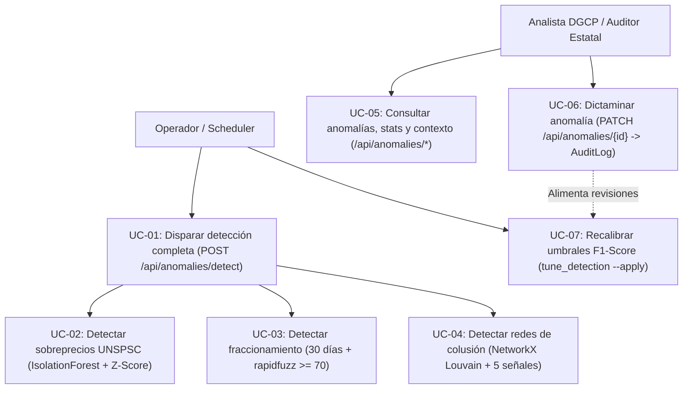
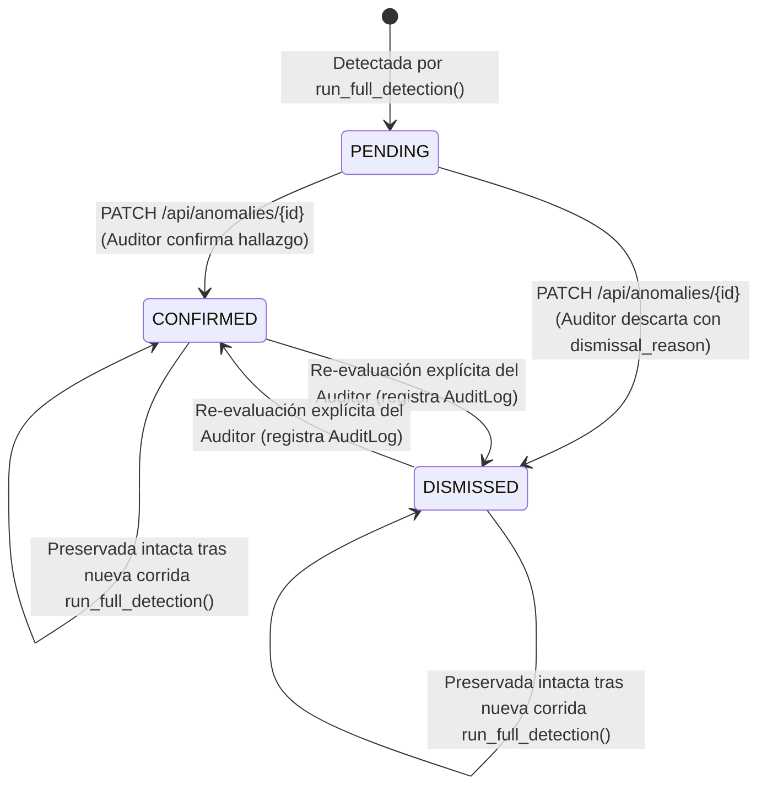

# Requirements: Motor de Detección de Anomalías (`deteccion-anomalias`)

> 📋 Generated by `requirements-analyst` · 2026-10-18
> 📋 As-Built — reverse-engineered from code (`a2c31c5`) and `specs/veedoria-core/intake.md`
> ✅ Approved by: Jeremy Michel Solano Frías (2026-10-18)

## Traceability
- **Work Item**: Pendiente (sin PBI/Feature en ADO)
- **Parent**: [veedoria-core](../intake.md)
- **Branch**: `dev`
- **Design**: [design.md](./design.md)
- **Test Plan**: [test-plan.md](./test-plan.md)
- **Test Cases**: [test-cases.md](./test-cases.md)

## Overview
El módulo **Motor de Detección de Anomalías** es el núcleo analítico de **VeedorIA** (**NexoDigital Solutions, S.R.L.**) encargado de auditar preventivamente las contrataciones públicas del Estado dominicano (bajo el marco de la **Ley No. 340-06** y la **Ley No. 47-25**) para identificar sobreprecios (`PRICE_ANOMALY`), fraccionamiento contractual (`FRAGMENTATION`) y redes de colusión (`COLLUSION`). Combina algoritmos de Machine Learning (*Isolation Forest* con caché `joblib` y *TF-IDF + NearestNeighbors* ejecutados en `ProcessPoolExecutor`), estadística robusta (*Z-Score* y desviación respecto a la mediana UNSPSC), similitud difusa (`rapidfuzz`), detección de comunidades en grafos (`NetworkX` Louvain) y un bucle de retroalimentación cerrado (`DetectionConfig` + `tune_detection.py`) que preserva los dictámenes humanos y optimiza el **F1-Score**.

## User Stories (EARS Notation)

### REQ-001: Disparo asíncrono de detección completa y preservación de dictámenes humanos
**Type:** Event-Driven
**Rule:** WHEN un operador o cliente invoca `POST /api/anomalies/detect` (o ejecuta `python -m src.cli.detect_anomalies`), the system SHALL verificar en `sync_log` que no exista ningún proceso con `process_type = 'detection'` y `status = 'running'`, encolar `detection_job` en `arq` respondiendo HTTP `202 Accepted`, capturar una instantánea de todas las anomalías previamente revisadas (`status != 'PENDING'`) por su llave natural (`("PRICE_ANOMALY", contract_id)`, `("FRAGMENTATION", process_id)`, `("COLLUSION", rnc_1, rnc_2)`), ejecutar secuencialmente `detect_price_anomalies`, `detect_fragmentation` y `detect_collusion`, y restaurar automáticamente el `status` y `reviewer_id` de los hallazgos ya dictaminados.
**Entities:** `Anomaly`, `SyncLog`, `DetectionConfig`
**Error Handling:** Si ya existe una detección en estado `running` en `sync_log` o en la cola `arq`, retorna `ApiResponse(success=False, message="La detección de anomalías ya está en progreso")` sin duplicar el trabajo; si el job falla durante la ejecución, `detection_job` actualiza el `SyncLog` a `status = 'failed'` con `error_message`.

**Acceptance Criteria:**
- [ ] Given que no hay registros en `sync_log` con `process_type = 'detection'` y `status = 'running'`, when se invoca `POST /api/anomalies/detect`, then encola `detection_job` en Redis, retorna `202 Accepted` con `data.task = job_id` y al finalizar persiste en `SyncLog.details` el JSON con los conteos `{"price_anomalies": P, "fragmentation": F, "collusion": C}`.
- [ ] Given anomalías existentes con estado `CONFIRMED` o `DISMISSED` antes de iniciar `run_full_detection`, when concluye el recálculo de las 3 tipologías, then dichas anomalías conservan intactos su `status` y `reviewer_id`.

**Priority:** Must
**Dependencies:** None
**Tracker:** Pendiente

### REQ-002: Detección híbrida de sobreprecios por código UNSPSC (`detect_price_anomalies`)
**Type:** Event-Driven
**Rule:** WHEN se ejecuta `detect_price_anomalies()`, the system SHALL agrupar por `unspsc_code` todos los `Item` con `unit_price > 0` (requiriendo al menos `4` ítems por grupo), evaluar mediante `IsolationForest` (`contamination = 0.02`, `n_estimators = 100`, `random_state = 42`, ejecutado en `ProcessPoolExecutor` y cacheado en disco en `MODEL_CACHE_DIR` por hash SHA-256) aquellos grupos con `>= 30` ítems (`IF_MIN_ITEMS`) o mediante *Z-Score* normalizado (`ZSCORE_THRESHOLD = 2.5` o `DetectionConfig["price_zscore_threshold"]`) los grupos de `4` a `29` ítems, y crear una anomalía `PRICE_ANOMALY` por contrato cuando el porcentaje de desviación sobre la mediana del grupo supere `DetectionConfig["price_min_deviation_pct"]` (`MIN_DEVIATION_PCT` por defecto).
**Entities:** `Item`, `Contract`, `Process`, `Institution`, `Anomaly`, `DetectionConfig`
**Error Handling:** Grupos UNSPSC con `< 4` precios válidos o desviación estándar igual a `0` se omiten de forma segura sin interrumpir el análisis; contratos ya marcados con `PRICE_ANOMALY` (`seen_contracts`) no se duplican.

**Acceptance Criteria:**
- [ ] Given un grupo `unspsc_code` con `>= 30` artículos, when `_compute_if_scores` se ejecuta en `ml_executor`, then reutiliza el modelo `.joblib` en caché si el hash SHA-256 de `contamination|sorted(prices)` coincide, o entrena y persiste el nuevo modelo `IsolationForest`.
- [ ] Given un artículo cuyo puntaje resulta anómalo (`score < 0` en Isolation Forest o supera el umbral Z-Score) y cuya desviación sobre la mediana `median_price` supera el umbral configurado, when se registra la anomalía, then calcula `severity = min(deviation_pct / 500, 1.0)` y genera la explicación en lenguaje natural indicando precio unitario, descripción, porcentaje sobre la mediana y código UNSPSC.

**Priority:** Must
**Dependencies:** REQ-001
**Tracker:** Pendiente

### REQ-003: Detección de fraccionamiento contractual por ventana temporal y similitud de ítems (`detect_fragmentation`)
**Type:** Event-Driven
**Rule:** WHEN se ejecuta `detect_fragmentation()`, the system SHALL seleccionar los contratos con `creation_date` dentro de los últimos `30` días (`FRAGMENTATION_WINDOW_DAYS = 30`) agrupados por institución compradora (`institution_id`), evaluar pares de contratos `(ci, cj)` cuya suma `ci.amount_adjudicated + cj.amount_adjudicated` sea mayor o igual a `DetectionConfig["fragmentation_threshold_dop"]` (`8,000,000` DOP por defecto) y cuyas descripciones de artículos tengan una similitud difusa `rapidfuzz.fuzz.ratio(di, dj) >= 70`, y registrar una anomalía `FRAGMENTATION` por proceso con `severity = min(log2(combined / FRAGMENTATION_THRESHOLD_DOP) / 3, 1.0)`.
**Entities:** `Contract`, `Process`, `Institution`, `Item`, `Anomaly`, `DetectionConfig`
**Error Handling:** Contratos sin `amount_adjudicated` o procesos que ya cuentan con una anomalía `FRAGMENTATION` registrada se omiten para evitar duplicados.

**Acceptance Criteria:**
- [ ] Given dos contratos de una misma institución creados dentro de la ventana de `30` días cuya suma adjudicada alcanza o supera el umbral en DOP y poseen al menos un par de ítems con `fuzz.ratio >= 70`, when se ejecuta `detect_fragmentation()`, then se crea una anomalía `FRAGMENTATION` vinculada a `process_id` y `contract_id` con la justificación de ambos contratos y el monto combinado.

**Priority:** Must
**Dependencies:** REQ-001
**Tracker:** Pendiente

### REQ-004: Detección de redes de colusión mediante grafos multi-señal y comunidades Louvain (`detect_collusion`)
**Type:** Event-Driven
**Rule:** WHEN se ejecuta `detect_collusion()` sobre un universo de `>= 3` proveedores, the system SHALL construir un grafo no dirigido `nx.Graph()` evaluando 5 señales de vinculación priorizadas (`shared_phone` peso `0.8`, `shared_address` peso `0.7`, `shared_domain` peso `0.6` excluyendo dominios públicos `BANNED_EMAIL_DOMAINS`, `similar_name` vía `TfidfVectorizer` char n-grams `(2,4)` + `NearestNeighbors` coseno con `similarity >= 0.85` entre proveedores de una misma institución, y `shared_rnc_prefix` de 6 dígitos peso `0.5`), segmentar comunidades mediante `nx.community.louvain_communities(G, seed=42)` (o componentes conexos si `nodos > 5000`) filtrando subgrafos con `density >= 0.15`, y registrar anomalías `COLLUSION` con nivel de confianza (`ALTA` para `>= 3` señales, `MEDIA` para `2` señales, `INFO` para `1` señal fuerte) y metadatos detallados en `detection_metadata`.
**Entities:** `Supplier`, `Contract`, `Process`, `Anomaly`
**Error Handling:** Pares con una única señal débil (`shared_rnc_prefix` o `similar_name` aisladas) se descartan para evitar falsos positivos; las inserciones se confirman en lotes de `COLLUSION_BATCH_SIZE = 100`.

**Acceptance Criteria:**
- [ ] Given proveedores que comparten teléfono (`>= 7` dígitos), dirección normalizada (`>= 15` caracteres), dominio corporativo, similitud de nombre (`>= 0.85` en la misma institución) o prefijo RNC (`6` dígitos), when pertenecen a una comunidad con `density >= 0.15` y superan el filtro de señales débiles, then el sistema crea la anomalía `COLLUSION` con `severity = min((num_signals / 5.0) * 0.6 + min(len(community) / 8.0, 1.0) * 0.4, 1.0)` y guarda los valores exactos en `detection_metadata`.

**Priority:** Must
**Dependencies:** REQ-001
**Tracker:** Pendiente

### REQ-005: Consulta paginada, estadísticas agregadas y contexto enriquecido por anomalía
**Type:** Event-Driven
**Rule:** WHEN un cliente consulta `GET /api/anomalies`, `GET /api/anomalies/stats`, `GET /api/anomalies/{anomaly_id}` o `GET /api/anomalies/{anomaly_id}/context`, the system SHALL devolver respectivamente: (1) la lista paginada y filtrada (`anomaly_type`, `status`, `min_severity`) ordenada por `severity DESC, created_at DESC` enriquecida con datos de contrato/proceso/institución; (2) las métricas globales (`total`, `total_by_type`, `total_by_status`, `avg_severity`); (3) el detalle individual; y (4) el contexto analítico específico según el tipo de anomalía (`market_prices` del mismo `unspsc_code` para sobreprecios, hasta `10` `recent_contracts` de los últimos `90` días de la misma institución para fraccionamiento, o `collusion_links` filtrados estrictamente por los proveedores involucrados en la anomalía consultada).
**Entities:** `Anomaly`, `Contract`, `Process`, `Institution`, `Item`
**Error Handling:** Si `anomaly_id` no existe en base de datos, `GET /api/anomalies/{id}` y `GET /api/anomalies/{id}/context` retornan `ApiResponse(success=False, message="Anomalía no encontrada")`.

**Acceptance Criteria:**
- [ ] Given una anomalía de tipo `COLLUSION`, when se consulta `GET /api/anomalies/{id}/context`, then `collusion_links` incluye únicamente enlaces donde al menos uno de los proveedores (`name_a` o `name_b`) pertenece a la anomalía actual (`current_names`), deduplicados por par de RNC.
- [ ] Given una anomalía de tipo `PRICE_ANOMALY`, when se consulta `GET /api/anomalies/{id}/context`, then `market_prices` retorna todos los artículos con el mismo `unspsc_code` y `unit_price > 0`, marcando `is_anomaly = True` en el contrato auditado.

**Priority:** Must
**Dependencies:** REQ-002, REQ-003, REQ-004
**Tracker:** Pendiente

### REQ-006: Emisión de dictamen de auditoría y recalibración de umbrales por F1-Score (`review_anomaly` y `tune_detection`)
**Type:** Event-Driven
**Rule:** WHEN un auditor envía `PATCH /api/anomalies/{anomaly_id}` con `AnomalyReviewPayload` (`reviewer_id`, `status`, `notes`, `dismissal_reason`), the system SHALL actualizar el estado de la anomalía (`CONFIRMED` o `DISMISSED`), persistir `dismissal_reason` y `updated_at`, y registrar una entrada inmutable en `audit_log` con `action_type = "ANOMALY_REVIEW"`, `old_value` y `new_value`; adicionalmente, WHEN se ejecuta `python -m src.cli.tune_detection --apply`, the system SHALL evaluar todas las anomalías dictaminadas (`CONFIRMED` vs `DISMISSED`) para calcular precisión, exhaustividad (*recall*) y **F1-Score** (`_calc_pr`) y actualizar en `detection_config` los umbrales óptimos (`price_zscore_threshold`, `price_min_deviation_pct`, `fragmentation_threshold_dop`).
**Entities:** `Anomaly`, `AuditLog`, `DetectionConfig`
**Error Handling:** Si `anomaly_id` no existe al invocar `PATCH /api/anomalies/{anomaly_id}`, retorna `ApiResponse(success=False, message="Anomalía no encontrada")` sin escribir en `audit_log`.

**Acceptance Criteria:**
- [ ] Given una anomalía existente en estado `PENDING`, when se envía `PATCH /api/anomalies/{id}` con `status = "DISMISSED"` y `dismissal_reason`, then se actualiza la fila en `anomaly` y se inserta un registro en `audit_log` con `old_value = {"status": "PENDING"}` y `new_value` con el nuevo estado, notas y motivo.
- [ ] Given anomalías revisadas (`CONFIRMED` y `DISMISSED`) en base de datos, when se ejecuta `python -m src.cli.tune_detection --apply`, then el calibrador selecciona el umbral que maximiza `f1` y lo persiste en `detection_config`.

**Priority:** Must
**Dependencies:** REQ-001, REQ-005
**Tracker:** Pendiente

## Non-Functional Requirements

### NFR-001: Ejecución multiproceso de modelos ML y caché en disco
**Category:** Performance
**Rule:** The system SHALL delegar el entrenamiento/inferencia de `IsolationForest` y la vectorización `TfidfVectorizer` + `NearestNeighbors` a un `ProcessPoolExecutor(max_workers=2)` y cachear los modelos `IsolationForest` serializados con `joblib` en `MODEL_CACHE_DIR` para no bloquear el bucle de eventos `asyncio` de FastAPI/worker.
**Metric:** Disparo del endpoint `POST /api/anomalies/detect` en `< 500ms` (`202 Accepted`) y reutilización en `< 50ms` de modelos `IsolationForest` cacheados.
**Priority:** Must

### NFR-002: Precisión analítica y control de falsos positivos
**Category:** Reliability
**Rule:** The system SHALL filtrar señales débiles aisladas en colusión, exigir similitud difusa `>= 70%` en fraccionamiento y permitir recalibración continua de umbrales en `DetectionConfig` buscando maximizar el F1-Score sobre las revisiones de auditores.
**Metric:** Meta de tasa de falsos positivos `< 5%` tras calibración trimestral y `F1-Score >= 85%`.
**Priority:** Must

### NFR-003: Acotamiento algorítmico ante grafos e instituciones masivas
**Category:** Scalability
**Rule:** The system SHALL limitar el número de aristas por grupo compartido (`MAX_EDGES_PER_GROUP = 100`), el tope de nombres por institución para TF-IDF (`TFIDF_MAX_NAMES = 500`), el umbral de nodos para Louvain (`LOUVAIN_MAX_NODES = 5000`) y el tamaño de lote de commits (`COLLUSION_BATCH_SIZE = 100`).
**Metric:** Complejidad espacial y temporal acotada sin errores de memoria (`OOM`) durante corridas completas.
**Priority:** Must

## Diagrams

### Use Case Diagram

### Supporting Diagram

## Dependencies
| Feature | Capability needed | Status | Workaround |
|---------|------------------|--------|------------|
| `ingesta-sincronizacion-dgcp` | Tablas `institution`, `process`, `contract`, `item` y `supplier` pobladas con datos OCDS de la DGCP | Implementado (`🟢 active`) | Datos semilla locales para pruebas unitarias |

## Assumptions
| # | Assumption | Temporary stub | Replaced when |
|---|-----------|----------------|---------------|
| 1 | Los artículos adjudicados contienen código `unspsc_code` y `unit_price > 0` para poder agrupar precios de mercado | Se omiten artículos sin `unspsc_code` o con `unit_price <= 0` | Mejora continua de catálogos en origen DGCP |
| 2 | En la descripción de anomalías de colusión se incluyen los RNC de ambos proveedores con el patrón `RNC: {rnc}` utilizado para reconstruir enlaces y preservar revisiones | Extracción por expresión regular en `run_full_detection` y `get_anomaly_context` | Si se migra a una tabla puente relacional `anomaly_suppliers` en una versión futura |

## Out of Scope
- Interfaz gráfica de administración de modelos ML (`/dashboard/ia-config` y `/admin/ml-models`, pantallas #17 y #33 del mapa de 36 pantallas, planificadas para fases incrementales).
- Re-entrenamiento automático en caliente dentro del endpoint `PATCH /api/anomalies/{id}` sin pasar por la validación de F1-Score de `tune_detection.py`.

## Approval
- [x] Analyst: Jeremy Michel Solano Frías Date: 2026-10-18

---
> 📍 Pendiente (sin PBI/Feature en ADO) · 🌿 `dev` · Generated by SDD Standard