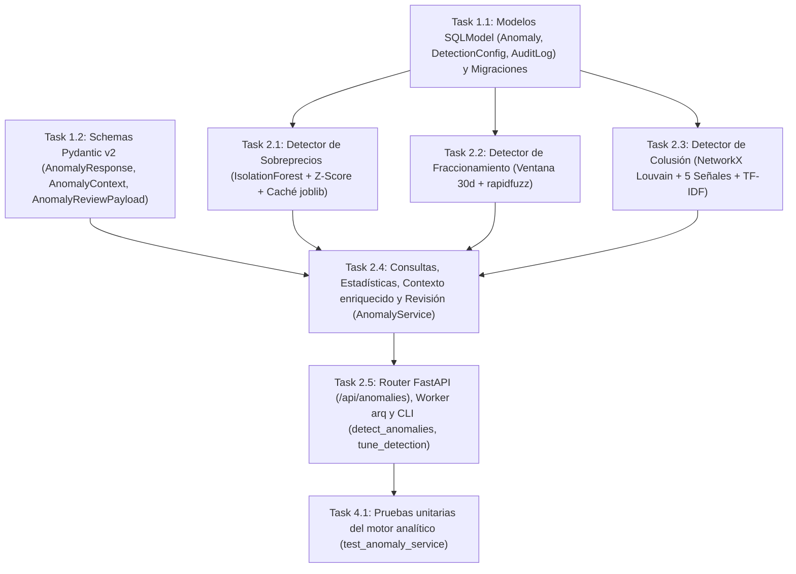

# Tasks: Motor de Detección de Anomalías (`deteccion-anomalias`)

> 📋 Generated by `solution-designer` · 2026-10-18
> 📋 As-Built — reverse-engineered from code
> ✅ Approved by: Jeremy Michel Solano Frías (2026-10-18)

## Traceability
- **Work Item**: Pendiente (sin PBI/Feature en ADO)
- **Branch**: `dev`

## Metadata
- **Based on:** [design.md](./design.md)
- **Total estimate:** ~24h (As-Built — 100% implementado)
- **Number of waves:** 3 (Wave 1, Wave 2, Wave 4)
- **Number of tasks:** 8
- **Sprint:** [TBD]
- **Assignee:** Jeremy Michel Solano Frías

## Estimation Rules

See `estimation-strategy.md` for full estimation rules, AI multipliers, and architecture impact.

**Quick reference:**
- Maximum **4 hours** per task (break larger tasks into subtasks)
- Estimates include implementation + unit tests + code review
- If a task exceeds 4h during implementation, split it immediately
- Add **20% buffer** to total estimate for unknowns
- If using agentic IDEs + SDD: apply multipliers from `estimation-strategy.md` §Scenario B
- Track actual vs estimated for future calibration (see `estimation-strategy.md` §Calibration)

## Dependency Graph

---

## Wave 1: Foundation & Setup (~4h)

### Task 1.1: Modelos SQLModel (`Anomaly`, `DetectionConfig`, `AuditLog`) y Migraciones (~2.5h)
- **Description:** Definir los modelos `Anomaly` (`AnomalyType`, `AnomalyStatus`, metadatos JSON `detection_metadata`, `confidence`, `signals_count`, `dismissal_reason`), `DetectionConfig` (`key`, `value`, `updated_at`) y `AuditLog` (`action_type`, `old_value`, `new_value`), junto con sus migraciones Alembic en `app/backend/migrations/versions/`.
- **Acceptance criteria:**
  - [x] Tablas `anomaly`, `detection_config` y `audit_log` creadas y migradas.
  - [x] Soporte de columna JSON para `detection_metadata` y valores de auditoría.
- **Dependencies:** None
- **Files to create/modify:** `app/backend/src/models/anomaly.py`, `app/backend/src/models/detection_config.py`, `app/backend/src/models/audit_log.py`, `app/backend/migrations/versions/*.py`

### Task 1.2: Schemas Pydantic v2 (`AnomalyResponse`, `AnomalyContext`, `AnomalyReviewPayload`) (~1.5h)
- **Description:** Definir los contratos de entrada y salida en `src/domain/schemas/anomaly.py` incluyendo `AnomalyResponse`, `AnomalyListResponse`, `AnomalyReviewPayload` (con validaciones regex para `status` y `dismissal_reason`), `AnomalyStats`, `MarketPrice`, `TimelineEntry`, `CollusionLink` y `AnomalyContext`.
- **Acceptance criteria:**
  - [x] Validaciones de rango y patrones regex activas en `AnomalyReviewPayload`.
  - [x] Serialización desde atributos ORM (`from_attributes=True`) funcionando en `AnomalyResponse`.
- **Dependencies:** None
- **Files to create/modify:** `app/backend/src/domain/schemas/anomaly.py`

---

## Wave 2: Core Implementation (~14h)

### Task 2.1: Detector de Sobreprecios (`detect_price_anomalies` — `IsolationForest` + `Z-Score` + Caché `joblib`) (~3.5h)
- **Description:** Implementar la agrupación por `unspsc_code` (`>= 4` ítems), inferencia con `IsolationForest` (`len >= 30`, `contamination = 0.02`, `n_estimators = 100`, `random_state = 42`) en `ProcessPoolExecutor(max_workers=2)` con caché en disco `MODEL_CACHE_DIR` por hash SHA-256, fallback a *Z-Score* normalizado (`4..29` ítems), filtro de desviación sobre la mediana (`price_min_deviation_pct`) y generación de explicación en lenguaje natural.
- **Acceptance criteria:**
  - [x] `_compute_if_scores` guarda y reutiliza archivos `if_{hash}.joblib`.
  - [x] `detect_price_anomalies` evita duplicar contratos (`seen_contracts`) y calcula `severity = min(deviation_pct / 500, 1.0)`.
- **Dependencies:** Task 1.1
- **Files to create/modify:** `app/backend/src/services/anomaly_service.py`

### Task 2.2: Detector de Fraccionamiento (`detect_fragmentation` — Ventana 30d + `rapidfuzz`) (~2.5h)
- **Description:** Implementar la detección de pares de contratos adjudicados por una misma institución dentro de los últimos `30` días cuya suma alcance o supere `fragmentation_threshold_dop` (`8,000,000` DOP) y cuyos ítems presenten similitud `rapidfuzz.fuzz.ratio >= 70`.
- **Acceptance criteria:**
  - [x] Agrupación por `institution_id` y ventana `FRAGMENTATION_WINDOW_DAYS = 30`.
  - [x] Cálculo de severidad logarítmica `min(log2(combined / threshold) / 3, 1.0)`.
- **Dependencies:** Task 1.1
- **Files to create/modify:** `app/backend/src/services/anomaly_service.py`

### Task 2.3: Detector de Colusión (`detect_collusion` — `NetworkX` Louvain + 5 Señales + TF-IDF) (~4h)
- **Description:** Construir el grafo `nx.Graph()` de proveedores evaluando las 5 señales (`shared_phone`, `shared_address`, `shared_domain`, `similar_name` con `TfidfVectorizer` char n-grams `(2,4)` + `NearestNeighbors` coseno `>= 0.85` en `ProcessPoolExecutor`, y `shared_rnc_prefix`), detectar comunidades con `louvain_communities(G, seed=42)` (`density >= 0.15`), filtrar señales débiles aisladas y persistir `confidence` (`ALTA`, `MEDIA`, `INFO`), `signals_count` y `detection_metadata`.
- **Acceptance criteria:**
  - [x] Topes de seguridad `MAX_EDGES_PER_GROUP = 100`, `TFIDF_MAX_NAMES = 500`, `LOUVAIN_MAX_NODES = 5000` y `COLLUSION_BATCH_SIZE = 100` aplicados.
  - [x] Metadatos exactos de señales persistidos en `detection_metadata`.
- **Dependencies:** Task 1.1
- **Files to create/modify:** `app/backend/src/services/anomaly_service.py`

### Task 2.4: Orquestación `run_full_detection`, Contexto Enriquecido y Revisión (`AnomalyService`) (~2h)
- **Description:** Implementar `run_full_detection()` con preservación y restauración de anomalías revisadas (`CONFIRMED`/`DISMISSED`), consultas paginadas con `_enrich_anomalies`, `get_anomaly_stats`, `get_anomaly_context` (filtrando `collusion_links` estrictamente por los proveedores de la anomalía actual) y `review_anomaly` con escritura en `AuditLog`.
- **Acceptance criteria:**
  - [x] `run_full_detection` preserva el `status` y `reviewer_id` de todas las anomalías dictaminadas.
  - [x] `get_anomaly_context` filtra enlaces de colusión por `current_names` y deduplica por par de RNC.
- **Dependencies:** Task 1.2, Task 2.1, Task 2.2, Task 2.3
- **Files to create/modify:** `app/backend/src/services/anomaly_service.py`

### Task 2.5: Router FastAPI (`/api/anomalies`), Worker `arq` y CLIs (`detect_anomalies`, `tune_detection`) (~2h)
- **Description:** Exponer los 6 endpoints en `src/presentation/routers/anomaly.py`, integrar `detection_job` en `src/cli/arq_worker.py`, crear `src/cli/detect_anomalies.py` y el calibrador de umbrales por F1-Score `src/cli/tune_detection.py` (`--apply`).
- **Acceptance criteria:**
  - [x] `POST /api/anomalies/detect` valida exclusión mutua en `SyncLog` y encola `detection_job`.
  - [x] `tune_detection.py` calcula precisión, recall y F1-Score y actualiza `DetectionConfig` con `--apply`.
- **Dependencies:** Task 2.4
- **Files to create/modify:** `app/backend/src/presentation/routers/anomaly.py`, `app/backend/src/cli/arq_worker.py`, `app/backend/src/cli/detect_anomalies.py`, `app/backend/src/cli/tune_detection.py`

---

## Wave 4: Testing & Polish (~2h)

### Task 4.1: Pruebas unitarias del motor analítico (`test_anomaly_service`) (~2h)
- **Description:** Verificar mediante `pytest` la detección de anomalías de precio, fraccionamiento, colusión, contexto enriquecido y preservación de revisiones en `app/backend/tests/unit/test_anomaly_service.py`.
- **Acceptance criteria:**
  - [x] Suite unitaria `app/backend/tests/unit/test_anomaly_service.py` pasando al 100%.
- **Dependencies:** Task 2.5
- **Files to create/modify:** `app/backend/tests/unit/test_anomaly_service.py`

---

## Implementation Order Summary
| Order | Task | Description | Est. | Depends On |
|-------|------|-------------|------|------------|
| 1 | 1.1 | Modelos SQLModel (`Anomaly`, `DetectionConfig`, `AuditLog`) y Migraciones | ~2.5h | — |
| 2 | 1.2 | Schemas Pydantic v2 (`AnomalyResponse`, `AnomalyContext`, `AnomalyReviewPayload`) | ~1.5h | — |
| 3 | 2.1 | Detector de Sobreprecios (`IsolationForest` + `Z-Score` + Caché `joblib`) | ~3.5h | 1.1 |
| 4 | 2.2 | Detector de Fraccionamiento (Ventana 30d + `rapidfuzz`) | ~2.5h | 1.1 |
| 5 | 2.3 | Detector de Colusión (`NetworkX` Louvain + 5 Señales + TF-IDF) | ~4.0h | 1.1 |
| 6 | 2.4 | Orquestación `run_full_detection`, Contexto Enriquecido y Revisión | ~2.0h | 1.2, 2.1, 2.2, 2.3 |
| 7 | 2.5 | Router FastAPI (`/api/anomalies`), Worker `arq` y CLIs (`detect_anomalies`, `tune_detection`) | ~2.0h | 2.4 |
| 8 | 4.1 | Pruebas unitarias del motor analítico (`test_anomaly_service`) | ~2.0h | 2.5 |

## Total Estimate: ~24h (includes 20% buffer)

## Completion Checklist
- [x] All tasks completed (As-Built)
- [x] All tests passing (`test_anomaly_service.py`)
- [x] Documentation updated (`requirements.md`, `design.md`, `tasks.md`)

---
> 📍 Pendiente (sin PBI/Feature en ADO) · 🌿 `dev` · Generated by SDD Standard