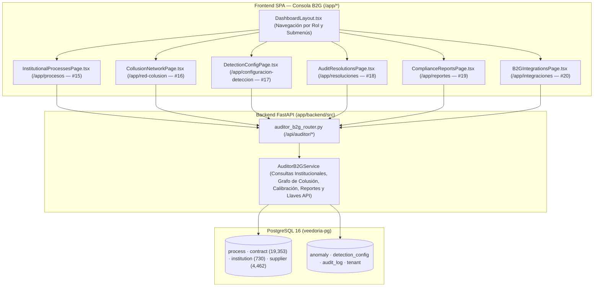
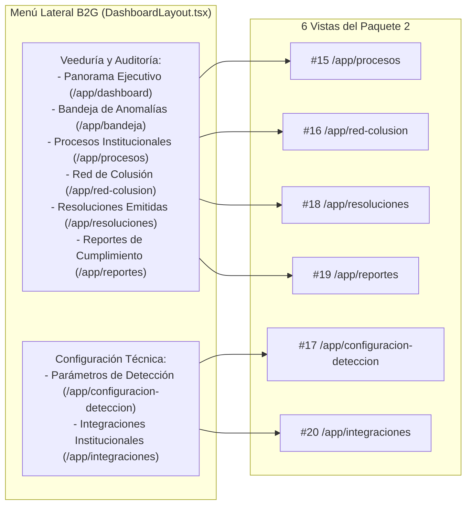

# Design: Herramientas de Auditoría Gubernamental B2G (`herramientas-auditoria-b2g`)

> 📋 Generated by `solution-designer` · 2026-10-20
> ✅ Approved by: pending

## Traceability
- **Work Item**: Pendiente (sin PBI/Feature en ADO)
- **Parent**: [veedoria-core](../intake.md)
- **Branch**: `dev`
- **Requirements**: [requirements.md](./requirements.md)
- **Test Plan**: [test-plan.md](./test-plan.md)
- **Test Cases**: [test-cases.md](./test-cases.md)

## Technology Decisions
- **Frontend**: **React `^19.2.6` + TypeScript `~6.0.2` + Vite `^8.0.12` + TailwindCSS `^4.3.1` + TanStack React Query `^5.99.0` + `react-router-dom` `^7.14.0` + `lucide-react` `^1.16.0`** — Implementa las **6 vistas especializadas de la Consola B2G (Pantallas `#15` a `#20` del Mapa de 36 Pantallas)** con cabeceras limpias sin badges decorativos ni repetición de alcance/suscripción, agrupadas ordenadamente en el menú lateral (`DashboardLayout.tsx`) y protegidas con `RequireAuth`:
  1. `InstitutionalProcessesPage.tsx` (`/app/procesos` — `#15` Explorador de Licitaciones Institucionales).
  2. `CollusionNetworkPage.tsx` (`/app/red-colusion` — `#16` Consola Interactiva de Redes de Colusión con bloqueo en `B2G_BASIC`).
  3. `DetectionConfigPage.tsx` (`/app/configuracion-deteccion` — `#17` Configuración de Parámetros y Umbrales del Motor).
  4. `AuditResolutionsPage.tsx` (`/app/resoluciones` — `#18` Historial de Resoluciones y Dictámenes de Alertas).
  5. `ComplianceReportsPage.tsx` (`/app/reportes` — `#19` Generador de Reportes de Cumplimiento y Exportación CSV / Acta Imprimible).
  6. `B2GIntegrationsPage.tsx` (`/app/integraciones` — `#20` Consola de Integraciones Institucionales y Llaves de Acceso).
- **Backend**: **Python `3.12+` / `3.14` + FastAPI `^0.135.3` + SQLModel / SQLAlchemy Async `^2.0.49` (`asyncpg`)** — Crea `app/backend/src/services/auditor_b2g_service.py` y `app/backend/src/presentation/routers/auditor_b2g_router.py` exponiendo los endpoints bajo `/api/auditor/*` con aislamiento automático por organización (`institution_id` para `GOV_INSTITUTION`, alcance nacional para `GOV_OVERSIGHT` y `PLATFORM_ADMIN`).
- **Database**: **PostgreSQL 16 (`veedoria-pg`)** — Opera directamente sobre las tablas existentes (`process`, `contract`, `institution`, `supplier`, `anomaly`, `detection_config`, `audit_log`, `tenant`, `app_user`) sin requerir migraciones destructivas. Las llaves de integración institucional (`#20`) se registran con trazabilidad inmutable en `audit_log` (`action = "API_KEY_CREATED"` / `"API_KEY_REVOKED"`).
- **Theme**: `govtech` (*El Observatorio Dominicano* — `design-system-theme.md`), encabezados limpios, cero badges decorativos, cero pestañas duplicadas y cero jerga técnica.

## Architecture

### System Overview


### Component Diagram


## API Contracts

### 1. `GET /api/auditor/processes` (`REQ-001` — Pantalla `#15`)
- **Query Params**: `?q=&status=&only_with_anomalies=false&page=1&limit=20`
- **Auth**: JWT (`PROCESS_READ`, segmento `GOV_INSTITUTION`, `GOV_OVERSIGHT` o `PLATFORM`).
- **Behavior**: Filtra `Process` + `Contract` + conteo de `Anomaly` por `current_user["tenant"]["institution_id"]` (si es entidad específica) o alcance nacional.
- **Response (`200 OK`)**:
```json
{
  "data": {
    "kpis": {
      "total_processes": 420,
      "total_contracts": 615,
      "total_amount": 1845000000.0,
      "processes_with_findings": 38
    },
    "items": [
      {
        "id": 102,
        "process_code": "MOPC-CCC-LPN-2025-0014",
        "title": "Rehabilitación de Caminos Vecinales Zona Norte",
        "institution_name": "Ministerio de Obras Públicas y Comunicaciones (MOPC)",
        "modality": "Licitación Pública Nacional",
        "status": "ADJUDICADO",
        "published_date": "2025-05-12",
        "contracts_count": 2,
        "total_amount": 48500000.0,
        "anomalies_count": 1,
        "max_severity": 0.84
      }
    ],
    "total": 420,
    "page": 1,
    "limit": 20
  }
}
```

### 2. `GET /api/auditor/collusion-network` (`REQ-002` — Pantalla `#16`)
- **Query Params**: `?min_shared_processes=1`
- **Auth**: JWT (`ANOMALY_READ`, segmento B2G / Plataforma).
- **Behavior**: Si `plan_tier == "B2G_BASIC"`, retorna `locked: true` con `clusters: []` y `links: []`. Si `plan_tier` es `B2G_PREMIUM`, `B2G_ENTERPRISE` o `PLATFORM_GLOBAL`, construye los nodos y enlaces relacionales a partir de alertas de tipo `COLLUSION` y proveedores que co-participan o concentran adjudicaciones recurrentes en los mismos procesos/instituciones.
- **Response (`200 OK`)**:
```json
{
  "data": {
    "locked": false,
    "required_plan_label": null,
    "summary": {
      "total_clusters": 6,
      "flagged_suppliers": 14,
      "shared_processes": 19,
      "exposed_amount": 312400000.0
    },
    "nodes": [
      { "id": "RPE-132993", "label": "Constructora del Caribe SRL", "type": "SUPPLIER", "contracts": 12, "amount": 84500000.0, "risk": "ALTO" }
    ],
    "links": [
      {
        "source_rpe": "132993",
        "source_name": "Constructora del Caribe SRL",
        "target_rpe": "98412",
        "target_name": "Inversiones & Equipos Vial SRL",
        "shared_processes": 4,
        "institution_name": "Ministerio de Obras Públicas y Comunicaciones",
        "signal_type": "Adjudicación rotativa en el mismo rubro",
        "combined_amount": 126000000.0,
        "severity": 0.86
      }
    ]
  }
}
```

### 3. `GET /api/auditor/detection-config` & `PUT /api/auditor/detection-config` (`REQ-003` — Pantalla `#17`)
- **Auth**: `GET` requiere `ANOMALY_READ`; `PUT` requiere rol `PLATFORM_ADMIN` o `TENANT_ADMIN` (o permiso `AI_CALIBRATE` / `ANOMALY_REVIEW`).
- **Behavior**: Lee y actualiza los pesos y umbrales de `DetectionConfig` (`PRICE_ANOMALY`, `SPLIT_CONTRACT`, `COLLUSION`, `SINGLE_BIDDER`) más los parámetros operativos (umbral de severidad crítica, porcentaje mínimo de variación de precio y ventana de días para fraccionamiento), guardando traza en `AuditLog`.

### 4. `GET /api/auditor/resolutions` (`REQ-004` — Pantalla `#18`)
- **Query Params**: `?status=ALL|CONFIRMED|DISMISSED&anomaly_type=&q=`
- **Auth**: JWT (`ANOMALY_READ`, segmento B2G / Plataforma).
- **Behavior**: Consulta las anomalías dictaminadas (`status IN ('CONFIRMED', 'DISMISSED')`) acotadas a la institución del auditor junto con su registro en `AuditLog` (`reviewed_by`, `reviewed_at`, `reviewer_notes`, `dismissal_reason`).

### 5. `GET /api/auditor/reports/summary` (`REQ-005` — Pantalla `#19`)
- **Legal Framework Integration**: Tanto `AnomalyDrawer.tsx` como `ComplianceReportsPage.tsx` incorporan la matriz de fundamentación jurídica bajo la **Ley 340-06 y Reglamento 416-23** (Art. 3 Eficiencia/Transparencia y normativa CBS/UNSPSC para sobreprecio y mala catalogación; Arts. 16, 17 y Reg. 416-23 Art. 62 para fraccionamiento; Arts. 11, 14, 66 Párrafo II y Ley 42-08 Art. 5 para colusión).
- **Query Params**: `?period=ALL|2025|2026`
- **Auth**: JWT (`ANOMALY_READ`, segmento B2G / Plataforma).
- **Behavior**: Devuelve el consolidado ejecutivo para el **Informe Institucional de Cumplimiento y Veeduría** (métricas de procesos fiscalizados, distribución de hallazgos por categoría, listado de contratos observados y dictámenes emitidos) listo para previsualización, impresión y exportación directa a CSV en el cliente.

### 6. `GET /api/auditor/integrations`, `POST /api/auditor/integrations/keys` & `DELETE /api/auditor/integrations/keys/{key_id}` (`REQ-006` — Pantalla `#20`)
- **Auth**: JWT (`ANOMALY_READ` para lectura; `TENANT_ADMIN` o `PLATFORM_ADMIN` para crear/revocar llaves).
- **Behavior**: Permite gestionar credenciales de interoperabilidad institucional (para conectar con SIGEF / portales internos de compras), mostrando el token completo una sola vez al momento de su creación (`vd_live_...`) y almacenando únicamente su prefijo enmascarado y huella SHA-256 en `AuditLog`. Si `plan_tier == "B2G_BASIC"`, informa que la interoperabilidad automatizada requiere el *Plan Institucional Avanzado*.

## Metodología Analítica, Fórmulas de Detección y Marco Normativo (Ley 340-06 · Reg. 416-23)

### A. Cálculo de Mediana y Sobreprecio por Rubro UNSPSC (`PRICE_ANOMALY`)
1. **Agrupación por Catálogo UNSPSC**: Todos los renglones adjudicados (`Item`) con `unit_price > 0` se agrupan por su código estándar de las Naciones Unidas (`unspsc_code`). Se requieren al menos $4$ registros históricos (`len(prices) >= 4`) para evaluar la categoría.
2. **Mediana Estadística del Mercado**: Se ordenan los precios unitarios del rubro $P_1 \le P_2 \le \dots \le P_n$ y se calcula la mediana (`np.median(prices)`), evitando el sesgo que producen valores extremos sobre la media aritmética.
3. **Fórmula de Porcentaje de Sobreprecio**:
   $$\text{Desviación \%} = \left( \frac{\text{Precio Unitario Adjudicado} - \text{Mediana UNSPSC}}{\text{Mediana UNSPSC}} \right) \times 100$$
4. **Doble Filtro de Activación**:
   - **Anomalía Estadística / ML**: Isolation Forest (`score < 0` cuando $n \ge 30$) o Z-Score ($\|z\| > 2.5$ cuando $4 \le n < 30$).
   - **Corte Normativo**: $\text{Desviación \%} \ge \text{PRICE\_VARIATION\_PCT\_THRESHOLD}$ (configurable en `DetectionConfig`).
5. **Muestreo Limpio en `get_anomaly_context` y `PriceScatter.tsx`**:
   - Cuando un mismo contrato contiene decenas de renglones con el mismo código UNSPSC (ej. `HPIC-DAF-CM-2026-0025` con 60 ítems bajo `31341101`), `get_anomaly_context` identifica **únicamente el renglón específico auditado** (`is_anomaly = true` solo para ese ítem) y construye una muestra representativa de hasta **30 puntos** distribuida uniformemente a lo largo del rango de precios del rubro.
   - Si el contrato auditado registra $>1$ renglón con el mismo código UNSPSC y precios dispersos, el inspector activa automáticamente el aviso amarillo de **Indicio de Agrupamiento Indebido CBS/UNSPSC (Art. 3 num. 3 Ley 340-06 — Principio de Transparencia)**.

### B. Evaluación de Fraccionamiento y Umbrales por Modalidad DGCP (`FRAGMENTATION`)
1. **Extracción de Modalidad desde la Data DGCP**: Los datasets abiertos de la DGCP no incluyen una columna de umbral, pero el código oficial del proceso (`dgcp_code`) incorpora la sigla de la modalidad de selección (`-CD-`, `-CM-`, `-CP-`, `-PEIN-`, `-PEPU-`, `-LPN-`, `-PEEN-`, `-PEUR-`).
2. **Resolución 100% desde Base de Datos (`_resolve_dgcp_modality_threshold`)**: El servicio cruza la sigla extraída del proceso con los **7 parámetros configurables en la tabla `detection_config`**:
   | Sigla en `dgcp_code` | Clave en `detection_config` | Modalidad Normativa (Ley 340-06 / Reg. 416-23) | Valor Base (DOP) |
   |---|---|---|---|
   | `-CD-` | `THRESHOLD_CD_DOP` | Compra por Debajo del Umbral (Art. 16 Num. 7) | `RD$ 250,000` |
   | `-CM-` | `THRESHOLD_CM_DOP` | Compra Menor (Art. 16 Num. 6) | `RD$ 1,650,000` |
   | `-CP-` | `THRESHOLD_CP_DOP` | Comparación de Precios (Art. 16 Num. 4) | `RD$ 6,500,000` |
   | `-PEIN-` / `-PEPU-` | `THRESHOLD_PEIN_DOP` | Excepción Ordinaria / Arrendamiento (Arts. 38–45 Reg. 416-23) | `RD$ 8,000,000` |
   | `-LPN-` / `-LPI-` | `THRESHOLD_LPN_DOP` | Licitación Pública (Art. 16 Num. 1) | `RD$ 15,000,000` |
   | `-PEEN-` / `-PEEX-` / `-PEUR-` | `THRESHOLD_PEEN_DOP` | Emergencia / Urgencia Nacional (Art. 6 Párrafo Único) | `RD$ 25,000,000` |
   | Sin sigla específica | `FRAGMENTATION_THRESHOLD_DOP` | Umbral General por Defecto (Art. 62 Reg. 416-23) | `RD$ 6,500,000` |
3. **Agrupación Completa de Contratos del Proceso Fraccionado**: En `get_anomaly_context`, todos los contratos pertenecientes al expediente fraccionado (`Contract.process_id == anomaly.process_id`) se marcan con `is_alert = true` (barras rojas en `FragmentationBarChart.tsx`) y su suma acumulada (`fragmentation_combined_amount`) se compara contra el umbral de la modalidad (`fragmentation_threshold`).

### C. Matriz Condicional de Fundamentación Jurídica (Ley 340-06 · Decreto 416-23)
Tanto en `AnomalyDrawer.tsx` como en `ComplianceReportsPage.tsx`, el sistema presenta dinámicamente los artículos vulnerados y las observaciones preventivas en recuadro ámbar según la evidencia del caso:
- **Sobreprecio (`PRICE_ANOMALY`)**: Art. 3 (Principio de Eficiencia y Economía — Ley 340-06) y Arts. 96–97 del Reglamento 416-23 (Razonabilidad del Precio y Estudio Previo en el SECP). Recuadro ámbar condicional cuando existen múltiples renglones bajo el mismo código UNSPSC en el contrato (*Mala Catalogación CBS-DGCP*).
- **Fraccionamiento (`FRAGMENTATION`)**: Arts. 16 y 17 Párrafo I de la Ley 340-06, Art. 62 del Reglamento 416-23 y régimen sancionador de los Arts. 65 y 66. Recuadro ámbar condicional diferenciando procesos de excepción (`PEEN`/`PEEX`/`PEUR` — Art. 6 Párrafo Único) frente a entregas ordinarias del PACC.
- **Colusión (`COLLUSION`)**: Art. 3 nums. 2 y 6, Arts. 11 y 14 (Prohibiciones e Inhabilidades), Art. 66 Párrafo II de la Ley 340-06 (inhabilitación del RPE de 1 a 5 años) y Art. 5 de la Ley 42-08 (Defensa de la Competencia). Recuadro ámbar condicional distinguiendo vínculos societarios directos (teléfono/dirección/dominio → cruce con **Declaración Jurada de Beneficiario Final — Ley 155-17**) frente a coincidencias nominales.

### D. Inspección Interna sin Redirección al Portal Público y Jerarquía de Capas (`z-index`)
- Ninguna acción de consulta dentro de `/app/*` redirige a `/public/*`: se implementaron los inspectores deslizables `ProcessInspectorDrawer` (`GET /api/auditor/processes/{process_id}`) y `SupplierInspectorDrawer` en `ConsoleInspectorDrawers.tsx`.
- Jerarquía estricta de superposición visual:
  - Drawers laterales (`AnomalyDrawer`, `ProcessInspectorDrawer`, `SupplierInspectorDrawer`): `fixed inset-0 z-[100] bg-black/50 backdrop-blur-sm`
  - Vista expandida de gráficos (`FullscreenOverlay.tsx`): `z-[150]`
  - Notificaciones del sistema (`.toast-region` en `App.tsx` e `index.css`): `z-[9999] !important`
  - Tooltips interactivos de D3 (`PriceScatter`, `FragmentationBarChart`, `CollusionNetwork` posicionados con `clientX`/`clientY`): `zIndex: 9999`

## Navigation & Route Protection (`DashboardLayout.tsx` y `App.tsx`)
- En `DashboardLayout.tsx`, dentro de la sección **Veeduría y Auditoría** (visible para `GOV_INSTITUTION`, `GOV_OVERSIGHT` y `PLATFORM_ADMIN`), se habilitan como enlaces reales (reemplazando los antiguos ítems deshabilitados con candado):
  - **Panorama Ejecutivo** (`/app/dashboard`)
  - **Bandeja de Anomalías** (`/app/bandeja`)
  - **Procesos Institucionales** (`/app/procesos`)
  - **Red de Colusión** (`/app/red-colusion`)
  - **Resoluciones de Auditoría** (`/app/resoluciones`)
  - **Reportes de Cumplimiento** (`/app/reportes`)
  - **Parámetros de Detección** (`/app/configuracion-deteccion`)
  - **Integraciones Institucionales** (`/app/integraciones`)
- En `App.tsx`, las 6 rutas nuevas se envuelven en `<RequireAuth allowedTenantTypes={["GOV_INSTITUTION", "GOV_OVERSIGHT", "PLATFORM"]}>` para impedir que usuarios del segmento proveedor (`B2B_SUPPLIER`) accedan por URL.

## Approval
- [ ] Developer / User: Jeremy Michel Solano Frías — Date: pending

---
> 📍 Pendiente (sin PBI/Feature en ADO) · 🌿 `dev` · Generated by SDD Standard
