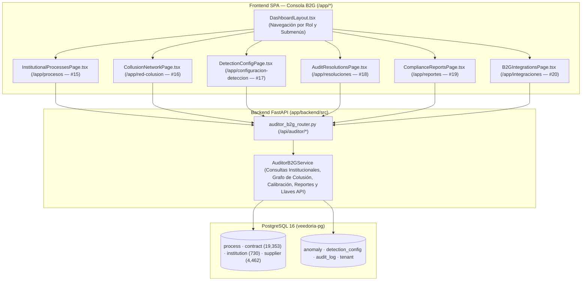
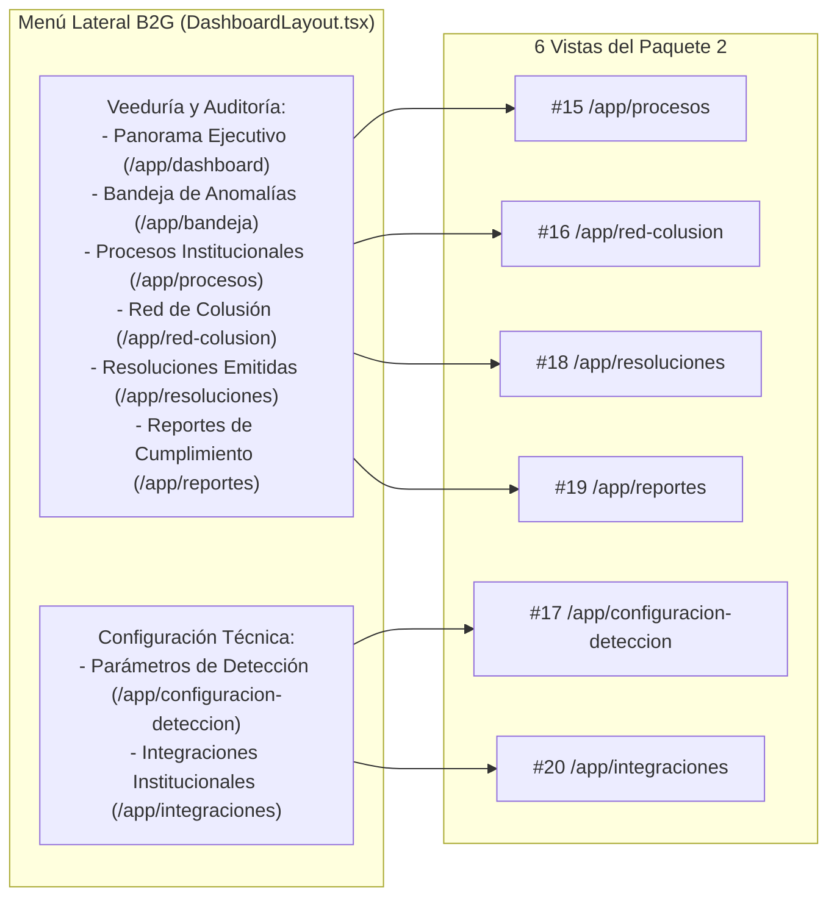

# Design: Herramientas de Auditoría Gubernamental B2G (`herramientas-auditoria-b2g`)

> 📋 Generated by `solution-designer` · 2026-10-20
> ✅ Approved by: pending

## Traceability
- **Work Item**: Pendiente (sin PBI/Feature en ADO)
- **Parent**: [veedoria-core](../intake.md)
- **Branch**: `dev`
- **Requirements**: [requirements.md](./requirements.md)
- **Test Plan**: [test-plan.md](./test-plan.md)
- **Test Cases**: [test-cases.md](./test-cases.md)

## Technology Decisions
- **Frontend**: **React `^19.2.6` + TypeScript `~6.0.2` + Vite `^8.0.12` + TailwindCSS `^4.3.1` + TanStack React Query `^5.99.0` + `react-router-dom` `^7.14.0` + `lucide-react` `^1.16.0`** — Implementa las **6 vistas especializadas de la Consola B2G (Pantallas `#15` a `#20` del Mapa de 36 Pantallas)** con cabeceras limpias sin badges decorativos ni repetición de alcance/suscripción, agrupadas ordenadamente en el menú lateral (`DashboardLayout.tsx`) y protegidas con `RequireAuth`:
  1. `InstitutionalProcessesPage.tsx` (`/app/procesos` — `#15` Explorador de Licitaciones Institucionales).
  2. `CollusionNetworkPage.tsx` (`/app/red-colusion` — `#16` Consola Interactiva de Redes de Colusión con bloqueo en `B2G_BASIC`).
  3. `DetectionConfigPage.tsx` (`/app/configuracion-deteccion` — `#17` Configuración de Parámetros y Umbrales del Motor).
  4. `AuditResolutionsPage.tsx` (`/app/resoluciones` — `#18` Historial de Resoluciones y Dictámenes de Alertas).
  5. `ComplianceReportsPage.tsx` (`/app/reportes` — `#19` Generador de Reportes de Cumplimiento y Exportación CSV / Acta Imprimible).
  6. `B2GIntegrationsPage.tsx` (`/app/integraciones` — `#20` Consola de Integraciones Institucionales y Llaves de Acceso).
- **Backend**: **Python `3.12+` / `3.14` + FastAPI `^0.135.3` + SQLModel / SQLAlchemy Async `^2.0.49` (`asyncpg`)** — Crea `app/backend/src/services/auditor_b2g_service.py` y `app/backend/src/presentation/routers/auditor_b2g_router.py` exponiendo los endpoints bajo `/api/auditor/*` con aislamiento automático por organización (`institution_id` para `GOV_INSTITUTION`, alcance nacional para `GOV_OVERSIGHT` y `PLATFORM_ADMIN`).
- **Database**: **PostgreSQL 16 (`veedoria-pg`)** — Opera directamente sobre las tablas existentes (`process`, `contract`, `institution`, `supplier`, `anomaly`, `detection_config`, `audit_log`, `tenant`, `app_user`) sin requerir migraciones destructivas. Las llaves de integración institucional (`#20`) se registran con trazabilidad inmutable en `audit_log` (`action = "API_KEY_CREATED"` / `"API_KEY_REVOKED"`).
- **Theme**: `govtech` (*El Observatorio Dominicano* — `design-system-theme.md`), encabezados limpios, cero badges decorativos, cero pestañas duplicadas y cero jerga técnica.

## Architecture

### System Overview


### Component Diagram


## API Contracts

### 1. `GET /api/auditor/processes` (`REQ-001` — Pantalla `#15`)
- **Query Params**: `?q=&status=&only_with_anomalies=false&page=1&limit=20`
- **Auth**: JWT (`PROCESS_READ`, segmento `GOV_INSTITUTION`, `GOV_OVERSIGHT` o `PLATFORM`).
- **Behavior**: Filtra `Process` + `Contract` + conteo de `Anomaly` por `current_user["tenant"]["institution_id"]` (si es entidad específica) o alcance nacional.
- **Response (`200 OK`)**:
```json
{
  "data": {
    "kpis": {
      "total_processes": 420,
      "total_contracts": 615,
      "total_amount": 1845000000.0,
      "processes_with_findings": 38
    },
    "items": [
      {
        "id": 102,
        "process_code": "MOPC-CCC-LPN-2025-0014",
        "title": "Rehabilitación de Caminos Vecinales Zona Norte",
        "institution_name": "Ministerio de Obras Públicas y Comunicaciones (MOPC)",
        "modality": "Licitación Pública Nacional",
        "status": "ADJUDICADO",
        "published_date": "2025-05-12",
        "contracts_count": 2,
        "total_amount": 48500000.0,
        "anomalies_count": 1,
        "max_severity": 0.84
      }
    ],
    "total": 420,
    "page": 1,
    "limit": 20
  }
}
```

### 2. `GET /api/auditor/collusion-network` (`REQ-002` — Pantalla `#16`)
- **Query Params**: `?min_shared_processes=1`
- **Auth**: JWT (`ANOMALY_READ`, segmento B2G / Plataforma).
- **Behavior**: Si `plan_tier == "B2G_BASIC"`, retorna `locked: true` con `clusters: []` y `links: []`. Si `plan_tier` es `B2G_PREMIUM`, `B2G_ENTERPRISE` o `PLATFORM_GLOBAL`, construye los nodos y enlaces relacionales a partir de alertas de tipo `COLLUSION` y proveedores que co-participan o concentran adjudicaciones recurrentes en los mismos procesos/instituciones.
- **Response (`200 OK`)**:
```json
{
  "data": {
    "locked": false,
    "required_plan_label": null,
    "summary": {
      "total_clusters": 6,
      "flagged_suppliers": 14,
      "shared_processes": 19,
      "exposed_amount": 312400000.0
    },
    "nodes": [
      { "id": "RPE-132993", "label": "Constructora del Caribe SRL", "type": "SUPPLIER", "contracts": 12, "amount": 84500000.0, "risk": "ALTO" }
    ],
    "links": [
      {
        "source_rpe": "132993",
        "source_name": "Constructora del Caribe SRL",
        "target_rpe": "98412",
        "target_name": "Inversiones & Equipos Vial SRL",
        "shared_processes": 4,
        "institution_name": "Ministerio de Obras Públicas y Comunicaciones",
        "signal_type": "Adjudicación rotativa en el mismo rubro",
        "combined_amount": 126000000.0,
        "severity": 0.86
      }
    ]
  }
}
```

### 3. `GET /api/auditor/detection-config` & `PUT /api/auditor/detection-config` (`REQ-003` — Pantalla `#17`)
- **Auth**: `GET` requiere `ANOMALY_READ`; `PUT` requiere rol `PLATFORM_ADMIN` o `TENANT_ADMIN` (o permiso `AI_CALIBRATE` / `ANOMALY_REVIEW`).
- **Behavior**: Lee y actualiza los pesos y umbrales de `DetectionConfig` (`PRICE_ANOMALY`, `SPLIT_CONTRACT`, `COLLUSION`, `SINGLE_BIDDER`) más los parámetros operativos (umbral de severidad crítica, porcentaje mínimo de variación de precio y ventana de días para fraccionamiento), guardando traza en `AuditLog`.

### 4. `GET /api/auditor/resolutions` (`REQ-004` — Pantalla `#18`)
- **Query Params**: `?status=ALL|CONFIRMED|DISMISSED&anomaly_type=&q=`
- **Auth**: JWT (`ANOMALY_READ`, segmento B2G / Plataforma).
- **Behavior**: Consulta las anomalías dictaminadas (`status IN ('CONFIRMED', 'DISMISSED')`) acotadas a la institución del auditor junto con su registro en `AuditLog` (`reviewed_by`, `reviewed_at`, `reviewer_notes`, `dismissal_reason`).

### 5. `GET /api/auditor/reports/summary` (`REQ-005` — Pantalla `#19`)
- **Legal Framework Integration**: Tanto `AnomalyDrawer.tsx` como `ComplianceReportsPage.tsx` incorporan la matriz de fundamentación jurídica bajo la **Ley 340-06 y Reglamento 416-23** (Art. 3 Eficiencia/Transparencia y normativa CBS/UNSPSC para sobreprecio y mala catalogación; Arts. 16, 17 y Reg. 416-23 Art. 62 para fraccionamiento; Arts. 11, 14, 66 Párrafo II y Ley 42-08 Art. 5 para colusión).
- **Query Params**: `?period=ALL|2025|2026`
- **Auth**: JWT (`ANOMALY_READ`, segmento B2G / Plataforma).
- **Behavior**: Devuelve el consolidado ejecutivo para el **Informe Institucional de Cumplimiento y Veeduría** (métricas de procesos fiscalizados, distribución de hallazgos por categoría, listado de contratos observados y dictámenes emitidos) listo para previsualización, impresión y exportación directa a CSV en el cliente.

### 6. `GET /api/auditor/integrations`, `POST /api/auditor/integrations/keys` & `DELETE /api/auditor/integrations/keys/{key_id}` (`REQ-006` — Pantalla `#20`)
- **Auth**: JWT (`ANOMALY_READ` para lectura; `TENANT_ADMIN` o `PLATFORM_ADMIN` para crear/revocar llaves).
- **Behavior**: Permite gestionar credenciales de interoperabilidad institucional (para conectar con SIGEF / portales internos de compras), mostrando el token completo una sola vez al momento de su creación (`vd_live_...`) y almacenando únicamente su prefijo enmascarado y huella SHA-256 en `AuditLog`. Si `plan_tier == "B2G_BASIC"`, informa que la interoperabilidad automatizada requiere el *Plan Institucional Avanzado*.

## Navigation & Route Protection (`DashboardLayout.tsx` y `App.tsx`)
- En `DashboardLayout.tsx`, dentro de la sección **Veeduría y Auditoría** (visible para `GOV_INSTITUTION`, `GOV_OVERSIGHT` y `PLATFORM_ADMIN`), se habilitan como enlaces reales (reemplazando los antiguos ítems deshabilitados con candado):
  - **Panorama Ejecutivo** (`/app/dashboard`)
  - **Bandeja de Anomalías** (`/app/bandeja`)
  - **Procesos Institucionales** (`/app/procesos`)
  - **Red de Colusión** (`/app/red-colusion`)
  - **Resoluciones de Auditoría** (`/app/resoluciones`)
  - **Reportes de Cumplimiento** (`/app/reportes`)
  - **Parámetros de Detección** (`/app/configuracion-deteccion`)
  - **Integraciones Institucionales** (`/app/integraciones`)
- En `App.tsx`, las 6 rutas nuevas se envuelven en `<RequireAuth allowedTenantTypes={["GOV_INSTITUTION", "GOV_OVERSIGHT", "PLATFORM"]}>` para impedir que usuarios del segmento proveedor (`B2B_SUPPLIER`) accedan por URL.

## Approval
- [ ] Developer / User: Jeremy Michel Solano Frías — Date: pending

---
> 📍 Pendiente (sin PBI/Feature en ADO) · 🌿 `dev` · Generated by SDD Standard
