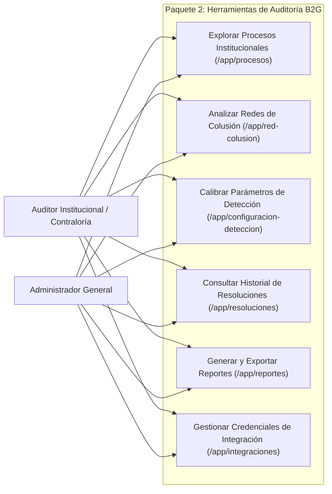

# Requirements: Herramientas de Auditoría Gubernamental B2G (`herramientas-auditoria-b2g`)

> 📋 Generated by `requirements-analyst` · 2026-10-20
> ✅ Approved by: pending

## Traceability
- **Work Item**: Pendiente (sin PBI/Feature en ADO)
- **Parent**: [veedoria-core](../intake.md)
- **Branch**: `dev`
- **Design**: [design.md](./design.md)
- **Test Plan**: [test-plan.md](./test-plan.md)
- **Test Cases**: [test-cases.md](./test-cases.md)

## Overview
Este módulo implementa las **6 pantallas especializadas del Paquete 2 (Consola B2G: Monitoreo Gubernamental)** definidas en el Mapa Completo de 36 Pantallas (`#15`, `#16`, `#17`, `#18`, `#19` y `#20`), dotando a los auditores institucionales (`GOV_INSTITUTION`), organismos de control nacional (`GOV_OVERSIGHT`) y administradores de plataforma de las herramientas completas de fiscalización, análisis relacional, calibración de reglas, trazabilidad de decisiones, exportación de informes y gestión de credenciales de interoperabilidad:
1. **Explorador de Licitaciones Institucionales (`/app/procesos` — `#15`)**: Consulta paginada y filtrable de los procesos de compra y contratos adjudicados por la institución suscriptora (o de alcance nacional para organismos rectores), con indicadores de hallazgos y acceso al expediente completo.
2. **Consola Interactiva de Redes de Colusión (`/app/red-colusion` — `#16`)**: Visualización relacional de proveedores y adjudicaciones que comparten patrones de co-participación recurrente, concentración atípica o vínculos detectados en las alertas de colusión (`COLLUSION`), con candado de suscripción para instituciones en *Plan Institucional Básico* (`B2G_BASIC`).
3. **Configuración de Parámetros de Detección (`/app/configuracion-deteccion` — `#17`)**: Panel de calibración de umbrales de sensibilidad (variación porcentual de precios, ventana temporal y límite de fraccionamiento, umbral de severidad mínima y pesos por categoría de hallazgo) respaldado por `DetectionConfig`.
4. **Historial de Resoluciones de Auditoría (`/app/resoluciones` — `#18`)**: Registro cronológico y auditable de todos los dictámenes emitidos por el equipo de auditoría (*Confirmado* vs. *Descartado*, motivo de descarte, notas de sustento, revisor y fecha), filtrable por estado, tipo de hallazgo y búsqueda libre.
5. **Generador de Reportes de Cumplimiento (`/app/reportes` — `#19`)**: Emisión de resúmenes ejecutivos e informes descargables (CSV / Vista imprimible de dictamen institucional) con las métricas de fiscalización, contratos observados y resoluciones del período seleccionado.
6. **Consola de Integraciones Institucionales (`/app/integraciones` — `#20`)**: Administración de llaves de acceso institucional y webhooks de notificación para interoperar con sistemas ERP/SIGEF gubernamentales (creación, visualización enmascarada y revocación de credenciales).

## User Stories (EARS Notation)

### REQ-001: Explorador de Procesos y Licitaciones Institucionales (`/app/procesos` — `#15`)
**Type:** Event-Driven
**Rule:** WHEN un auditor o administrador accede a `/app/procesos`, the system SHALL listar de forma paginada los procesos de contratación pública (`Process` + `Contract` + conteo de `Anomaly`) acotados automáticamente a la institución de su organización (`institution_id`) o a nivel nacional si pertenece a un órgano rector/administración general, permitiendo filtrar por búsqueda textual (código OCID, título o proveedor), estado del proceso, modalidad y presencia de hallazgos.
**Entities:** `Process`, `Contract`, `Institution`, `Supplier`, `Anomaly`
**Error Handling:** Si la búsqueda no arroja procesos, presenta un estado vacío claro con botón para restablecer filtros.

**Acceptance Criteria:**
- [x] Given un auditor del MOPC (`MOPC-B2G`), when abre `/app/procesos`, then visualiza únicamente los procesos de compra del MOPC con su código, objeto, modalidad, monto adjudicado en `RD$`, número de contratos y cantidad de hallazgos asociados.
- [x] Given un filtro por texto o por *"Con hallazgos"*, when el auditor aplica el filtro, then la tabla y los indicadores superiores (*Total de Procesos*, *Monto Adjudicado*, *Procesos con Hallazgos*) se actualizan en tiempo real.

**Priority:** Must
**Dependencies:** None
**Tracker:** Pendiente

### REQ-002: Consola Interactiva de Redes de Colusión (`/app/red-colusion` — `#16`)
**Type:** State-Driven
**Rule:** WHILE un usuario con *Plan Institucional Avanzado* (`B2G_ADVANCED`), órgano rector o administración general consulta `/app/red-colusion`, the system SHALL construir y mostrar la red de relaciones entre proveedores, instituciones y contratos con indicios de coordinación o concentración (`COLLUSION` y vínculos de co-adjudicación), incluyendo el mapa/grafo relacional interactivo, el listado de clústeres de riesgo y el detalle de contratos compartidos.
**Entities:** `Anomaly`, `Contract`, `Supplier`, `Process`, `Institution`
**Error Handling:** Si la organización del usuario tiene *Plan Institucional Básico* (`B2G_BASIC`, ej. `MINERD-B2G`), la consola muestra el bloqueo de suscripción indicando que el análisis de redes de colusión requiere el *Plan Institucional Avanzado*.

**Acceptance Criteria:**
- [x] Given una cuenta en `B2G_ADVANCED` o `PLATFORM_ADMIN`, when accede a `/app/red-colusion`, then visualiza los nodos de proveedores e instituciones vinculados, el nivel de coincidencia/riesgo y la tabla de relaciones detectadas.
- [x] Given una cuenta en `B2G_BASIC`, when accede a `/app/red-colusion`, then visualiza el candado de plan requerido sin exponer los clústeres restringidos.

**Priority:** Must
**Dependencies:** None
**Tracker:** Pendiente

### REQ-003: Configuración de Parámetros de Detección y Tabla de Umbrales DGCP (`/app/configuracion-deteccion` — `#17`)
**Type:** Event-Driven
**Rule:** WHEN un usuario autorizado consulta o actualiza los parámetros en `/app/configuracion-deteccion`, the system SHALL mostrar en dos secciones segmentadas los **13 parámetros persistidos en `DetectionConfig`**: (1) **Pesos y Sensibilidad del Motor** (`PRICE_ANOMALY_WEIGHT`, `FRAGMENTATION_WEIGHT`, `COLLUSION_WEIGHT`, `MIN_CRITICAL_SEVERITY`, `PRICE_VARIATION_PCT_THRESHOLD`, `FRAGMENTATION_WINDOW_DAYS`) y (2) **Tabla de Umbrales por Modalidad DGCP** (`THRESHOLD_CD_DOP` para `-CD-`, `THRESHOLD_CM_DOP` para `-CM-`, `THRESHOLD_CP_DOP` para `-CP-`, `THRESHOLD_PEIN_DOP` para `-PEIN-`/`-PEPU-`, `THRESHOLD_LPN_DOP` para `-LPN-`/`-LPI-`, `THRESHOLD_PEEN_DOP` para `-PEEN-`/`-PEUR-`, y `FRAGMENTATION_THRESHOLD_DOP` como tope general sin sigla), permitiendo guardar los ajustes en PostgreSQL y registrando el cambio en `AuditLog`.
**Entities:** `DetectionConfig`, `AuditLog`
**Error Handling:** Si un usuario sin permiso de configuración intenta modificar los umbrales, los controles se muestran en modo de solo lectura y el endpoint rechaza escrituras no autorizadas (`403`).

**Acceptance Criteria:**
- [x] Given un usuario con permiso de calibración/administración (`PLATFORM_ADMIN`, `TENANT_ADMIN`, `CONTRALOR`), when modifica un peso o un tope de modalidad DGCP en `/app/configuracion-deteccion` y guarda los cambios, then `PUT /api/auditor/detection-config` persiste los nuevos valores en `DetectionConfig` (`0` valores hardcodeados en código) y actualiza inmediatamente el umbral evaluado en los gráficos de fraccionamiento.

**Priority:** Must
**Dependencies:** None
**Tracker:** Pendiente

### REQ-004: Historial de Resoluciones de Alertas (`/app/resoluciones` — `#18`)
**Type:** Event-Driven
**Rule:** WHEN un auditor consulta `/app/resoluciones`, the system SHALL listar todas las alertas dictaminadas (`CONFIRMED` y `DISMISSED`) dentro del alcance de su organización junto con la trazabilidad en `AuditLog`, mostrando el código del proceso, proveedor, tipo de hallazgo, dictamen emitido, motivo de descarte o nota de auditoría, revisor y fecha de resolución.
**Entities:** `Anomaly`, `AuditLog`, `Contract`, `Process`, `Supplier`
**Error Handling:** Si aún no existen resoluciones en el filtro seleccionado, muestra el resumen en cero y enlace directo hacia `/app/bandeja` para dictaminar alertas pendientes.

**Acceptance Criteria:**
- [x] Given alertas previamente confirmadas o descartadas, when el auditor accede a `/app/resoluciones` o al inspector `AnomalyDrawer`, then visualiza los contadores de *Total Dictaminadas*, *Hallazgos Confirmados* y *Alertas Descartadas* junto con la tipificación legal aplicable de la **Ley 340-06 y Reglamento 416-23** (incluyendo detección de agrupamiento indebido de catálogo CBS/UNSPSC conforme al Art. 3 de Transparencia).

**Priority:** Must
**Dependencies:** None
**Tracker:** Pendiente

### REQ-005: Generador de Reportes de Cumplimiento (`/app/reportes` — `#19`)
**Type:** Event-Driven
**Rule:** WHEN el auditor accede a `/app/reportes` y selecciona el tipo de informe y rango de criterios, the system SHALL generar la vista previa estructurada del **Informe Institucional de Cumplimiento y Veeduría** con las cifras consolidadas de su institución (procesos evaluados, monto auditado, hallazgos por categoría y dictámenes emitidos) y permitir su descarga inmediata en formato tabular (`CSV`) o impresión de acta institucional.
**Entities:** `Process`, `Contract`, `Anomaly`, `Institution`
**Error Handling:** Si no hay registros para los filtros seleccionados, deshabilita la exportación vacía e informa al usuario.

**Acceptance Criteria:**
- [x] Given una institución activa, when el auditor abre `/app/reportes`, then visualiza la previsualización del acta ejecutiva con métricas reales y puede descargar el archivo CSV de procesos y hallazgos fiscalizados.

**Priority:** Must
**Dependencies:** REQ-001, REQ-004
**Tracker:** Pendiente

### REQ-006: Consola de Integraciones Institucionales y API Externa `/api/integration/*` (`/app/integraciones` — `#20`)
**Type:** Event-Driven
**Rule:** WHEN el usuario accede a `/app/integraciones`, the system SHALL listar las credenciales de interoperabilidad activas de su organización, permitiendo a perfiles autorizados (`PLATFORM_ADMIN`, `TENANT_ADMIN` o `CONTRALOR` en planes `B2G_PRO`/`B2G_PREMIUM`/`PLATFORM_GLOBAL`) emitir nuevas llaves (`vdia_b2g_...`) o revocarlas con traza en `AuditLog`, y exponer los endpoints externos de interoperabilidad bajo `/api/integration/anomalies`, `/api/integration/reports/summary` y `/api/integration/resolutions` autenticados mediante cabecera `Authorization: Bearer <API_KEY>` o `X-Integration-Key`.
**Entities:** `AuditLog`, `Tenant`
**Error Handling:** Las organizaciones en `B2G_BASIC` visualizan el estado informativo de que la interoperabilidad automatizada requiere plan superior; las llaves inválidas o revocadas en `/api/integration/*` reciben `401 Unauthorized`.

**Acceptance Criteria:**
- [x] Given una cuenta con acceso a integraciones (`B2G_PRO`, `B2G_PREMIUM` o `PLATFORM_ADMIN`), when crea una nueva credencial, then el backend almacena el hash SHA-256 en `AuditLog`, devuelve el token `vdia_b2g_...` por única vez y permite consumir `/api/integration/*` acotado automáticamente al tenant de la llave.

**Priority:** Must
**Dependencies:** None
**Tracker:** Pendiente

## Non-Functional Requirements

### NFR-001: Higiene Visual y Cumplimiento de `design-system-theme.md`
**Category:** Usability / Design System
**Rule:** The system SHALL construir las 6 vistas del Paquete 2 con encabezados limpios sin badges decorativos sobre los títulos, sin repetir metadatos de sesión/alcance/suscripción dentro de las páginas, sin duplicar pestañas de navegación que ya existan en el menú lateral y con `0` términos técnicos prohibidos.
**Metric:** `0` badges decorativos en cabeceras, `0` usos de `max-w-sm/md/lg/xl` y `0` términos técnicos de infraestructura.
**Priority:** Must

### NFR-002: Tiempo de Respuesta de Consultas B2G
**Category:** Performance
**Rule:** The system SHALL responder todos los endpoints de `/api/auditor/*` en menos de `500ms` p95 sobre la base de datos de `19,353` contratos.
**Metric:** Latencia HTTP `< 500ms`.
**Priority:** Must

## Diagrams

### Use Case Diagram

## Dependencies
| Feature | Capability needed | Status | Workaround |
|---------|------------------|--------|------------|
| `autenticacion-rbac` | Contexto multi-organización (`institution_id`, `plan_tier`) y `AuditLog` | ✅ Activo | Ninguno requerido |
| `consola-multi-rol-onboarding` | `DashboardLayout.tsx` y navegación por rol | ✅ Activo | Ninguno requerido |

## Assumptions
| # | Assumption | Temporary stub | Replaced when |
|---|-----------|----------------|---------------|
| 1 | Las credenciales creadas en `/app/integraciones` se almacenan con prefijo enmascarado y trazabilidad en `AuditLog` / configuración de la organización sin exponer secretos en texto plano tras su emisión | Almacenamiento de metadatos de llave y hash/prefijo | — |

## Approval
- [ ] Analyst / User: Jeremy Michel Solano Frías — Date: pending

---
> 📍 Pendiente (sin PBI/Feature en ADO) · 🌿 `dev` · Generated by SDD Standard
