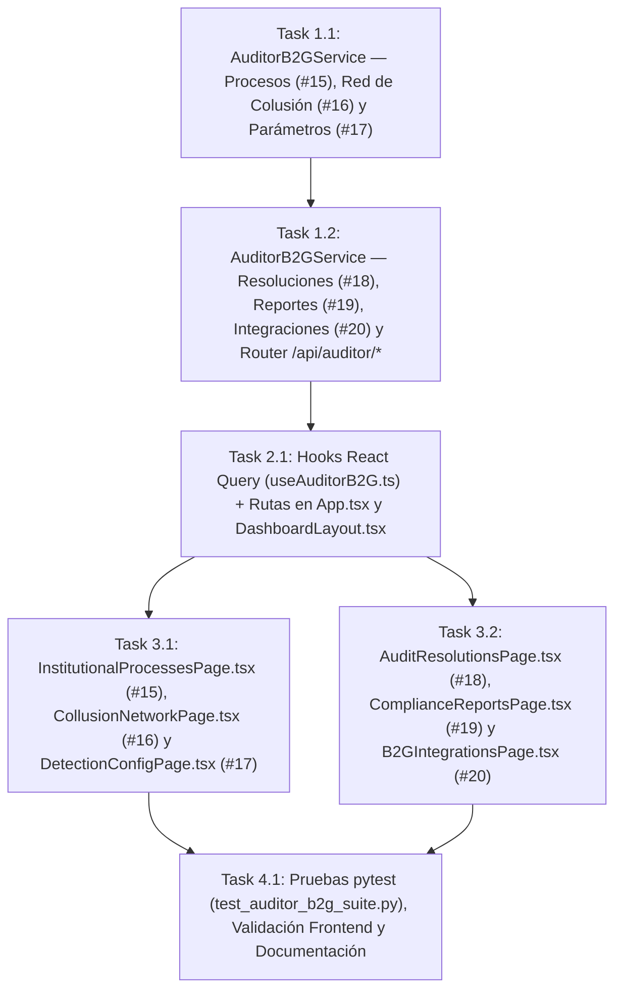

# Tasks: Herramientas de Auditoría Gubernamental B2G (`herramientas-auditoria-b2g`)

> 📋 Generated by `solution-designer` · 2026-10-20
> ✅ Approved by: pending

## Traceability
- **Work Item**: Pendiente (sin PBI/Feature en ADO)
- **Branch**: `dev`

## Metadata
- **Based on:** [design.md](./design.md)
- **Total estimate:** ~15.0h (incluye 20% buffer)
- **Number of waves:** 4 (Wave 1, Wave 2, Wave 3, Wave 4)
- **Number of tasks:** 7
- **Sprint:** [TBD]
- **Assignee:** Jeremy Michel Solano Frías

## Estimation Rules
- Maximum **4 hours** per task
- Estimates include implementation + unit tests + code review
- Work strictly **wave by wave** with explicit approval between waves

## Dependency Graph

---

## Wave 1: Backend B2G Auditing & Governance Services (~4.8h)

### Task 1.1: `AuditorB2GService` — Explorador de Procesos (`#15`), Red de Colusión (`#16`) y Parámetros de Detección (`#17`) (`REQ-001`, `REQ-002`, `REQ-003`) (~2.5h)
- **Description:** Crear `app/backend/src/services/auditor_b2g_service.py` implementando:
  - `list_institutional_processes(current_user, q, status, only_with_anomalies, page, limit)`: consulta paginada sobre `Process`, `Contract`, `Institution` y `Anomaly` acotada por `current_user["tenant"]["institution_id"]` (o nacional para `GOV_OVERSIGHT` / `PLATFORM_ADMIN`), calculando KPIs de procesos, contratos, monto total fiscalizado y procesos con hallazgos.
  - `get_collusion_network(current_user, min_shared_processes)`: aplica bloqueo `locked: true` cuando `plan_tier == "B2G_BASIC"`; para planes habilitados construye los nodos y enlaces relacionales entre proveedores que co-participan o concentran adjudicaciones y alertas de colusión.
  - `get_detection_config(current_user)` y `update_detection_config(current_user, payload)`: lectura y calibración de los pesos y umbrales sobre `DetectionConfig` con registro en `AuditLog`.
- **Acceptance criteria:**
  - [ ] `list_institutional_processes` aísla correctamente por `institution_id` y soporta búsqueda y filtro de hallazgos.
  - [ ] `get_collusion_network` devuelve `locked: true` en `B2G_BASIC` y el grafo relacional completo en `B2G_PREMIUM` / `B2G_ENTERPRISE` / `PLATFORM_GLOBAL`.
  - [ ] `update_detection_config` persiste cambios en `DetectionConfig` y escribe en `AuditLog`.
- **Dependencies:** None
- **Files to create/modify:** `app/backend/src/services/auditor_b2g_service.py`

### Task 1.2: `AuditorB2GService` — Resoluciones (`#18`), Reportes (`#19`), Integraciones (`#20`) y Router `auditor_b2g_router.py` (`REQ-004`, `REQ-005`, `REQ-006`) (~2.3h)
- **Description:** Completar `AuditorB2GService` y registrar `app/backend/src/presentation/routers/auditor_b2g_router.py` en `dependencies.py` y `main.py`:
  - `list_audit_resolutions(current_user, status, anomaly_type, q)`: lista anomalías dictaminadas (`CONFIRMED` y `DISMISSED`) junto con revisor, fecha, motivo y notas.
  - `get_compliance_report_summary(current_user, period)`: genera el resumen ejecutivo institucional, distribución por categoría de hallazgo y tabla exportable para CSV / impresión.
  - `list_integrations(current_user)`, `create_integration_key(current_user, payload)` y `revoke_integration_key(current_user, key_id)`: administra credenciales de interoperabilidad institucional con prefijo enmascarado y traza en `AuditLog`.
- **Acceptance criteria:**
  - [ ] Todos los endpoints bajo `/api/auditor/*` están protegidos por JWT y bloquean el acceso a cuentas del segmento `B2B_SUPPLIER` (`403`).
- **Dependencies:** Task 1.1
- **Files to create/modify:** `app/backend/src/services/auditor_b2g_service.py`, `app/backend/src/presentation/routers/auditor_b2g_router.py`, `app/backend/src/presentation/dependencies.py`, `app/backend/src/presentation/main.py`

---

## Wave 2: Frontend Hooks, Navigation & Route Guards (~1.8h)

### Task 2.1: Hooks React Query (`useAuditorB2G.ts`) y Enrutamiento Protegido en `App.tsx` y `DashboardLayout.tsx` (~1.8h)
- **Description:** Crear `app/frontend/src/presentation/hooks/useAuditorB2G.ts` con los hooks tipados para los 6 módulos (`/api/auditor/processes`, `/api/auditor/collusion-network`, `/api/auditor/detection-config`, `/api/auditor/resolutions`, `/api/auditor/reports/summary`, `/api/auditor/integrations`) y actualizar `DashboardLayout.tsx` y `App.tsx` para habilitar los enlaces reales en la barra lateral (eliminando los ítems deshabilitados con candado) y proteger las 6 rutas con `RequireAuth`.
- **Acceptance criteria:**
  - [ ] `0` tipos `any` en TypeScript.
  - [ ] El menú lateral de `DashboardLayout.tsx` enlaza a las 6 rutas para usuarios B2G y Administración General, y `RequireAuth` bloquea el acceso por URL a proveedores B2B.
- **Dependencies:** Task 1.2
- **Files to create/modify:** `app/frontend/src/presentation/hooks/useAuditorB2G.ts`, `app/frontend/src/presentation/layouts/DashboardLayout.tsx`, `app/frontend/src/App.tsx`

---

## Wave 3: B2G Auditing & Governance Console Views (~6.0h)

### Task 3.1: Vistas `InstitutionalProcessesPage.tsx` (`#15`), `CollusionNetworkPage.tsx` (`#16`) y `DetectionConfigPage.tsx` (`#17`) (`REQ-001`, `REQ-002`, `REQ-003`, `NFR-001`) (~3.0h)
- **Description:** Construir las 3 primeras vistas del Paquete 2 con cabeceras limpias sin badges decorativos ni repetición de alcance/suscripción:
  - `InstitutionalProcessesPage.tsx` (`/app/procesos`): 4 tarjetas KPI superiores + barra de filtros (búsqueda, estado, interruptor *"Solo con hallazgos"*) + tabla paginada con enlace directo al expediente `/public/process/:id`.
  - `CollusionNetworkPage.tsx` (`/app/red-colusion`): estado bloqueado para `B2G_BASIC` y, para planes habilitados, resumen de riesgo relacional + visualización de nodos/vínculos de proveedores + tabla detallada de co-adjudicaciones detectadas.
  - `DetectionConfigPage.tsx` (`/app/configuracion-deteccion`): controles de calibración de umbrales y pesos por categoría de hallazgo con guardado en vivo y aviso de solo lectura para perfiles sin permiso de edición.
- **Acceptance criteria:**
  - [ ] Las 3 vistas operan con datos reales del backend y cumplen estrictamente `design-system-theme.md`.
- **Dependencies:** Task 2.1
- **Files to create/modify:** `app/frontend/src/presentation/pages/InstitutionalProcessesPage.tsx`, `app/frontend/src/presentation/pages/CollusionNetworkPage.tsx`, `app/frontend/src/presentation/pages/DetectionConfigPage.tsx`

### Task 3.2: Vistas `AuditResolutionsPage.tsx` (`#18`), `ComplianceReportsPage.tsx` (`#19`) y `B2GIntegrationsPage.tsx` (`#20`) (`REQ-004`, `REQ-005`, `REQ-006`, `NFR-001`) (~3.0h)
- **Description:** Construir las 3 vistas restantes del Paquete 2:
  - `AuditResolutionsPage.tsx` (`/app/resoluciones`): KPIs de dictámenes (*Total Dictaminadas*, *Confirmadas*, *Descartadas*) + filtros por estado/tipo + tabla histórica con motivo de descarte, nota técnica, revisor y fecha.
  - `ComplianceReportsPage.tsx` (`/app/reportes`): selector de período + vista previa del **Informe Institucional de Cumplimiento y Veeduría** + exportación directa a `CSV` y botón de impresión de acta.
  - `B2GIntegrationsPage.tsx` (`/app/integraciones`): listado de llaves institucionales activas/revocadas, modal de generación de nueva credencial con visualización única del token y guía de cabeceras de interoperabilidad.
- **Acceptance criteria:**
  - [ ] Las 3 vistas renderizan datos reales, permiten exportar CSV y crear/revocar credenciales con trazabilidad.
- **Dependencies:** Task 2.1
- **Files to create/modify:** `app/frontend/src/presentation/pages/AuditResolutionsPage.tsx`, `app/frontend/src/presentation/pages/ComplianceReportsPage.tsx`, `app/frontend/src/presentation/pages/B2GIntegrationsPage.tsx`

---

## Wave 4: Testing, Verification & Architecture Sync (~2.4h)

### Task 4.1: Suite de Pruebas `pytest` (`test_auditor_b2g_suite.py`), Validación Frontend y Documentación (~2.4h)
- **Description:** Crear `app/backend/tests/test_auditor_b2g_suite.py` validando los 6 módulos de `/api/auditor/*` (aislamiento institucional, bloqueo `B2G_BASIC` en red de colusión, calibración de `DetectionConfig`, historial de resoluciones, resumen de reportes y ciclo de vida de llaves de integración); registrar `auditor_b2g_router` en `conftest.py`; ejecutar `pytest`, `npm run build` y `npx eslint`; y sincronizar `docs/architecture/api-contract.md` y `docs/architecture/system-design.md`.
- **Acceptance criteria:**
  - [ ] `pytest tests/test_auditor_b2g_suite.py` pasa al 100%.
  - [ ] `npm run build` y `npx eslint` pasan con `0` errores.
  - [ ] Documentación de arquitectura actualizada.
- **Dependencies:** Task 3.1, Task 3.2
- **Files to create/modify:** `app/backend/tests/test_auditor_b2g_suite.py`, `app/backend/tests/conftest.py`, `docs/architecture/api-contract.md`, `docs/architecture/system-design.md`

---

## Implementation Order Summary
| Order | Task | Description | Est. | Depends On |
|-------|------|-------------|------|------------|
| 1 | 1.1 | `AuditorB2GService`: Procesos (`#15`), Red de Colusión (`#16`) y Parámetros (`#17`) | ~2.5h | — |
| 2 | 1.2 | `AuditorB2GService`: Resoluciones (`#18`), Reportes (`#19`), Integraciones (`#20`) + Router | ~2.3h | 1.1 |
| 3 | 2.1 | Hooks `useAuditorB2G.ts` + Rutas y Sidebar en `App.tsx` / `DashboardLayout.tsx` | ~1.8h | 1.2 |
| 4 | 3.1 | Vistas `/app/procesos` (`#15`), `/app/red-colusion` (`#16`) y `/app/configuracion-deteccion` (`#17`) | ~3.0h | 2.1 |
| 5 | 3.2 | Vistas `/app/resoluciones` (`#18`), `/app/reportes` (`#19`) y `/app/integraciones` (`#20`) | ~3.0h | 2.1 |
| 6 | 4.1 | Pruebas `pytest`, validación Frontend (`tsc` + `eslint` + `vite build`) y documentación | ~2.4h | 3.1, 3.2 |

## Total Estimate: ~15.0h (includes 20% buffer)

## Completion Checklist
- [ ] All tasks completed
- [ ] All tests passing (`pytest` + `tsc -b` + `eslint` + `vite build`)
- [ ] `0` badges decorativos en cabeceras, `0` pestañas duplicadas y `0` términos técnicos prohibidos (`NFR-001`)
- [ ] Tiempos de respuesta `< 500ms` en `/api/auditor/*` (`NFR-002`)

---
> 📍 Pendiente (sin PBI/Feature en ADO) · 🌿 `dev` · Generated by SDD Standard
