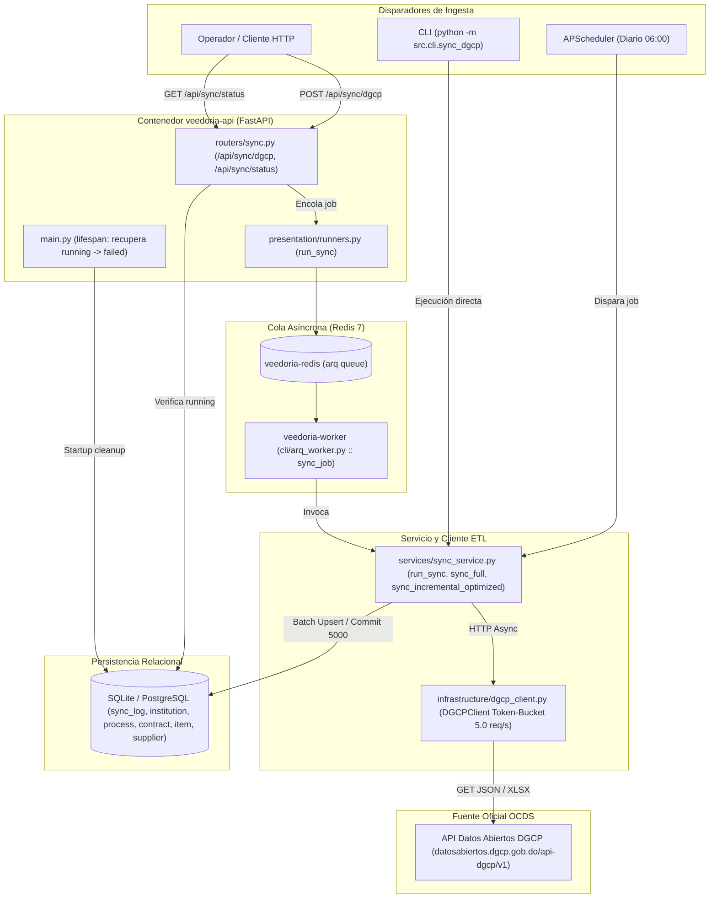
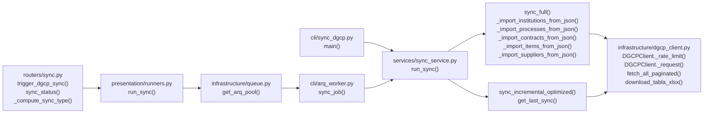

# Design: Ingesta y Sincronización DGCP (`ingesta-sincronizacion-dgcp`)

> 📋 Generated by `solution-designer` · 2026-10-18
> 📋 As-Built — reverse-engineered from code (`12b9d25`)
> ✅ Approved by: Jeremy Michel Solano Frías (2026-10-18)

## Traceability
- **Work Item**: Pendiente (sin PBI/Feature en ADO)
- **Parent**: [veedoria-core](../intake.md)
- **Branch**: `dev`
- **Requirements**: [requirements.md](./requirements.md)
- **Test Plan**: [test-plan.md](./test-plan.md)
- **Test Cases**: [test-cases.md](./test-cases.md)

## Technology Decisions
- **Frontend**: No aplica interfaz dedicada en este módulo (los estados se exponen vía `/api/sync/status` para consumo de consola) — mantiene separación de responsabilidades en el monorepo.
- **Backend**: **FastAPI `^0.110.0` + Uvicorn `^0.28.0` + `httpx` `^0.27.0` + `arq` `^0.28.0` + `APScheduler` `^3.10.4`** — FastAPI provee endpoints asíncronos no bloqueantes (`202 Accepted`), `httpx.AsyncClient` permite streaming paginado con limitador Token-Bucket (`asyncio.Semaphore(3)`) y reintentos exponenciales, y `arq` sobre Redis desacopla las corridas ETL de larga duración (`job_timeout = 3600s`) del proceso web HTTP.
- **Database**: **SQLModel `>=0.0.22,<0.1.0` (SQLAlchemy 2.0 Async) sobre SQLite (`aiosqlite`) en desarrollo y PostgreSQL (`asyncpg`) en producción** — permite inserciones masivas por lotes (`session.add_all` cada `5,000` registros) y consultas parametrizadas asíncronas.
- **Cloud Services**: **Render** (`render.yaml` con servicios `veedoria-api`, `veedoria-worker` y `veedoria-redis`) + contenedores multi-stage Docker (`python:3.12-slim`).
- **Theme**: `govtech` (definido en `.sdd-config.json`).

## Architecture

### System Overview


### Component Diagram


## Deployment
- **Pattern**: `monorepo-split` (Backend multi-servicio en Render con `veedoria-api` + `veedoria-worker` + `veedoria-redis`, y desarrollo local con Docker Compose).
- **App**: Render Web Service (`veedoria-api`) y Render Background Worker (`veedoria-worker`).
- **Infra**: Render Blueprint (`app/backend/render.yaml`) + Docker (`app/backend/Dockerfile` y `app/backend/docker-compose.yml`).
- **CI/CD**: Validación local con hooks SDD (`.githooks/pre-commit`, `ruff`, `pytest`).
- **Justification**: Separar `veedoria-api` de `veedoria-worker` evita que el consumo de memoria y tiempo de red de `sync_full` (~11 min) degrade la latencia (`< 200ms`) de los endpoints de consulta de la consola web.
- **Discarded**: Ejecución síncrona dentro del request HTTP (descartada por timeouts de proxy/cliente superando 30s) y ejecución exclusiva en `BackgroundTasks` del mismo proceso web (descartada en producción para aislar memoria entre API y worker).

### Environments
| Environment | Branch | URL | Database / Queue | Deploy trigger & Gate |
|-------------|--------|-----|------------------|-----------------------|
| **Local** | `feature/*` / `dev` | `http://localhost:3001` | SQLite (`veedoria.db`) o PostgreSQL Docker + Redis local (`:6379/0`) | Manual (`uvicorn` / `docker compose up`) |
| **DEV / QA** | `dev` | `https://dev-api.veedoria.do` (`veedoria-api-dev`) | PostgreSQL DEV + Redis DEV (`veedoria-worker-dev`) | Automático en merge a `dev` tras CI (`ruff` + `pytest` + `alembic upgrade head`) |
| **CERT (Staging)** | `cert` / `release/*` | `https://cert-api.veedoria.do` (`veedoria-api-cert`) | PostgreSQL CERT + Redis CERT (`veedoria-worker-cert`) | Promoción manual `dev → cert` · **Approval Gate: Dev + QA** (`alembic upgrade head` previo al deploy) |
| **PROD** | `main` | `https://api.veedoria.do` (`veedoria-api`) | PostgreSQL PROD + Redis PROD (`veedoria-worker`) | Promoción manual `cert → main` + Release Tag `vX.Y.Z` · **Approval Gate: Dev + QA + BA** (nunca directo `dev → prod`) |

## Database Schema

### Table: `sync_log`
| Column | Type | Constraints | Default | Description |
|--------|------|------------|---------|-------------|
| `id` | `INTEGER` | `PRIMARY KEY` | Auto-increment | Identificador único de la corrida de sincronización o detección |
| `process_type` | `VARCHAR` | `NOT NULL` | `'sync'` | Tipo de proceso (`'sync'` o `'detection'`) |
| `sync_type` | `VARCHAR` | `NULLABLE` | `None` | Alcance (`'incremental'`, `'full'` o fases combinadas con `'+'`) |
| `started_at` | `TIMESTAMP` | `NOT NULL` | ` utcnow()` | Fecha y hora UTC de inicio |
| `completed_at` | `TIMESTAMP` | `NULLABLE` | `None` | Fecha y hora UTC de finalización |
| `records_synced` | `INTEGER` | `NOT NULL` | `0` | Total de registros insertados/actualizados (`inst + p + c + i + s`) |
| `status` | `VARCHAR` | `NOT NULL` | `'running'` | Estado de ejecución (`'running'`, `'completed'`, `'failed'`) |
| `error_message` | `VARCHAR` | `NULLABLE` | `None` | Mensaje de error o `'server_restart'` si quedó huérfano |
| `triggered_by` | `VARCHAR` | `NOT NULL` | `'cron'` | Origen del disparo (`'api'`, `'cli'`, `'cron'`) |
| `details` | `VARCHAR` | `NULLABLE` | `None` | Detalles adicionales serializados en JSON |

### Table: `institution`
| Column | Type | Constraints | Default | Description |
|--------|------|------------|---------|-------------|
| `id` | `INTEGER` | `PRIMARY KEY` | Auto-increment | ID interno de la unidad de compra |
| `dgcp_id` | `VARCHAR` | `UNIQUE, INDEX, NOT NULL` | — | Código oficial de la unidad de compra (`codigo_unidad_compra`) |
| `name` | `VARCHAR` | `NOT NULL` | — | Nombre oficial de la institución compradora (`unidad_compra`) |

### Table: `process`
| Column | Type | Constraints | Default | Description |
|--------|------|------------|---------|-------------|
| `id` | `INTEGER` | `PRIMARY KEY` | Auto-increment | ID interno del proceso de contratación |
| `dgcp_code` | `VARCHAR` | `UNIQUE, INDEX, NOT NULL` | — | Código del proceso en la DGCP (`codigo_proceso`) |
| `title` | `VARCHAR` | `NOT NULL` | — | Objeto o descripción del proceso |
| `institution_id` | `INTEGER` | `FOREIGN KEY (institution.id), INDEX, NULLABLE` | `None` | Referencia a la institución compradora |
| `modality` | `VARCHAR` | `NULLABLE` | `None` | Modalidad de contratación |
| `status` | `VARCHAR` | `NULLABLE` | `None` | Estado del proceso |
| `published_date` | `TIMESTAMP` | `NULLABLE` | `None` | Fecha de publicación |
| `awarded_date` | `TIMESTAMP` | `NULLABLE` | `None` | Fecha de adjudicación |
| `estimated_amount` | `FLOAT` | `NULLABLE` | `None` | Monto estimado del proceso |

### Table: `contract`
| Column | Type | Constraints | Default | Description |
|--------|------|------------|---------|-------------|
| `id` | `INTEGER` | `PRIMARY KEY` | Auto-increment | ID interno del contrato |
| `contract_id` | `VARCHAR` | `INDEX, NULLABLE` | `None` | Código oficial del contrato (`codigo_contrato`) |
| `process_id` | `INTEGER` | `FOREIGN KEY (process.id), INDEX, NULLABLE` | `None` | Referencia al proceso de compra padre |
| `supplier_name` | `VARCHAR` | `NULLABLE` | `None` | Razón social adjudicada (`razon_social`) |
| `rpe` | `VARCHAR` | `INDEX, NULLABLE` | `None` | Registro de Proveedor del Estado (`rpe`) |
| `amount_adjudicated` | `FLOAT` | `NULLABLE` | `None` | Monto contratado (`valor_contratado`) |
| `currency` | `VARCHAR` | `NULLABLE` | `None` | Divisa del contrato (`DOP`, `USD`, etc.) |
| `signed_date` | `TIMESTAMP` | `NULLABLE` | `None` | Fecha de adjudicación/firma (`fecha_adjudicacion`) |
| `creation_date` | `TIMESTAMP` | `NULLABLE` | `None` | Fecha de creación del contrato (`fecha_creacion_contrato`) |
| `status` | `VARCHAR` | `NULLABLE` | `None` | Estado del contrato (`estado_contrato`) |
| `adjudication_status` | `VARCHAR` | `NULLABLE` | `None` | Estado de adjudicación (`estado_adjudicacion`) |
| `object_description` | `VARCHAR` | `NULLABLE` | `None` | Descripción del objeto contractual |

### Table: `item`
| Column | Type | Constraints | Default | Description |
|--------|------|------------|---------|-------------|
| `id` | `INTEGER` | `PRIMARY KEY` | Auto-increment | ID interno de la línea/artículo adjudicado |
| `contract_id` | `INTEGER` | `FOREIGN KEY (contract.id), INDEX, NOT NULL` | — | Referencia al contrato padre |
| `process_code` | `VARCHAR` | `INDEX, NULLABLE` | `None` | Código del proceso asociado (`codigo_proceso`) |
| `description` | `VARCHAR` | `NOT NULL` | — | Descripción del artículo (`descripcion_articulo`) |
| `quantity` | `FLOAT` | `NOT NULL` | `1.0` | Cantidad adjudicada (`cantidad`) |
| `unit` | `VARCHAR` | `NULLABLE` | `None` | Unidad de medida (`unidad_medida`) |
| `unit_price` | `FLOAT` | `NULLABLE` | `None` | Precio unitario adjudicado (`precio_unitario`) |
| `total_amount` | `FLOAT` | `NULLABLE` | `None` | Costo total del ítem (`costo_total`) |
| `unspsc_family` | `VARCHAR` | `INDEX, NULLABLE` | `None` | Familia UNSPSC (`familia`) |
| `unspsc_class` | `VARCHAR` | `NULLABLE` | `None` | Clase UNSPSC (`clase`) |
| `unspsc_code` | `VARCHAR` | `INDEX, NULLABLE` | `None` | Subclase/código UNSPSC (`subclase`) |
| `budget_account` | `VARCHAR` | `NULLABLE` | `None` | Cuenta presupuestaria (`cuenta_presupuestaria`) |

### Table: `supplier`
| Column | Type | Constraints | Default | Description |
|--------|------|------------|---------|-------------|
| `id` | `INTEGER` | `PRIMARY KEY` | Auto-increment | ID interno del proveedor |
| `rnc` | `VARCHAR` | `UNIQUE, INDEX, NOT NULL` | — | RNC / Cédula o documento fiscal (`numero_documento`) |
| `registered_name` | `VARCHAR` | `NULLABLE` | `None` | Razón social registrada (`razon_social`) |
| `trade_name` | `VARCHAR` | `NULLABLE` | `None` | Nombre comercial |
| `phone` | `VARCHAR` | `NULLABLE` | `None` | Teléfono comercial (`telefono_comercial`) |
| `email` | `VARCHAR` | `NULLABLE` | `None` | Correo electrónico comercial (`correo_comercial`) |
| `address` | `VARCHAR` | `NULLABLE` | `None` | Domicilio fiscal (`direccion`) |
| `status` | `VARCHAR` | `NULLABLE` | `None` | Estado en el RPE (`estado`) |
| `is_mipyme` | `BOOLEAN` | `NOT NULL` | `False` | Indicador MIPYME (`es_mipyme == "Sí"`) |
| `classification` | `VARCHAR` | `NULLABLE` | `None` | Clasificación del proveedor (`clasificacion`) |
| `supplier_type` | `VARCHAR` | `NULLABLE` | `None` | Rubro que provee (`provee`) |
| `province` | `VARCHAR` | `NULLABLE` | `None` | Provincia (`provincia`) |
| `municipality` | `VARCHAR` | `NULLABLE` | `None` | Municipio (`municipio`) |

### Indexes
| Name | Columns | Type |
|------|---------|------|
| `ix_institution_dgcp_id` | `institution(dgcp_id)` | `UNIQUE BTREE` |
| `ix_process_dgcp_code` | `process(dgcp_code)` | `UNIQUE BTREE` |
| `ix_process_institution_id` | `process(institution_id)` | `BTREE` |
| `ix_contract_contract_id` | `contract(contract_id)` | `BTREE` |
| `ix_contract_process_id` | `contract(process_id)` | `BTREE` |
| `ix_contract_rpe` | `contract(rpe)` | `BTREE` |
| `ix_item_contract_id` | `item(contract_id)` | `BTREE` |
| `ix_item_unspsc_family` | `item(unspsc_family)` | `BTREE` |
| `ix_item_unspsc_code` | `item(unspsc_code)` | `BTREE` |
| `ix_supplier_rnc` | `supplier(rnc)` | `UNIQUE BTREE` |

## API Contracts

### POST /api/sync/dgcp
- **Request**: Query parameters:
  - `full: bool = False`
  - `skip_institutions: bool = False`
  - `skip_processes: bool = False`
  - `skip_contracts: bool = False`
  - `skip_items: bool = False`
  - `skip_suppliers: bool = False`
  - `rate_limit: float = 5.0`
  - `days_back: int | None = None`
- **Response**: `202 Accepted` — `ApiResponse` JSON:
  ```json
  {
    "success": true,
    "data": {
      "task": "arq_job_id",
      "sync_type": "incremental"
    },
    "message": "Sync started"
  }
  ```
- **Auth**: Optional (en estado *As-Built*; restringido a `ADMIN`/`OPERATOR` en fase de RBAC).
- **Errors**:
  - `202` con `{"success": false, "message": "Sync ya está en progreso"}` si existe un `SyncLog` en estado `running`.
  - `202` con `{"success": false, "message": "La sincronización ya está en ejecución"}` si `arq` rechaza duplicar el job.
- **Maps to**: REQ-001, REQ-002, REQ-003, REQ-004

### GET /api/sync/status
- **Request**: Sin parámetros.
- **Response**: `200 OK` — `ApiResponse` JSON:
  ```json
  {
    "success": true,
    "data": {
      "last_sync": {
        "id": 12,
        "process_type": "sync",
        "status": "completed",
        "records": 4520,
        "started_at": "2026-10-18T06:00:00",
        "completed_at": "2026-10-18T06:08:12",
        "error": null,
        "triggered_by": "cron",
        "sync_type": "incremental",
        "details": null
      },
      "recent_syncs": [],
      "recent_detections": []
    }
  }
  ```
- **Auth**: Optional (lectura de monitoreo para consola).
- **Errors**: `500 Internal Server Error` si la base de datos no está disponible.
- **Maps to**: REQ-005, REQ-006

## Architecture Updates
- No global architecture changes required (el módulo *As-Built* ya está reflejado en `docs/architecture/system-design.md`, `docs/architecture/data-model.md`, `docs/architecture/api-contract.md` y `docs/architecture/integrations.md`).

## Approval
- [x] Developer: Jeremy Michel Solano Frías Date: 2026-10-18

---
> 📍 Pendiente (sin PBI/Feature en ADO) · 🌿 `dev` · Generated by SDD Standard