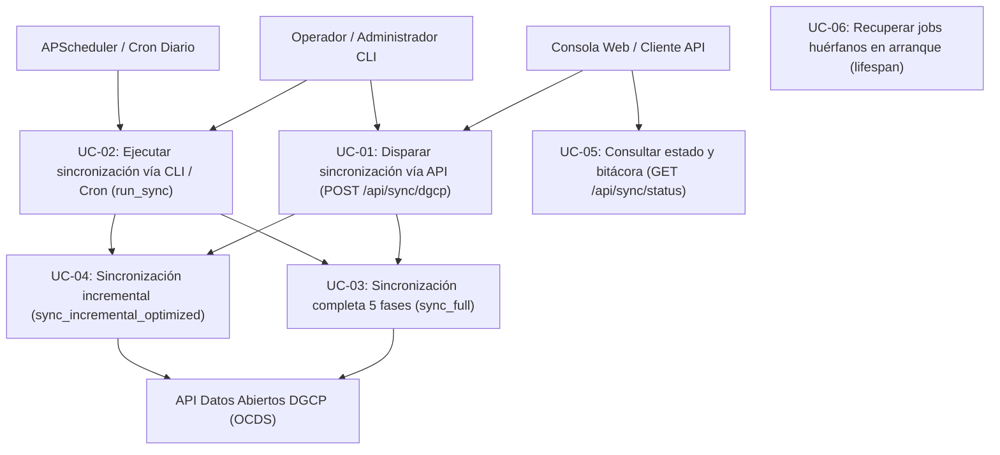
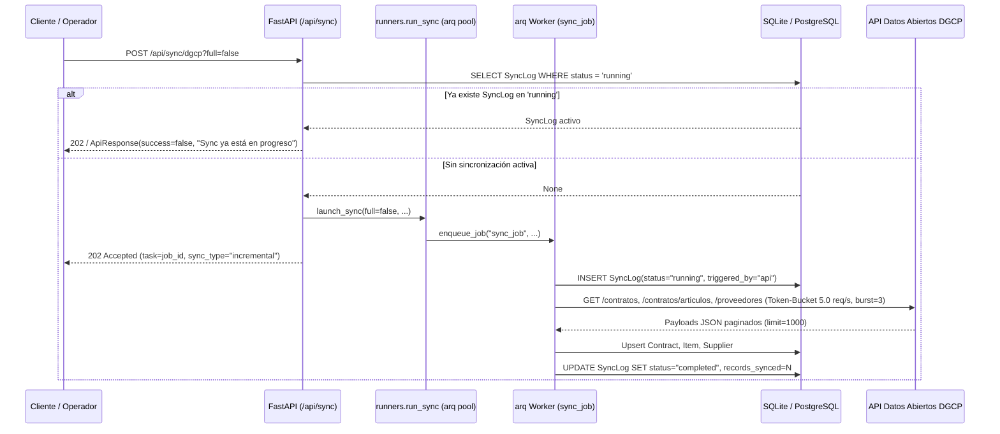

# Requirements: Ingesta y Sincronización DGCP (`ingesta-sincronizacion-dgcp`)

> 📋 Generated by `requirements-analyst` · 2026-10-18
> 📋 As-Built — reverse-engineered from code (`056e22c`) and `specs/veedoria-core/intake.md`
> ✅ Approved by: Jeremy Michel Solano Frías (2026-10-18)

## Traceability
- **Work Item**: Pendiente (sin PBI/Feature en ADO)
- **Parent**: [veedoria-core](../intake.md)
- **Branch**: `dev`
- **Design**: [design.md](./design.md)
- **Test Plan**: [test-plan.md](./test-plan.md)
- **Test Cases**: [test-cases.md](./test-cases.md)

## Overview
El módulo de **Ingesta y Sincronización DGCP** constituye el canal ETL automatizado de **VeedorIA** (**NexoDigital Solutions, S.R.L.**) encargado de extraer, limpiar, normalizar e insertar las transacciones públicas de contrataciones del Estado dominicano desde la API de Datos Abiertos de la **DGCP** (bajo el estándar internacional **OCDS** y las normas de interoperabilidad **NORTIC A4:2024**) hacia el esquema relacional normalizado (`Institution`, `Process`, `Contract`, `Item`, `Supplier`). Soporta ejecución completa (`sync_full`) e incremental optimizada (`sync_incremental_optimized`) en segundo plano mediante colas asíncronas (`arq` + Redis), programación periódica (`APScheduler`) o CLI (`src/cli/sync_dgcp.py`), garantizando trazabilidad completa en `SyncLog`.

## User Stories (EARS Notation)

### REQ-001: Disparo asíncrono de sincronización DGCP y exclusión mutua
**Type:** Event-Driven
**Rule:** WHEN un operador o cliente envía una petición `POST /api/sync/dgcp`, the system SHALL verificar en `sync_log` que no exista ningún proceso con `status = 'running'`, encolar el trabajo `sync_job` en Redis mediante `get_arq_pool()` (`src/presentation/runners.py`) y responder con código HTTP `202 Accepted` indicando el `job_id` y el `sync_type` calculado; IF ya existe un registro en `sync_log` con `status = 'running'` o `enqueue_job` devuelve `None`, the system SHALL rechazar el inicio devolviendo `ApiResponse(success=False, message=...)`.
**Entities:** `SyncLog`
**Error Handling:** Si existe una sincronización en curso en base de datos o en la cola `arq` (`RuntimeError("La sincronización ya está en ejecución")`), el endpoint retorna `success: false` con el mensaje descriptivo sin duplicar trabajos.

**Acceptance Criteria:**
- [ ] Given que no hay registros en `sync_log` con `status = 'running'`, when se invoca `POST /api/sync/dgcp?full=false`, then el sistema encola `sync_job` en `arq`, retorna HTTP `202` con `success: true`, `data.task = job_id` y `data.sync_type = "incremental"`.
- [ ] Given que se invoca `POST /api/sync/dgcp?full=true` con banderas parciales (`skip_institutions`, `skip_processes`, `skip_contracts`, `skip_items`, `skip_suppliers`), when al menos una bandera es `true`, then `_compute_sync_type` concatena con `+` únicamente las fases activas (ej. `contracts+items+suppliers`).
- [ ] Given que existe un registro en `sync_log` con `status = 'running'`, when se invoca `POST /api/sync/dgcp`, then el sistema retorna `success: false` y `message: "Sync ya está en progreso"` sin encolar otro job.

**Priority:** Must
**Dependencies:** None
**Tracker:** Pendiente

### REQ-002: Cliente HTTP resiliente con algoritmo Token-Bucket y descarga JSON/XLSX
**Type:** Ubiquitous
**Rule:** The system SHALL consumir los endpoints de la API de Datos Abiertos de la DGCP (`/unidades_compra`, `/procesos`, `/contratos`, `/contratos/articulos`, `/proveedores` y `/tablas/{endpoint}?tipo=xlsx`) mediante `DGCPClient` aplicando un limitador de tasa Token-Bucket (`rate_limit = 5.0` req/s por defecto, `burst = 3` con `asyncio.Semaphore(3)`), paginación de `limit = 1000` registros por página, y reintentos automáticos con backoff exponencial (`dgcp_max_retries = 3`, `dgcp_retry_base_delay * 2^attempt`) ante errores HTTP `>= 500`, `TimeoutException` o `NetworkError`.
**Entities:** `Institution`, `Process`, `Contract`, `Item`, `Supplier`, `SyncLog`
**Error Handling:** Si la respuesta JSON contiene `hasError: true` o se agotan los reintentos por error de red/HTTP, `DGCPClient` lanza `DGCPClientError`, la cual es capturada por `run_sync` para marcar el `SyncLog` como `failed` y persistir la causa en `error_message`.

**Acceptance Criteria:**
- [ ] Given una instancia de `DGCPClient(rate_limit=5.0, burst=3)` inicializada con `async with`, when realiza peticiones concurrentes, then aplica control de concurrencia y recarga de tokens respetando `1.0 / rate_limit` segundos por petición y encabezado `User-Agent: VeedorIA/1.0`.
- [ ] Given un error HTTP `503` o `httpx.TimeoutException` en `DGCPClient._request`, when `attempt < dgcp_max_retries - 1`, then espera exponencialmente antes de reintentar y lanza `DGCPClientError` solo si falla el último intento.
- [ ] Given la invocación a `download_tabla_xlsx(endpoint, dest_dir)`, when el endpoint responde exitosamente, then guarda el archivo binario `.xlsx` en `dest_dir` y retorna su `Path`.

**Priority:** Must
**Dependencies:** REQ-001
**Tracker:** Pendiente

### REQ-003: Sincronización completa (`sync_full`) con limpieza referencial, streaming por lotes y early-break
**Type:** Event-Driven
**Rule:** WHEN se ejecuta `run_sync` en modo completo (`full = True`), the system SHALL limpiar previamente las tablas dependientes en orden inverso de clave foránea (`audit_log`, `anomaly`, `item`, `contract`, `process`, `institution`, `supplier`) y ejecutar en secuencia las 5 fases no omitidas (`_import_institutions_from_json`, `_import_processes_from_json`, `_import_contracts_from_json`, `_import_items_from_json`, `_import_suppliers_from_json`), insertando en lotes de `5,000` registros (`session.add_all`), aplicando corte temprano (*early-break*) cuando una página completa de contratos supera la antigüedad `days_back` (`90` días por defecto) o una página de artículos (`page > 1`) no coincide con ningún contrato cargado, y tolerando hasta `< 3` errores de página antes de abortar una fase.
**Entities:** `Institution`, `Process`, `Contract`, `Item`, `Supplier`, `SyncLog`
**Error Handling:** Si una página de contratos, artículos o proveedores falla, incrementa el contador `errors` y continúa con la siguiente página; si alcanza `3` errores consecutivos de página, detiene esa fase de forma controlada haciendo commit del lote parcial acumulado.

**Acceptance Criteria:**
- [ ] Given `full = True`, when inicia `sync_full`, then limpia las tablas en orden `audit_log` → `anomaly` → `item` → `contract` → `process` → `institution` → `supplier` antes de importar.
- [ ] Given la importación de contratos e ítems en `sync_full`, when todos los contratos de una página (`page > 1`) tienen fecha anterior a `cutoff` (`today - days_back`) o ningún ítem de la página coincide con `contract_map`, then el importador ejecuta *early-break* sin recorrer páginas históricas innecesarias.
- [ ] Given el mapeo de artículos (`map_item_from_json`), when se importa cada artículo desde `/contratos/articulos`, then se persisten `unspsc_family` (`familia`), `unspsc_class` (`clase`), `unspsc_code` (`subclase`) y `budget_account` (`cuenta_presupuestaria`), y al finalizar `run_sync` se guarda la suma `inst + p + c + i + s` en `SyncLog.records_synced` con `status = "completed"`.

**Priority:** Must
**Dependencies:** REQ-002
**Tracker:** Pendiente

### REQ-004: Sincronización incremental optimizada (`sync_incremental_optimized`) basada en última marca de tiempo
**Type:** Event-Driven
**Rule:** WHEN se ejecuta `run_sync` en modo incremental (`full = False`), the system SHALL obtener la fecha `completed_at` del último `SyncLog` exitoso mediante `get_last_sync` (o `now - 1 day` si no existe previo), filtrar los contratos con `fecha_creacion_contrato >= since` realizando *upsert* sobre `Contract` (`contract_id`, `process_id`), descargar y hacer *upsert* de los artículos (`/contratos/articulos`) únicamente para los códigos de contrato nuevos/actualizados, y descargar y hacer *upsert* en `Supplier` (`/proveedores`) para cada `numero_documento` (`RNC`) involucrado en dichos contratos.
**Entities:** `Contract`, `Item`, `Supplier`, `Process`, `SyncLog`
**Error Handling:** Si falla la descarga de ítems de un contrato individual o de un RNC puntual durante el modo incremental, se registra un `logger.warning` y el bucle continúa con el resto de contratos/proveedores sin abortar la corrida.

**Acceptance Criteria:**
- [ ] Given un `SyncLog` previo con `status = "completed"`, when se ejecuta `sync_incremental_optimized`, then procesa únicamente contratos con `fecha_creacion_contrato >= last.completed_at`, actualizando `amount_adjudicated`, `status` y `signed_date` si el contrato ya existía o insertándolo si es nuevo.
- [ ] Given la lista `new_contract_codes` resultante del paso anterior, when consulta `/contratos/articulos` y `/proveedores`, then hace *upsert* de los `Item` (por `contract_id` y `description`) y de los `Supplier` (por `rnc`) vinculados.

**Priority:** Must
**Dependencies:** REQ-002, REQ-003
**Tracker:** Pendiente

### REQ-005: Recuperación automática de trabajos huérfanos en el arranque del servidor y ejecución CLI
**Type:** Event-Driven
**Rule:** WHEN la aplicación FastAPI inicia su ciclo de vida (`lifespan` en `src/presentation/main.py`), the system SHALL actualizar todo registro en `sync_log` que haya quedado en `status = 'running'` a `status = 'failed'` con `error_message = 'server_restart'`; asimismo, WHEN un operador ejecuta `python -m src.cli.sync_dgcp`, the system SHALL permitir correr `run_sync` directamente con `triggered_by = "cli"` soportando los mismos argumentos (`--full`, `--days-back`, `--skip-*`, `--rate-limit`).
**Entities:** `SyncLog`
**Error Handling:** En caso de reinicio abrupto del contenedor, el paso de `lifespan` libera automáticamente el bloqueo lógico de `status = 'running'`.

**Acceptance Criteria:**
- [ ] Given un registro en `sync_log` con `status = 'running'`, when el servidor FastAPI arranca, then el registro cambia a `status = 'failed'` con `error_message = 'server_restart'`.
- [ ] Given la ejecución por consola `python -m src.cli.sync_dgcp --full --skip-items --rate-limit 5.0`, when finaliza el comando, then registra en `sync_log` un evento con `triggered_by = "cli"` y `sync_type = "institutions+processes+contracts+suppliers"`.

**Priority:** Must
**Dependencies:** REQ-001
**Tracker:** Pendiente

### REQ-006: Consulta de estado histórico de sincronizaciones y detecciones
**Type:** Event-Driven
**Rule:** WHEN un cliente consulta `GET /api/sync/status`, the system SHALL recuperar los últimos `10` registros de `sync_log` ordenados descendentemente por `started_at`, separándolos en `recent_syncs` (`process_type == "sync"`) y `recent_detections` (`process_type != "sync"`), e identificando el último `SyncLog` de sincronización con `status == "completed"` como `last_sync`.
**Entities:** `SyncLog`
**Error Handling:** Si la tabla `sync_log` está vacía, el endpoint retorna `200 OK` con `last_sync: null`, `recent_syncs: []` y `recent_detections: []`.

**Acceptance Criteria:**
- [ ] Given registros existentes en `sync_log` tanto de `process_type = "sync"` como de `"detection"`, when se consulta `GET /api/sync/status`, then la respuesta devuelve `last_sync` apuntando a la última sincronización completada y las listas `recent_syncs` y `recent_detections` serializadas con `id`, `process_type`, `status`, `records`, `started_at`, `completed_at`, `error`, `triggered_by`, `sync_type` y `details`.
- [ ] Given una base de datos sin registros en `sync_log`, when se consulta `GET /api/sync/status`, then responde `200 OK` con `success: true`, `last_sync: null` y listas vacías.

**Priority:** Must
**Dependencies:** REQ-001
**Tracker:** Pendiente

## Non-Functional Requirements

### NFR-001: Tiempo de respuesta no bloqueante en disparo de sincronización
**Category:** Performance
**Rule:** The system SHALL responder a la solicitud de inicio de sincronización (`POST /api/sync/dgcp`) sin bloquear el hilo HTTP principal, delegando la ejecución al worker `arq` (`job_timeout = 3600s`, `keep_result = 86400s`).
**Metric:** Tiempo de respuesta HTTP `< 500ms` p95 con código `202 Accepted`.
**Priority:** Must

### NFR-002: Capacidad de procesamiento por lotes en streaming del pipeline ETL
**Category:** Scalability
**Rule:** The system SHALL paginar la API de la DGCP de `1,000` en `1,000` registros y confirmar transacciones en lotes de `5,000` entidades en base de datos para mantener un consumo de memoria acotado en `veedoria-worker`.
**Metric:** Rendimiento de ingesta `>= 10,000 registros/hora` (sincronización completa estimada en `~11 minutos` a `5.0 req/s`).
**Priority:** Should

### NFR-003: Resiliencia y control de tasa Token-Bucket hacia la DGCP
**Category:** Reliability
**Rule:** The system SHALL limitar la frecuencia y ráfaga de peticiones salientes hacia el portal de Datos Abiertos de la DGCP y aplicar backoff exponencial ante errores `5xx` o de red.
**Metric:** Tasa máxima por defecto de `5.0 req/s` con `burst = 3` (`asyncio.Semaphore(3)`) y hasta `3` reintentos automáticos por petición.
**Priority:** Must

## Diagrams

### Use Case Diagram

### Supporting Diagram

## Dependencies
| Feature | Capability needed | Status | Workaround |
|---------|------------------|--------|------------|
| Infraestructura Base (`database.py`, `queue.py`) | Sesiones asíncronas SQLAlchemy/SQLModel y pool Redis `arq` (`get_arq_pool`) | Implementado (`🟢 active`) | Ejecución directa vía CLI (`python -m src.cli.sync_dgcp`) cuando no se utiliza la cola Redis |

## Assumptions
| # | Assumption | Temporary stub | Replaced when |
|---|-----------|----------------|---------------|
| 1 | La API de Datos Abiertos de la DGCP (`https://datosabiertos.dgcp.gob.do/api-dgcp/v1`) mantiene disponibles los endpoints `/unidades_compra`, `/procesos`, `/contratos`, `/contratos/articulos`, `/proveedores` y `/tablas/{endpoint}?tipo=xlsx` | Semillas locales para pruebas unitarias/integración | En caso de cambio de versión en la API de la DGCP |
| 2 | Los endpoints `/api/sync/*` son invocados en entorno controlado sin guard JWT obligatorio | Acceso directo en router `/api/sync` | Al implementar en código el Módulo II de Autenticación y RBAC (`ADMIN` / `OPERATOR`) |

## Out of Scope
- Interfaz gráfica dedicada de administración de colas ETL (`/admin/etl` definida como pantalla #32 en `complete_screen_map.md` para fase posterior).
- Sincronización en tiempo real mediante Webhooks entrantes desde la DGCP (la API gubernamental actual opera por consulta *pull* paginada).

## Approval
- [x] Analyst: Jeremy Michel Solano Frías Date: 2026-10-18

---
> 📍 Pendiente (sin PBI/Feature en ADO) · 🌿 `dev` · Generated by SDD Standard