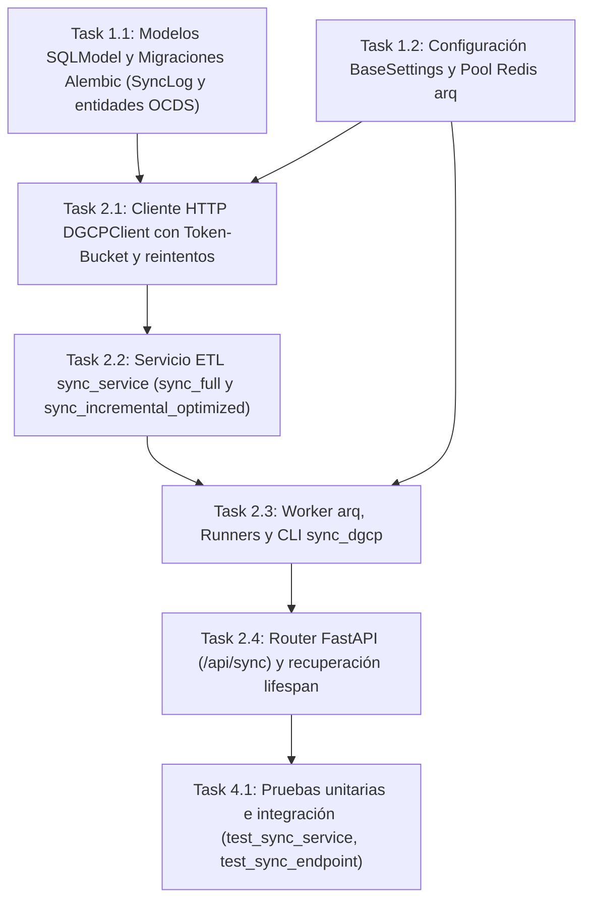

# Tasks: Ingesta y Sincronización DGCP (`ingesta-sincronizacion-dgcp`)

> 📋 Generated by `solution-designer` · 2026-10-18
> 📋 As-Built — reverse-engineered from code (`af1d232`)
> ✅ Approved by: Jeremy Michel Solano Frías (2026-10-18)

## Traceability
- **Work Item**: Pendiente (sin PBI/Feature en ADO)
- **Branch**: `dev`

## Metadata
- **Based on:** [design.md](./design.md)
- **Total estimate:** ~18h (As-Built — 100% implementado)
- **Number of waves:** 3 (Wave 1, Wave 2, Wave 4)
- **Number of tasks:** 7
- **Sprint:** [TBD]
- **Assignee:** Jeremy Michel Solano Frías

## Estimation Rules

See `estimation-strategy.md` for full estimation rules, AI multipliers, and architecture impact.

**Quick reference:**
- Maximum **4 hours** per task (break larger tasks into subtasks)
- Estimates include implementation + unit tests + code review
- If a task exceeds 4h during implementation, split it immediately
- Add **20% buffer** to total estimate for unknowns
- If using agentic IDEs + SDD: apply multipliers from `estimation-strategy.md` §Scenario B
- Track actual vs estimated for future calibration (see `estimation-strategy.md` §Calibration)

## Dependency Graph

---

## Wave 1: Foundation & Setup (~4h)

### Task 1.1: Modelos SQLModel y Migraciones Alembic (`SyncLog` y entidades OCDS) (~2.5h)
- **Description:** Definir los modelos relacionales `SyncLog`, `Institution`, `Process`, `Contract`, `Item` y `Supplier` en `app/backend/src/models/` junto con sus migraciones versionadas en `app/backend/migrations/versions/` (`5f60e1fac072_add_sync_log_table.py`, `3db536f8db33_add_sync_type_to_sync_log.py`, `a7a2bba8dc39_add_process_type_and_details_to_sync_log.py`).
- **Acceptance criteria:**
  - [x] Modelos SQLModel creados con índices B-Tree sobre `dgcp_id`, `dgcp_code`, `contract_id`, `rpe`, `unspsc_family`, `unspsc_code` y `rnc`.
  - [x] Migraciones Alembic aplicadas sobre SQLite y PostgreSQL sin errores.
- **Dependencies:** None
- **Files to create/modify:** `app/backend/src/models/sync_log.py`, `app/backend/src/models/institution.py`, `app/backend/src/models/process.py`, `app/backend/src/models/contract.py`, `app/backend/src/models/item.py`, `app/backend/src/models/supplier.py`, `app/backend/migrations/versions/*.py`

### Task 1.2: Configuración `BaseSettings` y Pool Redis `arq` (~1.5h)
- **Description:** Configurar parámetros de ingesta (`dgcp_api_base_url`, `dgcp_request_timeout`, `dgcp_max_retries`, `dgcp_retry_base_delay`, `sync_days_back`, `sync_batch_size`, `sync_rate_limit`, `sync_cron_hour`, `sync_cron_minute`, `redis_url`) en `src/config.py` y el pool de conexiones `get_arq_pool` en `src/infrastructure/queue.py`.
- **Acceptance criteria:**
  - [x] `Settings` carga valores por defecto seguros y variables de entorno.
  - [x] `get_arq_pool()` conecta al broker Redis configurado en `REDIS_URL`.
- **Dependencies:** None
- **Files to create/modify:** `app/backend/src/config.py`, `app/backend/src/infrastructure/queue.py`

---

## Wave 2: Core Implementation (~9h)

### Task 2.1: Cliente HTTP `DGCPClient` con Token-Bucket y reintentos (~2.5h)
- **Description:** Implementar `DGCPClient` y `DGCPResponse` en `src/infrastructure/dgcp_client.py` con limitador de tasa Token-Bucket (`rate_limit = 5.0`, `burst = 3`, `asyncio.Semaphore(3)`), paginación automática (`limit = 1000`), reintentos exponenciales (`dgcp_max_retries = 3`) y descarga binaria de tablas XLSX (`download_tabla_xlsx`).
- **Acceptance criteria:**
  - [x] `_rate_limit()` controla ráfagas y espaciamiento entre peticiones concurrentes.
  - [x] `_request()` reintenta ante errores HTTP `>= 500` y errores de red antes de lanzar `DGCPClientError`.
  - [x] Métodos `fetch_institutions`, `fetch_processes`, `fetch_contracts`, `fetch_contract_items`, `fetch_suppliers`, `fetch_all_contracts` y `download_tabla_xlsx` operativos.
- **Dependencies:** Task 1.1, Task 1.2
- **Files to create/modify:** `app/backend/src/infrastructure/dgcp_client.py`

### Task 2.2: Servicio ETL `sync_service` (`sync_full` y `sync_incremental_optimized`) (~3.5h)
- **Description:** Implementar el mapeo JSON OCDS (`map_institution_from_json`, `map_process_from_json`, `map_contract_from_json`, `map_item_from_json`, `map_supplier_from_json`, `parse_date`), la sincronización completa en 5 fases con limpieza inversa de FK, commits por lotes de `5,000` y *early-break* (`sync_full`), y la sincronización incremental (`sync_incremental_optimized`) orquestadas por `run_sync`.
- **Acceptance criteria:**
  - [x] `sync_full` limpia tablas en orden inverso de FK e importa las 5 entidades respetando las banderas `skip_*` y `days_back`.
  - [x] `sync_incremental_optimized` filtra contratos desde `get_last_sync` y hace *upsert* de contratos, ítems y proveedores asociados.
  - [x] `run_sync` registra el conteo total en `SyncLog.records_synced` y cambia el estado a `completed` o `failed`.
- **Dependencies:** Task 2.1
- **Files to create/modify:** `app/backend/src/services/sync_service.py`

### Task 2.3: Worker `arq`, Runners y CLI `sync_dgcp` (~1.5h)
- **Description:** Implementar `sync_job` y `WorkerSettings` en `src/cli/arq_worker.py`, el despachador `run_sync` en `src/presentation/runners.py` y el script CLI `src/cli/sync_dgcp.py` con soporte completo de banderas por consola.
- **Acceptance criteria:**
  - [x] `sync_job` ejecuta `run_sync` dentro de `veedoria-worker` con `job_timeout = 3600s`.
  - [x] `python -m src.cli.sync_dgcp` permite ejecutar sincronizaciones manuales con `--full`, `--days-back`, `--skip-*` y `--rate-limit`.
- **Dependencies:** Task 1.2, Task 2.2
- **Files to create/modify:** `app/backend/src/cli/arq_worker.py`, `app/backend/src/presentation/runners.py`, `app/backend/src/cli/sync_dgcp.py`

### Task 2.4: Router FastAPI (`/api/sync`) y recuperación `lifespan` (~1.5h)
- **Description:** Exponer `POST /api/sync/dgcp` (`202 Accepted` con exclusión mutua sobre `SyncLog.status == 'running'`) y `GET /api/sync/status` en `src/presentation/routers/sync.py`, e integrar en `src/presentation/main.py` la recuperación de registros `running` → `failed` (`server_restart`) al iniciar el servidor y el cron diario en `APScheduler`.
- **Acceptance criteria:**
  - [x] `POST /api/sync/dgcp` bloquea ejecuciones concurrentes y devuelve `task` + `sync_type`.
  - [x] `GET /api/sync/status` retorna `last_sync`, `recent_syncs` y `recent_detections`.
  - [x] `lifespan` marca como `failed` (`server_restart`) cualquier `SyncLog` huérfano al arrancar FastAPI.
- **Dependencies:** Task 2.3
- **Files to create/modify:** `app/backend/src/presentation/routers/sync.py`, `app/backend/src/presentation/main.py`

---

## Wave 4: Testing & Polish (~2h)

### Task 4.1: Pruebas unitarias e integración (`test_sync_service`, `test_sync_endpoint`) (~2h)
- **Description:** Verificar mediante `pytest` el mapeo y ejecución de `sync_service.py` y el contrato del endpoint `/api/sync/status`.
- **Acceptance criteria:**
  - [x] Suite unitaria `app/backend/tests/unit/test_sync_service.py` pasando.
  - [x] Suite de integración `app/backend/tests/integration/test_sync_endpoint.py` pasando.
- **Dependencies:** Task 2.4
- **Files to create/modify:** `app/backend/tests/unit/test_sync_service.py`, `app/backend/tests/integration/test_sync_endpoint.py`

---

## Implementation Order Summary
| Order | Task | Description | Est. | Depends On |
|-------|------|-------------|------|------------|
| 1 | 1.1 | Modelos SQLModel y Migraciones Alembic (`SyncLog` y entidades OCDS) | ~2.5h | — |
| 2 | 1.2 | Configuración `BaseSettings` y Pool Redis `arq` | ~1.5h | — |
| 3 | 2.1 | Cliente HTTP `DGCPClient` con Token-Bucket y reintentos | ~2.5h | 1.1, 1.2 |
| 4 | 2.2 | Servicio ETL `sync_service` (`sync_full` y `sync_incremental_optimized`) | ~3.5h | 2.1 |
| 5 | 2.3 | Worker `arq`, Runners y CLI `sync_dgcp` | ~1.5h | 1.2, 2.2 |
| 6 | 2.4 | Router FastAPI (`/api/sync`) y recuperación `lifespan` | ~1.5h | 2.3 |
| 7 | 4.1 | Pruebas unitarias e integración (`test_sync_service`, `test_sync_endpoint`) | ~2.0h | 2.4 |

## Total Estimate: ~18h (includes 20% buffer)

## Completion Checklist
- [x] All tasks completed (As-Built)
- [x] All tests passing (`test_sync_service.py`, `test_sync_endpoint.py`)
- [x] Documentation updated (`requirements.md`, `design.md`, `tasks.md`)

---
> 📍 Pendiente (sin PBI/Feature en ADO) · 🌿 `dev` · Generated by SDD Standard