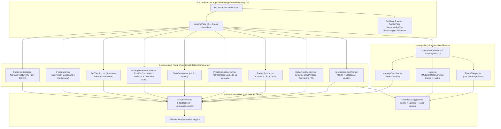
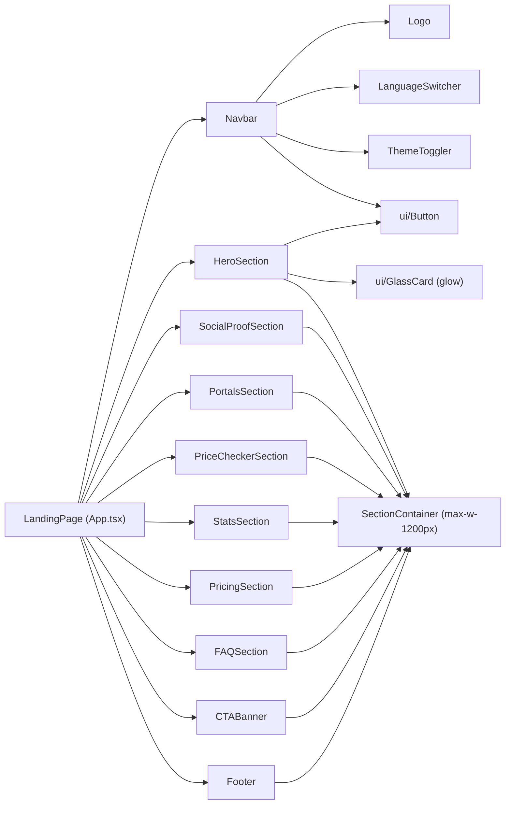

# Design: Portal Cívico y Landing (`portal-civico-landing`)

> 📋 Generated by `solution-designer` · 2026-10-19
> 📋 As-Built — reverse-engineered from code
> ✅ Approved by: Jeremy Michel Solano Frías (2026-10-19)

## Traceability
- **Work Item**: Pendiente (sin PBI/Feature en ADO)
- **Parent**: [veedoria-core](../intake.md)
- **Branch**: `dev`
- **Requirements**: [requirements.md](./requirements.md)
- **Test Plan**: [test-plan.md](./test-plan.md)
- **Test Cases**: [test-cases.md](./test-cases.md)

## Technology Decisions
- **Frontend**: **React `^19.2.6` + TypeScript `~6.0.2` + Vite `^8.0.12` + TailwindCSS `^4.3.1` + HeroUI `@heroui/react` `^3.2.1` + Framer Motion `^12.40.0` + `i18next` `^26.0.3` / `react-i18next` `^17.0.2` / `i18next-http-backend` `^3.0.4` / `i18next-browser-languagedetector` `^8.2.1` + `lucide-react` `^1.16.0`** — Permite renderizar una portada cívica e institucional bilingüe (`ES`/`EN`), con carga perezosa (`React.lazy()`) de los módulos privados (`/app/bandeja`), animaciones escalonadas de entrada en `HeroSection` y revelación progresiva por `IntersectionObserver` en las secciones inferiores.
- **Backend**: No requiere llamadas bloqueantes al backend durante la carga inicial de `/`, sirviendo los diccionarios estáticos desde `/locales/{{lng}}/landing.json` para garantizar un *First Contentful Paint* (FCP) inmediato.
- **Database**: Persistencia ligera en el navegador (`localStorage`) para la preferencia de idioma (`i18nextLng`) y el tema visual (`light` / `dark` mediante `@heroui/react` y el atributo `data-theme` en `document.documentElement`).
- **Cloud Services**: Despliegue estático SPA / CDN (Vercel / Render Static Site) con entornos efímeros de Preview por Pull Request y promoción controlada multi-ambiente (`dev → cert → main`).
- **Theme**: `govtech` (*Civil Clarity* en modo claro `--background: #faf8ff`, `--primary: #003d9b`; *Sovereign Ledger* en modo oscuro `--background: #0c0e14`, `--primary: #b2c5ff`), tipografías `Manrope` (`--font-display`), `Inter` (`--font-sans`) y `JetBrains Mono` (`--font-mono`), cumpliendo **WCAG 2.1 AA** y **NORTIC A2:2024**.

## Architecture

### System Overview

### Component Diagram

## Deployment
- **Pattern**: `monorepo-split` (SPA compilada con `tsc -b && vite build` en `app/frontend/dist`, sirviendo activos estáticos `.webp` y diccionarios JSON desde `/locales/`).
- **App**: Hosting estático / CDN (Vercel / Render Static Site) con soporte de reescritura SPA (`/* -> /index.html`).
- **Infra**: Distribución global por CDN con caché de activos inmutables (`/assets/*`) y recarga ligera de diccionarios i18n (`/locales/{es,en}/landing.json`).
- **CI/CD**: Validación estática (`eslint` + `tsc -b`), construcción Vite y promoción multi-ambiente con compuertas de aprobación.
- **Justification**: Separar `LandingPage` del bundle D3.js mediante `React.lazy()` garantiza una carga instantánea del portal ciudadano incluso en conexiones móviles 3G/4G.
- **Discarded**: Carga síncrona de `AuditorPage` y `d3` en el punto de entrada raíz (descartado para no penalizar el tiempo de carga del portal público).

### Environments
| Environment | Branch | Frontend URL | Static Assets & i18n Path | Deploy trigger & Gate |
|-------------|--------|--------------|---------------------------|-----------------------|
| **Local** | `feature/*` / `dev` | `http://localhost:5173/` | `http://localhost:5173/locales/{es,en}/landing.json` | Manual (`npm run dev` en `app/frontend`) |
| **Preview (PR)** | PR hacia `dev` | `https://pr-{N}-veedoria.vercel.app/` | `https://pr-{N}-veedoria.vercel.app/locales/{es,en}/landing.json` | Automático al abrir/actualizar PR (Vercel Preview efímero con auto-cleanup al cerrar PR) |
| **DEV / QA** | `dev` | `https://dev.veedoria.do/` | `https://dev.veedoria.do/locales/{es,en}/landing.json` | Automático en merge a `dev` tras CI (`eslint` + `tsc -b` + `vite build`) |
| **CERT (Staging)** | `cert` / `release/*` | `https://cert.veedoria.do/` | `https://cert.veedoria.do/locales/{es,en}/landing.json` | Promoción manual `dev → cert` · **Approval Gate: Dev + QA** (validación visual claro/oscuro, i18n ES/EN y Lighthouse A11y/Performance) |
| **PROD** | `main` | `https://veedoria.do/` | `https://veedoria.do/locales/{es,en}/landing.json` | Promoción manual `cert → main` + Release Tag `vX.Y.Z` · **Approval Gate: Dev + QA + BA** (nunca directo `dev → prod`) |

## Database Schema

### Table: `client_preferences_and_i18n` (almacenamiento en cliente `localStorage` + esquema de diccionario `landing.json`)
| Column | Type | Constraints | Default | Description |
|--------|------|------------|---------|-------------|
| `i18nextLng` | `'es' \| 'en'` | `localStorage` | `'es'` | Idioma activo gestionado por `i18next-browser-languagedetector` |
| `data-theme` | `'light' \| 'dark'` | `DOM Attribute (<html>)` | `'light'` | Tema visual observado por `Logo.tsx` (`MutationObserver`) y `@heroui/react` (`useTheme`) |
| `navbar` | `Record<string, unknown>` | `JSON Namespace (landing)` | — | Claves `login` y `links.{citizen,business,institutions}` |
| `hero` | `Record<string, string>` | `JSON Namespace (landing)` | — | Claves del encabezado principal y del Monitor de Gobernanza Soberana (`dashboard_*`, `alert_*`) |
| `portals` | `Record<'civic_tech' \| 'b2b' \| 'b2g', PortalItem>` | `JSON Namespace (landing)` | — | Tarjetas de los 3 portales del ecosistema (`title`, `desc`, `cta`, `badge?`) |
| `price_checker` | `Record<string, string>` | `JSON Namespace (landing)` | — | Textos y etiquetas del comparador demostrativo de precios del Estado vs. mercado |
| `metrics` | `Record<'funds' \| 'suppliers' \| 'accuracy' \| 'deviations', string>` | `JSON Namespace (landing)` | — | Etiquetas de los 4 indicadores macro en `StatsSection.tsx` |
| `pricing` | `Record<string, unknown>` | `JSON Namespace (landing)` | — | Definición de niveles de capacidades (`pyme`, `corporate`, `audit`) y nota de gratuidad `CivicTech` |
| `faq` | `Record<'q1' \| 'q2' \| 'q3', { q: string; a: string }>` | `JSON Namespace (landing)` | — | Preguntas y respuestas sobre origen de datos DGCP/OCDS, neutralidad IA y Gobernanza Soberana |

### Indexes
| Name | Columns | Type |
|------|---------|------|
| `localStorage_i18nextLng` | `i18nextLng` | `Browser Web Storage Key` |
| `html_data_theme_attr` | `document.documentElement[data-theme]` | `DOM Attribute Observer Target` |

## API Contracts

### GET /locales/{lng}/landing.json (consumido por `i18next-http-backend`)
- **Request**: Path param `lng` (`'es'` | `'en'`), precargado (`preload: ['es', 'en']`) al inicializar `src/i18n/index.ts`.
- **Response**: `200 OK` — Objeto JSON con las secciones `navbar`, `hero`, `social_proof`, `portals`, `price_checker`, `metrics`, `pricing`, `faq`, `cta_final`, `footer`, `theme_toggler` y `language_switcher`.
- **Auth**: None (recurso público estático).
- **Errors**: Fallback automático a `fallbackLng: 'es'` en caso de clave o idioma no soportado.
- **Maps to**: REQ-001, REQ-002, REQ-003, REQ-004, REQ-005

### GET / (Ruta pública SPA en `App.tsx`)
- **Request**: Navegación directa del navegador a `/`.
- **Response**: Renderizado de `<LandingPage />` compuesto por `Navbar`, `HeroSection`, `SocialProofSection`, `PortalsSection`, `PriceCheckerSection`, `StatsSection`, `PricingSection`, `FAQSection`, `CTABanner` y `Footer`.
- **Auth**: None (portal público ciudadano).
- **Errors**: Si el usuario navega a `/app`, `React.lazy()` y `<Suspense>` muestran el estado de carga antes de montar `DashboardLayout` y redirigir a `/app/bandeja`.
- **Maps to**: REQ-001, REQ-002, REQ-003, REQ-004, REQ-005

## Architecture Updates
- No global architecture changes required (documentado en `docs/architecture/system-design.md`).

## Approval
- [x] Developer: Jeremy Michel Solano Frías Date: 2026-10-19

---
> 📍 Pendiente (sin PBI/Feature en ADO) · 🌿 `dev` · Generated by SDD Standard