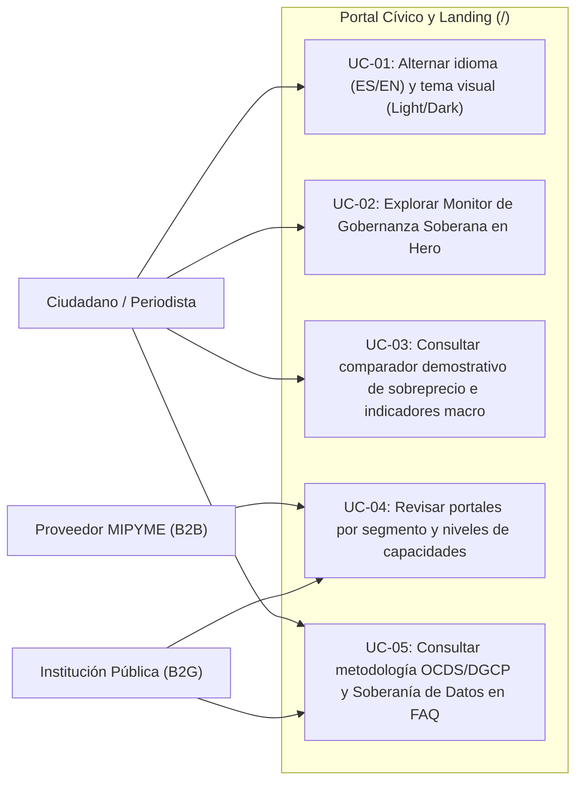
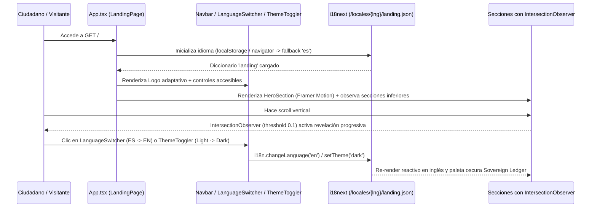

# Requirements: Portal Cívico y Landing (`portal-civico-landing`)

> 📋 Generated by `requirements-analyst` · 2026-10-18
> 📋 As-Built — reverse-engineered from code (`aafbfd2`) and `specs/veedoria-core/intake.md`
> ✅ Approved by: Jeremy Michel Solano Frías (2026-10-19)

## Traceability
- **Work Item**: Pendiente (sin PBI/Feature en ADO)
- **Parent**: [veedoria-core](../intake.md)
- **Branch**: `dev`
- **Design**: [design.md](./design.md)
- **Test Plan**: [test-plan.md](./test-plan.md)
- **Test Cases**: [test-cases.md](./test-cases.md)

## Overview
El módulo **Portal Cívico y Landing** (`/` — `LandingPage` en `App.tsx`) constituye la puerta de entrada pública y de transparencia ciudadana de **VeedorIA** (**NexoDigital Solutions, S.R.L.**). Cumple con las directrices de gobierno electrónico y datos abiertos (**NORTIC A2:2024** y **NORTIC A4:2024**), permitiendo a ciudadanos, periodistas de investigación, proveedores del Estado (MIPYMES/B2B) e instituciones fiscalizadoras (B2G) conocer la metodología de **Gobernanza Soberana**, explorar el comparador demostrativo de precios del Estado frente al mercado, consultar indicadores macro de vigilancia de compras públicas (**Ley 340-06** y **Ley 47-25**), y alternar de forma accesible (`WCAG 2.1 AA`) entre español e inglés (`ES`/`EN`) y entre los temas visuales claro y oscuro (*Civil Clarity* / *Sovereign Ledger*).

## User Stories (EARS Notation)

### REQ-001: Barra de navegación pública, logotipo adaptativo, selector bilingüe (`ES`/`EN`) y conmutador de tema (`Navbar`, `Logo`, `LanguageSwitcher`, `ThemeToggler`)
**Type:** Ubiquitous
**Rule:** The system SHALL presentar en la parte superior del portal público una barra de navegación fija (`Navbar.tsx`, `fixed top-0 w-full z-50 bg-background/80 backdrop-blur-xl`) contenida en `SectionContainer` (`max-w-[1200px]`), integrando el logotipo institucional (`Logo.tsx`) que observa mediante `MutationObserver` el atributo `data-theme` de `document.documentElement` para alternar automáticamente entre `veedoria_logo_light.webp` y `veedoria_logo_dark.webp`, los enlaces de segmento (`Buscador Ciudadano`, `Para Empresas`, `Para Instituciones`), el selector de idioma (`LanguageSwitcher.tsx`) conectado a `i18next` (`es`/`en` con persistencia en `localStorage`), el conmutador de tema visual (`ThemeToggler.tsx` vía `useTheme()` de `@heroui/react` con íconos `Sun`/`Moon`), y el botón primario de ingreso (`navbar.login`).
**Entities:** `I18nConfig`, `ThemeState`
**Error Handling:** Si el navegador no posee un idioma previamente almacenado en `localStorage`, `i18next` detecta el idioma del navegador y aplica `'es'` como `fallbackLng` cargando los diccionarios desde `/locales/{{lng}}/{{ns}}.json`.

**Acceptance Criteria:**
- [x] Given el portal cargado en `/`, when el usuario presiona `LanguageSwitcher`, then `i18n.changeLanguage()` alterna entre `'es'` y `'en'`, actualiza instantáneamente todos los textos del namespace `landing` y conserva la preferencia en `localStorage`.
- [x] Given cualquier sección del portal, when el usuario presiona `ThemeToggler`, then `setTheme()` alterna entre `'light'` y `'dark'`, actualiza el atributo `data-theme` en `<html>` y `Logo.tsx` conmuta la imagen `.webp` correspondiente sin recargar la página.
- [x] Given tecnologías de asistencia (lectores de pantalla), when enfocan `LanguageSwitcher` o `ThemeToggler`, then ambos botones exponen atributos `aria-label` descriptivos localizados (`language_switcher.switch_en` / `switch_es` y `theme_toggler.light` / `dark`).

**Priority:** Must
**Dependencies:** None
**Tracker:** Pendiente

### REQ-002: Sección Hero con animaciones escalonadas y Monitor de Gobernanza Soberana (`HeroSection`, `GlassCard`, `Button`)
**Type:** Event-Driven
**Rule:** WHEN un usuario accede a la ruta raíz `/`, the system SHALL renderizar `HeroSection.tsx` en una grilla responsiva de 12 columnas (`grid-cols-1 md:grid-cols-12`) con animaciones escalonadas vía `framer-motion` (`duration: 0.6s`, `delay: 0.2s..0.5s`), mostrando a la izquierda la insignia del sistema (`hero.badge`), el título con gradiente (`hero.title`), el subtítulo descriptivo y dos botones de acción (`hero.cta_search` y `hero.cta_demo`), y a la derecha una tarjeta `GlassCard` con efecto `glow` (`Monitor de Gobernanza Soberana`) que presenta el monto público monitoreado (`RD$ 142.5 Mil Millones`), la barra de progreso del Índice de Transparencia (`94.8%`) con indicador activo (`pulse-green`), y dos alertas ejemplares de gobernanza (`MOPC: Alerta de Precio Resuelta` con `RD$ 12.4M` de ahorro estimado y `SNS: Auditoría de Insumos` con `+15%` de eficiencia).
**Entities:** `GovernanceMonitorPreview`
**Error Handling:** En pantallas móviles (`< md`), la grilla colapsa a 1 columna apilando la tarjeta `GlassCard` debajo de los botones de acción sin desbordamiento horizontal (`overflow-hidden`).

**Acceptance Criteria:**
- [x] Given la carga inicial de `HeroSection`, when se montan los contenedores `motion.div`, then el badge, título, subtítulo, CTAs y `GlassCard` ejecutan su transición de opacidad y desplazamiento vertical (`opacity: 0 -> 1`, `y: 20 -> 0`).
- [x] Given la tarjeta `GlassCard` del Monitor de Gobernanza Soberana, when se visualiza en cualquier tema o idioma, then muestra el indicador `94.8%` en tipografía monoespaciada (`font-mono`) y las dos tarjetas de alertas institucionales (`MOPC` y `SNS`).

**Priority:** Must
**Dependencies:** REQ-001
**Tracker:** Pendiente

### REQ-003: Cintillo de estándares abiertos y tarjetas de portales por audiencia (`SocialProofSection`, `PortalsSection`)
**Type:** Event-Driven
**Rule:** WHEN las secciones `SocialProofSection` y `PortalsSection` entran en el viewport del navegador (`IntersectionObserver` con `threshold: 0.1`), the system SHALL revelar con transición suave (`duration-700`) el cintillo de respaldo tecnológico y de datos abiertos (`OCDS`, `DGCP Datos Abiertos`, `Open Contracting`, `AI Models OS`) y la grilla de 3 portales especializados (`CivicTech` con ícono `Globe`, `Proveedores B2B` con ícono `TrendingUp` y badge destacado `CRECIMIENTO`/`GROWTH`, y `Auditoría B2G` con ícono `Verified`), adaptando los bordes y fondos al tema activo (`resolvedTheme`).
**Entities:** `PortalSegmentCard`
**Error Handling:** Al desmontar cualquiera de los componentes, el `useEffect` ejecuta `observer.disconnect()` para prevenir fugas de memoria.

**Acceptance Criteria:**
- [x] Given el desplazamiento vertical del usuario hacia `SocialProofSection`, when el elemento cruza el `10%` de visibilidad (`threshold: 0.1`), then cambia su estado `visible` a `true` aplicando `opacity-100 translate-y-0`.
- [x] Given la renderización de `PortalsSection`, when se iteran los 3 segmentos (`civic_tech`, `b2b`, `b2g`), then la tarjeta `b2b` exhibe el borde destacado primario y la insignia superior derecha (`data.badge`), y cada tarjeta muestra su título, descripción y CTA con ícono interactivo `ArrowRight`.

**Priority:** Must
**Dependencies:** REQ-001
**Tracker:** Pendiente

### REQ-004: Comparador demostrativo de precios del Estado vs. mercado e indicadores macro (`PriceCheckerSection`, `StatsSection`)
**Type:** Event-Driven
**Rule:** WHEN el usuario desplaza la vista hacia `PriceCheckerSection` y `StatsSection`, the system SHALL revelar mediante `IntersectionObserver` (`threshold: 0.1`) un módulo demostrativo de comparación de precios (`Laptops Educativas Intel Core i5 (MINERD)`) que contrasta el precio unitario de licitación (`RD$ 85,000 / unidad`) frente al promedio de referencia del mercado (`RD$ 41,500 / unidad`) mediante tarjetas semánticas, un gráfico comparativo de barras (`100%` licitación vs. `48.9%` mercado) y una insignia pulsante de alerta (`SOBREPRECIO DETECTADO: +104.8%`), seguido por la banda `StatsSection` con 4 métricas macro (`RD$ 142.5B` Fondos Monitoreados, `2,450+` Proveedores Analizados, `92.0%` Precisión de IA y `4,120` Desviaciones Identificadas resaltadas en `text-error`).
**Entities:** `PriceComparisonDemo`, `PlatformMacroMetric`
**Error Handling:** El campo de búsqueda demostrativo en `PriceCheckerSection` se mantiene en modo `readOnly` para preservar la integridad del caso de estudio exhibido en la portada pública.

**Acceptance Criteria:**
- [x] Given la visualización de `PriceCheckerSection`, when se renderiza el comparador, then muestra los montos `RD$ 85,000` (en contenedor de error) y `RD$ 41,500` (en superficie de mercado `--market-surface`), las dos columnas proporcionales (`100%` y `48.9%`) y el badge central `price_checker.overprice_badge`.
- [x] Given la sección `StatsSection`, when se renderizan los 4 indicadores en grilla (`grid-cols-2 md:grid-cols-4`), then el indicador `metrics.deviations` (`4,120`) se destaca con clase `text-error` y los 3 restantes con `text-primary`.

**Priority:** Must
**Dependencies:** REQ-001
**Tracker:** Pendiente

### REQ-005: Niveles de capacidades del ecosistema, acordeón de metodología y Soberanía de Datos, CTA final y pie de página (`PricingSection`, `FAQSection`, `CTABanner`, `Footer`)
**Type:** Event-Driven
**Rule:** WHEN el usuario navega hacia la parte inferior del portal público, the system SHALL presentar los niveles de capacidades por perfil (`PricingSection.tsx`: PyME, Corporativo y Auditoría Institucional, destacando que el acceso `CivicTech` para ciudadanía y prensa es gratuito), el acordeón interactivo de preguntas frecuentes sobre transparencia y metodología (`FAQSection.tsx` con control de apertura `openIndex` para `q1` origen de datos DGCP/OCDS, `q2` neutralidad algorítmica *Sovereign AI* y `q3` Gobernanza Soberana), el banner de conversión final (`CTABanner.tsx` con botones `cta_primary` y `cta_secondary`) y el pie de página (`Footer.tsx`) con enlaces normativos (`privacy`, `terms`, `methodology`, `contact`).
**Entities:** `CapabilityTier`, `FAQItem`
**Error Handling:** En `FAQSection.tsx`, al hacer clic sobre una pregunta ya abierta (`openIndex === i`), el acordeón colapsa suavemente (`maxHeight: '0px'`) evitando estados bloqueados.

**Acceptance Criteria:**
- [x] Given el acordeón en `FAQSection`, when el usuario hace clic en una pregunta `i`, then `setOpenIndex(isOpen ? null : i)` expande la respuesta (`maxHeight: '300px'`) y rota el ícono `ChevronDown` `180°` (`rotate-180`).
- [x] Given el pie de página `Footer.tsx`, when se renderiza en modo claro u oscuro, then muestra el logotipo, el lema institucional (`footer.tagline`) y los 4 enlaces (`Privacidad`, `Términos`, `Metodología`, `Contacto`) traducidos según el idioma activo.

**Priority:** Must
**Dependencies:** REQ-001
**Tracker:** Pendiente

## Non-Functional Requirements

### Performance
- **Revelación progresiva sin bloqueo**: Las secciones bajo el pliegue (`SocialProofSection`, `PortalsSection`, `PriceCheckerSection`, `StatsSection`, `PricingSection`, `FAQSection`, `CTABanner`) utilizan `IntersectionObserver` nativo del navegador (`threshold: 0.1`) y transiciones CSS aceleradas por GPU (`opacity`, `transform`).
- **Carga diferida de rutas privadas**: En `App.tsx`, las rutas del panel de auditoría (`DashboardLayout` y `AuditorPage`) se importan con `React.lazy()` y `Suspense`, garantizando que el bundle inicial de `LandingPage` (`/`) no descargue los motores gráficos D3.js hasta que el usuario ingrese a `/app`.
- **Imágenes optimizadas**: Los logotipos institucionales se sirven en formato `.webp` (`veedoria_logo_light.webp`, `veedoria_logo_dark.webp`).

### Security & Compliance
- **Cumplimiento NORTIC A2:2024 y WCAG 2.1 AA**: Tokens de color con contraste verificado para modo claro (`--background: #faf8ff`, `--primary: #003d9b`) y modo oscuro (`--background: #0c0e14`, `--primary: #b2c5ff`), soporte para `@media (prefers-reduced-motion: reduce)` en `index.css` y etiquetas `aria-label` en controles interactivos de cabecera.
- **Protección de Datos (Ley 172-13)**: El portal público opera sin cookies invasivas de rastreo, empleando únicamente `localStorage` para recordar la preferencia de idioma (`i18nextLng`) y tema visual.

### Reliability
- **Desconexión limpia de observadores**: Todos los hooks `useEffect` que instancian `IntersectionObserver` o `MutationObserver` ejecutan `observer.disconnect()` en su función de limpieza.

## Edge Cases & Error Scenarios
| # | Scenario | Expected behavior |
|---|----------|-------------------|
| 1 | Usuario con preferencia del sistema operativo en modo oscuro (`prefers-color-scheme: dark`) sin selección manual previa | Las reglas CSS en `index.css` (`:root:not([data-theme="light"])`) y `useTheme()` aplican automáticamente la paleta oscura *Sovereign Ledger*. |
| 2 | Usuario con preferencia de movimiento reducido en el sistema operativo (`prefers-reduced-motion: reduce`) | Las animaciones de entrada y pulsos (`scroll-reveal`, `pulse-green`, `animate-pulse`) se atenúan o desactivan respetando la configuración de accesibilidad. |
| 3 | Cambio de idioma en caliente mientras un ítem del acordeón `FAQSection` está expandido | El estado `openIndex` se mantiene y el texto de la pregunta y respuesta abierta se actualiza inmediatamente al nuevo idioma (`ES` ↔ `EN`). |
| 4 | Visualización en dispositivos móviles de pantalla estrecha (`< 768px`) | La barra de navegación oculta los enlaces centrales (`hidden md:flex`) manteniendo visibles el logo, `LanguageSwitcher`, `ThemeToggler` y el botón de acceso, y todas las grillas colapsan a 1 o 2 columnas sin scroll horizontal. |

## Diagrams

### Use Case Diagram

### Supporting Diagram

## Dependencies
| Feature | Capability needed | Status | Workaround |
|---------|------------------|--------|------------|
| `consola-auditoria` | Ruta `/app/bandeja` cargada vía `React.lazy()` en `App.tsx` para la transición hacia la consola operativa | Implementado (`🟢 active`) | — |

## Assumptions
| # | Assumption | Temporary stub | Replaced when |
|---|-----------|----------------|---------------|
| 1 | El comparador de precios en `PriceCheckerSection.tsx` y el monitor en `HeroSection.tsx` muestran casos de estudio representativos estáticos para educación ciudadana rápida | Datos demostrativos localizados en `landing.json` y `PriceCheckerSection.tsx` | Al enlazar el buscador público interactivo (`/explore`, pantalla #2 de `complete_screen_map.md`) |
| 2 | Los botones de llamada a la acción (`navbar.login`, `hero.cta_search`, `cta_final.cta_primary`) son puntos de entrada visuales listos para navegación | Manejadores `onClick` en `Navbar.tsx` y botones de portada | Al activar las rutas públicas `/explore`, `/login` y `/register` del mapa de 36 pantallas |

## Out of Scope
- Buscador ciudadano transaccional con filtros en vivo y exportación CSV (`/explore` y `/tender/:ocid`, pantallas #2 y #3 de `complete_screen_map.md`).
- Flujos de registro, inicio de sesión y recuperación de contraseña (`/login`, `/register`, `/forgot-password`, pantallas #5, #6 y #7 de `complete_screen_map.md`).

## Approval
- [x] Analyst: Jeremy Michel Solano Frías Date: 2026-10-19

---
> 📍 Pendiente (sin PBI/Feature en ADO) · 🌿 `dev` · Generated by SDD Standard