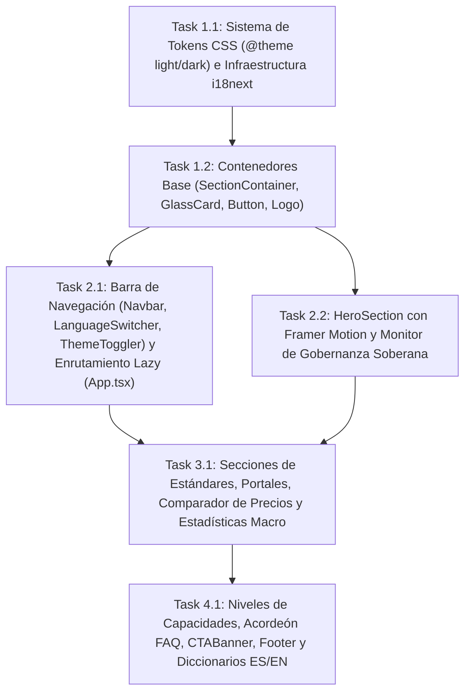

# Tasks: Portal Cívico y Landing (`portal-civico-landing`)

> 📋 Generated by `solution-designer` · 2026-10-19
> 📋 As-Built — reverse-engineered from code
> ✅ Approved by: Jeremy Michel Solano Frías (2026-10-19)

## Traceability
- **Work Item**: Pendiente (sin PBI/Feature en ADO)
- **Branch**: `dev`

## Metadata
- **Based on:** [design.md](./design.md)
- **Total estimate:** ~15h (As-Built — 100% implementado)
- **Number of waves:** 4 (Wave 1, Wave 2, Wave 3, Wave 4)
- **Number of tasks:** 6
- **Sprint:** [TBD]
- **Assignee:** Jeremy Michel Solano Frías

## Estimation Rules

See `estimation-strategy.md` for full estimation rules, AI multipliers, and architecture impact.

**Quick reference:**
- Maximum **4 hours** per task (break larger tasks into subtasks)
- Estimates include implementation + unit tests + code review
- If a task exceeds 4h during implementation, split it immediately
- Add **20% buffer** to total estimate for unknowns
- If using agentic IDEs + SDD: apply multipliers from `estimation-strategy.md` §Scenario B
- Track actual vs estimated for future calibration (see `estimation-strategy.md` §Calibration)

## Dependency Graph

---

## Wave 1: Foundation & Setup (~3.5h)

### Task 1.1: Sistema de Tokens CSS (`@theme` Light/Dark) e Infraestructura `i18next` (~2h)
- **Description:** Configurar en `app/frontend/src/index.css` los tokens tipográficos (`Manrope`, `Inter`, `JetBrains Mono`), las paletas semánticas para modo claro (*Civil Clarity*) y modo oscuro (*Sovereign Ledger* `[data-theme="dark"]` y `@media (prefers-color-scheme: dark)`), las utilidades de revelación por scroll (`.scroll-reveal`) y soporte para `prefers-reduced-motion: reduce`; e inicializar `app/frontend/src/i18n/index.ts` con `HttpBackend` (`/locales/{{lng}}/{{ns}}.json`) y `LanguageDetector` (`localStorage`).
- **Acceptance criteria:**
  - [x] Variables CSS definidas para modo claro y oscuro cumpliendo contraste WCAG 2.1 AA.
  - [x] `i18next` configurado con `fallbackLng: 'es'`, `supportedLngs: ['es', 'en']` y caché en `localStorage`.
- **Dependencies:** None
- **Files to create/modify:** `app/frontend/src/index.css`, `app/frontend/src/i18n/index.ts`

### Task 1.2: Contenedores y Primitivas UI (`SectionContainer`, `GlassCard`, `Button`, `Logo`) (~1.5h)
- **Description:** Implementar el contenedor centrado `SectionContainer.tsx` (`max-w-[1200px]`), la tarjeta translúcida `GlassCard.tsx` con soporte de resplandor (`glow`), el botón polimórfico `Button.tsx` (`primary`, `secondary`, `ghost`) sobre `@heroui/react`, y el logotipo institucional `Logo.tsx` con `MutationObserver` sobre `document.documentElement[data-theme]` para alternar entre `veedoria_logo_light.webp` y `veedoria_logo_dark.webp`.
- **Acceptance criteria:**
  - [x] `Logo.tsx` conmuta automáticamente entre los activos `.webp` claro y oscuro y desconecta el `MutationObserver` al desmontarse.
  - [x] `GlassCard` y `Button` exponen variantes tipadas reutilizables en todas las secciones de la portada.
- **Dependencies:** Task 1.1
- **Files to create/modify:** `app/frontend/src/presentation/components/SectionContainer.tsx`, `app/frontend/src/presentation/components/ui/GlassCard.tsx`, `app/frontend/src/presentation/components/ui/Button.tsx`, `app/frontend/src/presentation/components/Logo.tsx`

---

## Wave 2: Core Implementation (~4h)

### Task 2.1: Barra de Navegación (`Navbar`, `LanguageSwitcher`, `ThemeToggler`) y Enrutamiento con `React.lazy()` (`App.tsx`) (~2h)
- **Description:** Construir `Navbar.tsx` fijo en la parte superior con enlaces por perfil, integrando `LanguageSwitcher.tsx` (conmutación `es`/`en` y `aria-label` localizado) y `ThemeToggler.tsx` (`useTheme()` de `@heroui/react` con íconos `Sun`/`Moon` y `aria-label`); y estructurar `App.tsx` sirviendo `<LandingPage />` en `/` y cargando `DashboardLayout` y `AuditorPage` mediante `React.lazy()` y `<Suspense>` en `/app/bandeja`.
- **Acceptance criteria:**
  - [x] `LanguageSwitcher` y `ThemeToggler` cuentan con etiquetas `aria-label` dinámicas según el estado activo.
  - [x] El bundle de `LandingPage` no descarga las vistas privadas hasta navegar a `/app`.
- **Dependencies:** Task 1.2
- **Files to create/modify:** `app/frontend/src/presentation/components/Navbar.tsx`, `app/frontend/src/presentation/components/LanguageSwitcher.tsx`, `app/frontend/src/presentation/components/ThemeToggler.tsx`, `app/frontend/src/App.tsx`

### Task 2.2: `HeroSection` con Animaciones Escalonadas y Monitor de Gobernanza Soberana (~2h)
- **Description:** Implementar `HeroSection.tsx` en grilla de 12 columnas con animaciones de entrada vía `framer-motion` (`delay: 0.2s..0.5s`), presentando la insignia institucional, título con gradiente, subtítulo, dos CTAs y la tarjeta `GlassCard` del Monitor de Gobernanza Soberana (`RD$ 142.5 Mil Millones` monitoreados, barra de progreso `94.8%` con indicador `pulse-green` y tarjetas de alertas ejemplares `MOPC` y `SNS`).
- **Acceptance criteria:**
  - [x] Animaciones `motion.div` fluidas en escritorio y colapso responsivo a 1 columna en dispositivos móviles.
  - [x] Tarjeta del Monitor de Gobernanza Soberana renderizada con barra de transparencia al `94.8%` y alertas ejemplares.
- **Dependencies:** Task 1.2
- **Files to create/modify:** `app/frontend/src/presentation/components/HeroSection.tsx`

---

## Wave 3: UI & Integration (~3h)

### Task 3.1: Secciones de Estándares (`SocialProofSection`), Portales (`PortalsSection`), Comparador de Precios (`PriceCheckerSection`) e Indicadores (`StatsSection`) (~3h)
- **Description:** Implementar con revelación progresiva por `IntersectionObserver` (`threshold: 0.1`) el cintillo `SocialProofSection.tsx` (`OCDS`, `DGCP Datos Abiertos`, `Open Contracting`, `AI Models OS`), la grilla `PortalsSection.tsx` (`CivicTech`, `Proveedores B2B` destacado y `Auditoría B2G`), el comparador demostrativo `PriceCheckerSection.tsx` (licitación `RD$ 85,000` vs. mercado `RD$ 41,500`, gráfico comparativo `100%` vs `48.9%` y badge `+104.8%`) y la banda `StatsSection.tsx` (`RD$ 142.5B`, `2,450+`, `92.0%`, `4,120`).
- **Acceptance criteria:**
  - [x] Todos los `IntersectionObserver` ejecutan `observer.disconnect()` al desmontar el componente.
  - [x] `PriceCheckerSection` y `StatsSection` adaptan sus colores semánticos (`--market-surface`, `text-error`, `text-primary`) al tema claro u oscuro activo.
- **Dependencies:** Task 2.1, Task 2.2
- **Files to create/modify:** `app/frontend/src/presentation/components/SocialProofSection.tsx`, `app/frontend/src/presentation/components/PortalsSection.tsx`, `app/frontend/src/presentation/components/PriceCheckerSection.tsx`, `app/frontend/src/presentation/components/StatsSection.tsx`

---

## Wave 4: Testing & Polish (~2h)

### Task 4.1: Niveles de Capacidades (`PricingSection`), Acordeón `FAQSection`, `CTABanner`, `Footer` y Diccionarios `ES`/`EN` (`landing.json`) (~2h)
- **Description:** Implementar `PricingSection.tsx` (tarjetas de capacidades por perfil y nota de acceso `CivicTech` gratuito para ciudadanía y prensa), el acordeón interactivo `FAQSection.tsx` (`openIndex` para las 3 preguntas de origen de datos DGCP/OCDS, neutralidad IA y Gobernanza Soberana), el banner de conversión `CTABanner.tsx`, el pie de página `Footer.tsx` (`privacy`, `terms`, `methodology`, `contact`), y los diccionarios bilingües completos en `public/locales/es/landing.json` y `public/locales/en/landing.json`.
- **Acceptance criteria:**
  - [x] Acordeón `FAQSection` expande y colapsa suavemente (`max-height`) rotando el ícono `ChevronDown`.
  - [x] Paridad 100% de claves entre `public/locales/es/landing.json` y `public/locales/en/landing.json`, y compilación limpia con `tsc -b` y `eslint`.
- **Dependencies:** Task 3.1
- **Files to create/modify:** `app/frontend/src/presentation/components/PricingSection.tsx`, `app/frontend/src/presentation/components/FAQSection.tsx`, `app/frontend/src/presentation/components/CTABanner.tsx`, `app/frontend/src/presentation/components/Footer.tsx`, `app/frontend/public/locales/es/landing.json`, `app/frontend/public/locales/en/landing.json`

---

## Implementation Order Summary
| Order | Task | Description | Est. | Depends On |
|-------|------|-------------|------|------------|
| 1 | 1.1 | Sistema de Tokens CSS (`@theme` Light/Dark) e Infraestructura `i18next` | ~2.0h | — |
| 2 | 1.2 | Contenedores y Primitivas UI (`SectionContainer`, `GlassCard`, `Button`, `Logo`) | ~1.5h | 1.1 |
| 3 | 2.1 | Barra de Navegación (`Navbar`, `LanguageSwitcher`, `ThemeToggler`) y Enrutamiento con `React.lazy()` (`App.tsx`) | ~2.0h | 1.2 |
| 4 | 2.2 | `HeroSection` con Animaciones Escalonadas y Monitor de Gobernanza Soberana | ~2.0h | 1.2 |
| 5 | 3.1 | Secciones de Estándares (`SocialProofSection`), Portales (`PortalsSection`), Comparador (`PriceCheckerSection`) e Indicadores (`StatsSection`) | ~3.0h | 2.1, 2.2 |
| 6 | 4.1 | Niveles de Capacidades (`PricingSection`), Acordeón `FAQSection`, `CTABanner`, `Footer` y Diccionarios `ES`/`EN` (`landing.json`) | ~2.0h | 3.1 |

## Total Estimate: ~15h (includes 20% buffer)

## Completion Checklist
- [x] All tasks completed (As-Built)
- [x] All tests passing / TypeScript & ESLint clean
- [x] Documentation updated (`requirements.md`, `design.md`, `tasks.md`)

---
> 📍 Pendiente (sin PBI/Feature en ADO) · 🌿 `dev` · Generated by SDD Standard