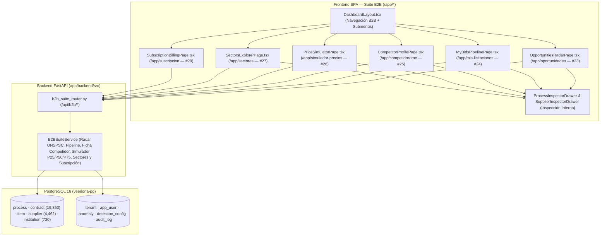
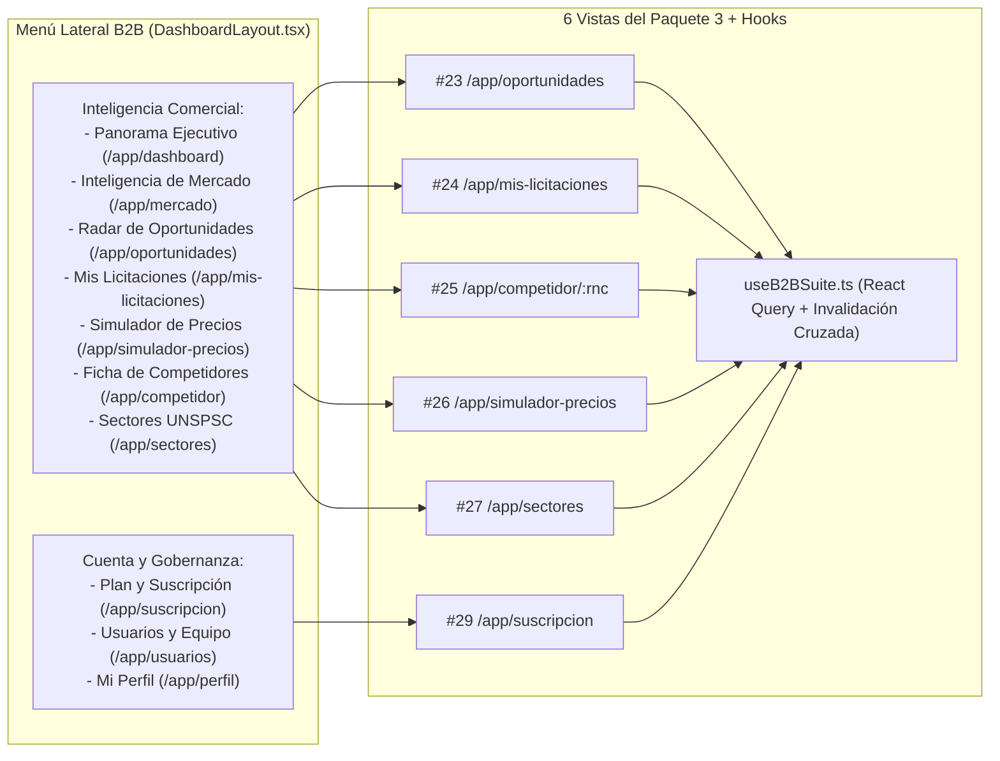

# Design: Suite de Licitaciones e Inteligencia Comercial B2B (`suite-licitaciones-b2b`)

> 📋 Generated by `solution-designer` · 2026-10-20
> ✅ Approved by: JeremyJS (2026-10-20)

## Traceability
- **Work Item**: Pendiente (sin PBI/Feature en ADO)
- **Parent**: [veedoria-core](../intake.md)
- **Branch**: `dev`
- **Requirements**: [requirements.md](./requirements.md)
- **Test Plan**: [test-plan.md](./test-plan.md)
- **Test Cases**: [test-cases.md](./test-cases.md)

## Technology Decisions
- **Frontend**: **React `^19.2.6` + TypeScript `~6.0.2` + Vite `^8.0.12` + TailwindCSS `^4.3.1` + TanStack React Query `^5.99.0` + `react-router-dom` `^7.14.0` + `lucide-react` `^1.16.0`** — Implementa las **6 vistas especializadas del Paquete 3 (Consola B2B: Inteligencia de Licitaciones y Suscripción Empresarial, Pantallas `#23`, `#24`, `#25`, `#26`, `#27` y `#29` del Mapa de 36 Pantallas)** con cabeceras limpias sin badges decorativos ni repetición de alcance/plan, integradas en el menú lateral (`DashboardLayout.tsx`), conectadas a los inspectores laterales internos (`ProcessInspectorDrawer` y `SupplierInspectorDrawer`) y protegidas con `RequireAuth`:
  1. `OpportunitiesRadarPage.tsx` (`/app/oportunidades` — `#23` Radar de Oportunidades y Alertas por Rubro UNSPSC).
  2. `MyBidsPipelinePage.tsx` (`/app/mis-licitaciones` — `#24` Seguimiento de Mis Licitaciones y Pipeline Comercial Kanban/Tabla).
  3. `CompetitorProfilePage.tsx` (`/app/competidor/:rnc` y `/app/competidor` — `#25` Ficha Forense y Comercial de Competidor con candado en `B2B_PYME`).
  4. `PriceSimulatorPage.tsx` (`/app/simulador-precios` — `#26` Simulador de Precios de Oferta, Cuartiles `P25/P50/P75` e Índice de Competitividad).
  5. `SectorsExplorerPage.tsx` (`/app/sectores` — `#27` Explorador de Sectores e Instituciones Compradoras y Configuración de Rubros UNSPSC).
  6. `SubscriptionBillingPage.tsx` (`/app/suscripcion` — `#29` Gestión de Plan, Cuotas en Tiempo Real y Suscripción Empresarial).
- **Backend**: **Python `3.12+` / `3.14` + FastAPI `^0.135.3` + SQLModel / SQLAlchemy Async `^2.0.49` (`asyncpg` / `aiosqlite`)** — Crea `app/backend/src/services/b2b_suite_service.py` y `app/backend/src/presentation/routers/b2b_suite_router.py` exponiendo los endpoints bajo `/api/b2b/*` con aislamiento estricto por organización (`tenant_id`, `supplier_rpe`, `plan_tier`).
- **Database**: **PostgreSQL 16 (`veedoria-pg`) y SQLite Async (`aiosqlite` en tests)** — Opera directamente sobre las tablas existentes (`process`, `contract`, `item`, `supplier`, `institution`, `anomaly`, `detection_config`, `tenant`, `app_user`, `audit_log`) sin requerir migraciones destructivas. El estado del pipeline comercial (`entity_type = "B2B_WATCHLIST"`) y los rubros UNSPSC monitoreados (`entity_type = "B2B_SECTORS"`) se persisten por `tenant_id` sobre `audit_log` con semilla inicial automática basada en el `supplier_rpe` real de la organización (ej. `CONSTRUCTORA-B2B`, RPE `132993`), mientras que el cambio de plan en `/app/suscripcion` actualiza directamente `tenant.plan_tier` y `tenant.max_categorias_unspsc` con traza inmutable en `audit_log`.
- **Cloud Services**: Despliegue contenedorizado Docker / Render (API FastAPI + PostgreSQL 16) y Vercel (SPA React).
- **Theme**: `govtech` (*El Observatorio Dominicano* — `design-system-theme.md`), encabezados limpios, cero badges decorativos sobre títulos, cero pestañas redundantes con el sidebar y navegación 100% interna dentro de `/app/*`.

## Architecture

### System Overview


### Component Diagram


## Deployment
- **Pattern**: `monorepo-split`
- **App**: Vercel (`app/frontend`) + Render / Docker (`app/backend`)
- **Infra**: Docker Compose (`veedoria-api`, `veedoria-worker`, `veedoria-pg`, `veedoria-redis`)
- **CI/CD**: GitHub Actions + validaciones estáticas (`ruff`, `pytest`, `tsc -b`, `eslint`, `vite build`)
- **Justification**: Mantiene la arquitectura limpia del monorepo sin introducir servicios externos adicionales ni latencia entre bases de datos.
- **Discarded**: Microservicio separado para inferencia de precios B2B (descartado por sobrecosto operativo e innecesario dado que SQLAlchemy Async calcula los cuartiles sobre `item` y `contract` en `< 50ms`).

### Environments
| Environment | URL | Deploy trigger |
|-------------|-----|----------------|
| Local / Dev | `http://localhost:5173` (UI) · `http://localhost:8000` (API) | `docker compose up` / rama `dev` |
| Production | Vercel (Frontend) · Render (Backend FastAPI) | Merge aprobado a `main` |

## Database Schema

### Table: `tenants` (`app/backend/src/models/auth.py` — Existente, utilizada para Cuotas y Suscripción)
| Column | Type | Constraints | Default | Description |
|--------|------|------------|---------|-------------|
| `id` | `int` | PK | Auto-increment | Identificador interno del tenant (`CONSTRUCTORA-B2B`, etc.) |
| `codigo` | `varchar(50)` | UNIQUE, NOT NULL | — | Código único de la organización (`CONSTRUCTORA-B2B`) |
| `nombre` | `varchar(255)` | NOT NULL | — | Razón social o nombre institucional |
| `tipo` | `varchar(50)` | NOT NULL | `'B2B_SUPPLIER'` | Segmento (`B2B_SUPPLIER`, `GOV_INSTITUTION`, `GOV_OVERSIGHT`, `PLATFORM`) |
| `plan_tier` | `varchar(50)` | NOT NULL | `'B2B_PYME'` | Nivel de plan (`B2B_PYME`, `B2B_CORPORATE`, etc.) |
| `supplier_rpe` | `varchar(50)` | NULLABLE, IDX | `NULL` | RPE del proveedor en la DGCP (`132993` para `CONSTRUCTORA-B2B`) |
| `max_categorias_unspsc` | `int` | NOT NULL | `3` | Límite de rubros UNSPSC activos (`3` en `B2B_PYME`, `9999` en `B2B_CORPORATE`) |
| `estado` | `varchar(30)` | NOT NULL | `'ACTIVO'` | Estado operativo de la suscripción |

### Table: `audit_log` (`app/backend/src/models/audit_log.py` — Existente, Persistencia Estructurada por Tenant)
| Column | Type | Constraints | Default | Description |
|--------|------|------------|---------|-------------|
| `id` | `int` | PK | Auto-increment | Identificador del registro |
| `action_type` | `varchar(50)` | NOT NULL, IDX | — | `B2B_BID_UPSERT`, `B2B_BID_DELETE`, `B2B_SECTORS_UPDATE`, `B2B_PLAN_CHANGE` |
| `user_id` | `varchar(36)` | NULLABLE, IDX | `NULL` | Usuario que ejecutó la acción |
| `entity_type` | `varchar(50)` | NOT NULL | — | `B2B_WATCHLIST:{tenant_id}`, `B2B_SECTORS:{tenant_id}`, `B2B_SUBSCRIPTION:{tenant_id}` |
| `entity_id` | `varchar(100)` | NOT NULL | — | ID de la postulación (`bid_id`) o código de configuración |
| `old_value` | `json` | NULLABLE | `NULL` | Estado previo |
| `new_value` | `json` | NULLABLE | `NULL` | Payload JSON con etapa comercial, monto ofertado, notas o rubros UNSPSC |
| `timestamp` | `datetime` | NOT NULL, IDX | `UTC now` | Fecha y hora exacta |

### Indexes
| Name | Columns | Type |
|------|---------|------|
| `ix_item_unspsc_family` | `item(unspsc_family)` | B-Tree (Existente — acelera cuartiles y sectores) |
| `ix_item_unspsc_code` | `item(unspsc_code)` | B-Tree (Existente — acelera simulador de precios) |
| `ix_contract_rpe` | `contract(rpe)` | B-Tree (Existente — acelera ficha de competidor y perfil B2B) |
| `ix_audit_log_action_type` | `audit_log(action_type)` | B-Tree (Existente — acelera lectura de pipeline y rubros por tenant) |

## API Contracts

### `GET /api/b2b/opportunities` (`REQ-001` — Pantalla `#23 /app/oportunidades`)
- **Request**: Query params `?unspsc_family=&institution_id=&modality=&q=&only_high_affinity=false&page=1&limit=20`
- **Response (`200 OK`)**:
```json
{
  "data": {
    "kpis": {
      "total_opportunities": 148,
      "sector_total_amount_dop": 642500000.0,
      "avg_affinity_score": 84.5,
      "monitored_families_count": 4,
      "max_families_allowed": 9999
    },
    "monitored_families": [
      { "code": "7214", "label": "Rubro 7214 — Construcción Pesada y Obras Viales" },
      { "code": "3011", "label": "Rubro 3011 — Hormigón, Cemento y Yeso" }
    ],
    "items": [
      {
        "process_id": 102,
        "process_code": "MOPC-CCC-LPN-2025-0014",
        "title": "Rehabilitación de Caminos Vecinales y Obras de Drenaje",
        "institution_id": 14,
        "institution_name": "Ministerio de Obras Públicas y Comunicaciones (MOPC)",
        "modality": "Licitación Pública Nacional",
        "unspsc_family": "7214",
        "unspsc_label": "Rubro 7214 — Construcción Pesada y Obras Viales",
        "reference_amount_dop": 18450000.0,
        "published_date": "2025-11-10",
        "affinity_score": 92,
        "competition_level": "MEDIA",
        "historical_competitors_count": 4,
        "in_watchlist": true,
        "watchlist_stage": "EN_PREPARACION"
      }
    ],
    "total": 148,
    "page": 1,
    "limit": 20
  }
}
```
- **Auth**: JWT requerido (`B2B_ANALYTICS`, tipos `B2B_SUPPLIER`, `GOV_OVERSIGHT`, `PLATFORM`).
- **Errors**: `401 Unauthorized`, `403 Forbidden`.
- **Maps to**: `REQ-001`

### `GET /api/b2b/bids`, `POST /api/b2b/bids`, `PUT /api/b2b/bids/{bid_id}` & `DELETE /api/b2b/bids/{bid_id}` (`REQ-002` — Pantalla `#24 /app/mis-licitaciones`)
- **Request (`POST /api/b2b/bids` / `PUT /api/b2b/bids/{bid_id}`)**:
```json
{
  "process_id": 102,
  "process_code": "MOPC-CCC-LPN-2025-0014",
  "stage": "EN_PREPARACION",
  "bid_amount_dop": 16800000.0,
  "priority": "ALTA",
  "notes": "Oferta ajustada al P40 del simulador UNSPSC 7214. Pendiente certificación DGII."
}
```
- **Response (`200 OK` en `GET /api/b2b/bids`)**:
```json
{
  "data": {
    "plan_tier": "B2B_CORPORATE",
    "active_limit": 9999,
    "kpis": {
      "total_tracked": 6,
      "pipeline_amount_dop": 74200000.0,
      "submitted_count": 2,
      "awarded_count": 1,
      "win_rate_pct": 33.3
    },
    "stages": ["GUARDADA", "EN_PREPARACION", "OFERTA_ENVIADA", "ADJUDICADA", "NO_ADJUDICADA"],
    "items": [
      {
        "bid_id": "bid-102",
        "process_id": 102,
        "process_code": "MOPC-CCC-LPN-2025-0014",
        "title": "Rehabilitación de Caminos Vecinales",
        "institution_name": "Ministerio de Obras Públicas y Comunicaciones (MOPC)",
        "unspsc_family": "7214",
        "stage": "EN_PREPARACION",
        "priority": "ALTA",
        "reference_amount_dop": 18450000.0,
        "bid_amount_dop": 16800000.0,
        "notes": "Oferta ajustada al P40 del simulador UNSPSC 7214.",
        "updated_at": "2026-10-20T21:00:00Z"
      }
    ]
  }
}
```
- **Auth**: JWT requerido (`B2B_ANALYTICS`), aislado por `current_user["tenant"]["id"]`.
- **Errors**: `403 Plan Quota Exceeded` si `plan_tier == "B2B_PYME"` e intenta superar `10` procesos en seguimiento activo; `404 Not Found`.
- **Maps to**: `REQ-002`

### `GET /api/b2b/competitors` & `GET /api/b2b/competitors/{rnc}` (`REQ-003` — Pantalla `#25 /app/competidor/:rnc`)
- **Request**: `GET /api/b2b/competitors?q=` (buscador/selector rápido de competidores del sector) y `GET /api/b2b/competitors/{rnc}` (ficha completa por RNC o RPE).
- **Response (`200 OK`)**:
```json
{
  "data": {
    "supplier": {
      "rnc": "132993",
      "rpe": "132993",
      "name": "Constructora & Suministros del Caribe, S.R.L.",
      "status": "ACTIVO",
      "is_mipyme": false,
      "province": "SANTO DOMINGO"
    },
    "kpis": {
      "contracts_won": 28,
      "total_adjudicated_dop": 194500000.0,
      "avg_contract_dop": 6946428.5,
      "institutions_count": 7,
      "anomalies_count": 2
    },
    "top_institutions": [
      { "institution_id": 14, "institution_name": "MOPC", "contracts_count": 11, "total_amount_dop": 98400000.0 }
    ],
    "recent_contracts": [
      {
        "process_id": 102,
        "process_code": "MOPC-CCC-LPN-2025-0014",
        "contract_id": "CONT-2025-088",
        "title": "Suministro de Hormigón Asfáltico",
        "institution_name": "MOPC",
        "amount_dop": 14200000.0,
        "signed_date": "2025-09-18"
      }
    ],
    "forensic_intelligence": {
      "locked": false,
      "required_plan_label": null,
      "shared_unspsc_pricing": [
        {
          "unspsc_family": "7214",
          "unspsc_label": "Rubro 7214 — Construcción Pesada",
          "competitor_median_unit_price_dop": 4650.0,
          "market_median_unit_price_dop": 4900.0,
          "price_delta_pct": -5.1,
          "contracts_in_family": 9
        }
      ],
      "risk_flags": [
        {
          "anomaly_id": "anom-1",
          "process_id": 102,
          "process_code": "MOPC-CCC-LPN-2025-0014",
          "anomaly_type": "COLLUSION",
          "severity": 0.78,
          "status": "PENDING",
          "description": "Co-participación recurrente detectada en el mismo bloque de procesos."
        }
      ]
    }
  }
}
```
- **Auth**: JWT requerido (`B2B_ANALYTICS`). Si `plan_tier == "B2B_PYME"`, `forensic_intelligence.locked = true` con `shared_unspsc_pricing: []` y `risk_flags: []`.
- **Errors**: `401 Unauthorized`, `403 Forbidden`.
- **Maps to**: `REQ-003`

### `GET /api/b2b/price-simulator/catalog` & `POST /api/b2b/price-simulator` (`REQ-004` — Pantalla `#26 /app/simulador-precios`)
- **Request (`POST /api/b2b/price-simulator`)**:
```json
{
  "unspsc_family": "7214",
  "proposed_unit_price_dop": 4450.0,
  "quantity": 120.0,
  "institution_id": null
}
```
- **Response (`200 OK`)**:
```json
{
  "data": {
    "unspsc_family": "7214",
    "unspsc_label": "Rubro 7214 — Construcción Pesada y Obras Viales",
    "unit_label": "Unidad / Servicio",
    "sample_size": 142,
    "proposed_unit_price_dop": 4450.0,
    "quantity": 120.0,
    "projected_total_dop": 534000.0,
    "distribution": {
      "min_dop": 1850.0,
      "p25_dop": 3900.0,
      "median_p50_dop": 4800.0,
      "p75_dop": 6100.0,
      "max_dop": 11200.0,
      "avg_dop": 5120.0
    },
    "competitiveness_index": 88,
    "win_probability_pct": 79.5,
    "deviation_vs_median_pct": -7.29,
    "risk_band": "OPTIMA_COMPETITIVA",
    "risk_band_label": "Oferta Altamente Competitiva (Banda Óptima P25–P50)",
    "legal_advisory": "Precio alineado con el principio de razonabilidad económica (Arts. 96–97 Reg. 416-23), un 7.3% por debajo de la mediana histórica sin incurrir en presunción de baja temeraria.",
    "institution_breakdown_locked": false,
    "reference_contracts": [
      {
        "process_id": 102,
        "process_code": "MOPC-CCC-LPN-2025-0014",
        "institution_name": "MOPC",
        "supplier_name": "Constructora & Suministros del Caribe, S.R.L.",
        "unit_price_dop": 4650.0,
        "total_amount_dop": 558000.0,
        "signed_date": "2025-09-18"
      }
    ]
  }
}
```
- **Auth**: JWT requerido (`B2B_ANALYTICS`).
- **Errors**: `422 Unprocessable Entity` si `proposed_unit_price_dop <= 0` o `quantity <= 0`.
- **Maps to**: `REQ-004`

### `GET /api/b2b/sectors` & `PUT /api/b2b/sectors` (`REQ-005` — Pantalla `#27 /app/sectores`)
- **Request (`PUT /api/b2b/sectors`)**:
```json
{
  "monitored_families": ["7214", "3011", "4321"]
}
```
- **Response (`200 OK`)**:
```json
{
  "data": {
    "plan_tier": "B2B_CORPORATE",
    "max_families_allowed": 9999,
    "monitored_families": ["7214", "3011", "4321"],
    "sectors": [
      {
        "unspsc_family": "7214",
        "label": "Rubro 7214 — Construcción Pesada y Obras Viales",
        "is_monitored": true,
        "total_contracts": 310,
        "total_amount_dop": 1420000000.0,
        "suppliers_count": 64,
        "median_unit_price_dop": 4800.0,
        "top_institution_name": "Ministerio de Obras Públicas y Comunicaciones (MOPC)",
        "competition_density": "MEDIA"
      }
    ]
  }
}
```
- **Auth**: JWT requerido (`B2B_ANALYTICS`).
- **Errors**: `403 Plan Quota Exceeded` si `plan_tier == "B2B_PYME"` y `len(monitored_families) > 3`.
- **Maps to**: `REQ-005`

### `GET /api/b2b/subscription` & `PUT /api/b2b/subscription` (`REQ-006` — Pantalla `#29 /app/suscripcion`)
- **Request (`PUT /api/b2b/subscription`)**:
```json
{
  "target_plan_tier": "B2B_CORPORATE",
  "billing_cycle": "ANUAL"
}
```
- **Response (`200 OK`)**:
```json
{
  "data": {
    "tenant": {
      "id": 5,
      "codigo": "CONSTRUCTORA-B2B",
      "nombre": "Constructora & Suministros del Caribe, S.R.L.",
      "tipo": "B2B_SUPPLIER",
      "plan_tier": "B2B_CORPORATE",
      "plan_label": "Plan Proveedor Corporativo",
      "supplier_rpe": "132993",
      "status": "ACTIVO",
      "billing_cycle": "ANUAL",
      "next_renewal_date": "2027-10-20"
    },
    "usage": {
      "monitored_families_used": 4,
      "monitored_families_limit": 9999,
      "active_bids_used": 6,
      "active_bids_limit": 9999,
      "team_members_used": 1,
      "team_members_limit": 25
    },
    "available_plans": [
      {
        "plan_tier": "B2B_PYME",
        "name": "Plan Proveedor PyME",
        "price_monthly_dop": 4900,
        "max_families": 3,
        "max_active_bids": 10,
        "forensic_competitor_access": false
      },
      {
        "plan_tier": "B2B_CORPORATE",
        "name": "Plan Proveedor Corporativo",
        "price_monthly_dop": 14900,
        "max_families": 9999,
        "max_active_bids": 9999,
        "forensic_competitor_access": true
      }
    ],
    "history": [
      {
        "event_id": 41,
        "action": "Actualización a Plan Proveedor Corporativo",
        "actor": "proveedor@constructora.do",
        "timestamp": "2026-10-20T21:15:00Z"
      }
    ]
  }
}
```
- **Auth**: `GET` abierto a cualquier usuario autenticado; `PUT` requiere `TENANT_ADMIN`, `PROVEEDOR` titular o `PLATFORM_ADMIN`.
- **Errors**: `403 Forbidden`, `422 Unprocessable Entity`.
- **Maps to**: `REQ-006`

## Metodología Analítica y Fórmulas de Inteligencia Comercial B2B

### 1. Fórmulas del Simulador de Precios Competitivos (`/app/simulador-precios` — `REQ-004`)
Para un código de familia UNSPSC $F$ con precios unitarios históricos ordenados $P_1 \le P_2 \le \dots \le P_n$ ($P_i > 0$):
1. **Cuartiles Estadísticos**:
   - $P_{25} = P_{\max(1, \lfloor 0.25 \cdot n \rfloor)}$
   - $\text{Mediana } (P_{50}) = P_{\max(1, \lfloor 0.50 \cdot n \rfloor)}$
   - $P_{75} = P_{\max(1, \lfloor 0.75 \cdot n \rfloor)}$
   - $\text{Rango Intercuartílico (IQR)} = \max(P_{75} - P_{25}, 0.10 \cdot P_{50})$
2. **Desviación Relativa frente a la Mediana**:
   $$\Delta_{\%} = \left( \frac{P_{\text{oferta}} - P_{50}}{P_{50}} \right) \times 100$$
3. **Clasificación en 4 Bandas Técnicas y Normativas (Ley 340-06 y Decreto 416-23)**:
   - **Riesgo de Baja Temeraria (`BAJA_TEMERARIA`)**: Cuando $P_{\text{oferta}} < 0.70 \cdot P_{25}$ (o $\Delta_{\%} < -35\%$). Advierte riesgo de descalificación técnica o solicitud de subsanación económica de costos conforme al principio de razonabilidad del precio (Arts. 96–97 del Reglamento 416-23).
   - **Banda Óptima Competitiva (`OPTIMA_COMPETITIVA`)**: Cuando $0.70 \cdot P_{25} \le P_{\text{oferta}} \le P_{50}$. Posiciona la oferta con máxima ventaja económica dentro del rango histórico de adjudicación.
   - **Zona Media de Mercado (`ZONA_MEDIA_MERCADO`)**: Cuando $P_{50} < P_{\text{oferta}} \le P_{75}$. Oferta viable pero sujeta a superación por competidores que oferten cerca de $P_{25}\text{–}P_{50}$.
   - **Riesgo de Sobreprecio / Fuera de Mercado (`RIESGO_SOBREPRECIO`)**: Cuando $P_{\text{oferta}} > P_{75}$ (especialmente si $\Delta_{\%} \ge \text{PRICE\_VARIATION\_PCT\_THRESHOLD}$ de `DetectionConfig`). Advierte baja probabilidad de adjudicación y riesgo de alerta preventiva por sobreprecio (Art. 3 Ley 340-06).
4. **Índice de Competitividad (`0–100`) y Probabilidad Estimada de Adjudicación (`%`)**:
   - Punto ideal de referencia: $P^* = 0.5 \cdot (P_{25} + P_{50})$.
   - En banda óptima ($0.70 \cdot P_{25} \le P_{\text{oferta}} \le P_{50}$): $\text{Índice} \in [80, 96]$ y $\text{Probabilidad} \in [72\%, 89\%]$.
   - En zona media ($P_{50} < P_{\text{oferta}} \le P_{75}$): decaimiento lineal hacia $\text{Índice} \in [52, 79]$ y $\text{Probabilidad} \in [38\%, 70\%]$.
   - En baja temeraria o sobreprecio: penalización progresiva ($\text{Índice} \in [12, 48]$ y $\text{Probabilidad} \in [8\%, 34\%]$).

### 2. Algoritmo de Puntaje de Afinidad en el Radar de Oportunidades (`/app/oportunidades` — `REQ-001`)
Para cada proceso con familia UNSPSC $f_p$, institución $I_p$ y monto $M_p$:
$$\text{Affinity Score} = \min\left(99, \; B_{\text{unspsc}}(f_p) + B_{\text{inst}}(I_p) + B_{\text{escala}}(M_p)\right)$$
- $B_{\text{unspsc}}(f_p) = 60$ si $f_p$ pertenece a los rubros UNSPSC activos monitoreados por la organización (`monitored_families`); $30$ en caso contrario.
- $B_{\text{inst}}(I_p) = 20$ si el proveedor (`supplier_rpe`) posee adjudicaciones históricas previas con la institución $I_p$; $10$ en caso contrario.
- $B_{\text{escala}}(M_p) = 15$ si el monto del proceso se encuentra dentro del rango operativo histórico del proveedor (`0.25x` a `2.5x` su contrato promedio); $8$ en caso contrario.

## Design Coherence
| Check | Result | Action |
|-------|--------|--------|
| Layout variety | ✅ 6 estructuras diferenciadas por función comercial | Radar con tarjetas de afinidad + tabla de acciones rápidas (`#23`), Tablero Kanban de 5 columnas + conmutador tabular (`#24`), Ficha dividida de expediente forense/comercial (`#25`), Laboratorio interactivo de simulación con regla visual de cuartiles (`#26`), Cuadrícula de sectores con interruptores de monitoreo (`#27`), y Consola de cuotas y planes (`#29`) |
| Theme compliance | ✅ 100% alineado con `govtech` (`design-system-theme.md`) | Encabezados limpios sin badges decorativos, sin repetición de alcance/plan y sin pestañas redundantes |
| Visual hierarchy | ✅ Progresión clara Descubrimiento → Simulación → Cartera → Cuenta | Flujo conectado mediante botones de acción directa e inspectores laterales |
| Shared components | ✅ Reutilización completa | Usa `DashboardLayout.tsx`, `ProcessInspectorDrawer`, `SupplierInspectorDrawer` y `RequireAuth` |
| Anti-patterns | ✅ Ninguno detectado | Cero enlaces de fuga a `/public/*`, cero jerga técnica de infraestructura y cero organizaciones ficticias |

## Requirements Coverage
| REQ | Covered by | Status |
|-----|-----------|--------|
| `REQ-001` | `GET /api/b2b/opportunities` + `OpportunitiesRadarPage.tsx` (`/app/oportunidades`) | ✅ |
| `REQ-002` | `GET/POST/PUT/DELETE /api/b2b/bids` + `MyBidsPipelinePage.tsx` (`/app/mis-licitaciones`) | ✅ |
| `REQ-003` | `GET /api/b2b/competitors` & `GET /api/b2b/competitors/{rnc}` + `CompetitorProfilePage.tsx` (`/app/competidor/:rnc`) | ✅ |
| `REQ-004` | `GET /api/b2b/price-simulator/catalog` & `POST /api/b2b/price-simulator` + `PriceSimulatorPage.tsx` (`/app/simulador-precios`) | ✅ |
| `REQ-005` | `GET/PUT /api/b2b/sectors` + `SectorsExplorerPage.tsx` (`/app/sectores`) | ✅ |
| `REQ-006` | `GET/PUT /api/b2b/subscription` + `SubscriptionBillingPage.tsx` (`/app/suscripcion`) | ✅ |
| `NFR-001` | Higiene visual `govtech` + navegación interna con `ProcessInspectorDrawer` y `SupplierInspectorDrawer` | ✅ |
| `NFR-002` | Aislamiento por `tenant_id` en `B2BSuiteService` y `b2b_suite_router.py` | ✅ |
| `NFR-003` | Consultas agregadas optimizadas sobre índices `ix_item_unspsc_family` e `ix_contract_rpe` | ✅ |

## Architecture Updates
Al completar la implementación del Paquete 3 se actualizarán de forma acumulativa los documentos globales oficiales en `docs/architecture/`:
- `docs/architecture/system-design.md`: Incorporación de `B2BSuiteService`, las 6 pantallas de la Suite B2B y las fórmulas matemáticas del Simulador de Precios Competitivos (`P25`, `P50`, `P75`) y del Radar de Oportunidades.
- `docs/architecture/api-contract.md`: Documentación de los endpoints bajo `/api/b2b/*`.
- `docs/architecture/data-model.md`: Registro del esquema de persistencia multi-tenant de cartera comercial y rubros UNSPSC monitoreados.
- `docs/architecture/security-model.md`: Matriz de cuotas y candados entre `B2B_PYME` y `B2B_CORPORATE`.

## Approval
- [x] Developer: JeremyJS Date: 2026-10-20

---
> 📍 Pendiente (sin PBI/Feature en ADO) · 🌿 `dev` · Generated by SDD Standard

