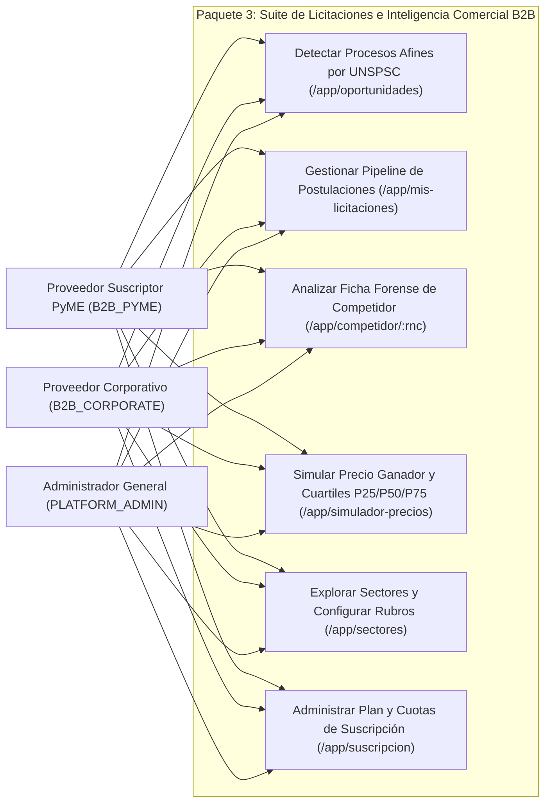
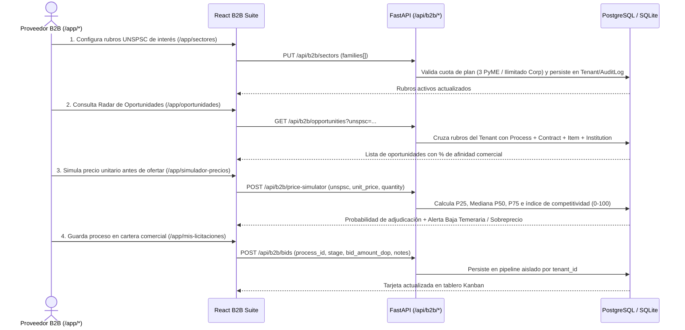

# Requirements: Suite de Licitaciones e Inteligencia Comercial B2B (`suite-licitaciones-b2b`)

> 📋 Generated by `requirements-analyst` · 2026-10-20
> ✅ Approved by: JeremyJS (2026-10-20)

## Traceability
- **Work Item**: Pendiente (sin PBI/Feature en ADO)
- **Parent**: [veedoria-core](../intake.md)
- **Branch**: `dev`
- **Design**: [design.md](./design.md)
- **Test Plan**: [test-plan.md](./test-plan.md)
- **Test Cases**: [test-cases.md](./test-cases.md)

## Overview
Este módulo implementa las **6 pantallas especializadas del Paquete 3 (Consola B2B: Inteligencia de Licitaciones y Suscripción Empresarial)** definidas en el Mapa Completo de 36 Pantallas (`#23`, `#24`, `#25`, `#26`, `#27` y `#29`), dotando a las empresas proveedoras del Estado (`B2B_SUPPLIER` en planes `B2B_PYME` y `B2B_CORPORATE`), así como a los administradores de plataforma (`PLATFORM_ADMIN`) y órganos de supervisión (`GOV_OVERSIGHT`), de un flujo comercial de extremo a extremo sobre datos reales de contrataciones públicas:
1. **Radar de Oportunidades y Alertas por Rubro UNSPSC (`/app/oportunidades` — `#23`)**: Cruce automatizado entre los rubros UNSPSC monitoreados por la organización suscriptora y los procesos de contratación del Estado, calculando un índice de afinidad comercial (`0–100%`), nivel de competencia estimado, filtros por institución compradora, modalidad DGCP y rubro, con acciones directas para inspeccionar el expediente en `ProcessInspectorDrawer`, enviar al pipeline de postulaciones o simular precio de oferta.
2. **Seguimiento de Mis Licitaciones y Postulaciones (`/app/mis-licitaciones` — `#24`)**: Tablero de gestión de cartera comercial (vista Kanban y vista tabular) aislado estrictamente por `tenant_id`, estructurado en 5 etapas (`GUARDADA`, `EN_PREPARACION`, `OFERTA_ENVIADA`, `ADJUDICADA`, `NO_ADJUDICADA`), con registro de monto ofertado en `RD$`, prioridad, notas estratégicas internas y acceso al expediente completo sin salir de `/app/*`.
3. **Ficha Forense y Comercial de Competidor (`/app/competidor/:rnc` y `/app/competidor` — `#25`)**: Perfil analítico de empresas competidoras inscritas en el RPE/DGCP que incluye buscador y selector rápido de competidores, métricas de contratos ganados, volumen adjudicado en `RD$`, instituciones compradoras recurrentes, comparativa de precios unitarios en rubros UNSPSC compartidos e historial de alertas preventivas (`Anomaly` de sobreprecio, fraccionamiento o colusión), aplicando candado diferenciado para cuentas en `B2B_PYME`.
4. **Simulador de Precios de Oferta e Índice de Competitividad (`/app/simulador-precios` — `#26`)**: Motor de inferencia estadística por familia/rubro UNSPSC que contrasta el precio unitario y cantidad propuestos por el oferente frente a la distribución histórica real de adjudicaciones (`Mínimo`, `Percentil P25`, `Mediana P50`, `Percentil P75`, `Máximo`), calculando el **Índice de Competitividad (`0–100`)**, la **Probabilidad Estimada de Adjudicación (%)** y las alertas preventivas de **Baja Temeraria** o **Sobreprecio fuera de mercado**.
5. **Explorador de Sectores e Instituciones Compradoras (`/app/sectores` — `#27`)**: Catálogo analítico de sectores y familias UNSPSC del Estado Dominicano con volumen transaccional acumulado, cantidad de contratos, precio mediano e instituciones públicas líderes por sector, permitiendo a la empresa suscriptora activar o desactivar sus rubros UNSPSC monitoreados (respetando el tope de `3` rubros en `B2B_PYME` y rubros ilimitados en `B2B_CORPORATE`).
6. **Gestión de Plan y Suscripción Empresarial (`/app/suscripcion` — `#29`)**: Consola de estado de cuenta, facturación y gobierno de suscripción que muestra el plan activo (`B2B_PYME` vs. `B2B_CORPORATE`, o el plan institucional correspondiente), medidores de consumo de cuotas en tiempo real (rubros UNSPSC activos, procesos en pipeline, usuarios de la organización), matriz comparativa de capacidades y conmutación/actualización de plan con persistencia en base de datos y registro en `AuditLog`.

## User Stories (EARS Notation)

### REQ-001: Radar de Oportunidades y Alertas por Rubro UNSPSC (`/app/oportunidades` — `#23`)
**Type:** Event-Driven
**Rule:** WHEN un usuario con acceso B2B (`B2B_SUPPLIER`, `GOV_OVERSIGHT` o `PLATFORM_ADMIN`) consulta `/app/oportunidades`, the system SHALL cruzar los códigos de familia UNSPSC configurados o históricos de la organización (`supplier_rpe` / rubros monitoreados) con el catálogo de procesos y contratos (`Process`, `Contract`, `Item`, `Institution`), calculando un **Puntaje de Afinidad Comercial (`0–100%`)**, clasificando la ventana de oportunidad y permitiendo filtrar por rubro UNSPSC, institución compradora, modalidad de contratación y búsqueda textual, así como agregar cualquier proceso con un clic a `/app/mis-licitaciones` o abrir su simulación en `/app/simulador-precios`.
**Entities:** `Process`, `Contract`, `Item`, `Institution`, `Tenant`
**Error Handling:** Si los filtros aplicados no arrojan procesos coincidentes, el sistema presenta un estado vacío claro con opción de restablecer filtros o ampliar la búsqueda a todos los sectores del catálogo.

**Acceptance Criteria:**
- [x] Given un usuario de una empresa proveedora suscrita (`B2B_SUPPLIER`, como `CONSTRUCTORA-B2B` o cualquier proveedor en `B2B_PYME` / `B2B_CORPORATE`), when accede a `/app/oportunidades`, then visualiza los KPIs superiores (*Oportunidades en sus Rubros*, *Monto Estimado del Sector*, *Afinidad Promedio*, *Rubros Monitoreados*) y el listado de procesos enriquecido con código DGCP, institución, rubro UNSPSC, monto de referencia en `RD$`, nivel de competencia y porcentaje de afinidad.
- [x] Given una fila en `/app/oportunidades`, when el usuario pulsa *"Guardar en Mis Licitaciones"* o *"Inspeccionar Proceso"*, then el proceso se incorpora inmediatamente a su pipeline comercial o se abre en el inspector interno `ProcessInspectorDrawer` sin abandonar `/app/*`.

**Priority:** Must
**Dependencies:** None
**Tracker:** Pendiente

### REQ-002: Seguimiento de Mis Licitaciones y Pipeline Comercial (`/app/mis-licitaciones` — `#24`)
**Type:** Event-Driven
**Rule:** WHEN un usuario gestiona su cartera de licitaciones en `/app/mis-licitaciones`, the system SHALL mostrar y persistir por organización (`tenant_id`) los procesos de contratación en seguimiento organizados en cinco etapas comerciales (`GUARDADA`, `EN_PREPARACION`, `OFERTA_ENVIADA`, `ADJUDICADA`, `NO_ADJUDICADA`), permitiendo alternar entre vista de tablero Kanban y tabla ejecutiva, actualizar la etapa de postulación, registrar el monto ofertado estimado en `RD$`, definir nivel de prioridad (`ALTA`, `MEDIA`, `BAJA`), documentar notas estratégicas privadas y eliminar postulaciones descartadas con trazabilidad en base de datos.
**Entities:** `Process`, `Contract`, `Institution`, `Tenant`, `AuditLog`
**Error Handling:** Si una organización en `B2B_PYME` supera el límite de procesos activos simultáneos en su pipeline (`10` procesos en seguimiento para `B2B_PYME` vs. ilimitados en `B2B_CORPORATE`), el sistema informa el límite de cuota con enlace directo a `/app/suscripcion`.

**Acceptance Criteria:**
- [x] Given un proveedor autenticado, when accede a `/app/mis-licitaciones`, then visualiza únicamente las postulaciones de su propia organización (`tenant_id`), con totalizadores por etapa, monto total en cartera en `RD$` y tasa de éxito comercial.
- [x] Given un proceso en el pipeline, when el usuario cambia su estado (ej. de `EN_PREPARACION` a `OFERTA_ENVIADA`), actualiza el monto ofertado o edita la nota comercial interna, then el cambio se persiste en base de datos y actualiza los indicadores del tablero en tiempo real.

**Priority:** Must
**Dependencies:** REQ-001
**Tracker:** Pendiente

### REQ-003: Ficha Forense y Comercial de Competidor (`/app/competidor/:rnc` — `#25`)
**Type:** State-Driven
**Rule:** WHILE un usuario consulta `/app/competidor/:rnc` (o selecciona un proveedor desde el buscador integrado de competidores, desde `/app/mercado?seccion=competidores` o desde `SupplierInspectorDrawer`), the system SHALL compilar el expediente comercial y forense del proveedor en el Estado Dominicano (`Supplier`, `Contract`, `Item`, `Institution`, `Anomaly`), exhibiendo su razón social, RPE/RNC, estado de habilitación, MiPyME, provincia, total de contratos e importe histórico adjudicado en `RD$`, distribución de instituciones compradoras, rubros UNSPSC donde participa, comparativa de precios unitarios frente a la mediana del mercado e indicadores de hallazgos preventivos registrados (`PRICE_ANOMALY`, `FRAGMENTATION`, `COLLUSION`), aplicando candado de suscripción en las secciones de inteligencia forense profunda para cuentas `B2B_PYME`.
**Entities:** `Supplier`, `Contract`, `Item`, `Process`, `Institution`, `Anomaly`
**Error Handling:** Si el RNC o RPE consultado no existe en la base de datos, el sistema muestra un selector interactivo con los principales proveedores del sector para elegir un competidor válido sin producir errores de navegación.

**Acceptance Criteria:**
- [x] Given una cuenta en `B2B_CORPORATE` (`CONSTRUCTORA-B2B`) o `PLATFORM_ADMIN`, when consulta `/app/competidor/:rnc`, then visualiza la ficha completa del competidor: KPIs de desempeño, desglose de instituciones compradoras frecuentes, tabla de precios unitarios ofertados por rubro UNSPSC y bandeja de señales/anomalías asociadas a sus contratos.
- [x] Given una cuenta en `B2B_PYME`, when consulta `/app/competidor/:rnc`, then visualiza los datos generales del proveedor y sus adjudicaciones recientes, mientras que la matriz forense de márgenes de precios unitarios y alertas de colusión muestra el candado de actualización al *Plan Proveedor Corporativo* (`B2B_CORPORATE`).

**Priority:** Must
**Dependencies:** None
**Tracker:** Pendiente

### REQ-004: Simulador de Precios de Oferta e Índice de Competitividad (`/app/simulador-precios` — `#26`)
**Type:** Event-Driven
**Rule:** WHEN un usuario selecciona un rubro UNSPSC, introduce una cantidad y un precio unitario de oferta propuesto en `RD$` dentro de `/app/simulador-precios`, the system SHALL calcular sobre los ítems adjudicados históricos (`Item` + `Contract`) la distribución estadística del rubro (`Mínimo`, `Percentil P25`, `Mediana P50`, `Percentil P75`, `Máximo` y `Promedio`), determinar el **Índice de Competitividad de la Oferta (`0–100`)**, estimar la **Probabilidad de Adjudicación (%)** y clasificar el posicionamiento del precio en una de las bandas técnicas (*Oferta Altamente Competitiva*, *Zona Media de Mercado*, *Riesgo de Baja Temeraria / Descalificación Técnica* cuando cae anormalmente por debajo de `P25`, o *Riesgo de Sobreprecio / Fuera de Mercado* cuando supera `P75` y el umbral porcentual de desviación).
**Entities:** `Item`, `Contract`, `Process`, `Institution`, `DetectionConfig`
**Error Handling:** Si el usuario introduce un precio menor o igual a cero, el sistema valida el campo en formulario impidiendo el cálculo; para usuarios en `B2B_PYME`, la banda de probabilidad avanzada por institución compradora muestra el candado de plan corporativo sin bloquear la simulación estadística base de sus rubros.

**Acceptance Criteria:**
- [x] Given un rubro UNSPSC seleccionado y un precio unitario propuesto en `RD$`, when el usuario ejecuta la simulación en `/app/simulador-precios`, then visualiza la barra de posicionamiento estadístico (`Min`, `P25`, `Mediana P50`, `P75`, `Max`), el monto total proyectado de la oferta (`precio × cantidad`), el puntaje de competitividad (`0–100`), la probabilidad estimada de éxito y el dictamen técnico preventivo sobre si el precio incurre en riesgo de baja temeraria o sobreprecio.
- [x] Given el resultado de una simulación, when el usuario consulta la tabla inferior de referencias reales del rubro, then visualiza los contratos históricos que sustentan los cuartiles y puede inspeccionarlos mediante `ProcessInspectorDrawer`.

**Priority:** Must
**Dependencies:** None
**Tracker:** Pendiente

### REQ-005: Explorador de Sectores e Instituciones Compradoras (`/app/sectores` — `#27`)
**Type:** Event-Driven
**Rule:** WHEN un usuario accede a `/app/sectores`, the system SHALL presentar el catálogo analítico de familias y sectores UNSPSC con actividad en el Estado Dominicano (volumen total contratado en `RD$`, número de procesos, cantidad de proveedores competidores, precio unitario mediano e institución pública líder del rubro), permitiendo a la organización suscriptora **activar o desactivar los rubros UNSPSC de su perfil de monitoreo** y persistir dicha selección para alimentar automáticamente `/app/oportunidades` y `/app/dashboard`.
**Entities:** `Item`, `Contract`, `Process`, `Institution`, `Tenant`, `AuditLog`
**Error Handling:** Si una cuenta en `B2B_PYME` intenta activar más de `3` rubros UNSPSC simultáneos, el sistema bloquea la cuarta activación mostrando un aviso claro con el límite de su plan (`3 / 3 rubros activos`) y acceso a `/app/suscripcion`.

**Acceptance Criteria:**
- [x] Given un usuario en `/app/sectores`, when explora el listado o filtra por código/nombre de sector UNSPSC, then visualiza las tarjetas y tabla comparativa de sectores con sus métricas de mercado e instituciones compradoras principales.
- [x] Given una cuenta en `B2B_CORPORATE` (sin límite de rubros) o `B2B_PYME` (hasta 3 rubros), when activa o desactiva un rubro UNSPSC en `/app/sectores`, then el cambio se guarda en base de datos para su organización y se refleja de inmediato en el contador de rubros activos y en el radar de `/app/oportunidades`.

**Priority:** Must
**Dependencies:** REQ-001
**Tracker:** Pendiente

### REQ-006: Gestión de Plan y Suscripción Empresarial (`/app/suscripcion` — `#29`)
**Type:** Event-Driven
**Rule:** WHEN un usuario autenticado accede a `/app/suscripcion`, the system SHALL mostrar el resumen ejecutivo de la suscripción actual de su organización (`Tenant.plan_tier`, estado de cuenta, ciclo de facturación y fecha de corte), los **medidores de consumo en tiempo real** frente a las cuotas del plan (*Rubros UNSPSC Monitoreados*, *Procesos en Pipeline Comercial*, *Miembros Activos del Equipo* y *Consultas de Inteligencia Competitiva*), la matriz comparativa entre planes (`B2B_PYME` vs. `B2B_CORPORATE`, o niveles equivalentes) y permitir a administradores autorizados (`TENANT_ADMIN`, `GERENTE_COMERCIAL`, `PLATFORM_ADMIN`) cambiar o actualizar el plan de servicio con persistencia inmediata en `Tenant.plan_tier` y traza en `AuditLog`.
**Entities:** `Tenant`, `User`, `AuditLog`
**Error Handling:** Si un usuario con rol de solo lectura intenta cambiar el plan de suscripción de la organización, el botón de cambio de plan permanece deshabilitado indicando que requiere permisos de administración de cuenta (`403 Forbidden` en backend).

**Acceptance Criteria:**
- [x] Given una organización en `B2B_PYME` o `B2B_CORPORATE` (`CONSTRUCTORA-B2B`), when abre `/app/suscripcion`, then visualiza su plan actual, las barras de progreso de uso real extraídas de la base de datos, el historial de eventos de suscripción y la tabla comparativa de beneficios.
- [x] Given un administrador de cuenta con plan `B2B_PYME`, when solicita actualizar al *Plan Proveedor Corporativo* (`B2B_CORPORATE`) desde `/app/suscripcion`, then `PUT /api/b2b/subscription` actualiza `Tenant.plan_tier`, registra el evento en `AuditLog` y desbloquea en caliente las capacidades corporativas en `/app/competidor/:rnc`, `/app/simulador-precios`, `/app/sectores` y `/app/mis-licitaciones`.

**Priority:** Must
**Dependencies:** REQ-002, REQ-005
**Tracker:** Pendiente

## Non-Functional Requirements

### NFR-001: Higiene Visual, Navegación Interna y Cumplimiento de `design-system-theme.md`
**Category:** Usability / Design System
**Rule:** The system SHALL construir las 6 vistas del Paquete 3 respetando estrictamente la guía visual institucional: encabezados de página limpios sin badges decorativos sobre el título, cero repetición de metadatos de organización/plan/alcance dentro del cuerpo de la página (ya visibles en el topbar de `DashboardLayout`), cero barras de pestañas redundantes con el menú lateral, navegación 100% interna dentro de `/app/*` apoyándose en `ProcessInspectorDrawer` y `SupplierInspectorDrawer` (sin redirigir a rutas públicas `/public/*`) y `0` términos técnicos de infraestructura en la interfaz.
**Metric:** `0` badges decorativos en cabeceras, `0` enlaces de salida hacia `/public/*` desde vistas internas y `0` términos técnicos prohibidos.
**Priority:** Must

### NFR-002: Aislamiento Multi-Tenant Estricto en Cartera y Configuración Comercial
**Category:** Security
**Rule:** The system SHALL aislar todas las postulaciones del pipeline (`/app/mis-licitaciones`), notas estratégicas privadas, rubros UNSPSC configurados (`/app/sectores`) y ajustes de suscripción (`/app/suscripcion`) por el identificador de organización (`tenant_id`) extraído del token JWT, impidiendo que un proveedor consulte o modifique la estrategia comercial de otro competidor.
**Metric:** `100%` de consultas y mutaciones de cartera comercial filtradas por `tenant_id` autenticado.
**Priority:** Must

### NFR-003: Rendimiento de Inferencia Estadística de Precios y Radar UNSPSC
**Category:** Performance
**Rule:** The system SHALL ejecutar los cálculos de cuartiles (`P25`, `P50`, `P75`) en `/app/simulador-precios` y el cruce de oportunidades por familia UNSPSC en `/app/oportunidades` en menos de `450ms` p95 sobre la base de datos de contratos e ítems adjudicados.
**Metric:** Tiempo de respuesta HTTP `< 450ms` p95 en todos los endpoints bajo `/api/b2b/*`.
**Priority:** Must

## Diagrams

### Use Case Diagram

### Supporting Diagram

## Dependencies
| Feature | Capability needed | Status | Workaround |
|---------|------------------|--------|------------|
| `autenticacion-rbac` | Autenticación JWT multi-tenant (`tenant_id`, `plan_tier`, `supplier_rpe`), permisos `B2B_ANALYTICS` y bitácora `AuditLog` | ✅ Activo | Ninguno requerido |
| `consola-multi-rol-onboarding` | `DashboardLayout.tsx`, selector de cuentas B2B (`CONSTRUCTORA-B2B` y empresas registradas) y vista base `/app/mercado` | ✅ Activo | Ninguno requerido |
| `herramientas-auditoria-b2g` | Inspectores laterales internos `ProcessInspectorDrawer` y `SupplierInspectorDrawer` para navegación 100% dentro de `/app/*` | ✅ Activo | Ninguno requerido |

## Assumptions
| # | Assumption | Temporary stub | Replaced when |
|---|-----------|----------------|---------------|
| 1 | La persistencia del pipeline comercial (`/app/mis-licitaciones`) y de los rubros UNSPSC monitoreados (`/app/sectores`) se almacena en base de datos vinculada al `tenant_id` (con semilla automática inicial basada en el `supplier_rpe` del proveedor (`supplier_rpe`, ej. `CONSTRUCTORA-B2B` con RPE `132993`) para que toda empresa B2B cuente con datos reales de sus contratos desde el primer ingreso) | Semilla inicial automática sobre contratos reales del RPE | Cuando el usuario agrega, mueve o edita sus propias postulaciones y rubros en vivo |
| 2 | La actualización de plan en `/app/suscripcion` (`B2B_PYME` ↔ `B2B_CORPORATE`) se aplica de forma inmediata sobre `Tenant.plan_tier` y `AuditLog` simulando la confirmación de pasarela de pago empresarial | Confirmación instantánea de cambio de plan en entorno local/demostración | Al conectar webhook externo de pasarela de cobro en producción |

## Out of Scope
- Presentación o carga electrónica vinculante de sobres económicos/técnicos en el Portal Transaccional oficial de la DGCP (VeedorIA opera como plataforma de inteligencia comercial, simulación y preparación estratégica, no como ente receptor oficial de ofertas del Estado).
- Emisión de Comprobantes Fiscales Electrónicos (`e-CF`) ante la DGII desde la pantalla de suscripción.
- Pantallas operativas exclusivas del Administrador Global de Plataforma (`#32 /app/sincronizacion`, `#33 /app/calibracion`, `#35 /app/bitacora`, `#36 /app/soporte`), las cuales corresponden al **Paquete 4 (`consola-admin-operaciones`)**.

## Approval
- [x] Analyst: JeremyJS Date: 2026-10-20

---
> 📍 Pendiente (sin PBI/Feature en ADO) · 🌿 `dev` · Generated by SDD Standard

