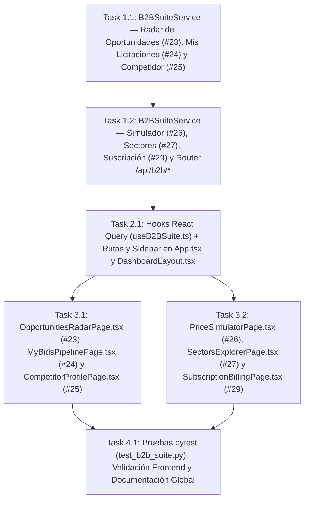

# Tasks: Suite de Licitaciones e Inteligencia Comercial B2B (`suite-licitaciones-b2b`)

> 📋 Generated by `solution-designer` · 2026-10-20
> ✅ Approved by: JeremyJS (2026-10-20)

## Traceability
- **Work Item**: Pendiente (sin PBI/Feature en ADO)
- **Branch**: `dev`

## Metadata
- **Based on:** [design.md](./design.md)
- **Total estimate:** ~15.7h (incluye 20% buffer)
- **Number of waves:** 4 (Wave 1, Wave 2, Wave 3, Wave 4)
- **Number of tasks:** 6
- **Sprint:** [TBD]
- **Assignee:** JeremyJS

## Estimation Rules
- Maximum **4 hours** per task
- Estimates include implementation + unit tests + code review
- Work strictly **wave by wave** with explicit approval between waves

## Dependency Graph

---

## Wave 1: Backend B2B Commercial Intelligence & Subscription Services (~5.1h)

### Task 1.1: `B2BSuiteService` — Radar de Oportunidades (`#23`), Pipeline de Mis Licitaciones (`#24`) y Ficha Forense de Competidor (`#25`) (`REQ-001`, `REQ-002`, `REQ-003`, `NFR-002`) (~2.6h)
- **Description:** Crear `app/backend/src/services/b2b_suite_service.py` implementando:
  - `list_opportunities(current_user, unspsc_family, institution_id, modality, q, only_high_affinity, page, limit)`: cruza las familias UNSPSC monitoreadas por el tenant (con semilla automática basada en su `supplier_rpe`, ej. `132993` para `CONSTRUCTORA-B2B`) con `Process`, `Contract`, `Item` e `Institution`, calculando el `affinity_score` (`0–99%`), nivel de competencia y estado en watchlist.
  - `list_bids(current_user)`, `upsert_bid(current_user, payload)` y `delete_bid(current_user, bid_id)`: gestiona el pipeline comercial aislado por `tenant_id` en 5 etapas (`GUARDADA`, `EN_PREPARACION`, `OFERTA_ENVIADA`, `ADJUDICADA`, `NO_ADJUDICADA`) con persistencia estructurada en `AuditLog` (`entity_type = f"B2B_WATCHLIST:{tenant_id}"`), validando el tope de `10` procesos activos cuando `plan_tier == "B2B_PYME"`.
  - `list_competitors(current_user, q)` y `get_competitor_profile(current_user, rnc)`: compila el expediente comercial y forense de cualquier proveedor (`Supplier`, `Contract`, `Item`, `Institution`, `Anomaly`), aplicando `forensic_intelligence.locked = True` cuando `plan_tier == "B2B_PYME"`.
- **Acceptance criteria:**
  - [ ] `list_opportunities` calcula el porcentaje de afinidad y soporta filtros por rubro UNSPSC, institución, modalidad y texto.
  - [ ] `list_bids`, `upsert_bid` y `delete_bid` aíslan estrictamente por `tenant_id` y aplican la cuota de `10` procesos en `B2B_PYME`.
  - [ ] `get_competitor_profile` retorna métricas reales del proveedor y bloquea la matriz forense para cuentas en `B2B_PYME`.
- **Dependencies:** None
- **Files to create/modify:** `app/backend/src/services/b2b_suite_service.py`

### Task 1.2: `B2BSuiteService` — Simulador de Precios `P25/P50/P75` (`#26`), Sectores UNSPSC (`#27`), Suscripción (`#29`) y Router `b2b_suite_router.py` (`REQ-004`, `REQ-005`, `REQ-006`, `NFR-003`) (~2.5h)
- **Description:** Completar `B2BSuiteService` y registrar `app/backend/src/presentation/routers/b2b_suite_router.py` en `dependencies.py` y `main.py`:
  - `get_simulator_catalog(current_user)` y `simulate_price(current_user, payload)`: calcula sobre `Item` y `Contract` los cuartiles estadísticos (`min_dop`, `p25_dop`, `median_p50_dop`, `p75_dop`, `max_dop`, `avg_dop`), el `competitiveness_index` (`0–100`), `win_probability_pct` (`%`) y el dictamen técnico-normativo bajo la **Ley 340-06 y Reglamento 416-23** (*Baja Temeraria*, *Banda Óptima Competitiva*, *Zona Media de Mercado*, *Riesgo de Sobreprecio*).
  - `list_sectors(current_user)` y `update_monitored_sectors(current_user, monitored_families)`: catálogo analítico de familias UNSPSC con volumen en `RD$`, comprador público líder y activación/desactivación de rubros monitoreados por `tenant_id` (`entity_type = f"B2B_SECTORS:{tenant_id}"`), respetando el límite de `3` rubros en `B2B_PYME`.
  - `get_subscription_summary(current_user)` y `update_subscription_plan(current_user, payload)`: retorna el estado del plan, medidores de consumo reales (`monitored_families_used`, `active_bids_used`, `team_members_used`), comparativa de planes y cambio en vivo entre `B2B_PYME` y `B2B_CORPORATE` actualizando `Tenant.plan_tier` y `Tenant.max_categorias_unspsc` con registro en `AuditLog`.
- **Acceptance criteria:**
  - [ ] `simulate_price` calcula cuartiles reales, índice de competitividad y las 4 bandas normativas; rechaza precios `<= 0` con `422`.
  - [ ] `update_monitored_sectors` bloquea con `403` si un tenant en `B2B_PYME` intenta activar más de `3` rubros UNSPSC.
  - [ ] `update_subscription_plan` persiste el nuevo `plan_tier` en `Tenant` y registra la traza en `AuditLog`.
- **Dependencies:** Task 1.1
- **Files to create/modify:** `app/backend/src/services/b2b_suite_service.py`, `app/backend/src/presentation/routers/b2b_suite_router.py`, `app/backend/src/presentation/dependencies.py`, `app/backend/src/presentation/main.py`

---

## Wave 2: Frontend Hooks, Navigation & Route Protection (~1.8h)

### Task 2.1: Hooks React Query (`useB2BSuite.ts`), Navegación Lateral en `DashboardLayout.tsx` y Rutas en `App.tsx` (`REQ-001`..`REQ-006`, `NFR-001`) (~1.8h)
- **Description:** Crear `app/frontend/src/presentation/hooks/useB2BSuite.ts` con las interfaces TypeScript y hooks React Query para los 6 módulos (`/api/b2b/opportunities`, `/api/b2b/bids`, `/api/b2b/competitors`, `/api/b2b/price-simulator`, `/api/b2b/sectors`, `/api/b2b/subscription`), invalidando cachés cruzados al guardar licitaciones, cambiar rubros o actualizar el plan; y actualizar `DashboardLayout.tsx` y `App.tsx` para incorporar las 6 rutas bajo `/app/*` protegidas con `RequireAuth`.
- **Acceptance criteria:**
  - [ ] `0` tipos `any` en TypeScript.
  - [ ] `DashboardLayout.tsx` muestra la navegación completa de la Suite B2B para usuarios `B2B_SUPPLIER`, `GOV_OVERSIGHT` y `PLATFORM_ADMIN`, más el acceso a `/app/suscripcion`.
- **Dependencies:** Task 1.2
- **Files to create/modify:** `app/frontend/src/presentation/hooks/useB2BSuite.ts`, `app/frontend/src/presentation/layouts/DashboardLayout.tsx`, `app/frontend/src/App.tsx`

---

## Wave 3: B2B Commercial Intelligence & Subscription Views (~6.4h)

### Task 3.1: Vistas `OpportunitiesRadarPage.tsx` (`#23`), `MyBidsPipelinePage.tsx` (`#24`) y `CompetitorProfilePage.tsx` (`#25`) (`REQ-001`, `REQ-002`, `REQ-003`, `NFR-001`) (~3.2h)
- **Description:** Construir las 3 primeras vistas del Paquete 3 respetando estrictamente `design-system-theme.md` (encabezados limpios sin badges decorativos, sin repetir organización/plan/alcance y navegación 100% interna con `ProcessInspectorDrawer` y `SupplierInspectorDrawer`):
  - `OpportunitiesRadarPage.tsx` (`/app/oportunidades`): KPIs de radar + filtros por rubro UNSPSC, modalidad, búsqueda e interruptor *"Solo alta afinidad (≥ 80%)"* + tabla de oportunidades con acción en 1 clic para guardar en `Mis Licitaciones`, abrir en `Simulador de Precios` o inspeccionar en `ProcessInspectorDrawer`.
  - `MyBidsPipelinePage.tsx` (`/app/mis-licitaciones`): KPIs de cartera + conmutador entre **Tablero Kanban de 5 Etapas** (`GUARDADA`, `EN_PREPARACION`, `OFERTA_ENVIADA`, `ADJUDICADA`, `NO_ADJUDICADA`) y vista tabular + edición rápida de etapa, monto ofertado en `RD$`, prioridad y notas estratégicas privadas.
  - `CompetitorProfilePage.tsx` (`/app/competidor/:rnc` y `/app/competidor`): buscador/selector de competidores del sector + KPIs de contratos adjudicados + instituciones compradoras recurrentes + sección de Inteligencia Forense (precios unitarios comparados por rubro UNSPSC y banderas de anomalías) con candado en `B2B_PYME`.
- **Acceptance criteria:**
  - [ ] Las 3 vistas consumen datos reales de `/api/b2b/*`, abren expedientes en `ProcessInspectorDrawer` / `SupplierInspectorDrawer` sin salir de `/app/*` y cumplen `NFR-001`.
- **Dependencies:** Task 2.1
- **Files to create/modify:** `app/frontend/src/presentation/pages/OpportunitiesRadarPage.tsx`, `app/frontend/src/presentation/pages/MyBidsPipelinePage.tsx`, `app/frontend/src/presentation/pages/CompetitorProfilePage.tsx`

### Task 3.2: Vistas `PriceSimulatorPage.tsx` (`#26`), `SectorsExplorerPage.tsx` (`#27`) y `SubscriptionBillingPage.tsx` (`#29`) (`REQ-004`, `REQ-005`, `REQ-006`, `NFR-001`) (~3.2h)
- **Description:** Construir las 3 vistas restantes del Paquete 3:
  - `PriceSimulatorPage.tsx` (`/app/simulador-precios`): formulario de simulación (selector de rubro UNSPSC, cantidad y precio unitario propuesto en `RD$`) + regla visual de posicionamiento en cuartiles (`Min`, `P25`, `Mediana P50`, `P75`, `Max`) + tarjetas de Índice de Competitividad (`0–100`), Probabilidad Estimada de Adjudicación (`%`) y dictamen preventivo según la **Ley 340-06 y Reglamento 416-23** (*Baja Temeraria* vs. *Banda Óptima* vs. *Sobreprecio*) + tabla de contratos históricos de referencia con acceso a `ProcessInspectorDrawer`.
  - `SectorsExplorerPage.tsx` (`/app/sectores`): barra de cuota de rubros activos (`N / 3` en `B2B_PYME` o `Ilimitados` en `B2B_CORPORATE`) + explorador de sectores UNSPSC con volumen contratado en `RD$`, precio mediano, comprador público líder e interruptor en vivo para activar/desactivar el monitoreo del rubro.
  - `SubscriptionBillingPage.tsx` (`/app/suscripcion`): resumen del plan activo de la organización + barras de progreso de cuotas en tiempo real (*Rubros UNSPSC Monitoreados*, *Procesos en Pipeline Comercial*, *Miembros del Equipo*) + matriz comparativa `B2B_PYME` vs `B2B_CORPORATE` con botón de cambio/actualización de plan en vivo y bitácora de eventos de suscripción.
- **Acceptance criteria:**
  - [ ] El simulador calcula y visualiza los cuartiles y bandas de riesgo en vivo; `/app/sectores` actualiza los rubros monitoreados; y `/app/suscripcion` permite alternar entre `B2B_PYME` y `B2B_CORPORATE` reflejando de inmediato el desbloqueo o bloqueo de candados en toda la suite.
- **Dependencies:** Task 2.1
- **Files to create/modify:** `app/frontend/src/presentation/pages/PriceSimulatorPage.tsx`, `app/frontend/src/presentation/pages/SectorsExplorerPage.tsx`, `app/frontend/src/presentation/pages/SubscriptionBillingPage.tsx`

---

## Wave 4: Automated Testing, Verification & Architecture Documentation (~2.4h)

### Task 4.1: Suite de Pruebas `pytest` (`test_b2b_suite.py`), Validación Frontend (`tsc` + `eslint` + `vite build`) y Documentación Global (~2.4h)
- **Description:** Crear `app/backend/tests/test_b2b_suite.py` verificando los 6 módulos de `/api/b2b/*` (radar de oportunidades, aislamiento multi-tenant y límite de cuota en pipeline `/api/b2b/bids`, candado `B2B_PYME` vs `B2B_CORPORATE` en `/api/b2b/competitors/{rnc}`, cuartiles y bandas normativas en `/api/b2b/price-simulator`, límite de 3 rubros en `/api/b2b/sectors` y actualización de plan en `/api/b2b/subscription`); registrar `b2b_suite_router` en `conftest.py`; ejecutar `pytest`, `npx tsc -b`, `npx eslint` y `npm run build` con `0` errores; y actualizar acumulativamente los documentos oficiales en `docs/architecture/{system-design,api-contract,data-model,security-model}.md`.
- **Acceptance criteria:**
  - [ ] `pytest tests/test_b2b_suite.py` pasa al 100%.
  - [ ] `npx tsc -b`, `npx eslint` y `npm run build` pasan con `0` errores.
  - [ ] Documentación global en `docs/architecture/` actualizada con las fórmulas del simulador de precios, algoritmo de afinidad y contratos `/api/b2b/*`.
- **Dependencies:** Task 3.1, Task 3.2
- **Files to create/modify:** `app/backend/tests/test_b2b_suite.py`, `app/backend/tests/conftest.py`, `docs/architecture/system-design.md`, `docs/architecture/api-contract.md`, `docs/architecture/data-model.md`, `docs/architecture/security-model.md`

---

## Implementation Order Summary
| Order | Task | Description | Est. | Depends On |
|-------|------|-------------|------|------------|
| 1 | 1.1 | `B2BSuiteService`: Radar de Oportunidades (`#23`), Mis Licitaciones (`#24`) y Competidor (`#25`) | ~2.6h | — |
| 2 | 1.2 | `B2BSuiteService`: Simulador (`#26`), Sectores (`#27`), Suscripción (`#29`) + Router `/api/b2b/*` | ~2.5h | 1.1 |
| 3 | 2.1 | Hooks `useB2BSuite.ts` + Rutas y Sidebar en `App.tsx` / `DashboardLayout.tsx` | ~1.8h | 1.2 |
| 4 | 3.1 | Vistas `/app/oportunidades` (`#23`), `/app/mis-licitaciones` (`#24`) y `/app/competidor/:rnc` (`#25`) | ~3.2h | 2.1 |
| 5 | 3.2 | Vistas `/app/simulador-precios` (`#26`), `/app/sectores` (`#27`) y `/app/suscripcion` (`#29`) | ~3.2h | 2.1 |
| 6 | 4.1 | Pruebas `pytest`, validación Frontend (`tsc` + `eslint` + `vite build`) y documentación global | ~2.4h | 3.1, 3.2 |

## Total Estimate: ~15.7h (includes 20% buffer)

## Completion Checklist
- [ ] All tasks completed
- [ ] All tests passing (`pytest` + `tsc -b` + `eslint` + `vite build`)
- [ ] `0` badges decorativos en cabeceras, `0` pestañas duplicadas y `0` términos técnicos prohibidos (`NFR-001`)
- [ ] Aislamiento multi-tenant por `tenant_id` (`NFR-002`) y tiempos de respuesta `< 450ms` en `/api/b2b/*` (`NFR-003`)

## Approval
- [x] Developer: JeremyJS Date: 2026-10-20

---
> 📍 Pendiente (sin PBI/Feature en ADO) · 🌿 `dev` · Generated by SDD Standard

